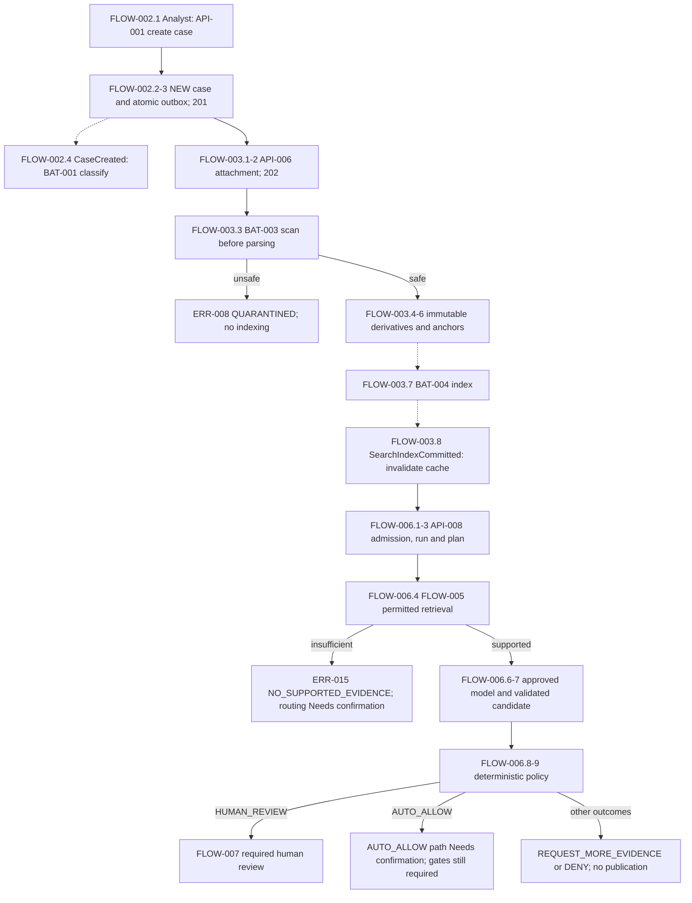
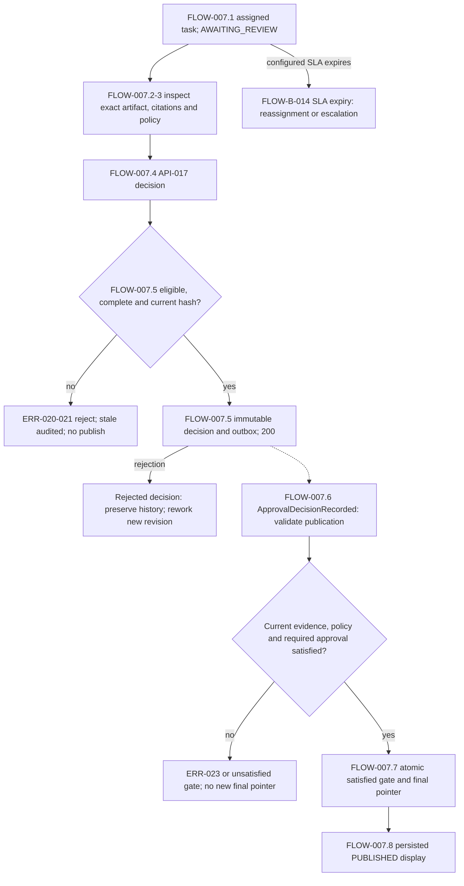
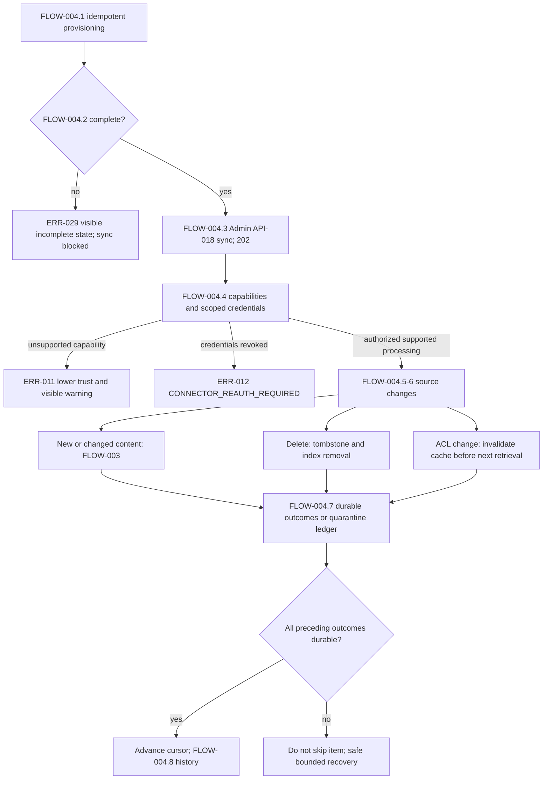
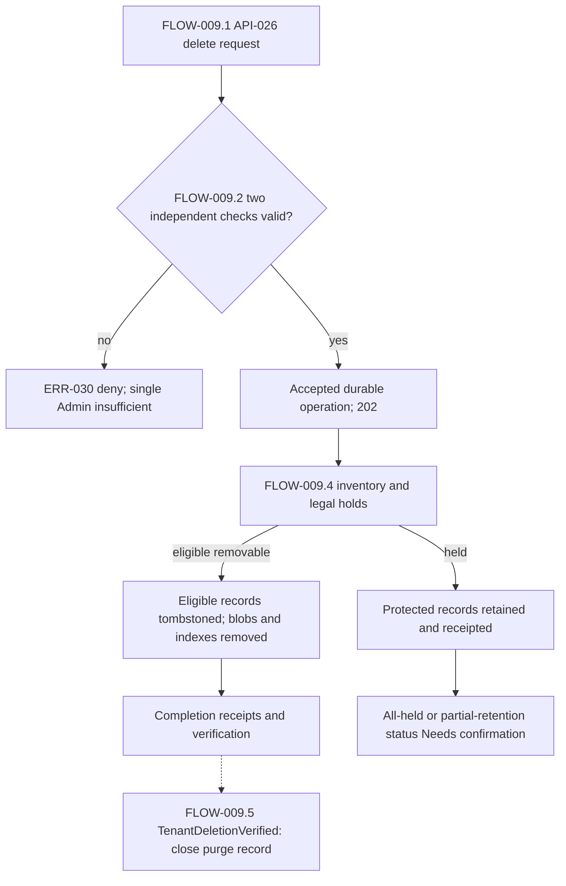

# 7. Processing Flow Specification

## Flow Inventory and Prerequisites

### Baseline and Traceability

This specification connects initiation, execution, completion, observation and recovery for OrionDesk AI **OD-AI-DDS-001, R1.0 / revision 1.3**.

**Source** means `1794310747-OrionDesk_AI_Detailed_Design_Specification.pdf`. All page references are original PDF page numbers.

- **Confirmed:** Source-supported behavior.
- **Needs confirmation:** Missing or contradictory details requiring an explicit decision before implementation lock.
- **Proposal:** Suggested design, not an approved requirement.

`FLOW-*` identifiers are assigned here because the source does not assign processing-flow identifiers. Step references use the form `FLOW-001.1`. They identify specification steps, not new API methods, events or database fields.

The following completed specifications remain authoritative for their respective details:

| Filename | Flow dependency |
|---|---|
| [01_screen_functions.md](01_screen_functions.md) | Screen IDs, user operations, accessibility and presentation |
| [02_api.md](02_api.md) | API IDs, exact paths, authentication profiles, HTTP contracts and unresolved IDL |
| [03_data.md](03_data.md) | Data IDs, authoritative stores, immutable lineage and transaction requirements |
| [04_batch_functions.md](04_batch_functions.md) | Logical background functions, triggers, checkpointing and operational gaps |
| [05_business_rules.md](05_business_rules.md) | Authorization, state, grounding, review, publication and lifecycle rules |
| [06_exception_handling.md](06_exception_handling.md) | Exception IDs, permanent/transient classification, safe errors and recovery procedures |

Earlier proposed navigation, payloads, screen placements and recovery interactions remain **Proposals**. This document does not promote them to confirmed requirements.

### Flow Inventory

All listed business or operational activities are **Confirmed**. Missing initiation contracts and completion predicates remain explicitly unresolved.

| Flow ID | Purpose | Users and systems | Trigger | Prerequisites | Completion condition | Related IDs / evidence |
|---|---|---|---|---|---|---|
| FLOW-001 | Establish authenticated resource access | Interactive user, identity provider, edge, domain service | Login or protected request | Valid identity and authorized tenant/resource scope | Authorized context established or safe denial returned | SF-007; API-027, AUTH-P/I/T; DAT-019; BR-001–002; ERR-001–003. Source, pp. 21–23 |
| FLOW-002 | Create, classify and maintain case | Analyst, Owner, Case Service, classifier/Triage Agent | Case creation, correction or case mutation | FLOW-001; valid input, key or revision precondition | One case/mutation and traceable classification/history | SCR-001–002; API-001–004, 051; BAT-001; BR-003–009. Source, pp. 12, 24–25, 83, 87 |
| FLOW-003 | Ingest attachment and construct index | Analyst, Ingestion Service, extraction/embedding workers, Indexer | Attachment acceptance or connector-supplied document | Authorized source; supported safe input | Immutable derivatives and indexing outcome recorded, or quarantine/failure | API-006–007; DAT-005–007, 020–023; BAT-003–004; BR-014–015. Source, pp. 30–34 |
| FLOW-004 | Provision and synchronize enterprise sources | Provisioning workflow, Admin, connector workers | Onboarding, historical backfill or sync request | Required workspace policy, keys, roles, quotas and connector scope | Provisioning completed; selected source outcomes/cursor/receipts durable | API-018–019, 048, 056; BAT-002, 011–012; BR-011–013. Source, pp. 27–29, 78 |
| FLOW-005 | Search and inspect grounded evidence | Member, Analyst/Reviewer, Research Agent, Retrieval Service | Search or citation activation | Current document ACL; supported indexed evidence | Authorized anchored evidence displayed/returned, or unsupported outcome | SCR-003; API-013–015, 045, 054; DAT-010, 023, 028; BR-016. Source, pp. 34–36, 57, 87 |
| FLOW-006 | Execute bounded grounded drafting and policy evaluation | Analyst, Orchestrator, Research/Draft Agents, gateway, Policy Service | Grounded-run request | Authorized case, admission, approved model/tools and budgets | Candidate/policy recorded; review wait, permitted publication validation or failure | API-008–012, 036, 045–046, 049; BAT-008; BR-017–021. Source, pp. 37–44, 49, 69 |
| FLOW-007 | Review, publish, expire or rework candidate | Reviewer, Policy Service, publication consumer, Analyst | Review opening/decision, expiry, rework or override | Exact candidate, current sources, reviewer eligibility and policy | Immutable decision; atomic publication only if gates pass; otherwise recorded rejection/expiry | API-016–017, 052–053; BAT-008–009; BR-022–024. Source, pp. 44–46, 58 |
| FLOW-008 | Close case and process eligible retention | Closure actor, Case Service, Retention Worker | Close request or retention selection | Authorized revision; closure guard unresolved; retention eligibility and holds | Immutable closure lineage or receipted eligible purge | API-005, 040, 057; BAT-013; BR-010, 025. Source, pp. 25–26, 51–53, 66 |
| FLOW-009 | Export or delete workspace safely | Admin + approver, lifecycle/Retention Worker | Export/delete request | Two independent checks; authorized inventory; applicable holds | Checksummed export or verified deletion/protected-record receipts | API-025–026, 029; BAT-014; BR-026. Source, pp. 78–80, 83 |
| FLOW-010 | Dispatch, reconcile and recover durable work | Event consumers, reconciliation worker, scoped operator | Committed event, discrepancy, dead letter or incident | Valid signed tenant context, event identity and authorized replay scope | One accepted transition; repaired discrepancy or explicit unresolved failure | API-037–038; BAT-005–007, 010, 019; BR-029–030; OPS-ERR-001–005. Source, pp. 34, 48–50, 69–70, 79, 90 |
| FLOW-011 | Observe audit, usage, progress and notifications | Auditor, Admin, authorized viewer, telemetry/notification boundaries | Read, stream reconnect, daily rollup, audit batch or optional webhook | Authorized projection and safe telemetry | Current scoped observation/rollup/archive/delivery outcome | API-010–012, 021–022, 041, 047; BAT-015, 017, 020; BR-027–028, 032. Source, pp. 55, 58–59, 62–66 |
| FLOW-012 | Evaluate and promote controlled release/baseline | Admin, evaluation harness, CI/CD, Security/SRE, engineering caller | Evaluation, model/prompt change, release or baseline change | Frozen fixtures, verified artifacts, compatibility and required evidence | Recorded evaluation; promotion only after gates; reconstructible baseline/release | API-023–024, 032–033, 043–044; BAT-016, 018; BR-031, 033. Source, pp. 8–10, 71–76, 88–89 |

The representative end-to-end journey is **FLOW-002 → FLOW-003 → FLOW-005 → FLOW-006 → FLOW-007**, with FLOW-001 applied at every boundary. This sequence preserves Source, p. 75, §21.3.1; it does not require every case to upload a new document when permitted evidence already exists.

### Shared Prerequisites and Boundary Contract

**FLOW-R-001 — Confirmed:**

1. Authenticate independently at public, internal and tool boundaries.
2. Establish immutable authorized tenant, actor, trace and correlation context.
3. Validate input before transaction entry or long-running allocation, and again at domain invariants and tool dispatch.
4. Resolve resources using tenant predicates and current access attributes.
5. Reevaluate mutation authorization and revision/state guards within the transaction.
6. Preserve retry-idempotency and event-revision safeguards.
7. Persist accepted state and required outbox records atomically; dispatch only committed outbox work or explicitly reconciled saga steps.
8. Reset pooled tenant-scoped session variables after every transaction.
9. Return actual acceptance/completion or safe documented failure; never ambiguous success or partial-as-approved output.

**Evidence:** Source, pp. 16–17, 21–25, 48–56, 86; API-R-004–010; DAT-R-005–008; BR-001–005; ERR-R-001–004.

**Needs confirmation:** Revision-check versus idempotency-lookup ordering, transaction isolation/locks, complete role matrix and controlled wire schemas. Procedure numbering does not settle these concurrent implementation choices.

## Normal Processing

### FLOW-001 — Authentication and Resource Authorization

1. **FLOW-001.1:** Interactive authentication uses OIDC authorization-code flow with PKCE. Validate issuer, audience, expiry, subject and tenancy claims. Browser local storage must not contain long-lived refresh tokens.
2. **FLOW-001.2:** Read identity context through API-027, `GET /v1/me`, where required by the interaction. Resolve principal/membership data, DAT-019. The login screen, workspace selector and initial landing route **Need confirmation**.
3. **FLOW-001.3:** For the requested resource/action, combine role, tenant, membership, sensitivity, document ACL and segregation of duties. Edge denial does not replace domain checks.
4. **FLOW-001.4:** Continue the authorized flow, or return a non-sensitive denial. Foreign-tenant substitution has the same not-found class as absent identity; audit retains principal/denied resource class without private existence.

Internal calls use independent service identities, audience checks and mTLS-authenticated HTTP or gRPC. Tool calls separately evaluate invoking principal, workspace policy, tool scope and classification. BFF cookies remain an optional source design, not a selected architecture.

**Evidence:** Source, pp. 18, 21–23, 41, 87. Rules: BR-001–002; exceptions: ERR-001–003.

### FLOW-002 — Case Creation, Classification and Mutation

1. **FLOW-002.1:** Analyst initiates SCR-001-E04 through API-001, `POST /v1/cases`, with `Idempotency-Key` and validated case context. Exact creation-form placement and request schema **Need confirmation**.
2. **FLOW-002.2:** Case Service authorizes tenant/workspace association, resolves creation replay identity and creates one DAT-003 `cases` aggregate in `NEW`. Storage revision defaults to `1`; sensitivity defaults to `'INTERNAL'`. Storage defaults do not settle browser input defaults.
3. **FLOW-002.3:** Commit accepted case state and associated DAT-014 outbox records in the required ACID boundary. Return `201` and case identifier. Publish `CaseCreated` with case ID/revision after commit.
4. **FLOW-002.4:** BAT-001 deduplicates `CaseCreated`, resolves relevant case revision and attaches classification labels, confidence and provenance. User corrections require reason code through API-051, whose endpoint/schema **Need confirmation**.
5. **FLOW-002.5:** SCR-001 loads API-002, `GET /v1/cases?cursor=...`; SCR-002 reads API-003, `GET /v1/cases/{caseId}`, returning `200` for authorized current revision.
6. **FLOW-002.6:** Owner mutation SCR-002-E02 uses API-004, `PATCH /v1/cases/{caseId}`, with `If-Match`. Enforce allowed state changes and monotonic revision; append DAT-004 history and required outbox atomically. Return `200` on accepted mutation.

Supported case transitions are `NEW → TRIAGED → IN_PROGRESS`, `IN_PROGRESS → PENDING_APPROVAL` or `RESOLVED`, and `PENDING_APPROVAL → RESOLVED` or `IN_PROGRESS`. Automatic triggers and individual role guards **Need confirmation**; classification does not automatically imply transition to `TRIAGED`.

Priority derives from explicit impact/urgency; workspace business calendars/timezone compute deadlines. Prediction cannot alter contractual deadline. Formula/catalog/calendar rules **Need confirmation**.

**Evidence:** Source, pp. 12, 24–26, 52, 83, 85–87. Rules: BR-003–009; exceptions: ERR-004–006.

### FLOW-003 — Attachment, Normalization and Indexing

1. **FLOW-003.1:** Analyst invokes SCR-002-E04/API-006, `POST /v1/cases/{caseId}/attachments`, with required long-running creation key and file. Validate PDF, DOCX, HTML or UTF-8 text, MIME-signature/extension agreement, configurable **25 MB per-file cap** and decompression threshold. Upload encoding, MB bytes and threshold **Need confirmation**.
2. **FLOW-003.2:** Persist accepted ingestion operation/source association under tenant scope; attachments DAT-020 reference immutable DAT-006 document versions. Return `202`, meaning ingestion acceptance, not readiness.
3. **FLOW-003.3:** BAT-003 scans before parsing; macros do not execute and embedded remote references are not fetched. Unsafe sources take ERR-008 quarantine branch.
4. **FLOW-003.4:** Parse layout blocks, pages, bounding boxes, tables, headings and reading order. OCR runs only when opted in and carries provenance.
5. **FLOW-003.5:** Normalize transport artifacts without rewriting claims. Create immutable fingerprint/pipeline-version derivatives in encrypted private storage; retain source URI, hash, page and optional bounding box in DAT-006–007/DAT-022. Tag likely personal data and store quality flags.
6. **FLOW-003.6:** Publish `DocumentNormalized` with version ID/source hash through the durable event boundary.
7. **FLOW-003.7:** BAT-004 consumes/deduplicates the event and constructs DAT-023 searchable derivatives with tenant/workspace/version/chunk/language/classification, **1536-dimensional embedding** and normalized keyword text.
8. **FLOW-003.8:** Indexer records the indexing outcome and emits `SearchIndexCommitted` with index generation/document revision. BAT-007 invalidates affected query caches.
9. **FLOW-003.9:** API-007, `GET /v1/documents/{documentId}/status`, supplies authorized processing observation.

Document vocabulary is `ACCEPTED`, `SCANNING`, `EXTRACTING`, `INDEXING`, `READY`, `QUARANTINED`. Exact transitions, physical state storage and indexing/quality-to-`READY` predicate **Need confirmation**. Low quality remains authorized-viewable but excluded from autonomous recommendations; indexing alone cannot confer autonomous eligibility.

Per-document/chunk/index commit units **Need confirmation**. Index failure does not undo accepted source metadata.

**Evidence:** Source, pp. 30–34, 49, 52, 62, 82–83, 87. Rules: BR-014–015, BR-027; exceptions: ERR-007–010, ERR-025.

### FLOW-004 — Provisioning, Historical Backfill and Incremental Sync

1. **FLOW-004.1:** BAT-011 creates workspace policy, encryption references, roles, quotas and connector stubs as one idempotent provisioning workflow, using DAT-001–002/019/021/029/034. API-056 initiation/status contracts **Need confirmation**.
2. **FLOW-004.2:** Expose incomplete provisioning and block sync until complete. No export/delete endpoint is inferred as a provisioning API.
3. **FLOW-004.3:** Admin initiates SCR-006-E01/API-018, `POST /v1/connectors/{connectorId}/sync`, with long-running creation key. Return `202` for accepted incremental operation.
4. **FLOW-004.4:** Connector worker discovers advertised `list`, `fetch`, delta cursor, ACL and delete support. Resolve credentials only through workspace-scoped vault references.
5. **FLOW-004.5:** Read changes through API-048 provider contract using DAT-015 `cursor`, `watermark`, `retry_state`. Preserve stable source identity, permissions and change history.
6. **FLOW-004.6:** Send new/changed sources through FLOW-003. For deletes, write tombstones and schedule index removal; for ACL changes, invalidate affected caches before the next retrieval.
7. **FLOW-004.7:** Persist each required ingestion outcome or quarantine exception in the sync error ledger. Advance cursor only after all preceding items have durable outcomes.
8. **FLOW-004.8:** SCR-006-E02 reads API-019, `GET /v1/connectors/{connectorId}/runs`.
9. **FLOW-004.9:** Historical BAT-012 backfill uses bounded windows, stable IDs and per-batch reconciliation receipts. Declare search readiness from index coverage, not queue emptiness.

Periodic schedule, provider contracts, window sizes, cursor ownership, sync completion enum and index-coverage threshold **Need confirmation**.

**Evidence:** Source, pp. 27–29, 78, 83. Rules: BR-011–013; exceptions: ERR-009, ERR-011–013, ERR-029.

### FLOW-005 — Retrieval and Source Inspection

1. **FLOW-005.1:** Member/search caller uses SCR-003-E02/API-013, `POST /v1/search`; Research Agent may use API-045, `knowledge.search@v1`. The REST schema is not inferred from the MCP schema.
2. **FLOW-005.2:** Resolve current tenant/workspace/document ACL and valid cache scope. Cache key includes tenant, user-scope digest, source ACL revision, query hash and index generation.
3. **FLOW-005.3:** Form lexical and normalized vector queries; retrieve bounded candidates, merge with reciprocal rank fusion, apply deterministic reranking and source diversity.
4. **FLOW-005.4:** Enforce returned-token budget and ACL filtering before releasing text to generation. Check autonomous quality eligibility where applicable.
5. **FLOW-005.5:** Return supported evidence containing chunk ID, source title, document revision, page anchor and ACL digest; API-013 success is `200`. Record evidence set DAT-010 for run-associated retrieval. Standalone association/nullability **Needs confirmation**.
6. **FLOW-005.6:** Inspect API-014, `GET /v1/evidence/{evidenceId}`, or API-015, `GET /v1/cases/{caseId}/evidence`. Verify opaque citations before display.
7. **FLOW-005.7:** Citation activation opens authorized exact source and highlights anchored page range. Public source-access contract API-054 **Needs confirmation**; access-controlled short-lived signed URLs are required.

MCP input is `{query: string, case_id: uuid, max_items: int<=10}`; output is `{evidence_set_id: uuid, citations: Citation[]}`. It is read-only, tenant-scoped `read:permitted_documents`, with no arbitrary URLs/filesystem access. Requiredness, lower bound and full `Citation` schema **Need confirmation**.

**Evidence:** Source, pp. 31, 34–36, 52–53, 57, 87. Rules: BR-013, BR-015–016; exceptions: ERR-015–016, ERR-023, ERR-026.

### FLOW-006 — Bounded Draft and Deterministic Policy

1. **FLOW-006.1:** Analyst requests SCR-002-E05/API-008, `POST /v1/cases/{caseId}/runs`, with `Idempotency-Key`. API-009, `POST /v1/runs`, is also source-evidenced; canonical relationship **Needs confirmation**.
2. **FLOW-006.2:** Check workspace tokens, queue age and provider capacity before admitting new execution; reserve input/output budget and persist DAT-008 run. API-008 returns `202`. Exact reservation/admission transaction and case-revision binding **Need confirmation**.
3. **FLOW-006.3:** Persist DAG plan revision before effects. Enforce acyclicity, depth **eight**, maximum **sixteen tool invocations**, explicit dependencies and replayable checkpoints. `AgentPlanApproved` dispatches plan steps.
4. **FLOW-006.4:** Advance `REQUESTED → RETRIEVING`; persist checkpoint before downstream dispatch. Research Agent obtains FLOW-005 evidence through approved version-pinned capability.
5. **FLOW-006.5:** Independently authorize MCP/tool execution. A2A tasks carry task/capability/input-output schema/deadline/trace context and may be declined. External writes require separate capability authorization; consequential mutation requires human authorization and idempotency.
6. **FLOW-006.6:** Advance to `GENERATING`; gateway API-036, `POST /internal/model/generate`, resolves approved deployment/region/data class and composes fixed rules, signed workflow instruction, validated user input and delimited untrusted evidence. Remove evidence tool directives, record injection indicators and minimize nonessential personal data where policy permits.
7. **FLOW-006.7:** Invoke external provider API-049; track DAT-016 token usage and DAT-024 model/prompt/candidate provenance. Validate versioned JSON with bounded retries.
8. **FLOW-006.8:** Advance to `POLICY_CHECK`; deterministic Policy Service normalizes/stores sensitivity, requested action, evidence quality, model class, financial impact category and confidence bands with rule version in DAT-017.
9. **FLOW-006.9:** Branch on `AUTO_ALLOW`, `HUMAN_REVIEW`, `REQUEST_MORE_EVIDENCE`, `DENY`. Human review proceeds to FLOW-007. Auto-allow publication path and other state mappings **Need confirmation**.

`WorkflowStageAdvanced` resumes consumers using run/stage/checkpoint. Checkpoints precede downstream dispatch; the orchestrator has no direct database credentials. Retrieval, generation, policy and approval remain separate records.

**Evidence:** Source, pp. 7, 9, 37–44, 49, 62, 69, 83, 87. Rules: BR-017–021; exceptions: ERR-013–019.

### FLOW-007 — Review and Atomic Publication

1. **FLOW-007.1:** For required review, create DAT-011 task using policy-defined pool/minimum role/separation constraints. Run enters `AWAITING_REVIEW`; review vocabulary includes `ASSIGNED`, `OPENED`, `APPROVED`, `REJECTED`, `EXPIRED`.
2. **FLOW-007.2:** Eligible Reviewer opens SCR-005-E01/API-016, `GET /v1/review-queue`. Provide exact candidate, citations, model/prompt version and policy reasons. Correlate `UserReviewOpened` without source text in diagnostics. Review-detail endpoint allocation **Needs confirmation**.
3. **FLOW-007.3:** Permit FLOW-005 source inspection before decision. Disable Approve/Reject until required fields complete; validate independently server-side.
4. **FLOW-007.4:** Reviewer submits API-017, `POST /v1/approvals/{approvalId}/decision`, with decision and exact reviewed-artifact binding. Capture actor, UTC timestamp, evaluated hash, rationale and optional annotations.
5. **FLOW-007.5:** Recheck eligibility/assignment/separation/current artifact. Commit accepted immutable DAT-012 decision and required outbox boundary; return `200`. Changed/wrong artifact is stale, audited and rejected with `409` supported.
6. **FLOW-007.6:** `ApprovalDecisionRecorded` consumer validates publication. Load current exact artifact, evidence, policy and applicable decisions; recompute current authorization.
7. **FLOW-007.7:** Only if required evidence, policy and approval gates are satisfied, atomically record DAT-026 satisfied gate and update final response pointer. The published run is `PUBLISHED`; accessible artifact text is `PUBLISHED`.
8. **FLOW-007.8:** Show confirmed publication from persisted state. Decision acceptance alone must not display publication success.

Artifact-hash canonicalization/algorithm, task identity mapping, required rationale/field set, repeated decisions, approval validity and automatic-versus-separate publication trigger **Need confirmation**.

**Evidence:** Source, pp. 11–13, 44–46, 52, 57–58, 82–85, 87. Rules: BR-022–024; exceptions: ERR-020–023.

### FLOW-008 — Closure and Routine Retention

1. **FLOW-008.1:** Invoke SCR-002-E06/API-005, `POST /v1/cases/{caseId}/close`, under authorized current-revision conditions. Closure actor, predecessor state, response mode/status and missing-approved-answer handling **Need confirmation**.
2. **FLOW-008.2:** Snapshot approved answer, cited immutable document versions and reviewer decisions into DAT-026 closure lineage. Preserve mutable case aggregate separately from immutable history.
3. **FLOW-008.3:** `CLOSED` is final except explicit reopening as a new revision through API-057, whose contract/target state **Needs confirmation**.
4. **FLOW-008.4:** BAT-013 selects only retention-eligible closed cases. Apply corporate retention class and legal holds.
5. **FLOW-008.5:** Eligible purge uses tombstones, retrieval exclusion, blob/index removal and DAT-018 receipts; preserve legal-hold exceptions. API-040, `POST /internal/storage/purge`, supports the storage boundary but its complete contract **Needs confirmation**.

Diagnostic default TTL **30 days** and security-audit **seven-year policy** remain separate. Routine-retention two-person approval applicability, schedules and backup/shared-source treatment **Need confirmation**.

**Evidence:** Source, pp. 25–26, 51–53, 66, 85. Rules: BR-010, BR-025; exceptions: ERR-004, ERR-030.

### FLOW-009 — Controlled Workspace Export or Delete

1. **FLOW-009.1:** Admin + approver initiate API-025, `POST /v1/workspaces/{workspaceId}/export`, or API-026, `POST /v1/workspaces/{workspaceId}/delete`, with long-running creation key.
2. **FLOW-009.2:** Validate two independent approval checks and authorized inventory. Single Admin is insufficient. Return `202` only for actually accepted durable work.
3. **FLOW-009.3 — Export branch:** BAT-014 packages case metadata, approved artifacts, source references and audit manifests with checksums; excludes secrets/internal model prompts.
4. **FLOW-009.4 — Delete branch:** Evaluate holds, retain protected objects and receipt exceptions; write tombstones, remove eligible blobs/index entries and record completion receipts.
5. **FLOW-009.5:** Retention Worker emits `TenantDeletionVerified` with manifest ID/receipt hash to close purge record after verification.
6. **FLOW-009.6:** Make only actual completion available. Status/download/receipt contracts, all-held completion and approval-capture UI **Need confirmation**.

No mandatory export-before-delete ordering is confirmed. API-029, `POST /v1/security/holds`, exists; hold creation/release/reevaluation controls remain incomplete. Data subject access requests use the same inventory, but identity verification and response flow **Need confirmation**.

**Evidence:** Source, pp. 61–63, 78–80, 83, 87. Rules: BR-025–026; exception: ERR-030.

### FLOW-010 — Durable Dispatch and Operational Recovery

1. **FLOW-010.1:** BAT-010 dispatches committed DAT-014 outbox work or explicitly reconciled saga steps using canonical JSON/UTC envelope: `event_id`, `type`, `schema_version`, `tenant_id`, `aggregate_id`, `aggregate_revision`, `occurred_at`, `trace_id`, `payload`.
2. **FLOW-010.2:** Consumer validates signed tenant context, deduplicates event ID/operation key and rejects stale aggregate revisions. Duplicate outcome returns without reapplying mutation; cross-partition ordering is not an invariant.
3. **FLOW-010.3:** On transient dependency fault, use bounded exponential backoff/jitter/circuit breaker. Permanent validation/permission failures are not retried.
4. **FLOW-010.4:** For index/message discrepancy, BAT-006 compares source fingerprints/indexed versions and repairs links from outbox ledger while preserving accepted source metadata.
5. **FLOW-010.5:** Dead-letter operator uses API-038, `POST /internal/deadletters/{id}/replay`, with reason, dry-run validation and scope limit. Preserve original event ID except provenance-linked schema migration.
6. **FLOW-010.6:** Resume appropriate consumers at persisted checkpoints through `WorkflowStageAdvanced`; API-037, `GET /internal/workflows/{runId}`, is observation, not an implicit restart endpoint.
7. **FLOW-010.7:** Verify scoped business outcome, source/index fingerprints and required denied-access probes before incident closure.

Additional supported recovery paths:

- **Parallel rebuild:** BAT-005 builds a parallel index and atomically switches read alias only after completeness/recall checks.
- **Delayed indexing:** Follow OPS-ERR-001: detect tenant/index generation; pause only faulty connector/indexer shard; inspect event/outbox/parser/throttling/ACL evidence; bounded validated replay; fingerprint/access verification; document audit IDs/time/blast radius/quality/prevention.
- **Suspected ACL leak:** OPS-ERR-002 suspends affected aliases, revokes cache, preserves audit, replays scoped ACL revisions and reenables only after negative tests.
- **Model outage:** OPS-ERR-003 disables new generation, preserves manual/evidence workflows and visible degradation; page only when availability budget impacted.
- **Regional recovery:** BAT-019/OPS-ERR-005 restores warm-region snapshots only under incident command and checks relational/object/index-recipe consistency; target RPO `<=15 minutes`, RTO `<=4 hours`.

Replay/pause/reenable grants, lease/fencing design, retry values, rebuild thresholds and restore order **Need confirmation**.

**Evidence:** Source, pp. 19, 34, 48–50, 69–70, 79, 90. Rules: BR-029–030; exceptions: ERR-006, ERR-023–028.

### FLOW-011 — Observation, Audit, Usage and Optional Notifications

1. **FLOW-011.1:** Authorized viewer reads API-010/API-011 run/steps and subscribes to API-012, `GET /v1/streams/runs/{runId}`. Show retrieval/generation/policy progress from server state.
2. **FLOW-011.2:** Reconnect with `Last-Event-ID` for increasing-offset retained backfill under current scope; refresh reconstructs progress without new execution.
3. **FLOW-011.3:** Auditor uses SCR-008/API-021, `GET /v1/audit/events`, `200`, for cursor-paginated immutable redacted records. BAT-017 chains audit batch hashes and exports to independently controlled retention.
4. **FLOW-011.4:** BAT-015 aggregates attributed invocation/embedding/storage/indexing usage daily. Admin reads SCR-010/API-022, `GET /v1/usage`, `200`, for costs/quotas/trends/budget/forecast/rejected excess requests.
5. **FLOW-011.5:** Correlate DAT-030 telemetry across DB/connector/retrieval/model/approval with identifiers/outcomes/token counts/digests, not documents/API secrets. Monitor golden and AI-specific signals; apply confirmed page-versus-ticket conditions.
6. **FLOW-011.6:** If optional webhooks enabled, BAT-020/API-047 signs subscribed notifications, retries exponentially and requires recipient signature/event-age verification. Delivery failure leaves internal transition committed.

UI local time carries timezone; durable timestamps remain UTC/RFC 3339. WCAG 2.2 AA target behavior includes visible focus, semantic keyboard ordering and meaningful live announcements.

SSE retention/expired offsets, audit redaction/hash batching, daily formulas/timezone/late corrections, webhook enablement/contracts and notification recipients **Need confirmation**.

**Evidence:** Source, pp. 54–59, 62–66. Rules: BR-027–028, BR-032; exceptions: ERR-027, ERR-031–032.

### FLOW-012 — Evaluation, Release and Baseline Change

1. **FLOW-012.1:** Admin uses SCR-010/API-023, `POST /v1/evaluations`, with long-running creation key; receive `202`.
2. **FLOW-012.2:** BAT-016 resolves frozen versioned independently reviewed **1,200-case** synthetic permission-controlled corpus with expected citations/outcomes and signed manifest.
3. **FLOW-012.3:** Exercise retrieval/refusal/ambiguity/adversarial evidence; persist scorecard and `EvaluationCompleted`; read API-024, `GET /v1/evaluations/{evaluationId}`. Report domain confidence intervals/distribution shift.
4. **FLOW-012.4:** Enforce citation precision `>=0.97`, unsupported-claim rate `<=0.02`, high-risk recall `1.00`; low statistical confidence or any critical isolation/approval exception blocks promotion.
5. **FLOW-012.5:** CI/CD/API-043, `POST /internal/releases`, verifies allowed build identity/image digest, static/dependency/unit/contract checks, SBOM, signed images/config and release evidence.
6. **FLOW-012.6:** BAT-018 applies compatible nullable expansion and bounded backfill; canary compares latency/errors/authorization denials/AI quality; enforce constraints after old replicas drain. No active-reader-dependent field removal.
7. **FLOW-012.7:** Security/SRE validate egress/secrets/backups/alerts; security-control review independently reproduces negative cases. Record reconstructible image/schema/prompt/model-routing-policy lineage; read API-044 release record.
8. **FLOW-012.8:** Engineering baseline changes use API-032, `POST /v1/design-decisions`, and API-033 baseline read. Record behavior/migration/threat/cost impacts and negative tests for revised invariants; approved minor revision increments, incompatible protocol change major increments.

Prompt/model changes require reevaluation. Canary regression rolls traffic back, not automatic database down-migration; data compensation only when explicitly supported.

Scoring/confidence/canary thresholds, release-state IDL, specific `SEC-001`–`SEC-012` definitions and change-approval capture **Need confirmation**.

**Evidence:** Source, pp. 8–10, 52, 71–76, 88–89. Rules: BR-031, BR-033; exception: ERR-033.

## Branches, Failures, and Recovery

### Conditional Paths and Resumption Points

The following handling is **Confirmed** unless explicitly identified as a Proposal or unresolved choice.

| Branch ID | Flow / condition | Required branch and termination boundary | Recovery/resumption and exception mapping |
|---|---|---|---|
| FLOW-B-001 | Any protected step: invalid identity/schema/permission | Reject protected operation; invalid request `422`; foreign case `404`-equivalent; safe denial, unchanged business state | ERR-001–003. Permanent validation/permission failure not automatically retried |
| FLOW-B-002 | FLOW-002.1 or long-running creation replay | Identical fingerprint returns original outcome; changed fingerprint conflicts, case `409 IDEMPOTENCY_CONFLICT` | ERR-005–006. Original identity is preserved; in-flight/expired-key behavior Needs confirmation |
| FLOW-B-003 | FLOW-002.6 stale revision | `409 CASE_VERSION_CONFLICT`, current revision, no mutation/outbox accepted event | ERR-004. Proposal: refetch/reconcile/resubmit; no blind overwrite |
| FLOW-B-004 | FLOW-003.3 unsafe input | `QUARANTINED`, no index admission | ERR-007–008. Quarantine release/remediation contract Needs confirmation; no automatic “safe” promotion |
| FLOW-B-005 | FLOW-003.5 low quality | Authorized viewing continues; autonomous recommendation excludes source | ERR-010. Side-by-side pipeline reprocessing supported; threshold/manual policy unresolved |
| FLOW-B-006 | FLOW-004.4 missing capability or revoked credential | Lower-trust warning for unsupported support; revoked queued job fails `CONNECTOR_REAUTH_REQUIRED` | ERR-011–012. Allowed lower-trust uses and reauthorization/requeue Needs confirmation |
| FLOW-B-007 | FLOW-004.7 malformed/undurable item | Bounded retries then durable quarantine exception; remaining batch may continue; cursor cannot skip undurable preceding item | ERR-009. Resume from safe cursor/outcomes; retry caps/commit grain unresolved |
| FLOW-B-008 | FLOW-005.4 insufficient evidence | `NO_SUPPORTED_EVIDENCE`; no fabricated context or falsely approved response | ERR-015–016. Clarification or human routing permitted; selection/state/endpoint Needs confirmation |
| FLOW-B-009 | FLOW-006.2 rejected admission | New run throttled `429` + `Retry-After`; saved cases available | ERR-013. Honor delay; later admission reevaluated. Thresholds/key handling unresolved |
| FLOW-B-010 | FLOW-006 quota/output/tool/plan failure | Quota terminal for current run; invalid output `MODEL_OUTPUT_INVALID`; unauthorized tool denied before dispatch; stop on budget/invalid-plan/policy/deadline failure | ERR-014, ERR-017–019. Bounded parsing/transient retries only; no weaker route/equivalent denied tool |
| FLOW-B-011 | FLOW-006.9 `AUTO_ALLOW` | Policy result does not independently prove publication readiness; all other gates still apply | Exact auto-allow transition/trigger Needs confirmation; do not infer unconditional publication from `INTERNAL` |
| FLOW-B-012 | FLOW-006.9 `REQUEST_MORE_EVIDENCE` or `DENY` | No publication under unsatisfied/denied evaluation; denial stops denied execution | Evidence-request path unresolved. Rework new run revision under API-053; preserve old denial |
| FLOW-B-013 | FLOW-007.5 stale/ineligible/incomplete review | Stale `409` supported/audited; no self-approval; incomplete controls disabled; no invalid gate authority | ERR-020–021. Proposal: reload exact current task and review again |
| FLOW-B-014 | FLOW-007 pending task reaches SLA | Record `EXPIRED` and reassignment/escalation; never implicit approval | ERR-022/BAT-009. Resume eligible routed review; expiry/decision winner rule unresolved |
| FLOW-B-015 | Review rejection/rework/override | Rejection is immutable; rework uses new run revision; override requires elevated role + secondary reviewer + audited reason | BR-023/API-052–053. Endpoint/eligibility/next-state mapping Needs confirmation |
| FLOW-B-016 | FLOW-007.6 ACL/hash/policy requirement fails | No publication of changed artifact or revoked evidence under old approval | ERR-023. Scoped ACL recovery FLOW-010; new evidence/review requires fresh legitimate gate |
| FLOW-B-017 | FLOW-008/009 held or ineligible object | Retain protected records and receipt exception; routine case retention excludes ineligible/nonclosed cases | ERR-030. Partial/all-held completion and routine approval applicability unresolved |
| FLOW-B-018 | FLOW-010 duplicate/delayed message | Record duplicate/stale outcome without another accepted mutation | ERR-006. Resume only uncompleted valid checkpoint work; no queue ordering assumption |
| FLOW-B-019 | FLOW-010 dependency/index fault | Bounded transient recovery; failed atomic transaction leaves no partial required commit; index fault preserves source | ERR-024–025. Reconciliation/dead-letter controls; no distributed rollback of provider/index |
| FLOW-B-020 | Generation/vector outage | Manual editing/evidence remain available; lexical fallback may continue visibly reduced quality; no gate bypass | ERR-026. Model outage disables new generation; recovery admission criteria unresolved |
| FLOW-B-021 | Stream disconnect/session/cursor fault | Observation fault does not itself mean execution failure | ERR-027. Scope-safe `Last-Event-ID`/server reconstruction; stale offset handling unresolved |
| FLOW-B-022 | Worker loss/region outage | Preserve tenant/idempotency/checkpoint safety | ERR-028. Incident-command warm restore; lease/takeover protocol unresolved |
| FLOW-B-023 | Webhook failure/audit violation/release regression | No webhook business rollback; deny historical edits; block unsafe release | ERR-031–033. Audit integrity repair and migration-specific compensation Needs confirmation |

**Evidence:** Source, pp. 13, 23–29, 30–42, 44–46, 48–59, 62–66, 69–80, 88–90; detailed handling remains in `06_exception_handling.md`.

### Parallelism, Mutual Exclusion and Compensation

**FLOW-R-002 — Confirmed:** Explicit dependencies, durable checkpoints and safe duplicate processing determine execution eligibility. The source does not establish a global singleton scheduler.

| Concurrent activity | Mandatory invariant | Needs confirmation |
|---|---|---|
| Classification and attachment work | Each derives from authorized durable case/source context; no duplicate accepted mutation | Classification dependency on attachments, correction conflict policy, exact parallel scheduling |
| DAG independent nodes | Explicit dependencies, total depth/tool/time budgets and tool authorization remain enforced | Which nodes execute concurrently, failure aggregation and call-counting on retry |
| Multiple source items/workers | Fair scheduling and durable preceding outcomes before cursor advance | Item parallelism, cursor lease/fencing and overlapping backfill/sync windows |
| Rebuild alongside active index | Parallel index; atomic alias switch after completeness/recall checks | Snapshot/delta merge and ACL/delete switch fencing |
| Review submission versus expiry/artifact edit | Exact current hash/eligibility; no implicit approval or old-hash publication | Transactional winner, task-version precondition and repeated decision handling |
| Purge versus export/retrieval/ingestion/rebuild | Holds, tombstone invisibility and authorized inventory remain enforced | Resource conflict/lock/cancellation policy and shared-reference treatment |
| Outbox consumers versus retries/replay | Exactly one accepted transition; stale revision cannot overwrite current state | Claim/lease/dedup-ledger commit protocol |
| SSE/usage/audit/webhooks alongside business work | Observation never restarts work; telemetry excludes sensitive content; webhook failure cannot undo mutation | Projections, retention, acknowledgement and final delivery states |

**Evidence:** Source, pp. 17, 28, 34, 40–42, 45, 48–55, 78–80.

Compensation is limited to supported cases: index/source reconciliation, outbox-link repair and explicitly supported release data operations. Provisioning/export orphan cleanup, token-reservation release, ambiguous provider side effects, partial physical purge and backup restoration effects **Need confirmation**. Recovery must not fabricate compensating operations or override holds.

## Flow Diagrams and Specification Mappings

### Diagram Interpretation

Diagrams use numbered steps from this document. Solid arrows show processing order/request flow; dashed arrows show asynchronous event handoff. Diagram nodes labeled **Needs confirmation** represent unresolved contracts or branch selection, not executable defaults.

### Create, Ingest, Draft and Review

This diagram represents the source acceptance journey, not a mandatory dependency from every index commit to run creation. Analyst run initiation remains a separate API operation. Classification/attachment ordering is not finalized.

**Evidence:** Source, pp. 12, 30–44, 75, 87.

### Exact-Artifact Review and Publication

The event starts **publication validation**, not unconditional publication. Expiry/decision race and accepted-decision-to-publication trigger timing remain unresolved.

**Evidence:** Source, pp. 44–46, 58, 87.

### Source Sync and Checkpoint Safety

Lower-trust continuation eligibility is **Needs confirmation**; no arrow silently grants unrestricted continuation.

**Evidence:** Source, pp. 27–29, 78.

### Verified Deletion and Protected Retention

This diagram does not settle all-held or mixed-inventory completion semantics, or routine-retention approval requirements.

**Evidence:** Source, pp. 78–80, 87, 89.

### Screen-to-Specification Mapping

All IDs link to completed specifications listed above. Related background functions are processing dependencies, not screen-launched controls unless explicitly confirmed.

| Screen / operation | Flows | APIs | Data | Batch | Business rules | Exceptions |
|---|---|---|---|---|---|---|
| SCR-001 queue/create | FLOW-001–002 | API-001–002 | DAT-003–004, 019, 027 | BAT-001, 010 | BR-001–007, 032 | ERR-001–006, 027 |
| SCR-002 read/save/classify | FLOW-002 | API-003–004, 051 | DAT-003–004 | BAT-001 | BR-003–009 | ERR-004–006 |
| SCR-002 attachment | FLOW-003 | API-006–007 | DAT-005–007, 020–023 | BAT-003–004 | BR-014–015 | ERR-007–010, 025 |
| SCR-002 draft | FLOW-005–007 | API-008–012; API-009 relationship unresolved | DAT-008–012, 016–017, 024–026 | BAT-008–010 | BR-016–024 | ERR-013–023 |
| SCR-002 closure/rework | FLOW-007–008 | API-005, 053, 057 | DAT-003–004, 026 | BAT-013 for later eligible retention | BR-007, 010, 023, 025 | ERR-004, 019–023, 030 |
| SCR-003 evidence/citation | FLOW-005 | API-013–015, 054; API-045 agent-side | DAT-005–007, 010, 023, 028 | BAT-007; BAT-008 retrieval | BR-013, 015–016, 032 | ERR-015–016, 023–026 |
| SCR-004 run timeline | FLOW-006, 010–011 | API-010–012; API-037 internal only | DAT-008–009, 028 | BAT-008, 010 | BR-019–020, 029–032 | ERR-013–019, 024–028 |
| SCR-005 review | FLOW-007 | API-016–017, 052; API-015 evidence | DAT-010–012, 017, 024, 026 | BAT-008–009 | BR-021–024 | ERR-020–023 |
| SCR-006 connector health | FLOW-004, 010 | API-018–019, 055–056 unresolved contracts | DAT-015, 021–023, 034 | BAT-002, 006–007, 011–012 | BR-011–013, 029 | ERR-009, 011–013, 023–025, 029 |
| SCR-007 policy settings | FLOW-001; configuration prerequisite | API-020, 050; save contract unresolved | DAT-002, 019, 024, 029 | No distinct configuration batch confirmed | BR-003, 017, 021, 025, 027 | ERR-001–004 |
| SCR-008 audit | FLOW-011 | API-021 | DAT-013, 030 | BAT-017 | BR-027, 032 | ERR-003, 027, 032 |
| SCR-009 Overview | Needs confirmation | No independent contract confirmed | DAT-036 projection unresolved | Needs confirmation | BR-032 | Shared access/display handling only |
| SCR-010 usage/evaluation | FLOW-011–012 | API-022–024 | DAT-016, 030, 033 | BAT-015–016 | BR-028, 031–032 | ERR-013, 024, 033 |
| SF-014 unplaced lifecycle/operator functions | FLOW-009–010 | API-025–026, 028–029, 038 | DAT-018–019, 027, 029, 034 | BAT-010, 014 | BR-001–005, 025–026, 030 | ERR-003, 006, 024, 030 |

## Acceptance Criteria

### Verification Basis

Fixtures must be synthetic and include successful, empty, mixed-permission, adversarial and malformed inputs. Randomized tests record seeds. Critical isolation/approval tests pass with **zero exceptions**; signed release outputs reference release digest.

**Evidence:** Source, pp. 74–76, 88–89.

| ID | Representative path / action | Expected result | Existing verification / source |
|---|---|---|---|
| AC-FLOW-001 | Execute FLOW-002 → FLOW-003 → FLOW-005 → FLOW-006 → FLOW-007 with authorized valid fixtures | One case, immutable safe sources, permitted anchored evidence, validated candidate, stored deterministic policy, eligible exact-hash review and atomic publication | AC-SF normal procedure; Source, p. 75, §21.3.1 |
| AC-FLOW-002 | Repeat case request with same key/body; then changed body | One case/identical outcome; changed body `409 IDEMPOTENCY_CONFLICT`; no duplicate classification-triggering transition | AC-API-001–002; AC-ERR-005; `TST-001–002`, Source, p. 89 |
| AC-FLOW-003 | Use foreign tenant identity and stale revision | Foreign case absent-equivalent nondisclosure; pooled context reset; stale PATCH `409 CASE_VERSION_CONFLICT`; no accepted mutation | AC-DAT-003–005; AC-ERR-002–004; Source, pp. 23, 84, 86 |
| AC-FLOW-004 | Upload unsafe PDF and separately process low-quality safe source | Unsafe quarantine/no index; low-quality authorized viewing without autonomous use; macros/remote references not executed/fetched | AC-BAT-008–009; `TST-015`; Source, pp. 30–32, 89 |
| AC-FLOW-005 | Sync incomplete/revoked/mixed poison-record scenarios | Incomplete provisioning blocks sync; revoked jobs `CONNECTOR_REAUTH_REQUIRED`; durable quarantine permits safe remaining-batch processing without cursor skip | AC-BAT-005–006, 021; Source, pp. 27–29, 78 |
| AC-FLOW-006 | Query insufficient evidence or invalid citation/model structure | `NO_SUPPORTED_EVIDENCE` where unsupported; invalid citations never verified; `MODEL_OUTPUT_INVALID` on invalid model output; no publication | AC-ERR-012–013; `TST-005`, `TST-009`; Source, pp. 35–38, 89 |
| AC-FLOW-007 | Exceed plan depth/tool budget, request arbitrary/equivalent-denied tool or unapproved fallback | No over-budget/unauthorized dispatch; exact failed checkpoint; no weaker/unapproved data route | AC-BAT-017–018; `T-06`, `T-10`, `TST-014`; Source, pp. 37–42, 88–89 |
| AC-FLOW-008 | Provider 429 storm and current-run quota exhaustion | Capped retries/controlled admission; throttled clients `429` + `Retry-After`; saved cases available; quota terminal without automatic route switch | AC-ERR-010–011; `TST-008`; Source, pp. 38, 69, 89 |
| AC-FLOW-009 | Review incomplete/self/wrong-hash task, then expire a pending task | Controls disabled while incomplete; self-approval denied; stale rejected/audited; expiry reassigns/escalates without approval | AC-SF-008–011; AC-ERR-016–017; `TST-006`, `TST-010`; Source, pp. 45–46, 58, 89 |
| AC-FLOW-010 | Reject draft and initiate legitimate rework | Historical rejection remains immutable; new run revision undergoes fresh evidence/policy/review gates | BR-023; Source, pp. 46, 75 |
| AC-FLOW-011 | Revoke source after indexing/review and replay old approval | No forbidden next-query evidence; current authorization checked at publication; old approval cannot publish changed/revoked-evidence artifact | AC-DAT-011, 013; `TST-004`, `TST-006`; Source, pp. 28, 46, 89 |
| AC-FLOW-012 | Lose response, replay event 100 times or fail required transaction | One accepted outcome; no duplicate side effect; no partial required business/outbox commit; safe actual operation/error | AC-ERR-006, 019–020; `T-07`, `TST-007`; Source, pp. 48–52, 88–89 |
| AC-FLOW-013 | Index failure followed by scoped reconciliation/replay; incomplete rebuild | Accepted source preserved; repair from fingerprints/outbox; no alias switch before completeness/recall passes | AC-BAT-010–011, 020; OPS-ERR-001; Source, pp. 34, 49–50, 90 |
| AC-FLOW-014 | Refresh/reconnect SSE or generation/vector outage | Persisted scoped progress without new execution; manual/evidence workflows retained; lexical fallback visibly reduced quality where used; no gate bypass | AC-ERR-021–022; Source, pp. 55, 58, 69, 79 |
| AC-FLOW-015 | Close eligible case and subsequently change source/run revision | Closure retains exact immutable approved answer/cited versions/reviewer decisions | AC-DAT-015; Source, pp. 25–26 |
| AC-FLOW-016 | Single Admin export/delete and authorized held-inventory deletion | Single Admin insufficient; export checksummed required content without secrets/prompts; protected records retained/receipted | AC-API-019–020; `T-11`, `TST-013`; Source, pp. 78–80, 88–89 |
| AC-FLOW-017 | Audit edit attempt, telemetry inspection and failed optional webhook | Historical edit denied; no documents/API secrets in diagnostics; webhook failure cannot roll back internal state | AC-ERR-026–027; `T-05`, `T-09`; Source, pp. 55, 62–66, 88 |
| AC-FLOW-018 | Corrupt frozen fixtures, regress safety or insufficient confidence | Fixture version/manifest detects change; release blocked regardless of other quality scores; rollback no automatic DB down-migration | AC-ERR-028; `T-12`, `TST-016`; Source, pp. 72–76, 88–89 |
| AC-FLOW-019 | Reference regional recovery | Object/relational consistency and index recipes verified; RPO `<=15 minutes`, RTO `<=4 hours` | AC-DAT-024; `TST-012`; Source, pp. 19, 69, 89 |
| AC-FLOW-020 | Keyboard-only case/evidence/review interaction and locale change | No blocked permitted action, visible focus/semantic order; meaningful announcements; durable UTC/order unchanged | AC-ERR-030; `TST-011`; Source, pp. 58–59, 89 |

Case-create P95 remains “within/under **300 ms**” pending equality/measurement resolution; search P95 is `<1.5 s` excluding remote connector fetch. The reference envelope is 2,000 daily active users, 60 requests/s steady, 180 requests/s burst, up to 100,000 indexed documents/tenant and 20 concurrent AI runs/large tenant. These are baseline design assumptions, not measured production performance or automatically universal quotas.

**Evidence:** Source, pp. 2, 12, 65, 68.

Empty sync, zero-page documents, no eligible retention, all-held deletion, empty backfill, zero usage and absent/corrupt evaluation corpus require tests. Exact empty/partial states **Need confirmation**; tests must not invent readiness, scores or completion.

## Consistency and Open Questions

### Cross-Specification Conflicts and Required Amendments

Earlier bodies are not rewritten. The following records connect unresolved issues across all seven specifications.

| ID | Affected flows and completed identifiers | Evidence / contradiction | Required resolution |
|---|---|---|---|
| OQ-FLOW-001 | FLOW-006; [02_api.md](02_api.md) API-008–009/OQ-API-001; [01_screen_functions.md](01_screen_functions.md) OQ-SF-003; [04_batch_functions.md](04_batch_functions.md) OQ-BAT-001 | Source pp. 15–17 registers `/v1/runs`; pp. 40, 83 registers case-nested path | Confirm canonical route/alias, case binding and shared replay namespace |
| OQ-FLOW-002 | Configuration prerequisites; API-050; OQ-SF-002, OQ-DAT-005, [05_business_rules.md](05_business_rules.md) OQ-BR-001 | Source p. 24 associates workspace settings with case PATCH | Supply legitimate workspace load/save/precondition contract; no inferred case mutation |
| OQ-FLOW-003 | FLOW-006–007; [06_exception_handling.md](06_exception_handling.md) OQ-ERR-002; OQ-BAT-002, OQ-BR-004 | Missing approval stops p. 41; valid `AWAITING_REVIEW` p. 49; recoverable timeout p. 12; example 180 seconds p. 90 | Define waiting versus failure, timeout coverage/clock and recoverable representation without inventing enum |
| OQ-FLOW-004 | FLOW-008; OQ-SF-005, OQ-API-004, OQ-DAT-009, OQ-BR-003 | Source p. 25 omits close predecessor/reopen target | Define role, guards, state/revision semantics and endpoint/response details |
| OQ-FLOW-005 | FLOW-008–009; [03_data.md](03_data.md) DAT-R-016; OQ-BAT-004, OQ-BR-005, OQ-ERR-005 | Routine closed-case retention p. 26 versus independent delete/export checks p. 78 | Define routine authorization and worker propagation; no universal exemption/addition |
| OQ-FLOW-006 | All responses; OQ-API-003, OQ-BR-009, OQ-ERR-001 | Snake-case prose p. 54 versus uppercase codes pp. 84, 89 | Preserve exact literals; finalize compatible convention and HTTP/retry mappings |
| OQ-FLOW-007 | FLOW-003/010/011/012; OQ-API-008, OQ-BAT-005–006, OQ-ERR-006 | Mutation/job wording repeated beside reads; dead-letter versus general outbox replay | Define actual event emission/read failure/replay surfaces. Ordinary GET must not create undocumented mutations/jobs |
| OQ-FLOW-008 | FLOW-002/003/008; OQ-DAT-001–004 | Mutable aggregate versus immutable-register wording; UUIDv7 versus fingerprint-derived identities; actor/reason/time names differ | Preserve current aggregate plus immutable history and approve explicit identity/field mappings |
| OQ-FLOW-009 | FLOW-007; OQ-BR-006, OQ-ERR-009 | High-risk self-approval rule p. 11 versus general task no-self-approval p. 85 | Preserve both; define originator and full segregation scope |
| OQ-FLOW-010 | FLOW-011 and UI mappings; OQ-SF-001/004, OQ-BR-007 | Primary screens p. 57 versus reference aliases/inconsistent selections and state labels | Confirm canonical routes/names/status projections; no merged aggregate enums or copied highlighting |
| OQ-FLOW-011 | AC-FLOW-020/performance; OQ-SF-008, OQ-API-006, OQ-ERR-010 | Within versus under 300 ms, Source pp. 12, 65 | Confirm timing measurement/equality, not inferred timeout |
| OQ-FLOW-012 | FLOW-012; OQ-BR-012, OQ-ERR-011 | `SEC-001`–`SEC-012` release-blocking range lacks definitions, Source p. 88 | Confirm individual control/evidence mapping without invented definitions |

### Open Flow Decisions and Dependencies

All items below are **Needs confirmation**. Source gaps are implementation blockers, not permission to choose defaults.

| ID | Affected requirements | Open decision | Prior links / source |
|---|---|---|---|
| OQ-FLOW-013 | FLOW-001, all protected steps | Complete role/Owner/Member/Admin/approver matrix; identity/session/service/tool grants and selection UX | `02_api.md` OQ-API-011/013; `01_screen_functions.md` OQ-SF-009; Source pp. 21–23, 83 |
| OQ-FLOW-014 | All flow inputs/outputs | Repository-controlled IDL, required/null fields, types/lengths/defaults, success/error/partial statuses and public-storage mappings | `02_api.md` OQ-API-012/026; `03_data.md` OQ-DAT-012/013; `06_exception_handling.md` OQ-ERR-012 |
| OQ-FLOW-015 | FLOW-002/006/007/010; FLOW-R-001–002 | Concurrency order, locks/isolation, leases/fencing, duplicate/in-flight/expiry semantics and local transaction ownership | OQ-DAT-017–018; OQ-BAT-008/011; OQ-ERR-014; Source pp. 25, 48–52 |
| OQ-FLOW-016 | FLOW-002/004/008/011 | Priority/calendar/correction rules; schedules/timezones/catch-up/window sizes; daily usage formulas and late corrections | OQ-BR-015/020/022; OQ-BAT-009–010; OQ-DAT-024 |
| OQ-FLOW-017 | FLOW-003–005 | File/bomb/quality/confidence limits, anchors, derivative identity, lower-trust uses, source/index readiness and rebuild thresholds | OQ-API-017/020; OQ-BAT-012; OQ-ERR-016; Source pp. 27–36, 78 |
| OQ-FLOW-018 | FLOW-006–007 | Admission/reservation/call counting, policy matrix/defaults/versions, hashing, required review fields, expiry race, override and rework APIs, publication trigger | OQ-BR-014/017–018; OQ-BAT-014; OQ-ERR-017 |
| OQ-FLOW-019 | FLOW-008–009 | Retention periods/eligibility, holds/check validity, inventory consistency, manifest/checksums, all-held completion, shared objects/backups, status/download | OQ-DAT-020; OQ-BAT-015; OQ-ERR-018; Source pp. 26, 66, 78–80 |
| OQ-FLOW-020 | FLOW-010/012 | Retry/circuit/heartbeat values, replay proof/scope, dedup retention, restore order/consistency and supported compensation | OQ-BAT-011/016; OQ-ERR-015/018; Source pp. 49–50, 69–73 |
| OQ-FLOW-021 | FLOW-011 | SSE/cursor retention/error behavior, signed-source URL expiry, webhook contracts, audit hash/redaction/repair, telemetry sampling and notification routes | OQ-API-019; OQ-DAT-021–022; OQ-ERR-019–021 |
| OQ-FLOW-022 | FLOW-012 | Scoring/confidence methods, release gate proofs, canary thresholds, migration-specific transforms and rollback readability | OQ-BAT-010/016; OQ-ERR-022; Source pp. 72–76 |
| OQ-FLOW-023 | All empty/partial paths | No-op completion, zero-page/zero-usage/empty-history/all-held/corrupt-corpus semantics and notifications | OQ-BAT-013; OQ-ERR-022; Source p. 89 |
| OQ-FLOW-024 | All external/storage flows | Supported region/search/identity/providers/models/corporate retention/connector permissions; tenant-key isolation versus rotation throughput | OQ-SF-021–022; OQ-API-027; OQ-BR-024; Source pp. 10, 90 |
| OQ-FLOW-025 | FLOW-R-002 and diagrams | Actual parallel node/item scheduling, sync/rebuild/purge conflict policies and classification/attachment dependency | OQ-BAT-008/012/014–015; Source pp. 28, 34, 40, 78–80 |

### Carry-Forward to Stage 8

- Preserve all earlier `SCR-*`, `API-*`, `DAT-*`, `BAT-*`, `BR-*`, `ERR-*`, acceptance and open-question identifiers.
- Proposed browser payloads/SSE frames, navigation, UI placement and refetch/reconcile interactions remain **Proposals**.
- Appendix F values are configuration examples unless independently confirmed elsewhere. In particular, the **180-second timeout**, replay deduplication period, retrieval candidate/RRF values and automatic-publication example are not settled unconditional policies.
- PostgreSQL, 1536-dimensional embeddings, depth eight/tool-call sixteen bounds, 30-day diagnostic default and seven-year audit policy retain their independent **Confirmed** evidence.
- Physical automation, irreversible financial transactions, foundation-model fine-tuning, unrestricted browsing and agent cloud-admin permissions remain **Out of scope**, explicitly excluded by Source, p. 9, §1.2.1. Deferred multilingual OCR beyond English, customer-managed weights and cross-region active/active mutation must not be introduced through these flows.
- Stage 8 is **To be defined in a later stage**. It must consolidate unresolved items using completed Markdown specifications only into `08_architecture_decision.md`, linking `07_processing_flows.md`, affected `FLOW-*`, `FLOW-R-*`, `FLOW-B-*`, `AC-FLOW-*`, `OQ-FLOW-*` and the earlier filenames/IDs.

No decision owner, deadline, date or approval is supplied for these open items. This specification records dependencies and required amendments; it does not silently resolve them or rewrite the six completed specifications.
