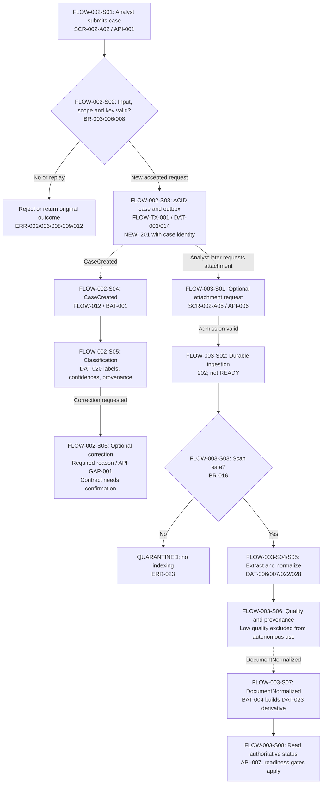
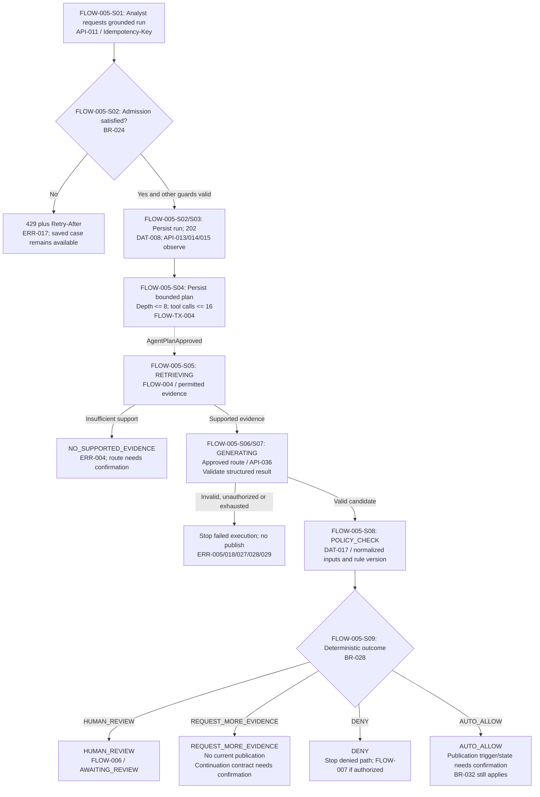
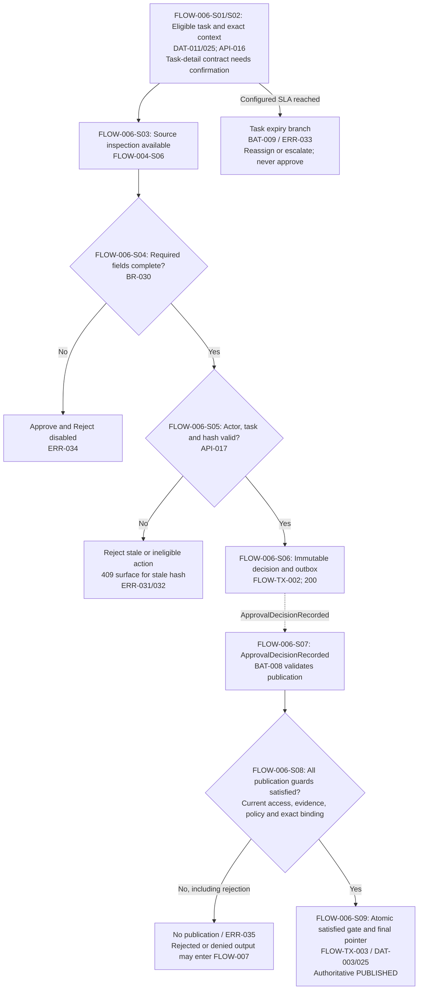
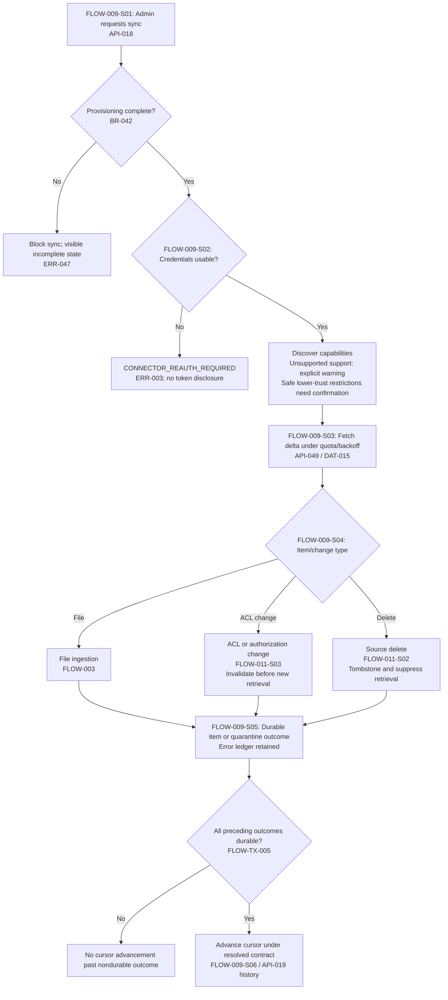
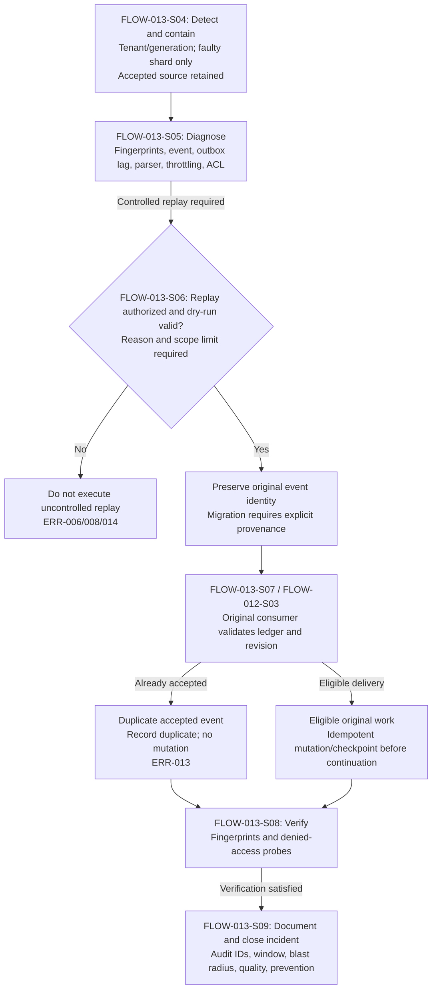
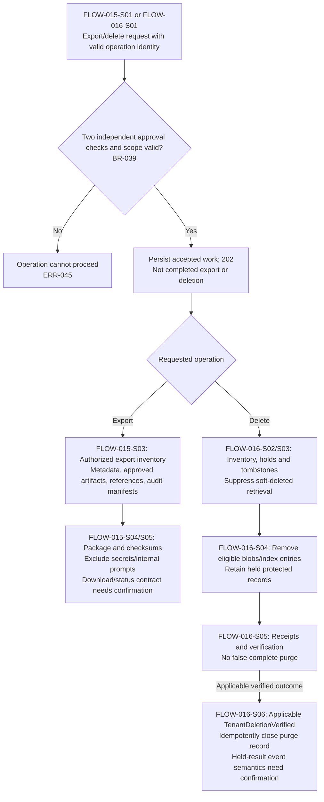
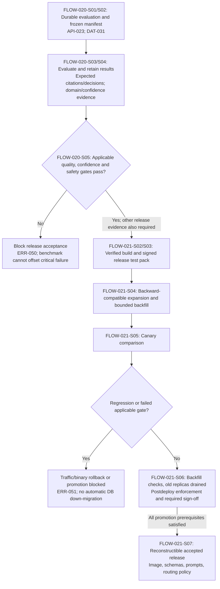

# 7. Processing Flow Specification

## Flow Inventory and Prerequisites

### Specification Basis and Status

| Item | Definition |
|---|---|
| Specification file | `07_processing_flows.md` |
| Source document | `1794567023-OrionDesk_AI_Detailed_Design_Specification.pdf` |
| Source baseline | `OD-AI-DDS-001`, release `R1.0`, design revision `1.3` |
| Completed preceding specifications | [`01_screen_functions.md`](01_screen_functions.md), [`02_api.md`](02_api.md), [`03_data.md`](03_data.md), [`04_batch_functions.md`](04_batch_functions.md), [`05_business_rules.md`](05_business_rules.md), [`06_exception_handling.md`](06_exception_handling.md) |
| Scope | Business initiation, synchronous processing, asynchronous continuation, decision gates, completion, and recovery across the six preceding specifications. |
| Identifier convention | `FLOW-001`–`FLOW-025` identify logical flows. `FLOW-xxx-Sxx` identifies a numbered step. `FLOW-COM-xxx`, `FLOW-TX-xxx`, `AC-FLOW-xxx`, `CON-FLOW-xxx`, and `OQ-FLOW-xxx` identify shared requirements, durable boundaries, acceptance criteria, conflicts, and unresolved decisions. |
| Identifier interpretation | The source does not assign individual flow IDs. Assigned identifiers do not establish new screens, endpoints, tables, executable jobs, queues, locks, or schedules. Source event and technical identifiers are preserved. |
| Citation convention | `[DDS]` means the source filename above. Citations use original PDF page numbers and sections. |
| Source character | Fictional normative reference design. Numeric values are design assumptions, not measured production results. |

[DDS]: 1794567023-OrionDesk_AI_Detailed_Design_Specification.pdf

Statuses used throughout:

- **Confirmed:** Supported by source prose, an identified contract, or a source illustration.
- **Needs confirmation:** Required implementation details are missing or contradictory.
- **Proposal:** An explicitly labeled, unapproved suggestion. Earlier proposals remain proposals.
- **NC:** Table abbreviation for **Needs confirmation**.

### Reading and Cross-Reference Rules

| Identifier prefix | Governing preceding specification |
|---|---|
| `SCR`, `SCR-X`, `SCR-COM` | [`01_screen_functions.md`](01_screen_functions.md) |
| `API`, `API-GAP`, `API-PROC`, `API-COM` | [`02_api.md`](02_api.md) |
| `DAT`, `DAT-REL`, `DAT-LC`, `DAT-CODE`, `DAT-FILE` | [`03_data.md`](03_data.md) |
| `BAT`, `BAT-OPS`, `BAT-COM` | [`04_batch_functions.md`](04_batch_functions.md) |
| `BR` | [`05_business_rules.md`](05_business_rules.md) |
| `ERR`, `ERR-COM`, `ERR-OPS` | [`06_exception_handling.md`](06_exception_handling.md) |

**FLOW-COM-001 — Interpretation of execution order.**

1. Numbered steps specify supported prerequisite and continuation relationships.
2. A referenced subflow executes only when its trigger applies; the inventory is not one global serial pipeline.
3. The confirmed end-to-end acceptance scenario is `create -> ingest -> retrieve -> draft -> review -> publish`.
4. This scenario does not mean every case requires an attachment, every run requires human review, or case classification must finish before all other case activity.
5. A diagram cannot resolve an absent endpoint, state transition, schema, permission, timer, or compensation contract.
6. Logical inputs and outputs are not automatically public JSON properties or physical columns.
7. Earlier proposed screen placement, navigation, token transport, and JSON mappings are not promoted to confirmed requirements.
8. Open contracts must be resolved explicitly before the affected production behavior is implemented.

**Sources:** [DDS], pp. 7, 12, 15–17, 44–46, 75, 82, 90.  
**Earlier trace:** `SCR-COM-001`, `API-COM-001`, `DAT-COM-001`, `BAT-COM-001`, BR-006/010, `ERR-COM-001`.

### Shared Prerequisites

| Requirement ID | Prerequisite |
|---|---|
| FLOW-COM-002 | Establish authenticated principal or independently authorized workload identity, trusted tenant scope, and trace/correlation context before resource access or work allocation. |
| FLOW-COM-003 | Satisfy applicable role, tenant, workspace membership, sensitivity, source ACL, action, and separation-of-duty predicates. Navigation and capability discovery are not authorization boundaries. |
| FLOW-COM-004 | Validate input before transaction entry or long-running allocation, again at domain invariants, and before tool dispatch. Client validation is convenience only. |
| FLOW-COM-005 | Use revision preconditions and operation/event idempotency where required. State-changing boundaries retain tenant, revision, actor, occurrence time, and correlation attribution. |
| FLOW-COM-006 | Access PostgreSQL, objects, indexes, caches, and background work under applicable tenant predicates. The orchestrator has no direct database credentials. |
| FLOW-COM-007 | Use only approved deployments, capabilities, external endpoints, and data-handling scopes. Retrieved and model-generated content cannot grant authority. |
| FLOW-COM-008 | Distinguish request acceptance, durable continuation, decision capture, and business completion. A `202`, successful status read, or stream disconnection is not proof of completion or publication. |

**Sources:** [DDS], pp. 7, 9, 18–23, 25, 37–42, 48–56, 58, 83, 86.  
**Related:** BR-002–009/022–027/045; `API-PROC-001/018/019`; `DAT-LC-013/015/016`; `BAT-OPS-001`; `ERR-COM-002/004`.

**Needs confirmation — OQ-FLOW-001/002/003:** Identity transport, complete role/action predicates, wire schemas, revision/key encoding, transaction concurrency, and attribution carriers remain unresolved. Shared prerequisites do not authorize implementation-selected defaults.

### Business Flow Inventory

All rows describe **Confirmed logical activities**. Detailed contracts and unresolved conditions are identified beside their procedures.

| Flow ID | Purpose | Users and systems | Trigger | Additional prerequisites | Completion condition | Related specification IDs and evidence |
|---|---|---|---|---|---|---|
| FLOW-001 | Authenticate and establish authorized resource context. | Interactive user, identity provider, edge, domain services; internal workloads use their own identities. | Interactive sign-in, authenticated request, or service invocation. | Valid OIDC/service context; trusted tenant and applicable resource authorization. | Trusted context established for the requested action; no blanket resource grant. | `SCR-X-001`; API-027/048; DAT-019; BR-002–004; ERR-007–009. [DDS], pp. 18–23. |
| FLOW-002 | Create and classify a case; support reasoned label correction. | Analyst, Case Service, classifier/Triage Agent. | API-001; `CaseCreated`; optional correction request. | Authorized workspace, valid business context and idempotency key. | One case created in `NEW`; asynchronous classification attached to correct case/version; correction, if requested, accepted with reason/provenance. | SCR-002-A02/A04; API-001/API-GAP-001; DAT-003/020/026; BAT-001; BR-008/011–013; ERR-002/006/010/012. [DDS], pp. 12, 25, 83, 87. |
| FLOW-003 | Ingest attachment/source and build searchable derivatives. | Analyst or connector worker, Ingestion Service, Indexer, object storage. | API-006 or connector/backfill-delivered source; `DocumentNormalized`. | Allowed file, matching MIME/extension, configured limits, scoped immutable version context. | Safe derivatives and anchors durable; applicable index/readiness gates satisfied; unsafe content quarantined without indexing. | SCR-002-A05/A06; API-006/007; DAT-005–007/020/022/023/028; BAT-003/004; BR-016–020; ERR-020/022–025/037/039. [DDS], pp. 30–35, 82–83, 87. |
| FLOW-004 | Search permitted evidence and inspect cited source versions. | Authorized search user, Reviewer, Retrieval Service, controlled source-access services. | API-009, case-evidence read, approved MCP search, or citation activation. | Permitted scope, current source ACL, resolvable anchors, query/evidence budgets. | Supported evidence returned and verified; cited source opens at its stored anchor when authorized. | SCR-003; API-008–010/045; DAT-006/007/010/019/023/027/028; BR-017–021/027; ERR-004/025/039. [DDS], pp. 31, 34–36, 52, 57, 87. |
| FLOW-005 | Execute bounded retrieval, generation, and deterministic policy evaluation. | Analyst, Orchestrator, Research/Draft agents, Model Gateway, Policy Evaluator. | API-011; API-012 alternative unresolved; `AgentPlanApproved` and `WorkflowStageAdvanced`. | Case access, admission thresholds, budgets, approved tools/deployments, permitted evidence. | Candidate and separate evidence/model/policy records produced; appropriate review/nonpublication route selected; terminal or recoverable outcome represented truthfully. | SCR-002-A07/SCR-004; API-011–015/036/045/046/050; DAT-008–010/016/017/024–026; BAT-007; BR-022–028; ERR-005/017/018/026–030. [DDS], pp. 12, 37–49, 58, 69, 83, 87. |
| FLOW-006 | Review exact candidate, capture decision, and validate publication. | Eligible Reviewer, Policy Service, publication consumer. | Policy-required task; API-016/017; `ApprovalDecisionRecorded`. | Exact review context, valid task, required fields, reviewer eligibility, unchanged artifact hash. | Decision immutable; publication occurs only after satisfied exact-content gate and atomic final-pointer update. | SCR-005/SCR-002-A12; API-016/017; DAT-011/012/017/025; BAT-008/009; BR-029–032; ERR-031–035. [DDS], pp. 44–46, 57–58, 83, 87. |
| FLOW-007 | Rework rejection/denial or request constrained override. | Authorized case user, elevated role, secondary reviewer, Orchestrator/Policy Service. | Rejected/denied recommendation or authorized override request. | Historical decision retained; new-run or override authorization resolved. | New revision follows all controls, or authorized override recorded with cumulative requirements; old denial unchanged. | SCR-002-A11/SCR-005-A07; API-GAP-005/006; DAT-008/012/017/025; BR-033; ERR-010/032/035. [DDS], pp. 46, 75. |
| FLOW-008 | Read, maintain, close, or explicitly reopen a case. | Authorized Analyst/Reviewer, case Owner relationship, closure/reopen actor NC, Case Service. | Queue/detail read; API-004/005; explicit reopen. | Current revision, authorized editable fields, valid state/business rules; closure guards NC. | Accepted revision displayed; closure preserves immutable approved lineage; reopen creates new revision without rewriting history. | SCR-001/SCR-002; API-002–005/API-GAP-005; DAT-003/004/025; BR-007/012–015; ERR-001/010/040. [DDS], pp. 24–26, 57, 83–86. |
| FLOW-009 | Synchronize enterprise repository changes safely. | Admin, connector workers, repository provider, ingestion/index/cache services. | API-018; source changes; `ConnectorSyncStarted`. | Completed provisioning, configured credentials/capabilities, provider cursor and quotas. | Per-item outcomes durable; cursor advances only after preceding outcomes; exceptions retained. | SCR-006; API-018/019/049; DAT-005/015/019/021; BAT-002; BR-034–036; ERR-003/016/019–021/047. [DDS], pp. 27–29, 78, 83. |
| FLOW-010 | Change workspace policy or membership through separate authorized contracts. | Workspace Admin/Admin or membership administrator; domain/policy services. | Policy change or API-028 membership update. | Current revision/configuration and field/action authorization; actual policy API NC. | Authorized versioned change and durable audit; downstream authorization/configuration handling follows resolved activation contract. | SCR-007/`SCR-X-002`; API-020/028/API-GAP-002; DAT-002/019/024; BR-003/007/010; ERR-008/011/040. [DDS], pp. 21–25, 37, 44, 71–73. |
| FLOW-011 | Propagate ACL/authorization changes, source deletion, and cache invalidation. | Connector/identity/index/cache services. | Source ACL/delete change, authorization change, or `SearchIndexCommitted`. | Identified affected scope and revision; current ACL authority. | Revoked/soft-deleted content not served; affected caches purged before new retrieval; publication rechecks current access. | API-009/010/028; DAT-005/019/023/027/029; BAT-006; BR-021; ERR-025/035/036. [DDS], pp. 27–29, 46, 51–53, 87. |

### Supporting and Lifecycle Flow Inventory

| Flow ID | Purpose | Users and systems | Trigger | Additional prerequisites | Completion condition | Related specification IDs and evidence |
|---|---|---|---|---|---|---|
| FLOW-012 | Publish committed events and dispatch replay-safe consumers. | Business producers, messaging platform, scoped consumers. | Committed outbox or reconciled saga work. | Valid versioned envelope, operation/event ledger, tenant/resource scope. | One accepted business transition; duplicate/delayed delivery safe; checkpoint precedes continuation. | API-COM-006/API-037; DAT-014/026; BAT-010; BR-009; ERR-013/014/040/041. [DDS], pp. 17, 48–52, 87. |
| FLOW-013 | Rebuild/reconcile indexes and conduct controlled replay. | Indexer, reconciliation worker, authorized operator. | Rebuild request, fingerprint mismatch, delayed-index incident, or API-038 replay. | Authoritative source inventory; replay reason, dry run and scope limit when replaying. | Checked alias switch or verified scoped repair; source authority retained; original event identity/provenance preserved. | API-037/038; DAT-014/023/026; BAT-005/011/012; BR-020/036/044; ERR-014/037/038/041. [DDS], pp. 34, 49–50, 79, 90. |
| FLOW-014 | Provision workspace and onboard historical sources. | Authorized provisioning/backfill actor NC; provisioning and ingestion systems. | Provisioning or historical onboarding request; launch interface NC. | Approved policy/encryption/role/quota/source configuration. | Required setup consistent; incomplete state blocks sync; backfill receipts and coverage-based readiness retained. | `SCR-X-002`; API-GAP-008; DAT-001/002/019/029; BAT-018/019; BR-042; ERR-047. [DDS], p. 78. |
| FLOW-015 | Export authorized workspace data. | `Admin + approver`, export worker, authorized recipient. | API-025 after independent checks. | Two independent approvals, authorized inventory, valid key/scope. | Manifest/package contains required authorized content/checksums and exclusions; download/status contract NC. | `SCR-X-003`; API-025; DAT-029/DAT-FILE-004; BAT-020; BR-039/040; ERR-045/046. [DDS], pp. 78–79, 83, 88. |
| FLOW-016 | Delete workspace data and verify receipts. | `Admin + approver`, Retention Worker, storage/index services. | API-026; applicable `TenantDeletionVerified`. | Two independent approvals, authorized inventory, legal holds. | Eligible removal verified and receipted; held records retained/receipted; purge record closed only under resolved verification contract. | `SCR-X-004`; API-026/040; DAT-018/028/029; BAT-021; BR-039/041; ERR-044–046. [DDS], pp. 80, 83, 85, 87, 89. |
| FLOW-017 | Create holds or apply retention with protected-record exceptions. | Hold administrator NC; retention/telemetry systems. | API-029 hold request or retention/tombstone eligibility. | Authorized hold/purge scope and applicable policy; case-retention targets eligible and closed. | Hold durable, or eligible purge receipted without removing protected/ineligible data. | `SCR-X-005`; API-029/040; DAT-018/029/030; BAT-013/014; BR-038; ERR-044/046. [DDS], pp. 26, 51–53, 66, 80. |
| FLOW-018 | Inspect immutable audit evidence and retain tamper-evident exports. | Auditor, audit-producing services, independent retention storage. | API-021 query; audit append/batch export independently. | Authorized redacted scope; append-only history and defined batch integrity contract. | Authorized history returned; batch-hash evidence independently retained; no historical edit. | SCR-008; API-021; DAT-004/012/013; BAT-015; BR-037; ERR-048/049. [DDS], pp. 11, 62, 83, 85, 88. |
| FLOW-019 | Account for usage, produce daily reporting, and evaluate operational signals. | Model/usage systems, Admin reader, monitoring systems. | Provider usage; daily aggregation; API-022/041/042/034/035/030 reads; monitored conditions. | Attributed usage, configured measurement/window/alert policy. | Costs/quotas/trends and source-required metrics/evidence available; paging/ticket category respected. | SCR-010; API-022/030/034/035/041/042; DAT-016/030/036; BAT-016; BR-025/043/046; ERR-018/053/054. [DDS], pp. 19, 38, 64–70, 83. |
| FLOW-020 | Evaluate frozen quality and safety evidence. | Admin, evaluation harness, independent fixture review. | API-023; prompt/model change requiring reevaluation. | Frozen versioned corpus, signed manifest, expected citations/decisions. | Authoritative evaluation completed and read; execution completion distinct from release pass. | SCR-011; API-023/024; DAT-031; BAT-017; BR-049; ERR-050. [DDS], pp. 74–76, 83, 88–89. |
| FLOW-021 | Build, migrate, canary, and promote compatible releases. | CI/deployment systems, allowed build identity, Security/SRE and security-control review. | Controlled release/API-043. | Attested artifacts, compatibility, test/evaluation evidence, rollout/sign-off criteria. | Reconstructible accepted release; regression blocks promotion and rolls back traffic, not automatically data. | `SCR-X-009`; API-031/043/044; DAT-032; BAT-022/026; BR-048/049; ERR-050/051. [DDS], pp. 20, 52, 55, 71–76, 88–89. |
| FLOW-022 | Operate safely during degradation or recover under incident control. | Incident operator/on-call, recovery facilities, generation/search services. | Model/vector degradation, suspected ACL leak, or regional outage. | Appropriate containment authority; approved routes; backups/object versions/rebuild recipes for recovery. | Safe available workflows preserved; affected access restored only after required verification; regional safety/RPO/RTO verified. | API-030/034/035/042; DAT-023/027/028/036; BAT-023; BR-044/047; ERR-015/036/052. [DDS], pp. 19, 69–70, 79. |
| FLOW-023 | Rotate service credentials and encryption keys. | Identity/vault/key-management systems. | Automatic credential rotation or defined key-rotation policy. | Scoped vault references, managed identity where supported, approved policy. | Rotated access under resolved verification contract; secrets remain scoped; no request-path bulk reencryption. | DAT-019/028/032; BAT-024; BR-037; ERR-049. [DDS], pp. 21, 63. |
| FLOW-024 | Deliver optional signed webhooks independently of business commits. | Notification producer, delivery system, configured recipient. | Eligible accepted notification and optional subscription. | Authorized recipient, signing and age-verification contracts. | Resolved acknowledgment/delivery outcome; internal case transition unaffected by failure. | `SCR-X-007`; API-047; DAT-034; BAT-025; BR-009/036; ERR-043. [DDS], p. 55. |
| FLOW-025 | Record controlled design changes and baseline evidence. | Authorized governance actor NC; baseline services. | API-032 change/decision request; API-033 read independently. | Impact/test links, approval and version contract. | Accepted revision/baseline evidence traceable; revised invariants linked to negative tests. | `SCR-X-008`; API-032/033; DAT-033; BR-050; ERR-006/008/014/054. [DDS], pp. 8–10. |

### Scope Exclusions and Undescribed Flows

| Area | Treatment |
|---|---|
| Physical automation, irreversible financial transactions, foundation-model fine-tuning, unrestricted browsing, administrative cloud permissions for agents | **Out of scope.** Explicit exclusions in [DDS], p. 9, §1.2.1. |
| Application-hosted GPU inference | **Out of scope for R1.** External model dependencies are specified in [DDS], p. 19, §4.2.1. |
| Cross-region active/active mutation, OCR beyond English, customer-managed model weights | **Deferred from this baseline.** [DDS], p. 10, §1.3.2. |
| Overview-specific business flow, universal dashboard refresh, automatic case closure, unrestricted document download, generic cancel/resume controls, financial period closing | **Needs confirmation.** The source does not provide these flow contracts. |
| Exact user routes, primary actions, modal placement, operational console access, completion notifications | **Needs confirmation.** Supported activities do not establish their screen organization or transport. |

## Normal Processing

### Shared Request and Durable Continuation Procedure

The following procedure applies at the relevant boundaries of each flow. It is not a requirement to call `GET /v1/me` before every request.

1. **FLOW-COM-P01 — Establish context.** Authenticate the caller/workload and establish trusted tenant, actor, trace, and correlation context. Do not obtain authority from unverified body fields.
2. **FLOW-COM-P02 — Validate and authorize.** Validate the applicable request/envelope, resource references, action predicates, revision, and operation identity before allocation, transaction entry, or tool dispatch.
3. **FLOW-COM-P03 — Read authoritative prerequisites.** Read current case, task, configuration, source permission, inventory, quota, or checkpoint under tenant scope as required by the operation.
4. **FLOW-COM-P04 — Commit accepted work.** Reevaluate resource attributes within the mutation transaction. Apply the accepted business mutation and source-required durable records using the boundaries below.
5. **FLOW-COM-P05 — Continue durably.** Dispatch committed outbox work or an explicitly reconciled saga continuation. Consumers validate scope, deduplicate event/operation identity, and detect stale aggregate revisions.
6. **FLOW-COM-P06 — Report and release context.** Return the authoritative result or actual persisted asynchronous identity. Reset scoped database session variables after every transaction, including exceptional paths, before connection reuse.

**Sources:** [DDS], pp. 17, 22, 25, 48–56, 86.  
**Related:** `API-PROC-001`; `DAT-LC-013/015/016`; `BAT-OPS-001/003/004`; BR-003–009; `ERR-COM-002`.

### Durable Boundary Register

These identifiers name requirements, not implementation-selected transaction objects or schemas.

| Boundary ID | Confirmed durable boundary | Participation that remains NC |
|---|---|---|
| FLOW-TX-001 | Accepted case mutation and associated outbox insert commit in one ACID transaction. Current state and append-only history must remain consistent. | Exact history, audit, idempotency/result-ledger participation; isolation, locking, revision encoding and response reconstruction. |
| FLOW-TX-002 | Approval decision and associated outbox insert commit in one ACID transaction. Decision evidence is immutable. | Exact task-state update, audit participation, decision-key protocol and competing-decision handling. |
| FLOW-TX-003 | Satisfied publication gate and final response pointer update occur in the same transaction. | Run/case-state projection participation, locking, approval lifetime and automatic-allow trigger. |
| FLOW-TX-004 | Run plan revision is persisted before side effects; each workflow stage writes a checkpoint before downstream dispatch. | Allocation/reservation transaction, step claims, worker fencing, checkpoint history and acknowledgment order. |
| FLOW-TX-005 | Connector cursor advances only after all preceding items have durable ingestion outcomes. | Item/batch transaction size, cursor ownership, exception representation and indexing-versus-ingestion outcome boundary. |
| FLOW-TX-006 | Replacement read alias switches atomically after completeness and recall checks. | Snapshot/catch-up, check formulas, writer fencing and old-generation retirement. |
| FLOW-TX-007 | Search indexing and webhooks are asynchronous with explicit reconciliation; failed indexing does not roll back accepted source metadata. | Cross-store commit units, partial-object/package cleanup and operation-specific compensation. |

**Sources:** [DDS], pp. 28, 34, 40, 45, 49, 52.  
**Open:** OQ-FLOW-003/015/018/020.

### State and Completion Interpretation

| Aggregate or result | Confirmed vocabulary/behavior | Unresolved synchronization |
|---|---|---|
| Case | `NEW`, `TRIAGED`, `IN_PROGRESS`, `PENDING_APPROVAL`, `RESOLVED`, `CLOSED`. Guarded transitions specified below. | Automatic mapping from classifier, review, or published run to case transition. |
| Run | `REQUESTED`, `RETRIEVING`, `GENERATING`, `POLICY_CHECK`, `AWAITING_REVIEW`, `PUBLISHED`, `FAILED`. | `AUTO_ALLOW` progression; recoverable timeout; valid waiting versus missing-approval failure. |
| Document | `ACCEPTED`, `SCANNING`, `EXTRACTING`, `INDEXING`, `READY`, `QUARANTINED`. | Complete transition graph, retry representation, low-quality `READY` treatment and state owner. |
| Review | `ASSIGNED`, `OPENED`, `APPROVED`, `REJECTED`, `EXPIRED`. | Exact opening trigger, reassignment history, decision/expiry races and late decisions. |
| Artifact display | `DRAFT`, `NEEDS_REVIEW`, `PUBLISHED`; accessible text required. | Stored-versus-derived labels and mappings to other aggregates. |
| Request acceptance | `201` creates case; applicable `202` creates durable work. | Exact response envelopes and status/download contracts not provided. |

**Sources:** [DDS], pp. 12, 25, 49, 57–58, 82–83.  
**Related:** DAT-CODE-001–007; BR-014/026/031/045; `ERR-COM-004/005`.

### FLOW-001 — Authentication and Authorized Context

**Source:** [DDS], pp. 18–23, §§4.1.2 and 5.1–5.3.

1. **FLOW-001-S01 — Authenticate.** The interactive user completes OIDC authorization-code flow with PKCE through API-048. Identity-provider URLs, callback, session storage, and sign-in screen are NC. Internal workloads instead use their independently scoped service identity.
2. **FLOW-001-S02 — Validate boundary identity.** The edge validates issuer, audience, expiry, subject, tenant, and expected algorithm. Internal calls apply TLS/mTLS, audience, and scoped IAM controls. Read DAT-019 identity/grant context; reject invalid context through ERR-007.
3. **FLOW-001-S03 — Obtain principal context when requested.** API-027, `GET /v1/me`, returns authenticated context through its unresolved response schema. It does not grant all case, source, administrative, or audit permissions.
4. **FLOW-001-S04 — Evaluate the target action.** Apply BR-003/004 and FLOW-COM-002–007 at the relevant domain/storage boundary. Permitted denial evidence may be recorded; `AccessDenied` supports alert enrichment. No accepted business mutation occurs merely from establishing context.

**Completion:** Authorized context exists for the particular requested operation.

**Needs confirmation — OQ-FLOW-001:** Resolve IdP, Bearer versus optional BFF cookies, claim names, expiry behavior, service grants, role aliases, Auditor evidence access, and sign-in/out destinations.  
**Earlier:** OQ-SCR-002/003; OQ-API-001/002; OQ-DAT-017; OQ-BAT-003; OQ-BR-001; OQ-ERR-003.

### FLOW-002 — Case Creation, Classification, and Correction

**Sources:** [DDS], p. 12, §2.2.1; p. 25, §§6.2.2–6.3.1; pp. 83, 86–87.

1. **FLOW-002-S01 — Submit business intake.** The Analyst supplies validated case business context through API-001, `POST /v1/cases`, with `Idempotency-Key`. `SCR-002-A02` represents the action; a new-case mode launched from Case Queue remains the unapproved `P-SCR-002` placement.
2. **FLOW-002-S02 — Validate creation prerequisites.** Apply BR-003/006/008/011. Read authorized DAT-002 workspace/configuration and DAT-026 operation outcome as needed. Establish valid tenant/workspace association. Priority uses explicit impact/urgency; contractual deadlines use workspace calendar/timezone, but their formulas remain NC.
3. **FLOW-002-S03 — Commit and return creation.** Create DAT-003 case state in `NEW` with tenant/workspace identity and associated durable event evidence under FLOW-TX-001. The reference DDL supplies revision default `1` and sensitivity default `INTERNAL`; complete request defaulting remains NC. Return `201` with the case identifier, not classification completion.
4. **FLOW-002-S04 — Dispatch classification.** FLOW-012 publishes `CaseCreated`. BAT-001 consumes the case ID/revision concepts after event/scope/idempotency validation. The payload schema and attachment-readiness dependency are NC.
5. **FLOW-002-S05 — Persist classification.** The classifier/Triage Agent attaches labels, confidences, and provenance to the correct case/version in DAT-020 through the resolved narrow persistence boundary. Classification is not policy authorization and does not, by itself, confirm an automatic `NEW -> TRIAGED` transition.
6. **FLOW-002-S06 — Correct labels when requested.** `SCR-002-A04` submits corrected labels with a required reason code through API-GAP-001. Validate actor, revision, reason, and provenance preservation before accepting the correction. Do not overwrite a later user correction through an unresolved classifier replay policy.

**Completion:** One authoritative case creation, followed by separately identifiable classification/correction outcomes. Optional attachment processing enters FLOW-003; AI drafting enters FLOW-005 only after its own prerequisites.

**Needs confirmation — OQ-FLOW-004/005:** Intake fields, classification vocabularies/confidences, correction API/role/races, priority matrix, SLA duration/calendar, and triage transition triggers.  
**Earlier:** OQ-SCR-004–008; OQ-API-007/008; OQ-DAT-006/007; OQ-BAT-010; OQ-BR-005–008; OQ-ERR-002/004.

### FLOW-003 — Attachment/Source Ingestion and Indexing

**Sources:** [DDS], pp. 30–35, Chapter 8 and §9.1; pp. 52, 82–83, 87.

1. **FLOW-003-S01 — Validate source admission.** An Analyst uses `SCR-002-A05` and API-006, `POST /v1/cases/{caseId}/attachments`, with job idempotency. Connector/backfill sources enter through their authorized source boundary instead. Apply PDF/DOCX/HTML/UTF-8 text support, MIME/extension agreement, configurable 25 MB per-file cap, and decompression controls.
2. **FLOW-003-S02 — Accept durable ingestion.** Persist the accepted ingestion operation and applicable source/attachment/version relationships in DAT-005/006/020/022/028. API-006 returns `202`. Upload encoding, response property names, and object/database coordination are NC.
3. **FLOW-003-S03 — Scan before parsing.** BAT-003 scans accepted uploads before parser execution. Macros are disabled and embedded remote references are not fetched. Unsafe attachments enter `QUARANTINED` and do not continue to indexing; ERR-023 applies.
4. **FLOW-003-S04 — Extract layout and optional OCR.** Preserve PDF page/block/bounding-box, table row/column, heading, and reading-order data. Use OCR fallback only through opt-in configuration, with marked provenance. Beyond-English OCR remains deferred.
5. **FLOW-003-S05 — Normalize and anchor immutable evidence.** Strip transport artifacts without rewriting claims. Store source URI, file hash, page number, and optional bounding box per chunk. Preserve DAT-006 immutable versions and DAT-007 anchors; fingerprint plus pipeline version supports side-by-side derivatives.
6. **FLOW-003-S06 — Record quality and privacy metadata.** Record empty-page ratio, unknown-character ratio, table-loss indicators, language confidence, and likely-personal-data tags. Authorized low-quality documents remain viewable but are excluded from autonomous recommendations.
7. **FLOW-003-S07 — Build the derivative index.** Publish `DocumentNormalized` through FLOW-012. BAT-004 writes DAT-023 keyword/vector derivatives with tenant, workspace, document version, chunk, language, classification, normalized text, and 1536-dimensional embedding. `SearchIndexCommitted` leads to query-cache invalidation through FLOW-011. Failed index writes enter FLOW-013 without undoing accepted source metadata.
8. **FLOW-003-S08 — Report authoritative status.** `SCR-002-A06` uses API-007, `GET /v1/documents/{documentId}/status`. Display current document state and supplied quality/provenance. Do not claim `READY` from `202`, parser completion, or queue emptiness alone.

**Completion:** Safe immutable evidence and applicable indexed readiness, or explicit quarantine/failure/quality outcome.

**Needs confirmation — OQ-FLOW-006/007/015:** Exact file boundaries, parser/OCR/quality contracts, version/hash/anchor representation, source access, index commit/readiness, and partial cross-store recovery.  
**Earlier:** OQ-API-009/010/011; OQ-DAT-008–012/017; OQ-BAT-012/013; OQ-BR-009–012; OQ-ERR-010/011/014.

### FLOW-004 — Permitted Search and Citation Inspection

**Sources:** [DDS], pp. 31, 34–36, 52–53, 57–58, 87.

1. **FLOW-004-S01 — Select the supported entry contract.** Use API-009, `POST /v1/search`, for public search; API-008, `GET /v1/cases/{caseId}/evidence`, for case evidence; or approved API-045, `knowledge.search@v1`, within an authorized agent plan. These are alternatives, not a required chain of three calls.
2. **FLOW-004-S02 — Establish permitted retrieval context.** Validate query/scope and apply originating ACLs using DAT-019 and source/version metadata. Select the authorized index generation and applicable versioned cache context. Public query properties and standalone search persistence remain NC.
3. **FLOW-004-S03 — Retrieve and rank bounded candidates.** Form lexical and normalized vector queries; merge bounded candidates using reciprocal rank fusion; deterministically rerank; apply diversity and token budgets. Ranking cannot grant permission. ACL filtering must occur before any text is released to generation.
4. **FLOW-004-S04 — Evaluate support.** If confidence/evidence quality is insufficient, return `NO_SUPPORTED_EVIDENCE` under ERR-004. The orchestrator may seek clarification or human help through an unresolved routing contract. Do not fabricate context.
5. **FLOW-004-S05 — Return and verify evidence.** Supported API-009 retrieval returns `200`. Each evidence item contains chunk ID, source title, document revision, page anchor, and ACL digest. Verify opaque citations before display and retain immutable-version references in DAT-010 under the resolved persistence contract.
6. **FLOW-004-S06 — Inspect the cited source.** `SCR-003-A03`/`SCR-005-A03` uses API-010, `GET /v1/evidence/{evidenceId}`, as applicable and the still-missing browser source-access contract. Open the cited stored source and highlight its anchored page range under current permission. API-039, `GET /internal/storage/documents/{id}`, is a narrow internal interface, not an inferred browser route.

**Completion:** Supported authorized evidence and inspectable source provenance. No case run is automatically allocated merely because search occurs.

**Needs confirmation — OQ-FLOW-007:** Public query/result schema, ranking parameters/ties, evidence thresholds, `Citation`, ID relationships, signed URL lifetime/revocation, non-PDF anchors, and human/clarification route.

### FLOW-005 — Bounded Grounded AI Run

**Sources:** [DDS], pp. 12, 37–42, 44, 49, 58, 62, 69, 83, 87.

1. **FLOW-005-S01 — Request and validate a run.** The Analyst uses `SCR-002-A07` and API-011, `POST /v1/cases/{caseId}/runs`, with `Idempotency-Key`. Validate case access, user input, operation identity, approved configuration, and admission thresholds. API-012, `POST /v1/runs`, remains an unresolved alternate contract, not a second mandatory call.
2. **FLOW-005-S02 — Admit and allocate durable work.** Admit only when workspace tokens, queue age, and provider capacity satisfy configured thresholds. Reserve input/output token budget and persist DAT-008 run/operation state. Return `202` with the persisted run identity. Initial progression uses `REQUESTED`; allocation/reservation atomics remain NC.
3. **FLOW-005-S03 — Observe independently of execution.** The UI retrieves API-013, `GET /v1/runs/{runId}`, and API-014 steps where needed, and subscribes to API-015, `GET /v1/streams/runs/{runId}`. Run/SSE reads return the confirmed `200` where specified. Apply scoped monotonic offsets; page refresh reconstructs current server state. Observation does not dispatch another run.
4. **FLOW-005-S04 — Persist and dispatch the bounded plan.** Persist plan revision before effects. Enforce DAG depth maximum eight, maximum sixteen tool invocations, and explicit dependencies. `AgentPlanApproved` dispatches eligible steps through FLOW-012. At every stage, persist the checkpoint before downstream dispatch under FLOW-TX-004.
5. **FLOW-005-S05 — Retrieve authorized grounding.** During `RETRIEVING`, the Research Agent requests permitted evidence through FLOW-004 and approved narrow tools. If A2A is used, declare task ID, capability, input/output schema, deadline, and trace context; separate authorization still applies and the receiver may decline.
6. **FLOW-005-S06 — Route and prepare generation.** Select a specific workspace-approved deployment for the maximum class of included material. Fallback is eligible only when approved, with equal or stronger data handling and approved region/deployment. Construct fixed system rules, signed workflow instruction, validated user input, and separately delimited untrusted evidence. Strip tool-call directives from the evidence context, record injection indicators, and redact nonessential personal fields where policy permits.
7. **FLOW-005-S07 — Generate and validate.** During `GENERATING`, use internal API-036, `POST /internal/model/generate`, and external API-050 through the gateway. Request a versioned JSON schema and apply bounded parsing retries. Unknown fields, invalid citations, or control-character injection produce `MODEL_OUTPUT_INVALID`; invalid output cannot publish. Record actual model/prompt versions and usage in DAT-016/024/025. Quota exhaustion terminates the current run without changing model or data class.
8. **FLOW-005-S08 — Evaluate deterministic policy.** During `POLICY_CHECK`, normalize and store sensitivity, requested action, evidence quality, model class, financial impact category, and confidence bands with rule-set version in DAT-017. Preserve separate retrieval, generation, and policy records. An LLM tag cannot override the result.
9. **FLOW-005-S09 — Select the controlled continuation.** `HUMAN_REVIEW` creates policy-routed review work and the supported `AWAITING_REVIEW` path into FLOW-006. `REQUEST_MORE_EVIDENCE` and `DENY` do not publish the current unsupported/denied output. `AUTO_ALLOW` does not waive publication checks; its exact trigger and state path remain NC. FLOW-006 publication validation applies to any permitted publication route.

**Completion:** Durable candidate/policy outcome and applicable review, publication, failure, or recoverable-timeout outcome. The exact recoverable-timeout representation is unresolved.

**Needs confirmation — OQ-FLOW-008/009/010/012:** Canonical run launch, case-revision binding, tool/call accounting, invalid-plan bound, policy matrix, automatic-allow path, missing approval versus valid waiting, timeout treatment during review, and failure/resume contracts.

### FLOW-006 — Binding Review and Publication

**Sources:** [DDS], pp. 44–46, 52, 57–58, 82–83, 87.

1. **FLOW-006-S01 — Establish eligible review task.** Policy Service routes a task using reviewer pool, minimum role, and separation of duties. Bind DAT-011 task to the run and exact DAT-025 artifact hash. High-risk authors cannot self-approve; broader no-self-approval scope remains unresolved.
2. **FLOW-006-S02 — Open authorized review work.** The Reviewer loads API-016, `GET /v1/review-queue`, using `SCR-005-A01`, and obtains exact task context through the unresolved task-detail contract. Show candidate, citations, actual model/prompt versions, and policy reasons. `UserReviewOpened` is source-named, but its exact trigger/API is NC.
3. **FLOW-006-S03 — Make source inspection available.** Follow FLOW-004-S06 for authorized citation/source inspection. The reviewer must be able to inspect actual evidence before approval; the source does not require a citation-click count or checkbox.
4. **FLOW-006-S04 — Complete required review fields.** Both Approve and Reject remain disabled until the resolved required fields are complete. Capture decision/rationale and optional annotations. Server validation remains authoritative.
5. **FLOW-006-S05 — Submit and revalidate binding.** API-017, `POST /v1/approvals/{approvalId}/decision`, rechecks actor, task validity/expiry, eligibility, separation of duties, required data, and exact reviewed hash. A changed/wrong artifact produces the confirmed `409` conflict surface, stale rejection, and audit evidence.
6. **FLOW-006-S06 — Commit immutable decision.** Record decision, actor, timestamp, evaluated artifact hash, rationale, and optional annotations in DAT-012 with associated outbox under FLOW-TX-002. Return `200` for accepted decision. Update authoritative review outcome under its resolved state contract; accepted decision is not proof of publication.
7. **FLOW-006-S07 — Dispatch publication validation.** FLOW-012 publishes `ApprovalDecisionRecorded`; BAT-008 resolves the exact decision/artifact/evidence. A rejection is not permission to satisfy the publication gate.
8. **FLOW-006-S08 — Revalidate all publication prerequisites.** Check current authorization and source evidence, valid structured output, deterministic policy, required approval sufficiency, and exact hash binding. Reject stale/unauthorized evidence or changed artifacts. Keep DAT-010/011/012/017/025 records separate.
9. **FLOW-006-S09 — Publish atomically and display truthfully.** Under FLOW-TX-003, record the satisfied gate and update DAT-003 current approved-result pointer together. Display artifact/run `PUBLISHED` only from authoritative accepted publication state. The exact mapping to case `RESOLVED` is NC; no public Publish button/API is established.

**Completion:** Accepted decision and, only when all gate conditions hold, one exact-content publication.

**Needs confirmation — OQ-FLOW-011/012:** Task/detail/open contract, mandatory review fields, hash schema, pools/SLA/races, global self-approval, multi-reviewer sufficiency, automatic publication, override, and final-state projection.

### FLOW-007 — Rework and Override Alternatives

**Sources:** [DDS], p. 46, §12.3.2; p. 75, §21.3.1.

1. **FLOW-007-S01 — Preserve the original outcome.** Retain rejected/denied DAT-012/017 decision and DAT-025 artifact/evidence lineage. No historical denial is retroactively changed to approval.
2. **FLOW-007-S02 — Rework alternative.** When authorized rework is requested, create a new run revision and follow FLOW-005 again. API-GAP-005 must define lineage and launch binding; API-011 is not automatically a complete rework schema.
3. **FLOW-007-S03 — Override alternative.** If an override is permitted under the resolved contract, require elevated role, secondary reviewer, and audited reason cumulatively. API-GAP-006 and DAT-012 override evidence remain incomplete.
4. **FLOW-007-S04 — Reapply applicable controls.** New candidate or accepted override follows applicable evidence, authorization, exact-content, and publication checks. An override does not authorize excluded capabilities, cross-tenant access, or arbitrary tool substitution.

**Completion:** New controlled revision or explicitly authorized override evidence; old rejection/denial unchanged.

**Needs confirmation — OQ-FLOW-012/013:** Eligible override cases/roles/API, secondary independence, reason fields, rework identity, and resulting state.

### FLOW-008 — Case Reading, Maintenance, Closure, and Reopening

**Sources:** [DDS], pp. 24–26, 57–59, 83–86.

1. **FLOW-008-S01 — Read authorized current state.** `SCR-001-A01/A03` uses API-002, `GET /v1/cases?cursor=...`; opening an authorized case uses API-003, `GET /v1/cases/{caseId}`, returning `200`. Queue-to-detail gesture/navigation remains proposed. Read DAT-003 current state and applicable authorized lineage/projections.
2. **FLOW-008-S02 — Prepare a permitted change.** The authorized updater changes only resolved editable fields. Validate explicit impact/urgency-derived priority, calendar-derived deadline, sensitivity, ownership, and applicable state guards. Do not treat all domain fields as editable inputs.
3. **FLOW-008-S03 — Commit a revision-safe update.** API-004, `PATCH /v1/cases/{caseId}`, carries `If-Match`. Reevaluate resource/Owner predicate and current revision. Under FLOW-TX-001, update current state and consistent append-only DAT-004 history/outbox. Return `200`; stale update returns `409 CASE_VERSION_CONFLICT` with authorized current revision.
4. **FLOW-008-S04 — Close when separately requested and permitted.** API-005, `POST /v1/cases/{caseId}/close`, validates its still-incomplete state/role/precondition contract. Snapshot approved answer, immutable cited versions, and reviewer decisions in DAT-025/004 lineage. Do not infer predecessor states or response mode from the endpoint name.
5. **FLOW-008-S05 — Reopen only explicitly as new revision.** Preserve the closed snapshot and create the authorized new revision through API-GAP-005. Reopened target state/API and success navigation remain NC.

**Confirmed case transitions:** `NEW -> TRIAGED`; `TRIAGED -> IN_PROGRESS`; `IN_PROGRESS -> PENDING_APPROVAL` or `RESOLVED`; `PENDING_APPROVAL -> RESOLVED` or `IN_PROGRESS`. `CLOSED` is final except explicit reopening as a new revision. The source does not enumerate the complete transition into `CLOSED`.

**Needs confirmation — OQ-FLOW-005/013:** Field/update schemas, business formulas, ownership, transition triggers, closure/reopen guards, snapshot representation, repeated closure, and retained historical source access.

### FLOW-009 — Incremental Connector Synchronization

**Sources:** [DDS], pp. 27–29, 78, 83, 85.

1. **FLOW-009-S01 — Validate and accept sync.** Admin uses `SCR-006-A02` and API-018, `POST /v1/connectors/{connectorId}/sync`, with job idempotency. Check authorized workspace and completed provisioning; persist accepted sync work and return `202`.
2. **FLOW-009-S02 — Resolve credentials and capabilities.** BAT-002 obtains workspace-scoped secret reference and list/fetch/delta-cursor/ACL/delete capabilities. Revoked queued credentials fail `CONNECTOR_REAUTH_REQUIRED`. Unsupported capability produces explicit lower-trust warning; safe restrictions are NC.
3. **FLOW-009-S03 — Fetch changes under controlled load.** Read DAT-015 cursor/watermark/retry context and API-049 repository data. Honor `Retry-After`, bounded backoff/jitter, quotas, and fair scheduling. Preserve stable source IDs, permissions, and history.
4. **FLOW-009-S04 — Apply item-specific continuation.** New/changed files enter FLOW-003. ACL/delete changes enter FLOW-011. These are conditional item paths; an ACL revocation cannot wait for unrelated file processing or ordinary TTL expiration.
5. **FLOW-009-S05 — Persist outcomes and advance safely.** Record per-item outcomes and error ledger. After bounded malformed-record retries, quarantine with reason, correlation ID, and remediation path; remaining batch may proceed with durable exception. Advance cursor only after preceding durable outcomes under FLOW-TX-005. The source does not define that every item must be fully indexed `READY` before this checkpoint.
6. **FLOW-009-S06 — Report sync history.** `SCR-006-A01` uses API-019, `GET /v1/connectors/{connectorId}/runs`, to display current/past outcomes, warnings, and durable exceptions. Exact state/count/pagination schema remains NC.

**Needs confirmation — OQ-FLOW-014:** Provider grants/capabilities, credential recovery, current versus per-run cursor layout, concurrent sync/fencing, initial/expired cursor, item/batch bounds, and no-change completion.

### FLOW-010 — Workspace Policy or Membership Change

**Sources:** [DDS], pp. 21–25, 37, 44–45, 71–73.

Policy and membership changes are separate activities sharing authorization/versioning constraints. They are not a two-call transaction.

1. **FLOW-010-S01 — Read applicable current context.** Policy Settings reads current configuration through API-GAP-002; membership read contract is unresolved. Read DAT-002/019 current policy, membership, and revision as applicable.
2. **FLOW-010-S02 — Prepare the selected change.** Policy may concern retention, specific allowed deployments, credential references, approved pinned toolsets, reviewer routing, quotas, or calendars. API-020, `GET /v1/model-catalog`, supplies registry metadata when requested. Membership uses API-028, `PUT /v1/workspaces/{workspaceId}/members`; replace/upsert/removal semantics are NC.
3. **FLOW-010-S03 — Validate and persist.** Apply action/field authorization, revision precondition, domain invariants, and durable attribution/audit. Do not use API-004 case PATCH as the workspace-policy endpoint solely from §6.1.1.
4. **FLOW-010-S04 — Apply resolved activation/propagation.** Authorization changes enter FLOW-011. Policy activation and applicability to queued/in-flight runs, assigned reviews, existing deadlines, and retention targets require explicit resolution; no universal “latest version” rule is selected.

**Needs confirmation — OQ-FLOW-001/002/010:** Actual settings APIs, membership semantics, editable fields, registry/grant schemas, revision carrier, activation, precedence, and in-flight version treatment.

### FLOW-011 — Authorization, Deletion, and Cache Propagation

**Sources:** [DDS], pp. 27–29, 46, 51–53, 87.

1. **FLOW-011-S01 — Establish affected change scope.** Validate source/authorization revision and identify tenant, source, membership/ACL, index generation, and affected cache scope. Exact change-event schemas and source-detection mechanism are NC.
2. **FLOW-011-S02 — Handle source deletion when applicable.** Create DAT-029 tombstone and schedule index removal. Suppress retrieval of the soft-deleted entity even before physical index/object removal completes.
3. **FLOW-011-S03 — Enforce revocation before new retrieval.** Update applicable source authorization and purge affected DAT-027 entries before new results are served. Cache keys contain tenant, user-scope digest, source ACL revision, query hash, and index generation. Normal TTL does not override revocation.
4. **FLOW-011-S04 — Invalidate on index commit independently.** `SearchIndexCommitted` from the Indexer invalidates query caches associated with committed generation/document revision. A search request does not itself become an index-write trigger.
5. **FLOW-011-S05 — Recheck downstream use.** FLOW-004 applies current permissions before release; FLOW-006 rechecks evidence/authorization before publication. Stale forbidden visibility is ERR-036 and enters FLOW-022 ACL containment.

**Needs confirmation — OQ-FLOW-015:** In-flight propagation atomics, group/ACL mapping, signed-URL revocation, affected-key discovery, cache TTL, source detection, and safe missing-ACL capability behavior.

### FLOW-012 — Outbox and Replay-Safe Consumer Continuation

**Sources:** [DDS], pp. 17, 48–52, 87.

1. **FLOW-012-S01 — Select committed continuation.** Authorized publisher reads committed DAT-014 outbox or explicitly reconciled saga work. Selection/claim fields and broker topology are NC.
2. **FLOW-012-S02 — Validate and publish envelope.** Use exact mandatory properties `event_id`, `type`, `schema_version`, `tenant_id`, `aggregate_id`, `aggregate_revision`, `occurred_at`, `trace_id`, and `payload`. Producers use UTC/canonical JSON; signed tenant context and required durable attribution remain effective.
3. **FLOW-012-S03 — Validate delivery at consumer.** Authenticate/authorize scope, validate versioned payload, and check DAT-026 event/operation ledger and aggregate revision. No cross-partition ordering assumption is allowed.
4. **FLOW-012-S04 — Handle duplicate or eligible mutation.** An already accepted event records duplicate outcome and returns without reapplying mutation. Eligible work executes the original scoped consumer using applicable ACID/outbox or reconciled saga boundary.
5. **FLOW-012-S05 — Persist before next dispatch.** Write required checkpoint before downstream continuation. `WorkflowStageAdvanced` resumes consumers. Maintain one accepted business transition and one accepted-transition audit record; acknowledgment/ledger commit mechanics are NC.

**Confirmed catalog connections:** `CaseCreated -> classifier`; `DocumentNormalized -> index`; `SearchIndexCommitted -> cache invalidation`; `AgentPlanApproved -> plan steps`; `ApprovalDecisionRecorded -> publication validation`; `WorkflowStageAdvanced -> resume`; `AccessDenied -> alert enrichment`; `TenantDeletionVerified -> close purge record`.

**Needs confirmation — OQ-FLOW-016/018:** Full payloads/triggers/signatures, actor/correlation carrier, stale/future revision disposition, ledger retention, producer claims, acknowledgments, worker loss, and migrated replay.

### FLOW-013 — Index Rebuild, Reconciliation, and Controlled Replay

**Sources:** [DDS], p. 34, §9.1.2; pp. 49–50; p. 79, §22.2.2; p. 90, §F.1.

Steps 2–3 are the rebuild path. Steps 4–9 are the incident/reconciliation path; explicit replay at step 6 also supports a separately authorized dead-letter request.

1. **FLOW-013-S01 — Establish authorized processing scope.** Select rebuild, failed derivative/message repair, or operator replay. Read authoritative source versions/fingerprints and applicable DAT-014/023/026 context.
2. **FLOW-013-S02 — Build parallel replacement when rebuilding.** Create a separate index generation from authoritative immutable source data. Preserve source ACL/delete controls while the existing read alias remains in service.
3. **FLOW-013-S03 — Validate and switch replacement.** Execute completeness and recall checks; switch alias atomically only after passing them under FLOW-TX-006. Empty/check-failure/catch-up/old-generation handling remains NC.
4. **FLOW-013-S04 — Detect and contain delayed indexing.** Alert on oldest queue age/index backlog, identify tenant/generation, and pause only faulty connector or indexer shard. Keep accepted source records durable.
5. **FLOW-013-S05 — Diagnose and reconcile.** Inspect event ID, outbox lag, parser flags, search throttling, and source ACL revision. Compare source/index fingerprints. Retry failed derivatives under bounded transient policy and repair message links from outbox.
6. **FLOW-013-S06 — Validate controlled replay when required.** API-038, `POST /internal/deadletters/{id}/replay`, requires operator authorization, reason, dry-run validation, and scope limit. Validated outbox replay is also supported by the runbook, but its entry contract is not supplied. Preserve original event identity unless explicit schema migration retains provenance.
7. **FLOW-013-S07 — Reenter original consumer.** Replay through FLOW-012, retaining tenant, revision, idempotency, policy, and artifact guards. Replay is not permission to force a rejected mutation.
8. **FLOW-013-S08 — Verify recovery.** Compare fingerprints and run denied-access probes before incident closure. For an ACL incident, search cannot be reenabled before negative-access tests pass.
9. **FLOW-013-S09 — Document evidence.** Link audit IDs, time window, blast radius, quality effect, and preventive action.

**Needs confirmation — OQ-FLOW-015/018:** Rebuild/replay commands, scope units/bounds, check thresholds, concurrency/fencing, dry-run results, stale worker ownership, no-input status, and partial recovery/cleanup.

### FLOW-014 — Provisioning and Historical Onboarding

**Source:** [DDS], p. 78, §§22.1.1–22.1.2.

1. **FLOW-014-S01 — Validate provisioning input.** Establish authorized tenant/workspace target and approved policy, encryption, role, quota, and connector configuration. Launch/status interfaces and initiating role remain API-GAP-008.
2. **FLOW-014-S02 — Establish required resources idempotently.** BAT-018 creates workspace policy, encryption references, role bindings, quotas, and connector stubs as one durable idempotent workflow. This is not confirmation of one distributed ACID transaction.
3. **FLOW-014-S03 — Enforce completeness.** Persist visible complete/incomplete provisioning context in DAT-029 under the resolved schema. Incomplete provisioning blocks FLOW-009 sync.
4. **FLOW-014-S04 — Backfill bounded history when requested.** BAT-019 selects a bounded historical window, preserves stable source IDs, and invokes FLOW-003 for selected documents.
5. **FLOW-014-S05 — Reconcile and establish search readiness.** Record per-batch reconciliation receipts. Readiness depends on indexed coverage, not merely queue emptiness.

**Needs confirmation — OQ-FLOW-019:** Resource order, completeness predicate, partial-resource compensation, historical window/batch bounds, incremental-sync overlap, receipts, and coverage thresholds.

### FLOW-015 — Controlled Workspace Export

**Sources:** [DDS], pp. 78–79, 83, 88, `T-11`.

1. **FLOW-015-S01 — Validate independent authorization.** API-025, `POST /v1/workspaces/{workspaceId}/export`, validates target, request, idempotency, `Admin + approver`, and two independently verified approval checks. Single-Admin execution is not permitted.
2. **FLOW-015-S02 — Persist accepted work.** Return `202` only for actual durable export work. Approval binding, snapshot scope, and response/status schema are NC.
3. **FLOW-015-S03 — Collect authorized content.** BAT-020 reads permitted case metadata, approved DAT-025 artifacts, source references, and DAT-013 audit manifests. The source does not establish export of every raw source binary or draft.
4. **FLOW-015-S04 — Package manifest and checksums.** Write DAT-029 export evidence and DAT-FILE-004 package using the resolved format. Exclude secrets and internal model prompts.
5. **FLOW-015-S05 — Report authoritative completion.** Completion requires the authorized package/manifest/checksum outcome, not `202` alone. Recipient/download/status/lifetime and partial-package behavior are NC. Do not emit `TenantDeletionVerified` merely because Chapter 22 associates that event with export prose.

**Needs confirmation — OQ-FLOW-020:** Independent approval protocol, snapshot consistency, content scope, checksum/package format, empty/partial completion, status/download, and package lifetime.

### FLOW-016 — Verified Workspace Deletion

**Sources:** [DDS], pp. 80, 83, 85, 87, 89, `TST-013`.

1. **FLOW-016-S01 — Validate and accept controlled deletion.** API-026, `POST /v1/workspaces/{workspaceId}/delete`, applies independent approvals, workspace/action authorization, request validation, and job idempotency; return `202` for durable accepted work.
2. **FLOW-016-S02 — Resolve inventory and holds.** BAT-021 reads current authorized deletion inventory and applicable legal holds in DAT-029. Hold timing/races and relational/backup inventory scope are NC.
3. **FLOW-016-S03 — Tombstone targets.** Write tombstones and prevent retrieval of soft-deleted entities. This suppression must not wait for physical index removal.
4. **FLOW-016-S04 — Remove eligible content and protect held records.** Use scoped storage/purge processing, including API-040 where applicable, to remove eligible DAT-028 blobs and DAT-023 entries. Retain held protected records.
5. **FLOW-016-S05 — Record and verify receipts.** Retain tenant, object reference, purge time, actor, and applicable hold exceptions in DAT-018 under its resolved schema. Verify eligible removal; do not claim all protected records were erased.
6. **FLOW-016-S06 — Close verified purge outcome.** The applicable `TenantDeletionVerified` carries manifest ID/receipt hash concepts and idempotently closes the purge record. The exact verification semantics when records remain held are NC.

**Completion:** Verified eligible deletion and explicitly retained/receipted exceptions. No reverse-deletion or automatic restoration compensation is confirmed.

**Needs confirmation — OQ-FLOW-020/021:** Inventory, hold races, receipt survival, partial/all-held result, event semantics, root tenant/workspace mapping, shared/historical sources, and backups. Data-subject **access requests** use the same inventory; they are not automatically erasure requests.

### FLOW-017 — Holds and Retention Alternatives

**Sources:** [DDS], pp. 26, 51–53, 61–63, 66, 80.

1. **FLOW-017-S01 — Select the independent trigger.** An authorized hold request uses API-029, `POST /v1/security/holds`; retention processing instead selects policy-eligible records/tombstones. These are not a required hold-then-purge sequence.
2. **FLOW-017-S02 — Persist hold or validate retention eligibility.** Hold creation records authorized scope through its unresolved schema. Case-retention BAT-013 operates only on eligible `CLOSED` cases. Diagnostic/audit BAT-014 uses separate retention classes.
3. **FLOW-017-S03 — Protect held data and purge eligible data.** Resolve applicable holds before destructive work. Use the controlled tombstone/object/index purge boundary; held/ineligible records are not removed.
4. **FLOW-017-S04 — Record completion and exceptions.** Persist purge receipts and legal-hold exceptions. The source baseline has a 30-day diagnostic default TTL and distinct fictional seven-year security-audit policy; corporate selection/precedence remains open.

**Needs confirmation — OQ-FLOW-021:** Hold role/reason/scope/read/release contract, age/equality boundaries, retention classes, scheduler, all-held/empty status, and lineage/backup survival.

### FLOW-018 — Immutable Audit Inspection and Retention Export

**Sources:** [DDS], pp. 11, 62, 83, 85, 88.

1. **FLOW-018-S01 — Query authorized history.** Auditor uses `SCR-008-A01` and API-021, `GET /v1/audit/events`, returning `200` cursor-paginated immutable history within tenant/redacted scope.
2. **FLOW-018-S02 — Inspect permitted evidence.** Display authorized actor/action/digest, decision metadata, prompt-template digests, and access lineage supplied by the resolved projection. Audit detail and Auditor source-access contracts are NC; no general case-read grant is inferred.
3. **FLOW-018-S03 — Retain integrity evidence independently.** Audit-producing/batch processing, independently of query execution, appends entries, chains batches with hashes, and exports through BAT-015 to independently controlled retention storage.
4. **FLOW-018-S04 — Preserve history under all actions.** Reject historical audit/revision/decision editing. Integrity/export failure is not repaired by rewriting the ledger and is not displayed as verified evidence.

**Needs confirmation — OQ-FLOW-022:** Redaction/detail/filter/cursor contracts, batch order/hash/export/checkpoint verification, independent grants, retention, and integrity-failure recovery.

### FLOW-019 — Usage Reporting and Operational Signals

**Sources:** [DDS], pp. 19, 38, 64–70, 83, 85.

Usage aggregation and monitoring are separate consumers of evidence; neither is triggered merely by a reporting GET.

1. **FLOW-019-S01 — Record attributed usage.** Gateway/accounting records actual run/deployment input/output tokens and workspace quota context in DAT-016. Preserve cost-center/deployment-version attribution and separate model, embedding, storage, and indexing measures.
2. **FLOW-019-S02 — Aggregate daily reporting.** BAT-016 produces budget, forecast, rejected-excess, cost/quota, and trend data in DAT-030 under the unresolved accounting/window formulas. Keep raw files, normalized text, vectors, and replication sizing distinct where required.
3. **FLOW-019-S03 — Read usage when requested.** Admin uses API-022, `GET /v1/usage`, returning `200`. SCR-010 placement remains proposed; missing source usage must not be fabricated as complete or zero.
4. **FLOW-019-S04 — Read operational projections independently.** Protected API-041 metrics/API-042 capacity and API-034/035 health/API-030 degraded-mode reads expose their resolved projections. These reads do not themselves admit work, promote a release, or execute a detector.
5. **FLOW-019-S05 — Evaluate actionable signals.** Monitor rate, errors, latency, saturation, grounding pass, retrieval empty rate, provider throttling, token use, approval backlog age, and relevant queue/backlog signals. Page for user-impacting failure-budget/stale-ACL/missing-approval incidents; routine spend anomalies create tickets with owner/threshold. Actual thresholds/routes/assignments are NC.

**Source objectives:** API availability 99.9% monthly; case-create P95 within/under 300 ms wording unresolved; search P95 under 1.5 s excluding remote connector fetch; generation latency measured separately.

**Needs confirmation — OQ-FLOW-023/025:** Accounting grain, reservations/billing/corrections, day/currency/rounding/forecast formulas, log/metric schema, alert thresholds, actual recipients, scaling, and SLO measurement.

### FLOW-020 — Frozen Evaluation

**Sources:** [DDS], pp. 74–76, 83, 88–89.

1. **FLOW-020-S01 — Accept authorized evaluation.** Admin uses API-023, `POST /v1/evaluations`, with job idempotency and resolved versioned inputs; persist work and return `202`.
2. **FLOW-020-S02 — Verify frozen fixtures.** BAT-017 verifies dataset version/signed manifest and independent leakage review. The reference corpus contains 1,200 synthetic permission-controlled cases; each stores expected citations and decision outcomes.
3. **FLOW-020-S03 — Execute and score evidence.** Run deterministic contract/negative cases separately from probabilistic evaluation. Preserve citation precision target `>=0.97`, unsupported-claim rate `<=0.02`, high-risk policy recall `1.00` on the frozen safety suite, and confidence/distribution-shift evidence by domain.
4. **FLOW-020-S04 — Persist and read results.** Retain DAT-031 scorecard/gate evidence and source-named `EvaluationCompleted`; API-024, `GET /v1/evaluations/{evaluationId}`, reads authoritative result under unresolved read/status/schema contract.
5. **FLOW-020-S05 — Apply release and reevaluation requirements.** Low statistical confidence and critical isolation/approval failures block release irrespective of benchmark score. Changed prompt/model requires reevaluation. Evaluation completion is not release approval.

**Needs confirmation — OQ-FLOW-024:** Input/result/progress/read roles, signatures, domains/statistical calculations, metric denominators/rounding, partial/empty suite behavior, and individual `SEC-001`–`SEC-012` definitions.

### FLOW-021 — Compatible Release and Migration

**Sources:** [DDS], pp. 19–20, 52, 55, 71–76, 88–89.

The sequence below expresses confirmed dependencies, not a selected CI tool or complete pipeline scheduling/parallelization contract.

1. **FLOW-021-S01 — Establish controlled release scope.** Validate protected API-043, `POST /internal/releases`, or pipeline launch identity, artifacts, configuration, and migration plan. Declarative modules document inputs/outputs; Terraform versus Bicep is unselected. No datastore is publicly exposed and egress is limited to declared endpoints.
2. **FLOW-021-S02 — Build and attest.** Run static analysis, dependency scanning, unit/contract tests, SBOM generation, and image signing. Production accepts only digests verified against an allowed build identity. Environment images/templates remain consistent with isolated secrets/quotas; development excludes production data.
3. **FLOW-021-S03 — Produce release verification.** Execute applicable FLOW-020 evaluation and minimum release pack: unit, schema evolution, negative authorization, workflow replay, staging sync, visual accessibility, search recall, grounding, policy recall, load, and DR tests. Record randomized seeds and signed outputs referenced by release digest.
4. **FLOW-021-S04 — Expand schema compatibly.** Predeploy migrations are backward compatible. Add nullable columns first and backfill in bounded batches according to the actual migration plan. No active-reader-dependent field is removed.
5. **FLOW-021-S05 — Canary and compare.** Assess state/schema compatibility before traffic movement and compare latency, errors, authorization denials, and AI-quality regressions against baseline. Regression triggers automated traffic/binary rollback, not database down-migration.
6. **FLOW-021-S06 — Enforce after required readiness and drainage.** Final constraints require completed applicable backfill/verification and old-replica drainage. Security/SRE validate egress, secrets, backup status, and alert routing before promotion; security-control evidence is independently reproduced and signed as required.
7. **FLOW-021-S07 — Record accepted promotion.** Bind image digest, schemas, prompts, and model-routing policy in DAT-032 release evidence. Preserve `ReleasePromoted` where accepted. API-044, `GET /internal/releases/{releaseId}`, reads reconstructible metadata. `DeploymentPromoted` remains a distinct source term pending mapping.

**Needs confirmation — OQ-FLOW-024:** Actual migration transformations/bounds, pipeline ordering, build/signature/sign-off protocol, canary threshold/window, readable-write rollback, explicit data compensation, and promotion states.

### FLOW-022 — Degradation and Incident Recovery Alternatives

**Sources:** [DDS], pp. 19, 69–70, 79.

1. **FLOW-022-S01 — Identify the affected incident scope.** Establish authorized model, vector, ACL, or regional incident context and retain privacy-safe diagnostic evidence. Detection thresholds/commands are NC.
2. **FLOW-022-S02 — Model outage alternative.** Disable new generation admission, keep manual case/evidence workflows available, and display degraded status. Preserve approved route/fallback restrictions. Page on-call only when availability budget is impacted.
3. **FLOW-022-S03 — Vector degradation alternative.** Permitted lexical retrieval may continue with visible reduced-quality flag. It must retain current ACL, evidence, policy, and approval controls.
4. **FLOW-022-S04 — Suspected ACL leak alternative.** Suspend affected aliases, revoke cached evidence, preserve audit traces, and conduct scoped ACL replay through FLOW-013. Reenable search only after negative-access tests pass.
5. **FLOW-022-S05 — Regional outage alternative.** Under incident command only, restore secondary snapshots using continuous PostgreSQL backups, object versions, and rebuild recipes. Persistent writes normally target the primary; failover fencing/worker activation is NC. Reconcile relational/object state and rebuild derivative search as required.
6. **FLOW-022-S06 — Verify the applicable outcome.** Regional acceptance measures safety, consistency, RPO `<=15 minutes`, and RTO `<=4 hours`. ACL recovery requires negative tests. Model/vector recovery reenabling criteria remain NC; no generic health read automatically reenables all work.

**Needs confirmation — OQ-FLOW-015/018/025:** Incident detection, containment/recovery authority, probes, outage/resumption API behavior, write fencing, backup/hold/deletion propagation, and measurement points.

### FLOW-023 — Credential and Key Rotation

**Sources:** [DDS], p. 21, §5.1.2; p. 63, §17.3.2.

1. **FLOW-023-S01 — Resolve policy and eligible references.** Read approved credential/key-rotation policy and scoped vault references. Provider-managed versus application execution and schedule are NC.
2. **FLOW-023-S02 — Rotate within declared scope.** Use managed identity where supported; do not share workload identities or place secret values in public arguments, traces, prompts, or provider context outside declared scope.
3. **FLOW-023-S03 — Maintain authorized access.** Apply the resolved overlap/reference-switch/verification contract. Rotation must not require bulk reencryption in the request path; no separate background reencryption job is confirmed.
4. **FLOW-023-S04 — Record truthful outcome.** Retain applicable durable attribution and verified result. Failure cannot justify static-secret disclosure or unapproved credential fallback.

**Needs confirmation — OQ-FLOW-022/025:** Rotation schedule, overlap/grace, reference switching, verification/revocation/rollback, vault outage, and per-tenant isolation versus throughput.

### FLOW-024 — Optional Signed Webhook

**Source:** [DDS], p. 55, §15.2.2.

1. **FLOW-024-S01 — Select eligible committed notification.** Resolve optional authorized subscription/recipient and accepted internal notification. Event mapping and subscription administration remain NC.
2. **FLOW-024-S02 — Construct and sign delivery.** Use the resolved payload/signature contract. Recipient verifies signature and event age.
3. **FLOW-024-S03 — Deliver and handle retries.** API-047 sends through the unresolved URL/method/acknowledgment contract. Retry with exponential backoff under bounded dependency policy.
4. **FLOW-024-S04 — Keep delivery separate from case outcome.** Record authoritative delivery outcome where defined. Webhook failure never rolls back accepted case transition; no email/SMS or manual-redelivery fallback is confirmed.

**Needs confirmation — OQ-FLOW-016/018:** Signature/age/payload, retry cap/deadline, acknowledgment classification, deduplication, terminal delivery, and redelivery contract.

### FLOW-025 — Controlled Baseline Change

**Sources:** [DDS], pp. 8–10, §§1.1–1.5.

1. **FLOW-025-S01 — Submit controlled change.** API-032, `POST /v1/design-decisions`, receives the resolved change contract, including behavior, migration, threat-surface, and operating-cost impact scores. Revised invariants require at least one negative-test link.
2. **FLOW-025-S02 — Validate authority and approval.** Apply input, tenant/action, stale-write, and idempotency/durable-attribution controls. Governance approval mechanics and score scales are NC.
3. **FLOW-025-S03 — Record approved revision.** Approved records increment minor revision; incompatible protocol changes increment major revision. Retain DAT-033 traceability and applicable `BaselineCommitted` evidence through durable publication.
4. **FLOW-025-S04 — Read baseline independently.** API-033, `GET /v1/design-baselines/{id}`, returns authorized baseline metadata under its unresolved schema. Reading a baseline does not itself approve/commit another change. API-031 OpenAPI retrieval likewise does not execute compatibility verification.

**Needs confirmation — OQ-FLOW-024:** Governance roles/schema, approval/version formatting, impact scales, event trigger, and baseline result contract.

## Branches, Failures, and Recovery

### Shared Request and Consumer Branches

| Branch condition | Affected point | Required behavior | Exception IDs | Recovery or termination |
|---|---|---|---|---|
| Invalid authentication/service context | FLOW-001-S02 and every boundary | Reject before unauthorized access/allocation. | ERR-007 | Permanent for that attempt; session/grant restoration contract NC. |
| Resource/action/SoD denial | Shared validation and mutation/publication guards | No accepted business mutation; safe authorized denial evidence permitted. | ERR-008 | No transient retry; no equivalent-tool or role-inference bypass. |
| Foreign-tenant or absent ID | Resource reads/mutations | Same `404`-equivalent non-disclosing class; no private existence/current-revision disclosure. | ERR-009 | Terminate rejected attempt without expanding scope. |
| Schema-invalid public request | Before allocation/transaction/dispatch | `422`; safe details only. | ERR-006 | Correct input; missing-header/business error mapping NC. |
| Identical accepted request replay | FLOW-002-S02 or other idempotent admission | Return original outcome/operation; no second creation. | ERR-012 | Result reconstruction, not a new launch. |
| Same key, changed fingerprint | Idempotent admission | `409 IDEMPOTENCY_CONFLICT`; no second outcome under key. | ERR-002 | Resolve intended operation explicitly; no silent new key. |
| Duplicate accepted event | FLOW-012-S03/S04 | Record duplicate outcome, return without mutation. | ERR-013 | No compensation; accepted state preserved. |
| Stale/invalid envelope | FLOW-012-S03 | Validate/detect; do not overwrite later state or accept invalid scope. | ERR-014 | Exact acknowledgment/dead-letter/future-revision policy NC. |
| Dependency unavailable or reply/commit outcome uncertain | Applicable API/service boundary | Documented retryable error or actual persisted async identity; never ambiguous success. | ERR-015/040 | Use original identity and authoritative records; pending/unknown result protocol NC. |
| Transaction fails before commit | FLOW-TX-001/002/003 | No partial accepted mutation/outbox or gate/pointer. | ERR-040 | Roll back uncommitted unit; exact database error/retry translation NC. |

**Sources:** [DDS], pp. 13, 21–25, 45, 48–56, 83–86, 89.  
**Open:** OQ-FLOW-001–003/016/018.

### Case, Ingestion, and Search Branches

| Branch condition | Flow/step | Required result | Exception IDs | Continuation/resumption |
|---|---|---|---|---|
| Classification correction lacks reason | FLOW-002-S06 | Do not accept correction; retain prior provenance. | ERR-010 | Corrected submission through unresolved API-GAP-001. |
| Classifier result races with newer revision/correction | FLOW-002-S05/S06 | Stale/unauthorized write cannot overwrite accepted later state. | ERR-010/014 | Exact recompute/discard/review policy NC. |
| Stale `If-Match` | FLOW-008-S03 | `409 CASE_VERSION_CONFLICT`, authorized current revision; no stale write. | ERR-001 | API-003 current read, then explicit conflict resolution; no automatic merge. |
| Invalid case transition or closure/reopen guard | FLOW-008-S03–S05 | Reject unsupported change; preserve closed snapshot. | ERR-010 | New authorized action only after guard contract resolves. |
| Unsupported/mismatched/oversized/decompression-violating file | FLOW-003-S01 | Fail closed; no unsafe processing/readiness claim. | ERR-022 | Correct/replace input; exact HTTP/state mapping NC. |
| Unsafe attachment | FLOW-003-S03 | `QUARANTINED`, no indexing, no macro/remote-reference execution. | ERR-023 | No confirmed automatic quarantine release or safe active-content viewer. |
| Safe low-quality extraction | FLOW-003-S06 | Remains viewable under permission; excluded from autonomous recommendations. | ERR-024 | Side-by-side reprocessing supported; launch/thresholds NC. |
| Missing usable extraction/quality result | FLOW-003-S04–S08 | Do not invent autonomous-use or `READY` default. | ERR-024/054 | Empty/missing-quality state contract NC. |
| Insufficient or ambiguous evidence | FLOW-004-S04 | `NO_SUPPORTED_EVIDENCE`; no fabricated context. | ERR-004 | Optional clarification/human path; transport/route NC. |
| Missing citations | FLOW-005-S07/S09 | Needs-review or unsupported outcome; no unsupported publication. | ERR-004/005/025 | Distinguish absence from schema-invalid citations through OQ-FLOW-007. |
| Anchor unavailable, invalid, or permission revoked | FLOW-004-S05/S06 | Do not display as verified evidence or count forbidden support. | ERR-025/039 | Transient object retry only where appropriate; no latest-source substitution. |
| Index write delayed/failed | FLOW-003-S07 | Preserve accepted source/version metadata. | ERR-037 | FLOW-013 reconciliation/replay. |
| Rebuild completeness/recall unsatisfied | FLOW-013-S03 | No alias switch to unpassed generation. | ERR-038 | Continue controlled parallel rebuild/reconciliation; exact bounds NC. |

**Sources:** [DDS], pp. 12–13, 25–26, 30–36, 49, 57, 89–90.

### AI, Policy, and Review Branches

| Branch condition | Flow/step | Required result | Exception IDs | Termination or next point |
|---|---|---|---|---|
| New-run admission threshold fails | FLOW-005-S01/S02 | `429` plus `Retry-After`; saved case remains available; no started-run success. | ERR-017 | Reattempt through normal admission/key contract; no fixed delay supplied. |
| Provider throttling | FLOW-005-S07 or FLOW-009-S03 | Capped retries; controlled load; connector honors `Retry-After`. | ERR-016 | Bounded dependency retry; cap/circuit settings NC. |
| Current-run quota exhausted | FLOW-005-S07 | Terminal current run; no automatic model/data-class change. | ERR-018 | Budget reconciliation/new-run semantics NC. |
| Provider/deployment outage | FLOW-005-S06/S07 | No unapproved region/deployment fallback. | ERR-015/016 | Eligible approved fallback only, or FLOW-022 outage handling. |
| Hostile source/model instructions | FLOW-005-S04–S07 | Content remains untrusted; no tenant/tool/approval authority; indicators safely recorded. | ERR-026 | Detection-specific continuation/termination NC; authority escalation always blocked. |
| Arbitrary/unauthorized tool | FLOW-005-S04/S05 | `DENY` before dispatch; no equivalent denied-tool substitution. | ERR-027 | Terminate denied invocation. |
| A2A receiver declines | FLOW-005-S05 | Do not assume accepted/completed task. | ERR-027 | Decline/result/rerouting protocol NC. |
| Depth/call budget exceeded or repeatedly invalid plan | FLOW-005-S04 | Stop exhausted/invalid path and report failed checkpoint. | ERR-028 | Exact call accounting, invalid count, and resume/new-run decision NC. |
| Deadline/runtime maximum reached | Applicable execution checkpoint | Applicable stop; terminal or recoverable outcome, no false publication. | ERR-029 | Timeout accounting/state/resume NC; 180 seconds is not selected reviewer SLA. |
| Policy `DENY` | FLOW-005-S09 | Denied path does not proceed or publish. | ERR-030 | FLOW-007 rework/authorized override only. |
| Policy `REQUEST_MORE_EVIDENCE` | FLOW-005-S09 | Current unsupported content cannot publish. | ERR-030 | Evidence/clarification/human routing contract NC. |
| Policy `HUMAN_REVIEW` | FLOW-005-S09 | Policy-routed review and supported waiting path. | ERR-030 | FLOW-006; valid wait versus missing-approval failure unresolved. |
| Policy `AUTO_ALLOW` | FLOW-005-S09 | Other evidence/authorization/gate requirements remain. | ERR-030/035 | Trigger/state path NC; no unconditional direct publication. |
| Review fields incomplete/context unavailable | FLOW-006-S02–S04 | Disable both controls for incomplete fields; do not falsely claim source inspectability. | ERR-034 | Correct fields or bounded transient context read; no click-count gate. |
| Wrong/changed artifact hash | FLOW-006-S05 | `409` conflict surface; rejected as stale and audited. | ERR-031 | Reload exact current task/candidate; old hash cannot be reused. |
| Reviewer/override independence fails | FLOW-006-S01/S05 or FLOW-007-S03 | Deny high-risk self-approval/ineligible review or incomplete override. | ERR-032 | New authorized attempt; no transient retry. |
| Task expires | During FLOW-006 before accepted decision | No implicit approval; reassign/escalate and record escalation. | ERR-033 | BAT-009; deadline/decision race and routing NC. |
| Accepted rejection | FLOW-006-S06/S07 | Immutable rejection; publication gate not satisfied by rejection. | ERR-030/035 | FLOW-007 new revision when authorized. |
| Current evidence/authorization fails at publication | FLOW-006-S08 | No final-pointer update or published display. | ERR-035 | Failed-publication review/rework trigger NC. |

**Sources:** [DDS], pp. 11–13, 37–46, 49, 58, 69, 87–90.

There is no confirmed universal priority ordering among `DENY`, `REQUEST_MORE_EVIDENCE`, `HUMAN_REVIEW`, and `AUTO_ALLOW`. FLOW-005 consumes the deterministic engine’s result; it does not invent rule combination.

### Supporting Flow Failures

| Condition | Affected flows | Required handling | Exception IDs and open continuation |
|---|---|---|---|
| Credential revoked | FLOW-009 | `CONNECTOR_REAUTH_REQUIRED`, no token disclosure, no transient retry of revoked grant. | ERR-003; reauthentication/relaunch NC. |
| Unsupported capability | FLOW-009/011 | Explicit lower-trust warning; mandatory ACL/soft-delete controls remain. | ERR-019; safe restrictions NC. |
| Poison/partial connector batch | FLOW-009 | Bounded retries then durable quarantine exception; cursor cannot pass nondurable preceding outcome. | ERR-020/021; partial/no-change states NC. |
| Incomplete provisioning/backfill | FLOW-014 | Visible incomplete state blocks sync; queue empty does not prove coverage. | ERR-047; resource compensation/checkpoint NC. |
| Missing independent exit approvals | FLOW-015/016 | Export/delete cannot proceed. | ERR-045; approval protocol NC. |
| Hold/ineligible purge | FLOW-016/017 | Retain protected/ineligible records; receipt hold exceptions. | ERR-044; all-held/empty completion NC. |
| Partial export/deletion or failed verification | FLOW-015/016 | No false completed package/full purge; durable inventory/receipts preserved. | ERR-046; resume/cleanup/compensation NC. |
| Audit edit/integrity/export failure | FLOW-018 | Historical edit rejected; failed verification not presented as valid; no ledger rewrite. | ERR-048; chain/export recovery NC. |
| Sensitive disclosure/vault/rotation failure | FLOW-018/023 and all boundaries | Never disclose out-of-scope secrets/documents/prompts; no unapproved credential fallback. | ERR-049; post-disclosure/rotation recovery NC. |
| Missing/late usage or partial rollup | FLOW-019 | Preserve attribution; no fabricated complete/zero/refund amount. | ERR-053; correction/rerun formula NC. |
| Fixture/signature/critical/low-confidence failure | FLOW-020/021 | Block applicable release acceptance; no empty/partial suite passing convention. | ERR-050; statistical/result contract NC. |
| Compatibility/sign-off/canary failure | FLOW-021 | Block promotion; regressions roll back traffic/binary, not automatically database. | ERR-051; explicit migration compensation NC. |
| Region/restore failure | FLOW-022 | Incident control, safety/consistency and RPO/RTO verification; no false recovery. | ERR-052; fencing/retry/activation NC. |
| Webhook fails | FLOW-024 | Signed bounded retry; accepted case unchanged. | ERR-043; terminal delivery/redelivery NC. |
| Undescribed summary/calendar/internal failure | Applicable flow | Safe authoritative outcome, no ambiguous success or invented fallback. | ERR-054; component-specific contract NC. |

**Sources:** [DDS], pp. 20–21, 26–29, 49–55, 62–66, 69–80, 88–90.

### Parallel Processing and Mutual Exclusion

**FLOW-COM-009 — Concurrency must preserve outcomes without inventing a locking design.**

| Contention or parallel activity | Confirmed dependency/safety requirement | Needs confirmation |
|---|---|---|
| Case response and asynchronous classification | Case creation returns independently of classification completion. | Attachment/classification dependency and correction race. |
| UI observation and AI execution | SSE/status reads observe durable execution; refresh does not restart it. | Initial snapshot/stream race, cursor gaps and client event application. |
| Lexical and vector retrieval | Both contribute bounded candidates to hybrid retrieval. | Whether performed concurrently, query scheduling and tie resolution. |
| Independent DAG nodes | Explicit dependencies and bounded plan required. | Which nodes may run concurrently, shared budget atomicity and tool effect conflicts. |
| Same request/key | One accepted outcome under retries. | Pending duplicate/result reservation and locking protocol. |
| Same connector/cursor | Preceding outcomes durable before advancement. | Single active sync versus partitioned sync, lease/fencing and expired cursor. |
| Same source/pipeline | Immutable side-by-side versions; idempotent writes. | Duplicate derivative uniqueness/claims and unchanged-pipeline replay. |
| Incremental indexing and rebuild | Parallel replacement with checked atomic alias switch. | Snapshot/catch-up and concurrent generation writers. |
| ACL update and retrieval/publication | Revocation before next retrieval; current publication recheck. | In-flight result/URL race and atomic invalidation. |
| Decision, expiry, and reassignment | Valid hash/actor/task; no implicit approval/history rewrite. | Race ordering, late decisions, assignment identity and multiple reviewers. |
| Duplicate publication consumers | One exact-content gate/pointer result. | Locks/isolation, ledger acknowledgment and approval lifetime. |
| Purge and newly applied hold | Protected data retained/receipted. | Destructive-operation fence and hold arrival timing. |
| Daily rollup/evaluation/export/migration reruns | Cross-service writes idempotent; versioned evidence retained. | Window/result identity, overlap, corrections and replacement rules. |
| Primary and recovery-region workers | Primary writes; restore under incident command. | Write fencing, worker activation and stale-owner prevention. |

**Sources:** [DDS], pp. 12, 19, 25, 28, 31, 34–35, 40–42, 45–50, 55, 58, 65, 69, 80.  
**Earlier:** `BAT-OPS-002/003`; OQ-API-004/005; OQ-DAT-014; OQ-BAT-004/005; OQ-ERR-015.

No distributed lock product, lease duration, heartbeat interval, database isolation level, queue partition count, or “one job per tenant” limit is selected.

### Recovery and Resumption Register

| Recovery basis | Supported resumption point | Preconditions and restrictions | Unresolved mechanics |
|---|---|---|---|
| Original accepted request key/outcome | Reconstruct original operation/result at admission boundary. | Same applicable actor/fingerprint contract; no duplicate business effect. | Pending/expired/permission-changed result replay. |
| Durable run/step checkpoint | Continue through the validated original workflow consumer. | Plan/budget, scope, revision, grants and current applicable guards retained. | Exact worker claim, timeout pause, stale owner, checkpoint migration and public resume control. |
| Retained SSE offset | Progress backfill through API-015 using `Last-Event-ID`; API-013 current state on refresh. | Caller scope; no business reexecution. | Gap/expiry/token-change protocol and connection backoff. |
| Durable connector outcomes/cursor | Retry incomplete source work without reapplying accepted effects. | Preceding outcomes durable; credential/source authorization current. | Cursor ownership, expiry, batch selection and no-change result. |
| Source/index fingerprints and outbox | Reconcile failed derivative/message continuation through FLOW-013. | Accepted source retained; scoped replay validated; denied probes required for incident recovery. | Detection cadence, bounded scan, cleanup and pause/resume commands. |
| Dead-letter original identity | FLOW-013-S06/S07 into original consumer. | Operator reason, dry run, scope limit; explicit migration provenance if transformed. | Scope value, deadline, partial result and exhausted disposition. |
| New candidate revision | FLOW-007-S02 into FLOW-005. | Historical denial retained; new artifact follows all controls. | Run linkage and launch schema. |
| Deletion inventory/receipts | Continue eligible verified removal under original authorized operation. | Holds protected; no false full deletion. | Hold races, partial state, status, reverse/cleanup behavior. |
| Backup/object versions/rebuild recipes | FLOW-022-S05 under incident command. | Primary-write and safety/consistency requirements. | Fencing, recovery point, worker activation and restore retry. |

**Sources:** [DDS], pp. 25, 28, 31, 40, 46, 49–55, 58, 69–70, 80, 90.

### Retry and Compensation Constraints

1. Transient dependency/read failures use bounded exponential backoff, randomized jitter, and per-dependency circuit breakers.
2. Validation and permission failures are permanent and not transient-retried.
3. Mutable retries retain idempotency and separate authorization; consequential tools also require human authorization.
4. Preserve accepted source metadata when indexing fails; reconcile rather than reverse it.
5. Preserve accepted case state when webhook delivery fails.
6. Preserve immutable decisions when publication fails; do not retrofit a different artifact into old approval.
7. Roll back only uncommitted ACID work under its transaction boundary; lost reply is not evidence that committed work must be reversed.
8. Canary rollback reverses traffic/binary first; data compensation only when explicitly supported.
9. No automatic cleanup/rollback/recreation is confirmed for partial provisioning, export, purge, rotation, or migration.
10. `run_timeout_seconds: 180`, `replay_dedup_hours: 24`, and `trace_sample_rate: 0.10` remain examples. The 24-hour case-domain idempotency contract, depth eight, and maximum sixteen tool invocations are independently confirmed.
11. Service latency targets are not request or worker timeouts.
12. Empty selection is not universally a successful no-op; per-flow statuses, counts, receipts, and successors remain NC where absent.

**Sources:** [DDS], pp. 20, 25, 28–29, 38, 40–42, 45–50, 55, 65, 72, 78–80, 89–90.  
**Open:** OQ-FLOW-003/009/018/020–025.

## Flow Diagrams and Specification Mappings

### Diagram Conventions

- Labels identify the corresponding flow step and established specification IDs.
- Solid arrows indicate processing/dependency relationships; labeled dotted arrows indicate asynchronous event continuation.
- Decision nodes describe confirmed guards, not a selected rule evaluation order.
- Nodes labeled **Needs confirmation** expose unresolved contracts and do not authorize execution past them.
- Diagrams are views of the procedures above, not additional interfaces or deployment units.
- A `BAT` reference denotes the logical function in `04_batch_functions.md`, not a confirmed executable name.

### Case Creation and Optional Ingestion

Classification and attachment ingestion are separate asynchronous activities. The diagram does not establish that either must finish before every case action.

**Trace:** FLOW-002/003; API-001/006/007; BAT-001/003/004; BR-011/016–020; ERR-012/023/024/037.  
**Sources:** [DDS], pp. 12, 30–35, 83, 87.

### Bounded Run and Deterministic Policy Branches

Every stage persists a checkpoint before downstream dispatch. The diagram does not resolve execution-time accounting while awaiting review.

**Trace:** FLOW-004/005/006/007; API-011–015/036; BAT-007; BR-019/022–028/032; ERR-004/005/017/018/027–030.  
**Sources:** [DDS], pp. 37–49, 58, 69, 82–83, 87.

### Exact Review, Expiry, and Atomic Publication

Decision/expiry races and multiple-reviewer sufficiency remain NC. An accepted rejection event reaches validation but cannot satisfy the gate by itself.

**Trace:** FLOW-006/007; API-016/017; DAT-011/012/025; BAT-008/009; BR-029–033; ERR-031–035.  
**Sources:** [DDS], pp. 44–46, 52, 57–58, 83, 87.

### Connector Item Outcomes and Source-Access Propagation

The ingestion outcome required for cursor advancement is not silently equated to fully indexed `READY`. ACL revocation timing cannot be delayed by unrelated file items.

**Sources:** [DDS], pp. 27–29, 78, 83, 85.

### Reconciliation and Identity-Preserving Replay

Exact replay limits, stale/future revision acknowledgment, worker fencing, and failed-verification continuation are NC.

**Sources:** [DDS], pp. 48–50, 79, 90.

### Independent Export and Legal-Hold-Safe Deletion

No export-then-delete chain is established.

**Sources:** [DDS], pp. 78–80, 83, 87–89.

### Evaluation and Release Gates

The diagram shows dependencies, not complete CI task ordering or an approval protocol. Numerical canary/confidence calculations remain NC.

**Sources:** [DDS], pp. 52, 72–76, 88–89.

### Screen-to-Contract Mapping

Data and batch entries identify supporting responsibilities, not browser access to stores or jobs.

| Screen/action | Flows | APIs | Data | Batch/asynchronous processing | Business rules | Principal exceptions |
|---|---|---|---|---|---|---|
| SCR-001 Case Queue | FLOW-002/008 | API-002/003; creation API-001 only through unresolved launch placement | DAT-003/035 | BAT-001 outcomes indirectly | BR-003/004/011/014/045 | ERR-006/008/009/054 |
| SCR-002 Case Detail | FLOW-002/003/005–008 | API-001/003–008/011/013/015; correction/reopen/rework/publication gaps | DAT-003/004/005–012/017/020/025/035 | BAT-001/003/004/007/008 | BR-007/008/011–018/022–026/032/033/045 | ERR-001/002/004–006/010/017/018/022–025/029/030/035/040 |
| SCR-003 Evidence Viewer | FLOW-004/011 | API-008–010; browser source API-GAP-003 | DAT-005–007/010/019/023/027/028 | BAT-006/007 evidence consumers; indexing/reconciliation indirectly | BR-003/004/017–021/037/045 | ERR-004/008/009/024/025/036/039 |
| SCR-004 Run Timeline | FLOW-005/012/013 | API-013–015; API-011 launch association proposed where specified | DAT-008–010/016/017/024–026/034/035 | BAT-007/008/010–012 | BR-005/009/022–028/045 | ERR-005/013–018/026–030/035/037/041/042 |
| SCR-005 Review Inbox | FLOW-006/007 | API-016/017; API-GAP-004/006; evidence API-008/010 as applicable | DAT-010–012/017/019/025/035 | BAT-008/009; `ApprovalDecisionRecorded` | BR-029–033/045 | ERR-025/030–035/039/040 |
| SCR-006 Connector Health | FLOW-009/011/013/014 | API-018/019; connector administration API-GAP-007 | DAT-005/015/019/021/023/029 | BAT-002/003/004/006/011/012/018/019 | BR-021/034–036/042/044 | ERR-003/016/019–021/036–038/047 |
| SCR-007 Policy Settings | FLOW-010/017/023 as activity dependencies, not approved control placement | API-020; actual policy API-GAP-002 | DAT-002/017/019/024/032 | No settings executable confirmed; downstream BAT-007/009/013/014/024 | BR-007/010/022/028/029/031/037/038 | ERR-008/011/040/049 |
| SCR-008 Audit Explorer | FLOW-018 | API-021; detail/source access gaps | DAT-004/012/013/035 | BAT-015 independently, not triggered by query | BR-003/004/037/045 | ERR-008/009/048/049/054 |
| SCR-009 Overview | No distinct business flow confirmed | API-GAP-010; no Overview endpoint confirmed | DAT-035 projections NC | No dashboard refresh job confirmed | BR-003/045 | ERR-054; specific failure contract NC |
| SCR-010 Usage & Quality | FLOW-019; quality navigation proposed | API-022; relation to API-023/024 NC | DAT-016/030/035 | BAT-016; BAT-017 if quality organization approved | BR-025/043/046 | ERR-018/053/054 |
| SCR-011 AI Quality / Evaluation Scorecard | FLOW-020 | API-023/024; read scope/progress NC | DAT-031/035 | BAT-017; `EvaluationCompleted` | BR-049 | ERR-006/008/015/050 |

**Sources:** [DDS], pp. 11–13, 24–46, 57–59, 64–66, 74–76, 81, 83–87.  
**Status:** The eight primary screens are confirmed. SCR-009–011 illustrated organization and earlier proposed controls remain unresolved as recorded in `01_screen_functions.md`.

### Unlocated Operation Mapping

| Earlier operation ID | Flows | APIs and boundaries | Data/batch mapping | Rules/exceptions | UI status |
|---|---|---|---|---|---|
| SCR-X-001 Authentication/session | FLOW-001 | API-027/048 | DAT-019 | BR-002–004; ERR-007–009 | Sign-in/out/session screens and transport NC. |
| SCR-X-002 Membership/provisioning | FLOW-010/014 | API-028/API-GAP-008 | DAT-001/002/019/029; BAT-018/019 | BR-003/007/010/042; ERR-011/047 | No membership/provisioning screen confirmed. |
| SCR-X-003 Workspace export | FLOW-015 | API-025 | DAT-029/DAT-FILE-004; BAT-020 | BR-039/040; ERR-045/046 | Placement, approval, status/download UI NC. |
| SCR-X-004 Workspace deletion | FLOW-016/017 | API-026/040 | DAT-018/023/028/029; BAT-013/021 | BR-038/039/041; ERR-044–046 | Placement/status/receipt UI NC. |
| SCR-X-005 Legal/security hold | FLOW-017 | API-029 | DAT-029; retention consumers | BR-038/041; ERR-044 | Fields, role, read/release and screen NC. |
| SCR-X-006 Dead-letter replay | FLOW-013 | API-038; internal workflow API-037 | DAT-014/026; BAT-011/012 | BR-009/036/044; ERR-013/014/037/041 | Internal endpoint is not automatically browser-callable. |
| SCR-X-007 Optional webhook administration | FLOW-024 | API-047; administration gap | DAT-034; BAT-025 | BR-009/036/037; ERR-043/049 | No webhook configuration/delivery-history screen confirmed. |
| SCR-X-008 Design records | FLOW-025 | API-032/033 | DAT-033 | BR-050; ERR-006/008/014/054 | No design-decision screen confirmed. |
| SCR-X-009 Operational/release/health control | FLOW-013/019/021–023 | API-030/031/034/035/037–044 and protected controls | DAT-030/032/036; BAT-005/011/012/022–024/026 | BR-044/046–049; ERR-037–041/049/051–054 | No general operational console or public access to internal controls confirmed. |

**Sources:** [DDS], pp. 8–10, 18–23, 48–55, 61–73, 78–80, 83, 90.

## Acceptance Criteria

### Verification Basis

**FLOW-COM-010 — End-to-end evidence.**

1. Use synthetic successful, empty, mixed-permission, adversarial, and malformed fixtures.
2. Record randomized-test seeds.
3. Test deterministic transitions, tenancy, idempotency, artifact hashes, retries, and schema compatibility without live model calls where specified.
4. Pin provider-facing adapters with consumer-driven contracts.
5. Exercise PostgreSQL/outbox, revocation, delayed indexing, object purge, and recovery in disposable environments.
6. Critical isolation and approval tests pass with zero exceptions.
7. Sign release test outputs and reference the release digest.
8. Tests must not replace unresolved schemas, calculations, thresholds, clocks, retry settings, or schedules with implementation-selected assumptions.

**Sources:** [DDS], pp. 74–76, 88–89.

### Representative Normal, Branching, Failure, and Recovery Paths

| Acceptance ID | Path and action | Expected result | Trace/source |
|---|---|---|---|
| AC-FLOW-001 | FLOW-001 with valid interactive/service context | Correct tenant/action context established; all resource predicates still required; no universal role grant. | BR-002–004; [DDS], pp. 18–23. |
| AC-FLOW-002 | Invalid algorithm, missing tenant, wrong service audience, or foreign resource | Reject before unauthorized work; foreign/absent ID same `404`-equivalent class; no existence leakage. | ERR-007–009; `T-01`, `TST-003`; [DDS], pp. 21–23, 88–89. |
| AC-FLOW-003 | Create valid case through FLOW-002 | `201` with one identity, initial `NEW`; classification asynchronous; correct tenant/workspace references. | API-001; BR-011; [DDS], pp. 12, 83, 86. |
| AC-FLOW-004 | Same case request/key repeated; then changed body reused | Identical request: one case/identical response. Changed body: `409 IDEMPOTENCY_CONFLICT`, no second outcome under key. | ERR-002/012; `TST-001/002`; [DDS], pp. 25, 54, 89. |
| AC-FLOW-005 | Complete classification and submit correction | Labels/confidences/provenance associated correctly; correction requires reason; no unsupported authority gained from classification. | FLOW-002-S05/S06; BR-011; [DDS], p. 12. |
| AC-FLOW-006 | Valid current update and stale competing update | Current authorized update accepted; stale `If-Match` gives `409 CASE_VERSION_CONFLICT` and current revision; no stale write. | FLOW-008; ERR-001; [DDS], pp. 25, 83–84. |
| AC-FLOW-007 | Apply priority/calendar fixture after formulas resolved | Priority derives from explicit impact/urgency; workspace calendar/timezone computes deadline; advisory prediction/locale cannot alter durable contractual deadline. | BR-012/013; [DDS], pp. 25, 59. |
| AC-FLOW-008 | Permitted attachment through FLOW-003 | `202` durable ingestion; scan before parse; no macro execution/remote fetch; immutable anchors/provenance and authoritative status. | API-006/007; BR-016/017; [DDS], pp. 30–32, 83. |
| AC-FLOW-009 | Unsafe/polyglot/bomb, mismatched or oversized attachment | Fail closed; unsafe material quarantined and never indexed. Exact size/decompression equality waits for resolution. | ERR-022/023; `T-04`, `TST-015`; [DDS], pp. 30, 88–89. |
| AC-FLOW-010 | Low-quality safe source and changed-pipeline reprocessing | Source viewable under permission but excluded from autonomous recommendations; side-by-side reprocessing preserves earlier cited versions. | BR-017/018; [DDS], pp. 31–32. |
| AC-FLOW-011 | Mixed-permission public/MCP retrieval | Only permitted supported evidence released; required item metadata present; ranking does not authorize text. | FLOW-004; BR-019/027; [DDS], pp. 34–36, 87. |
| AC-FLOW-012 | Insufficient evidence or missing citations | `NO_SUPPORTED_EVIDENCE` or source-supported needs-review/unsupported outcome; no fabricated context/publication. Missing versus invalid citation mapping remains explicit. | ERR-004/005/025; `TST-009`; [DDS], pp. 36, 38, 89. |
| AC-FLOW-013 | Activate valid citation before approval | Opens exact stored cited source and highlights anchored page range under current permission; no latest-version substitution. | FLOW-004-S06/006-S03; [DDS], pp. 31, 35, 57–58. |
| AC-FLOW-014 | End-to-end `create -> ingest -> retrieve -> draft -> review -> publish` | Separate case, evidence, generation, policy and decision records; exact accepted artifact published only after all gates. | FLOW-002–006; BR-032; [DDS], pp. 12, 45–46, 75. |
| AC-FLOW-015 | New-run admission fails | `429` plus `Retry-After`; no started-run success; saved cases remain usable. | ERR-017; [DDS], p. 69. |
| AC-FLOW-016 | Accepted run observed, refreshed, then SSE reconnected | Durable run after `202`; API-013 reconstructs state; retained scoped monotonic backfill via `Last-Event-ID`; no workflow reallocation. | FLOW-005-S03; ERR-042; [DDS], pp. 55, 58, 83. |
| AC-FLOW-017 | Recursive hints, arbitrary tool, exceeded plan/call boundary | Depth eight/call maximum sixteen enforced; unauthorized invocation denied before dispatch; no equivalent-tool substitution; failed checkpoint reported. | ERR-027/028; `T-10`, `TST-014`; [DDS], pp. 40–42, 88–89. |
| AC-FLOW-018 | Hostile retrieved instructions or invalid structured output | Evidence/model text gains no authority; indicators safely recorded; invalid output gives `MODEL_OUTPUT_INVALID`, no publish. | ERR-005/026; `T-02`, `TST-005`; [DDS], pp. 7, 38–39, 61, 88–89. |
| AC-FLOW-019 | Restricted context during provider outage or current-run exhaustion | No unapproved fallback; exhaustion terminal current run without model/data-class switch; actual usage attributable. | BR-022/025; `T-06`; [DDS], pp. 37–38, 88. |
| AC-FLOW-020 | Reproduce policy decision | Retained normalized inputs and actual rule version reproduce deterministic result; model tag cannot override. | FLOW-005-S08; DAT-017; [DDS], pp. 44, 85. |
| AC-FLOW-021 | Open valid review with incomplete required fields | Exact candidate/citations/model/prompt/policy reasons available; both controls disabled until required fields complete; source inspectable. | FLOW-006-S02–S04; BR-030; [DDS], pp. 57–58. |
| AC-FLOW-022 | Wrong hash, high-risk self-review, or incomplete override | Stale hash rejected/audited with `409` surface; high-risk self-review and incomplete cumulative override denied. | ERR-031/032; `T-03`, `TST-006`; [DDS], pp. 11, 45–46, 83, 88–89. |
| AC-FLOW-023 | Review expiry, rejection, and authorized rework | Expiry never approves and records escalation; rejection immutable; rework creates new run revision and repeats controls. | FLOW-006/007; `TST-010`; [DDS], pp. 45–46, 75, 89. |
| AC-FLOW-024 | Change permissions after retrieval or replay approval for another artifact | Publication rechecks current access/evidence; different artifact cannot use old approval; final pointer unchanged on failed gate. | ERR-035; BR-032; [DDS], pp. 13, 45–46. |
| AC-FLOW-025 | Interrupt case/decision/publication before commit | Case/outbox, decision/outbox, and gate/pointer respective units cannot partially commit. | FLOW-TX-001–003; ERR-040; [DDS], pp. 45, 52. |
| AC-FLOW-026 | Replay same event 100 times or delay/stale deliveries | Exactly one accepted business transition; duplicates recorded without reapplication; no cross-partition ordering dependency. | FLOW-012; `T-07`, `TST-007`; [DDS], pp. 48–50, 88–89. |
| AC-FLOW-027 | Provisioned Admin starts sync; credentials revoked/partial poison item/throttling injected | `202`; explicit capability warning; revoked credentials fail safely; durable item ledger and safe cursor; bounded retries/quarantine/fair load. | FLOW-009; ERR-003/016/019–021; `TST-008`; [DDS], pp. 27–29, 83, 89. |
| AC-FLOW-028 | Revoke source access after indexing, or delete before index cleanup | No forbidden evidence on next query; caches invalidated before serving; tombstoned entity unavailable despite pending physical cleanup. | FLOW-011; `T-08`, `TST-004`; [DDS], pp. 27–29, 51–53, 88–89. |
| AC-FLOW-029 | Failed index and controlled replay/rebuild | Source metadata retained; checked parallel alias switch; replay requires reason/dry-run/scope, preserves identity/provenance; fingerprints and denied probes verified. | FLOW-013; ERR-037/038; [DDS], pp. 34, 49–50, 90. |
| AC-FLOW-030 | Provisioning interrupted and historical onboarding retried | One idempotent setup; incomplete state blocks sync; stable IDs/batch receipts; coverage—not empty queue—establishes readiness. | FLOW-014; ERR-047; [DDS], p. 78. |
| AC-FLOW-031 | Single Admin exit request followed by properly authorized export | Single-person bypass prevented; authorized package has metadata/approved artifacts/source references/audit manifests/checksums; secrets/internal prompts absent. | FLOW-015; `T-11`; [DDS], pp. 78–79, 83, 88. |
| AC-FLOW-032 | Delete/purge with eligible, open/ineligible, and held records | Case-retention selects eligible closed cases; held data retained/receipted; eligible workspace removal verified; no false complete protected purge. | FLOW-016/017; `TST-013`; [DDS], pp. 26, 80, 89. |
| AC-FLOW-033 | Authorized closure/reopen and later lifecycle processing | Snapshot preserves approved answer, cited immutable versions and reviewer decisions; reopen does not overwrite history; retention/hold contract respected. | FLOW-008/017; BR-015/038; [DDS], pp. 24–26. |
| AC-FLOW-034 | Audit query and historical modification attempt | `200` cursor-paginated authorized immutable evidence; modification rejected; independently retained hash-chain requirement preserved. | FLOW-018; `T-09`; [DDS], pp. 11, 62, 83, 88. |
| AC-FLOW-035 | Observe diagnostics/provider/export/rotation boundaries | No out-of-scope credentials/documents/full prompts in diagnostics/errors/provider context; vault scope preserved; no request-path bulk reencryption. | FLOW-018/023; ERR-049; `T-05`; [DDS], pp. 21, 27, 62–66, 79, 84, 88. |
| AC-FLOW-036 | Produce daily reporting with replayed/late/missing usage | Required categories/cost-center/deployment attribution retained; no fabricated zero/complete report or duplicate accepted accounting effect. Exact corrections/formulas await resolution. | FLOW-019; ERR-053; [DDS], pp. 38, 65, 85. |
| AC-FLOW-037 | Frozen evaluation, poisoned fixtures, low confidence, safety-regressed canary | Preserve reference targets/dataset evidence; fixture replacement prevented; critical/low-confidence/regressed safety blocks promotion regardless of score. | FLOW-020/021; `T-12`, `TST-016`; [DDS], pp. 74–76, 88–89. |
| AC-FLOW-038 | Compatible migration and regression rollback | Nullable expansion/bounded backfill before enforcement; old readers drain; no early incompatible removal; regression rolls back traffic/binary, not automatically database. | FLOW-021; ERR-051; [DDS], pp. 20, 52, 55, 72–73. |
| AC-FLOW-039 | Generation/vector/ACL incident and regional fault injection | Safe manual/evidence workflows retained; lexical-only flag visible; no authorization/approval bypass; ACL reenable only after negative tests; regional safety/RPO/RTO verified. | FLOW-022; `TST-012`; [DDS], pp. 69–70, 79, 89. |
| AC-FLOW-040 | Webhook failure after case commit; controlled baseline change | Failed signed notification does not undo case. Revised invariant has negative-test link and approved version/evidence; baseline GET does not commit change. | FLOW-024/025; BR-050; [DDS], pp. 8–10, 55. |
| AC-FLOW-041 | Keyboard-only case/review/source workflow and localized times | Supported actions accessible with visible focus; meaningful transitions announced; timezone-labeled local display does not alter UTC/API ordering. | BR-013/045; `TST-011`; [DDS], pp. 58–59, 89. |
| AC-FLOW-042 | Defined-load performance/recovery verification | Preserve separate API/search/model measurements and reference recovery limits; strict case-create equality and availability calculation await resolution. | BR-046/047; [DDS], pp. 12, 65, 68–70. |

### Unresolved Boundary Assertions

Before finalizing executable assertions, resolve:

- Exact 25 MB meaning/inclusive boundary and decompression threshold.
- Admission/quota/call accounting and equality.
- Case/review deadline clocks, expiry races, and valid review waiting.
- Idempotency expiry, simultaneous pending requests, and stream history gaps.
- Empty connector delta, extraction, rebuild, backfill, retention, export, evaluation, and usage outcomes.
- Mandatory request/result/error properties and exact asynchronous states.
- Partial-work compensation and retained history after deletion.
- Strict case-create 300 ms wording and SLO measurement points.

The source requires empty and malformed fixtures but does not define a universal empty-success state or passing score convention.  
**Source:** [DDS], p. 89, §E.1; component-specific gaps above.

## Consistency and Open Questions

### Cross-Specification Conflicts and Required Amendments

No preceding body or identifier is changed by this document. The following records identify evidence, affected identifiers, and required controlled amendments across the seven specifications.

| Conflict ID | Evidence and contradiction/gap | Affected identifiers | Required resolution/amendment |
|---|---|---|---|
| CON-FLOW-001 | Case-scoped run creation versus `POST /v1/runs`. [DDS], pp. 12, 40–42, 83 versus pp. 15–17. | FLOW-005; API-011/012; `CON-SCR-004`, `CON-API-001`, `CON-BAT-002`, `CON-BR-001`, `CON-ERR-011`. | Define canonical/alternate semantics, request binding, and errors; amend screen/API/batch mappings only after decision. |
| CON-FLOW-002 | Missing approval terminates, `AWAITING_REVIEW` valid, recoverable timeout lacks catalog state. [DDS], pp. 12, 41, 45, 49, 82, 90. | FLOW-005/006/007; ERR-029/030/033; all earlier waiting conflicts. | Separate valid waiting, execution failure, reviewer expiry, and recoverability; do not add state or apply 180-second review SLA silently. |
| CON-FLOW-003 | Closure operation exists without complete transition into `CLOSED` or reopen API. [DDS], pp. 24–26. | FLOW-008/017; API-005/API-GAP-005; DAT-004/025; BR-014/015; prior closure conflicts. | Complete roles/states/preconditions/snapshot and repeated-close/reopen behavior without overwriting lineage. |
| CON-FLOW-004 | Role aliases, Auditor evidence path, and broader no-self-approval text differ from listed roles/scopes. [DDS], pp. 11, 22, 45–46, 83, 85, 90. | FLOW-001/004/006/010/015–018; OQ-SCR-003/OQ-API-002; BR-003/029/039; ERR-008/032/045. | Explicit role/action/resource matrix and independent reviewer/exit protocol; no inferred Admin/Auditor grant or self-approval exception. |
| CON-FLOW-005 | Workspace settings associated with case PATCH. [DDS], p. 24, §6.1.1. | FLOW-010; SCR-007; API-GAP-002; DAT-002; ERR-011; prior settings conflicts. | Supply actual workspace-policy API and concurrency/activation contract; do not repurpose case PATCH by association. |
| CON-FLOW-006 | Repeated GET prose associates reads with jobs/events without precise triggers; `UserReviewOpened` absent from Appendix C. [DDS], pp. 8–80 and p. 87. | FLOW-001/004/006/018–021/025; API reads/event inventory; DAT-034; BAT trigger contracts. | Define actual read and write triggers. No read-triggered classifier, index commit, review mutation, detector, purge, or release promotion by inference. |
| CON-FLOW-007 | Mandatory actor/correlation attribution omitted from enumerated event envelope. [DDS], p. 48 and repeated durable-boundary sections. | FLOW-COM-005/FLOW-012; API-COM-006; DAT-EVT fields; BAT-COM-003; ERR-OPS-001. | Define carriers without inventing confirmed envelope properties; amend IDL/data/event contracts together. |
| CON-FLOW-008 | Partial selected fields omit supported business data; generic registers describe mutable case as immutable derivative. [DDS], pp. 13, 24–26, 45, 85–86. | FLOW-002/006/008; DAT-003/004/012/025; API-CASE fields; `CON-DAT-001/002/008`. | Complete schema while distinguishing current mutable row from immutable revisions/artifacts/decisions; no lost supported fields or adopted proposal JSON. |
| CON-FLOW-009 | UUIDv7 baseline, fingerprint-derived version identity, distinct hashes, and opaque citation/task aliases are unresolved. [DDS], pp. 31, 35, 44–45, 51, 53, 85. | FLOW-003/004/006/012/013; DAT-COM-004; API-EVID fields/API-017. | Define identity/hash/anchor/binding semantics and canonical encodings; no universal alias or hash-to-UUID algorithm. |
| CON-FLOW-010 | A2A requires output schema but sample omits it and uses placeholder tenant/case strings. [DDS], pp. 41, 51, 87. | FLOW-005-S05; API-046; DAT-034; BR-027; ERR-027. | Formalize input/output/decline/signature/ID contracts; sample remains nondeployable placeholder evidence. |
| CON-FLOW-011 | Lower-trust unsupported connector capabilities versus mandatory revocation/ACL controls. [DDS], pp. 21–23, 27–29. | FLOW-009/011/022; BAT-002/006; BR-021/034; ERR-019/036. | Define safe restrictions; missing ACL capability cannot allow unauthorized release or TTL-delayed revocation. |
| CON-FLOW-012 | Per-sync-run cursor/watermark/error ledger versus connector-keyed selected cursor fields. [DDS], pp. 28–29, 85. | FLOW-009; DAT-015/021; BAT-002; BR-035; ERR-020/021. | Define current/history storage, cursor ownership, durable exceptions, and partial outcomes. Do not equate durable ingestion to indexed `READY` without resolution. |
| CON-FLOW-013 | Unsafe quarantine versus viewable low-quality exception; missing citations versus invalid citations; injection fail-closed versus indicator stripping. [DDS], pp. 13, 30–32, 38–39, 89. | FLOW-003–006; ERR-004/005/023–026; `CON-ERR-004/005/008`. | Define distinct eligibility/error/continuation contracts without unsafe viewing, fabricated support, or universal indicator-termination assumptions. |
| CON-FLOW-014 | Exact approval/independent exit constraints exist but task lifetime, required fields, multi-reviewer sufficiency and approval binding protocol are absent. [DDS], pp. 45–46, 58, 78, 83, 88. | FLOW-006/007/015/016; API-017/025/026; DAT-011/012/029; BR-030–033/039. | Complete decision/gate/expiry and two-person authorization contracts. Client-selected IDs are not a complete independent approval protocol. |
| CON-FLOW-015 | Immutable closed citations/audit/receipts versus source and workspace purge, legal holds, and backups. [DDS], pp. 26, 51, 62, 80, 85, 89. | FLOW-008/016–018/022; DAT-018/025/029; BR-015/038/041; ERR-044/046/048/052. | Define retained/removed scope and authorized historical access; no cascade erasure, version substitution, hold bypass, or false full purge. |
| CON-FLOW-016 | `TenantDeletionVerified` repeatedly associated with export/provisioning; `DeploymentPromoted` and `ReleasePromoted` lack complete mapping. [DDS], pp. 18–20, 71–80, 87. | FLOW-014–016/021/025; API/DAT event inventories. | Supply precise producers/triggers; export/provisioning/read events cannot be treated as deletion verification or promotion. |
| CON-FLOW-017 | Error snake-case wording versus uppercase literals; multiple `409` causes. [DDS], pp. 54, 83–84, 89. | All failure branches; ERR-001–005/031; earlier error conflicts. | Preserve literals and distinguish revision, idempotency, and hash conflict schemas/statuses. |
| CON-FLOW-018 | Illustrations disagree with active navigation, mix aggregate statuses, and repeat unrelated summaries. [DDS], pp. 7, 14, 33, 43, 47, 60, 67, 77, 81. | Screen mapping; FLOW-002/004–008/019/020; SCR-001–011; DAT-035; BR-045. | Confirm hierarchy/routes/primary actions, status ownership and summary formulas; do not copy mismatched highlights or infer new flows. |
| CON-FLOW-019 | Daily aggregation, retention, rotation, and expiry behavior do not select executables, schedules, reporting clocks, or no-input states. [DDS], pp. 45, 51, 63, 65–66, 78. | FLOW-006/014/017–019/023; BAT-009/013–016/018/019/024. | Define realization, calendar/window, limits, and empty/partial outcomes independently; no midnight scheduler or universal no-op success. |
| CON-FLOW-020 | Appendix F/reference retention/provider values coexist with explicit selections still open; key isolation/rotation unresolved. [DDS], pp. 10, 66, 90. | FLOW-005/010/017/019/022/023; all configuration/provider questions. | Approve actual values and precedence through dated decisions; examples do not become production approval. |
| CON-FLOW-021 | Case-create “within” versus “under” 300 ms; latency target is not timeout. [DDS], pp. 12, 65. | AC-FLOW-042; FLOW-005/019/022; OQ-API-033; BR-046; ERR-029. | Resolve strict threshold and measurement separately from execution timeout, alerting, and review SLA. |
| CON-FLOW-022 | Earlier handoffs describe completed stages as future work and suggest additional security/nonfunctional/operations specifications. | Dependency sections in files 01–06; all FLOW mappings. | Controlled amendments may point to completed files and this flow specification. No standalone additional specification is generated here. Unresolved security/operations contracts remain open; Stage 8 is decision consolidation, not presumed completed implementation design. |

### Open-Decision Register

All items are **Needs confirmation**. No decision, owner, deadline, approval, or chosen implementation is assigned.

| Open ID | Affected flows/requirements | Missing contract or decision | Earlier specification links and IDs |
|---|---|---|---|
| OQ-FLOW-001 | FLOW-001/004/006/009/010/015–018/023 | Identity/session claims/transport/expiry; complete role/action/resource/service matrix, aliases, Auditor path, authorship and approval independence. | [`01_screen_functions.md`](01_screen_functions.md): OQ-SCR-002/003; [`02_api.md`](02_api.md): OQ-API-001/002/016; [`03_data.md`](03_data.md): OQ-DAT-017; [`04_batch_functions.md`](04_batch_functions.md): OQ-BAT-003; [`05_business_rules.md`](05_business_rules.md): OQ-BR-001/019/024; [`06_exception_handling.md`](06_exception_handling.md): OQ-ERR-003. Evidence: [DDS], pp. 11, 18–23, 45–46, 83–90. |
| OQ-FLOW-002 | All input/output/read/failure boundaries | Repository-controlled schemas, media types, mandatory/null fields, limits, IDs, pagination, exact safe error/status mappings and missing-header behavior. | [`01_screen_functions.md`](01_screen_functions.md): OQ-SCR-004/011/029; [`02_api.md`](02_api.md): OQ-API-003/006/030/032; [`03_data.md`](03_data.md): OQ-DAT-002/003/024; [`04_batch_functions.md`](04_batch_functions.md): OQ-BAT-002/009; [`05_business_rules.md`](05_business_rules.md): OQ-BR-002; [`06_exception_handling.md`](06_exception_handling.md): OQ-ERR-001/002. Evidence: [DDS], pp. 54–56, 82–87. |
| OQ-FLOW-003 | FLOW-TX-001–007; request replay and competing writes | RLS/write/reset controls, isolation/locks, precondition encoding, key/fingerprint/TTL/pending result, transaction/audit/result participation, unknown commit outcome and explicit compensation. | [`02_api.md`](02_api.md): OQ-API-004/005/027; [`03_data.md`](03_data.md): OQ-DAT-013/014; [`04_batch_functions.md`](04_batch_functions.md): OQ-BAT-004–006; [`05_business_rules.md`](05_business_rules.md): OQ-BR-003; [`06_exception_handling.md`](06_exception_handling.md): OQ-ERR-004/005/015. Evidence: [DDS], pp. 22, 25, 45, 48–54, 86. |
| OQ-FLOW-004 | FLOW-002 | Intake placement/schema, classification version/labels/confidences/provenance, correction reason/API/role, attachment dependency and stale correction/classifier races. | [`01_screen_functions.md`](01_screen_functions.md): OQ-SCR-004/005/007; [`02_api.md`](02_api.md): OQ-API-007/008; [`03_data.md`](03_data.md): OQ-DAT-006; [`04_batch_functions.md`](04_batch_functions.md): OQ-BAT-010; [`05_business_rules.md`](05_business_rules.md): OQ-BR-005; [`06_exception_handling.md`](06_exception_handling.md): OQ-ERR-002. Evidence: [DDS], p. 12. |
| OQ-FLOW-005 | FLOW-002/008/010 | Impact/urgency/priority formulas and vocabularies; contractual SLA start/duration/calendar/timezone/DST/pause/equality/recalculation. | [`01_screen_functions.md`](01_screen_functions.md): OQ-SCR-008/031; [`02_api.md`](02_api.md): OQ-API-007; [`03_data.md`](03_data.md): OQ-DAT-005/006/024; [`05_business_rules.md`](05_business_rules.md): OQ-BR-006/007; [`06_exception_handling.md`](06_exception_handling.md): OQ-ERR-004/025. Evidence: [DDS], pp. 25, 59. |
| OQ-FLOW-006 | FLOW-003 | File transport/allowlist/MB/equality/decompression/parser bounds; malformed/unsafe/low-quality taxonomy, OCR defaults, quality thresholds, serialization and quarantine access. | [`01_screen_functions.md`](01_screen_functions.md): OQ-SCR-009; [`02_api.md`](02_api.md): OQ-API-009; [`03_data.md`](03_data.md): OQ-DAT-008/010/017; [`04_batch_functions.md`](04_batch_functions.md): OQ-BAT-012; [`05_business_rules.md`](05_business_rules.md): OQ-BR-009/010; [`06_exception_handling.md`](06_exception_handling.md): OQ-ERR-010. Evidence: [DDS], pp. 30–32, 62, 82. |
| OQ-FLOW-007 | FLOW-003–006 | Citation/evidence/source IDs and hashes; anchor/bbox/non-PDF/source URL; search schema/ranking/ties/budgets/thresholds; standalone evidence persistence; missing versus invalid citations and clarification/human route. | [`01_screen_functions.md`](01_screen_functions.md): OQ-SCR-010/011; [`02_api.md`](02_api.md): OQ-API-010/011/028; [`03_data.md`](03_data.md): OQ-DAT-008/009/011; [`04_batch_functions.md`](04_batch_functions.md): OQ-BAT-013; [`05_business_rules.md`](05_business_rules.md): OQ-BR-011; [`06_exception_handling.md`](06_exception_handling.md): OQ-ERR-011. Evidence: [DDS], pp. 31, 34–36, 52, 57, 87, 89. |
| OQ-FLOW-008 | FLOW-005/007 | Canonical versus alternate run API, case-revision binding, creation/reservation response, rework lineage and any cancel/retry/resume mutation. | [`01_screen_functions.md`](01_screen_functions.md): OQ-SCR-012; [`02_api.md`](02_api.md): OQ-API-012; [`03_data.md`](03_data.md): OQ-DAT-015; [`04_batch_functions.md`](04_batch_functions.md): OQ-BAT-014; [`05_business_rules.md`](05_business_rules.md): OQ-BR-015; [`06_exception_handling.md`](06_exception_handling.md): OQ-ERR-008. Evidence: [DDS], pp. 12–17, 40–42, 46, 83. |
| OQ-FLOW-009 | FLOW-005/006/012/022 | Admission/reservation thresholds, call/depth/retry counting, invalid-plan bound, deadlines, valid review wait versus missing approval, recoverable timeout and worker continuation. | [`02_api.md`](02_api.md): OQ-API-013; [`03_data.md`](03_data.md): OQ-DAT-015/020; [`04_batch_functions.md`](04_batch_functions.md): OQ-BAT-007/014; [`05_business_rules.md`](05_business_rules.md): OQ-BR-014/015; [`06_exception_handling.md`](06_exception_handling.md): OQ-ERR-008. Evidence: [DDS], pp. 12, 38–42, 49, 69, 82, 90. |
| OQ-FLOW-010 | FLOW-005/010/017/023 | Actual policy matrix, normalized category/confidence/high-risk rules, combination order, model/class compatibility, editable settings, activation/precedence/effective periods and in-flight version selection. | [`01_screen_functions.md`](01_screen_functions.md): OQ-SCR-008/020; [`02_api.md`](02_api.md): OQ-API-020; [`03_data.md`](03_data.md): OQ-DAT-005/021; [`04_batch_functions.md`](04_batch_functions.md): OQ-BAT-014/015/016; [`05_business_rules.md`](05_business_rules.md): OQ-BR-004/013/017; [`06_exception_handling.md`](06_exception_handling.md): OQ-ERR-012. Evidence: [DDS], pp. 24, 37–39, 44–46, 71–73, 90. |
| OQ-FLOW-011 | FLOW-006 | Task detail/open API, `approvalId`, hash binding, required fields/rationale/annotations, pools/minimum roles/global self-approval, SLA clocks, expiry/reassignment/late/multiple decision races. | [`01_screen_functions.md`](01_screen_functions.md): OQ-SCR-003/014/015/021; [`02_api.md`](02_api.md): OQ-API-015/016/035; [`03_data.md`](03_data.md): OQ-DAT-016; [`04_batch_functions.md`](04_batch_functions.md): OQ-BAT-015; [`05_business_rules.md`](05_business_rules.md): OQ-BR-018/019; [`06_exception_handling.md`](06_exception_handling.md): OQ-ERR-012. Evidence: [DDS], pp. 45, 57–59, 83, 85. |
| OQ-FLOW-012 | FLOW-005–007 | Automatic-allow publication trigger/state; gate projection, current revalidation, decision lifetime/revocation/sufficiency, elevated override/secondary reviewer/reason/API and failed-publication recovery. | [`01_screen_functions.md`](01_screen_functions.md): OQ-SCR-016/017; [`02_api.md`](02_api.md): OQ-API-017/018; [`03_data.md`](03_data.md): OQ-DAT-015/016/021; [`04_batch_functions.md`](04_batch_functions.md): OQ-BAT-015; [`05_business_rules.md`](05_business_rules.md): OQ-BR-020; [`06_exception_handling.md`](06_exception_handling.md): OQ-ERR-013. Evidence: [DDS], pp. 45–46, 58. |
| OQ-FLOW-013 | FLOW-002/007/008/017 | Case/business-number/owner mapping, transition triggers, close/reopen predecessor/target/role/preconditions, absence of approved result, snapshot/history and rework references. | [`01_screen_functions.md`](01_screen_functions.md): OQ-SCR-006/018; [`02_api.md`](02_api.md): OQ-API-007/012; [`03_data.md`](03_data.md): OQ-DAT-006/007; [`05_business_rules.md`](05_business_rules.md): OQ-BR-008; [`06_exception_handling.md`](06_exception_handling.md): OQ-ERR-004/018. Evidence: [DDS], pp. 24–26, 46, 51, 85–86. |
| OQ-FLOW-014 | FLOW-009/011/014 | Connector providers/capabilities/trust restrictions/credential APIs; source namespace/cursor history/order/expiry, concurrency, durable item boundary, quarantine, partial/no-change outcome. | [`01_screen_functions.md`](01_screen_functions.md): OQ-SCR-019; [`02_api.md`](02_api.md): OQ-API-019/034; [`03_data.md`](03_data.md): OQ-DAT-019; [`04_batch_functions.md`](04_batch_functions.md): OQ-BAT-011; [`05_business_rules.md`](05_business_rules.md): OQ-BR-021; [`06_exception_handling.md`](06_exception_handling.md): OQ-ERR-009. Evidence: [DDS], pp. 27–29, 78, 85, 90. |
| OQ-FLOW-015 | FLOW-003/004/006/009/011/013/022 | ACL/cache/member/source detection atomics, in-flight/URL races, digest scopes/TTL, index checks/catch-up/coverage, containment/reenable, and safe missing-ACL behavior. | [`02_api.md`](02_api.md): OQ-API-019/031; [`03_data.md`](03_data.md): OQ-DAT-011/012/017/019; [`04_batch_functions.md`](04_batch_functions.md): OQ-BAT-013; [`05_business_rules.md`](05_business_rules.md): OQ-BR-011/012/028; [`06_exception_handling.md`](06_exception_handling.md): OQ-ERR-014. Evidence: [DDS], pp. 27–29, 34, 46, 53, 69, 78–79, 90. |
| OQ-FLOW-016 | FLOW-005/006/012/019/021/024/025 | Full event producer/trigger/payload/signature/routes, actor/correlation, ledger lifetime, event-to-SSE/webhook mapping, A2A output/decline and formal MCP grants/requiredness. | [`02_api.md`](02_api.md): OQ-API-028/029/035; [`03_data.md`](03_data.md): OQ-DAT-013/024; [`04_batch_functions.md`](04_batch_functions.md): OQ-BAT-006/025; [`05_business_rules.md`](05_business_rules.md): OQ-BR-016/022; [`06_exception_handling.md`](06_exception_handling.md): OQ-ERR-006/017. Evidence: [DDS], pp. 41–42, 48–50, 55, 87. |
| OQ-FLOW-017 | FLOW-004/005/006/008/019/020 and all displays | Actual routes/hierarchy/primary actions, proposed placement, summaries, state mapping, SSE payload/order/history/gaps/expiry, notification and detailed error/focus/browser/localization behavior. | [`01_screen_functions.md`](01_screen_functions.md): OQ-SCR-001/006/013/022/028/029/031; [`02_api.md`](02_api.md): OQ-API-014/036; [`03_data.md`](03_data.md): OQ-DAT-024/026; [`05_business_rules.md`](05_business_rules.md): OQ-BR-027; [`06_exception_handling.md`](06_exception_handling.md): OQ-ERR-016/025. Evidence: [DDS], pp. 7, 55, 57–59, 82; detailed route/error controls absent. |
| OQ-FLOW-018 | FLOW-009/012/013/022/024; retry/recovery register | Retry/dependency/circuit limits, worker claims/heartbeat/fencing, acknowledgment atomics, replay dry-run/reason/scope/deadline/provenance, old-schema and no-input outcomes, pause/resume and delivery recovery. | [`02_api.md`](02_api.md): OQ-API-027–029/035; [`03_data.md`](03_data.md): OQ-DAT-013/014/024; [`04_batch_functions.md`](04_batch_functions.md): OQ-BAT-004–009/025; [`05_business_rules.md`](05_business_rules.md): OQ-BR-022; [`06_exception_handling.md`](06_exception_handling.md): OQ-ERR-006/007/015/017. Evidence: [DDS], pp. 42, 48–50, 55, 70, 90. |
| OQ-FLOW-019 | FLOW-014 | Provisioning launch/status/role/order/completeness/checkpoint/compensation, changed-config rerun, historical window/batch/overlap/receipt and coverage contract. | [`01_screen_functions.md`](01_screen_functions.md): OQ-SCR-026; [`02_api.md`](02_api.md): OQ-API-025; [`03_data.md`](03_data.md): OQ-DAT-018/019; [`04_batch_functions.md`](04_batch_functions.md): OQ-BAT-020; [`05_business_rules.md`](05_business_rules.md): OQ-BR-025; [`06_exception_handling.md`](06_exception_handling.md): OQ-ERR-020. Evidence: [DDS], p. 78. |
| OQ-FLOW-020 | FLOW-015/016 | Independent approval protocol/scope/validity/rechecks; inventory/snapshot, export/checksum/format/lifetime/download, partial/all-held/empty completion, verified deletion event and explicit compensation. | [`01_screen_functions.md`](01_screen_functions.md): OQ-SCR-025; [`02_api.md`](02_api.md): OQ-API-024; [`03_data.md`](03_data.md): OQ-DAT-018/023; [`04_batch_functions.md`](04_batch_functions.md): OQ-BAT-016/021; [`05_business_rules.md`](05_business_rules.md): OQ-BR-024; [`06_exception_handling.md`](06_exception_handling.md): OQ-ERR-018/019. Evidence: [DDS], pp. 78–80, 83, 87–89. |
| OQ-FLOW-021 | FLOW-008/016–018/022 | Holds/retention clocks/scope/release/races, corporate precedence, receipt/inventory/tombstone survival, historical citation/shared-source/audit/actor/backup treatment, data-subject access semantics and schedules. | [`02_api.md`](02_api.md): OQ-API-024/025/034; [`03_data.md`](03_data.md): OQ-DAT-007/018/025; [`04_batch_functions.md`](04_batch_functions.md): OQ-BAT-016/023; [`05_business_rules.md`](05_business_rules.md): OQ-BR-023; [`06_exception_handling.md`](06_exception_handling.md): OQ-ERR-018. Evidence: [DDS], pp. 26, 51, 62, 66, 80, 85, 89–90. |
| OQ-FLOW-022 | FLOW-003/005/018/023 | Privacy tags/redaction, Auditor evidence, audit hash-chain/independent export verification/failure, disclosure response, vault/rotation realization/schedule/overlap/reference/revocation/rollback. | [`02_api.md`](02_api.md): OQ-API-021/034; [`03_data.md`](03_data.md): OQ-DAT-016–018/023/025; [`04_batch_functions.md`](04_batch_functions.md): OQ-BAT-017/024; [`05_business_rules.md`](05_business_rules.md): OQ-BR-013/023/030; [`06_exception_handling.md`](06_exception_handling.md): OQ-ERR-021. Evidence: [DDS], pp. 21, 27, 62–66, 84, 90. |
| OQ-FLOW-023 | FLOW-005/019 and operational monitoring | Usage/reservation/actual/billing grain, daily windows, currency/rounding/cost/forecast/correction/zero-input, log levels/sampling, metric/alert/scaling formulas, thresholds/recipients/routes and assignments. | [`01_screen_functions.md`](01_screen_functions.md): OQ-SCR-023/027/028; [`02_api.md`](02_api.md): OQ-API-022/031/033; [`03_data.md`](03_data.md): OQ-DAT-020/026; [`04_batch_functions.md`](04_batch_functions.md): OQ-BAT-001/008/018; [`05_business_rules.md`](05_business_rules.md): OQ-BR-014/026/028; [`06_exception_handling.md`](06_exception_handling.md): OQ-ERR-023/024. Evidence: [DDS], pp. 19, 38, 64–70, 85. |
| OQ-FLOW-024 | FLOW-020/021/025 | Evaluation inputs/results/read/progress, fixture signatures, statistical/domain/metric calculations and partial suites; individual SEC requirements; actual build/migration/canary/sign-off/compensation; governance impacts/version/approval. | [`01_screen_functions.md`](01_screen_functions.md): OQ-SCR-024/027; [`02_api.md`](02_api.md): OQ-API-023/026/027/030; [`03_data.md`](03_data.md): OQ-DAT-022; [`04_batch_functions.md`](04_batch_functions.md): OQ-BAT-019/022; [`05_business_rules.md`](05_business_rules.md): OQ-BR-029; [`06_exception_handling.md`](06_exception_handling.md): OQ-ERR-022. Evidence: [DDS], pp. 8–10, 52, 55, 71–76, 88–89. |
| OQ-FLOW-025 | All integrations; FLOW-019/022/023 | Approved cloud/regions/search/IdP/models/connector permissions/corporate retention/key isolation, capacity/quota selection, strict SLO/availability/RPO/RTO measurements, backup/write-fencing and recovery activation. | [`01_screen_functions.md`](01_screen_functions.md): OQ-SCR-030/031; [`02_api.md`](02_api.md): OQ-API-033/034; [`03_data.md`](03_data.md): OQ-DAT-025; [`04_batch_functions.md`](04_batch_functions.md): OQ-BAT-023/024/026; [`05_business_rules.md`](05_business_rules.md): OQ-BR-028/030; [`06_exception_handling.md`](06_exception_handling.md): OQ-ERR-026. Evidence: [DDS], pp. 10, 19, 65, 68–70, 90. |
| OQ-FLOW-026 | Undescribed flow categories and earlier future handoffs | Overview purpose/summary contracts, any additional administrative/download/cancel/period-end flows, exact standalone security/operations contract placement, and controlled update of stale dependency pointers. | [`01_screen_functions.md`](01_screen_functions.md): OQ-SCR-001/022/027; [`02_api.md`](02_api.md): API-GAP-001–012/OQ-API-036; [`03_data.md`](03_data.md): OQ-DAT-001/026; [`04_batch_functions.md`](04_batch_functions.md): OQ-BAT-001/002/009; [`05_business_rules.md`](05_business_rules.md): OQ-BR-026/027; [`06_exception_handling.md`](06_exception_handling.md): OQ-ERR-025. Source gaps do not supply implementation permission. |

### Proposal Status and Dependencies

| Item | Status and handoff |
|---|---|
| `P-SCR-001`–`P-SCR-003` | Remain unapproved alias/hierarchy, new-case mode, and field/control-placement proposals. Flow references do not approve routes, consoles, or new controls. |
| `P-API-001` | Remains unapproved Bearer token carrier; no selection against optional BFF cookies. |
| `P-API-002` | Remains unapproved JSON mapping; flow inputs/outputs do not establish those wrappers or mandatory properties. |
| New flow-design proposals | None selected. Assigned flow/step/boundary IDs and diagrams organize confirmed requirements and gaps, not new implementation decisions. |
| Amendments to files 01–06 | Required only through controlled resolution of affected CON/OQ IDs. Preserve original identifiers and evidence status. This document performs no earlier rewrite. |
| Security, nonfunctional, and operational implementation gaps | Remain explicit dependencies in affected API/data/batch/rule/exception contracts. No additional completed specification or selected implementation is presumed. |
| Stage 8 consolidation | **To be defined in a later stage.** `08_architecture_decision.md` must use the completed Markdown specifications to consolidate TBD items, linking to `07_processing_flows.md` FLOW/OQ/CON IDs and affected earlier filenames/requirement IDs. This stage records no invented decision, owner, deadline, date, or approval. |
