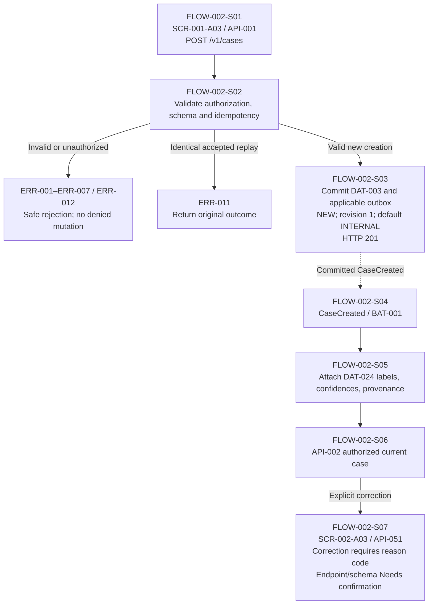
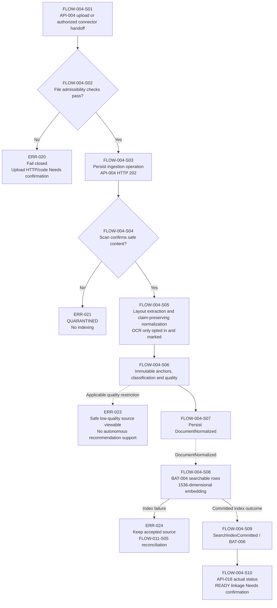
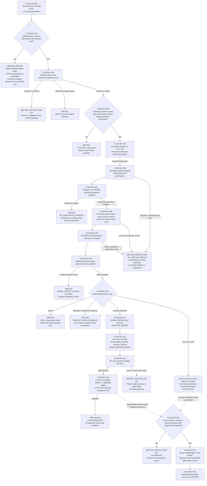
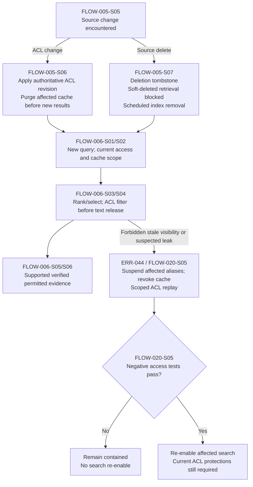
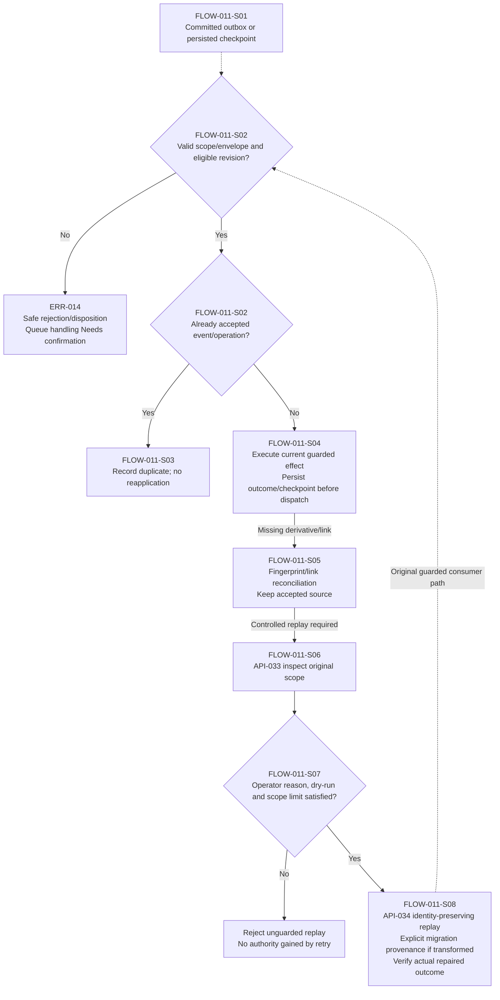
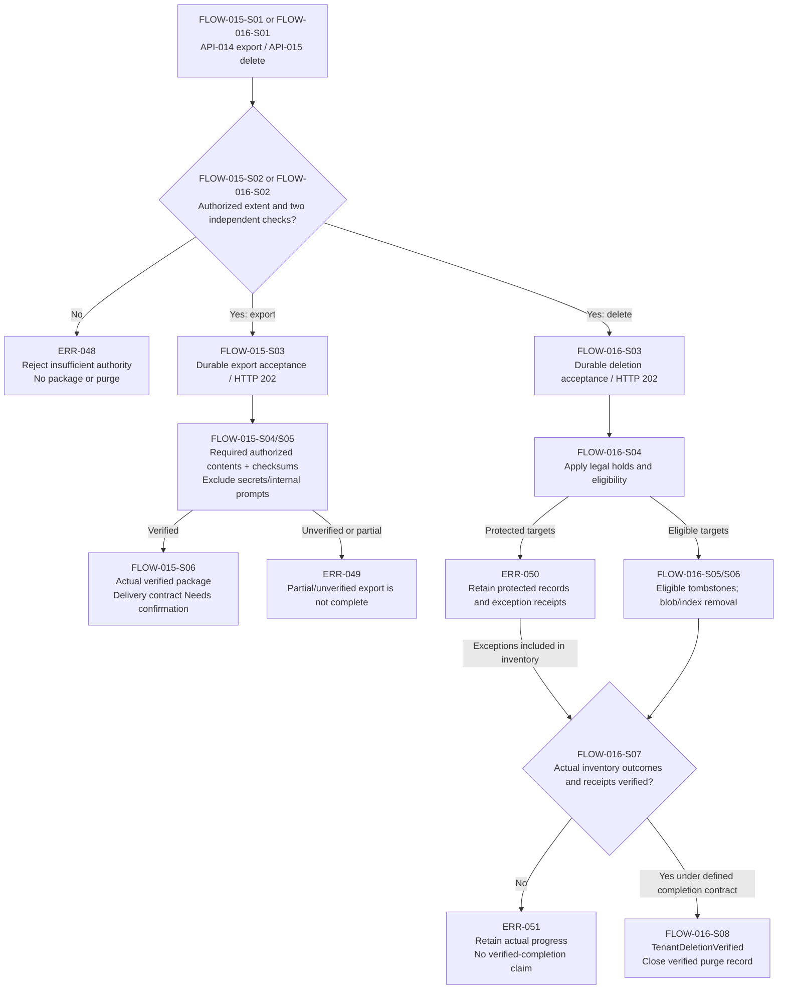
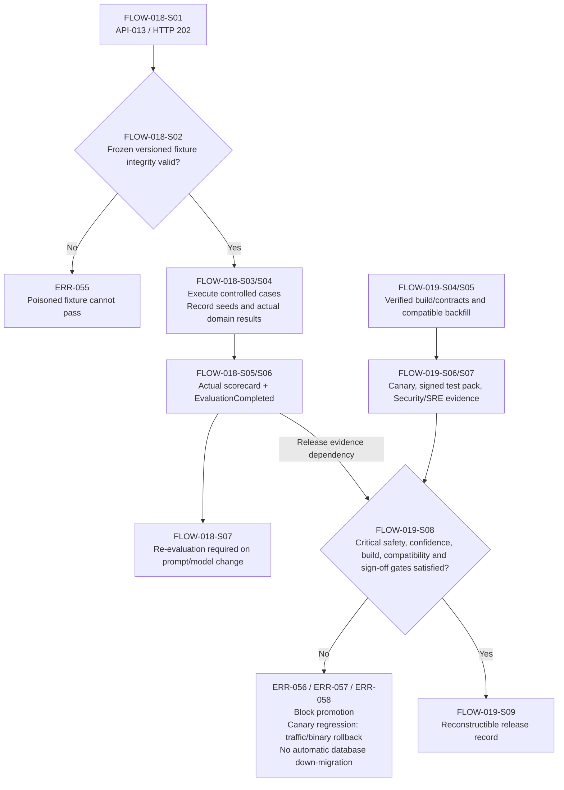

# 7. Processing Flow Specification

## Flow Inventory and Prerequisites

### Specification Basis and Status

| Item | Definition |
|---|---|
| Output file | `07_processing_flows.md` |
| Application | OrionDesk AI |
| Source document | `1794806332-OrionDesk_AI_Detailed_Design_Specification.pdf` |
| Baseline | `OD-AI-DDS-001`; release `R1.0`; design revision `1.3` |
| Source authority | Fictional reference architecture, normative for the sample application. Numeric targets are design assumptions, not measured production results. |
| Citation convention | **S** denotes `1794806332-OrionDesk_AI_Detailed_Design_Specification.pdf`. Citations identify original PDF pages and sections. |
| Completed specifications | [01_screen_functions.md](01_screen_functions.md), [02_api.md](02_api.md), [03_data.md](03_data.md), [04_batch_functions.md](04_batch_functions.md), [05_business_rules.md](05_business_rules.md), and [06_exception_handling.md](06_exception_handling.md) |
| Flow identifiers | `FLOW-001`–`FLOW-022` identify analytical processing flows. `FLOW-xxx-Sxx` identifies a procedure step. These are specification identifiers, not new APIs, events, jobs, screens, or database entities. |
| Confirmed | Explicitly supported by S. A confirmed processing obligation does not establish an unspecified transport, schema, actor mapping, numeric threshold, schedule, or transaction mechanism. |
| Needs confirmation | An unresolved contract or decision. It is not permission for an implementation AI to choose behavior. |
| Proposal | An explicitly suggested design. Earlier screen arrangements, JSON bodies, SSE representations, and reconciliation UX remain Proposals. |
| Remaining stage | `08_architecture_decision.md` is **To be defined in a later stage**. No architecture decision, owner, deadline, or approval is presumed. |

**FLOW-SCP-001 — Confirmed:** Connect business initiation, durable processing, user-visible outcomes, and recovery across the preceding six specifications. Preserve the separation between retrieval, generation, deterministic policy evaluation, and reviewer approval.

**Source:** S, p. 12, §2.2.2; pp. 44–50, Chapters 12–13.

**FLOW-SCP-002 — Confirmed:** The principal end-to-end acceptance journey is:

`create → ingest → retrieve → draft → review → publish`

Rejected-draft rework, poisoned-document quarantine, and cross-tenant search denial are also required acceptance journeys. This sequence does not define an automatic Case-state transition at each stage.

**Source:** S, p. 75, §21.3.1.

**FLOW-SCP-003 — Needs confirmation:** Exact execution contracts remain unresolved wherever the source and earlier specifications omit schemas, state guards, formulas, schedules, concurrency controls, or recovery mechanisms. This specification does not fill those gaps by selecting conventional defaults.

### Flow Inventory

The inventory identifies logical relationships, not independently deployed workflows. A reference to a screen describes the preceding specification’s operation association; it does not approve an unresolved form placement or browser route.

| Flow ID | Purpose | Users and systems | Trigger | Prerequisites | Completion condition | Related specification IDs / source |
|---|---|---|---|---|---|---|
| FLOW-001 | Establish identity and enforce resource authorization | Interactive user, browser, edge gateway, identity provider, domain services | Sign-in or protected request | Approved identity/session contract; verified principal and tenant; applicable resource context | Authorized request may continue, or safe denial terminates it without protected data or denied mutation | SF-PRE-001–003; API-AUTH-001–005; DAT-019–022; BR-001–004; ERR-001–004. S, pp. 18, 21–23 |
| FLOW-002 | Create and classify a case; correct labels | Analyst, Case Service, classifier/Triage Agent | API-001 request; `CaseCreated`; authorized correction | Valid business context, workspace access, idempotency; correction reason code | One created case; classification attached to applicable context; accepted correction retains provenance | SCR-001-A03; SCR-002-A03; API-001/051; DAT-003/024/044; BAT-001; BR-008/010; ERR-010–014. S, pp. 12, 40, 83, 87 |
| FLOW-003 | Read/edit case, execute guarded transitions, close, explicitly reopen | Authorized Analyst/Reviewer; `Owner` mutation scope; Case Service | Case inquiry or explicit mutation | Current authorized case; revision precondition; supported field/edge and applicable evidence/approval guards | Accepted current revision/history, closure snapshot, or explicit new-revision reopening; rejected writes leave state unchanged | SCR-002-A01–04/A07–08/T01–T08; API-002/003/016/017/052; DAT-003/004/025/026; BR-007/011–014; ERR-007/009/010. S, pp. 24–26 |
| FLOW-004 | Safely ingest, normalize, and index attachments | Analyst, Ingestion Service, scanner/parser, Indexer | API-004 upload or authorized connector handoff; `DocumentNormalized` | Admissible file, source context, scoped worker, processing version | Immutable claim-preserving derivatives and actual index outcome; unsafe content quarantined without indexing | SCR-002-A05; API-004/018; DAT-005–007/023/029–031/035; BAT-003/004/006; BR-015–020; ERR-020–025. S, pp. 30–36 |
| FLOW-005 | Incrementally synchronize source changes, ACLs, and deletions | Admin, connector workers, repository provider | API-009; source change encountered during sync | Complete provisioning; scoped connector credentials; capability/trust and quota checks | Durable item outcomes, cursor/high-watermark/error ledger; revoked access effective before next retrieval | SCR-006; API-009/025/054/055; DAT-015/022/027/028/034; BAT-002/006/007; BR-034–036; ERR-017–022/044. S, pp. 27–29 |
| FLOW-006 | Retrieve permitted evidence, inspect exact sources, and rebuild indexes | Authorized Member/Analyst/Reviewer; Retrieval Service; Indexer | API-010/021/022; citation activation; separately authorized rebuild | Current source ACLs, immutable versions/anchors, approved retrieval/index configuration | Verified permitted evidence or `NO_SUPPORTED_EVIDENCE`; source anchor displayed; rebuilt read alias activates only after checks | SCR-003; API-010/021/022/035/046/057; DAT-010/031–035; BAT-005/006; BR-004/017/019/020; ERR-024–027/044. S, pp. 31, 34–36, 52–53, 57 |
| FLOW-007 | Execute bounded draft, required review, and atomic publication | Analyst, Orchestrator, Research/Draft Agents, model gateway, Policy Service, Reviewer | API-005; `AgentPlanApproved`; `ApprovalDecisionRecorded` | Authentication and resource authorization; valid request/idempotency; admission; approved tools/models; evidence and classification controls | Exact supported artifact published after satisfied gate, or actual restricted/failed outcome without publication | SCR-002-A06/A09; SCR-004/005; API-005/008/020/023/024/032/046/047; DAT-008–012/016/017/038–043; BAT-010/011; BR-021–031; ERR-028–043. S, pp. 37–49 |
| FLOW-008 | Expire review, reject/rework, or perform authorized override | Reviewer, review-routing service, authorized elevated actor and secondary reviewer | Configured SLA expiry; rejection; override or rework request | Exact candidate/task/history; applicable actor, state, hash, and routing guards | Expiry/escalation or immutable rejection; rework as new run revision; override only with all prerequisites | SCR-005-A04–06; SCR-002-A10; API-024/053; DAT-011/012/039/043; BAT-012; BR-029/030; ERR-040–042. S, pp. 45–46 |
| FLOW-009 | Read persisted run progress and resume SSE | Authorized Analyst/Reviewer, browser, run inquiry/stream services | API-006/007/019; refresh or reconnect | Current run authorization; valid retained offset when resuming | Persisted stages restored and scoped retained events delivered; read recovery does not replay business mutations | SCR-004-A01–03; DAT-008/009/049; BR-032; ERR-045/046. S, pp. 55, 58, 83 |
| FLOW-010 | Manage versioned settings, membership, and holds | Workspace administrator or other explicitly eligible actor; domain/security services | Supported administrative request | Confirmed per-operation rights and schema; current revision where applicable | Accepted versioned administrative result with durable audit; holds protect lifecycle targets | SCR-007; SF-SCP-008; API-028/029/049/050; DAT-002/020–022/053; BR-002/007/025/038; ERR-002/008/050. S, pp. 21–24, 61–63 |
| FLOW-011 | Dispatch outbox work, reconcile, and perform guarded replay | Producers, consumers, reconciliation worker, authorized operator | Committed outbox event; missing derivative/link; API-034 replay | Valid signed tenant/envelope context; original identity; reason/dry-run/scope for replay | One accepted effect; duplicate recorded; missing effects repaired without source rollback | API-033/034; DAT-014/045–048; BAT-008/009/022; BR-008/009/036/037; ERR-013–016/024/046. S, pp. 17, 48–50, 90 |
| FLOW-012 | Provision and backfill safely | Authorized provisioning/onboarding actor and workers | Provisioning or historic backfill request; initiation contract unresolved | Authorized configuration/source inventory; bounded scope | Required policy/keys/roles/quotas/stubs verified; per-batch receipts and coverage-based readiness | API-056; DAT-001/002/020/027/052/058; BAT-018/019; BR-033; ERR-047. S, p. 78 |
| FLOW-013 | Query immutable audit lineage and archive batches | Auditor, audit-ledger/archive boundary | API-011 inquiry; archive processing trigger unresolved | Tenant/redaction scope; append-only entries; approved chain/archive contract | Authorized immutable log returned; verifiable archive retained independently | SCR-008; DAT-013; BAT-015; BR-043; ERR-052/053. S, pp. 11, 62, 83 |
| FLOW-014 | Record attributed usage and produce daily rollups | Gateway/workers, usage processor, Admin reader | Usage occurrence; daily processing; API-012 | Attributed run/deployment/cost-center usage and approved daily calculation contract | Actual attributed costs/quotas/trends and daily budget/forecast/rejected-request results | SCR-010-A01; DAT-016/054; BAT-016; BR-042; ERR-054. S, pp. 38, 65, 83 |
| FLOW-015 | Produce controlled export | `Admin + approver`; export workflow | API-014 | Authorized extent, two independent checks, idempotency, approved inventory/format | Required package and checksum manifest verified; secrets/internal prompts excluded | SF-SCP-007; DAT-059; BAT-020; BR-039/040; ERR-048/049. S, pp. 78–79, 83, 88 |
| FLOW-016 | Delete eligible inventory and verify receipts | `Admin + approver`; deletion workflow; Retention Worker | API-015 | Authorized extent, independent checks, holds/retention inventory, idempotency | Actual removals and retained exceptions verified; `TenantDeletionVerified` closes purge record | DAT-018/035/053/059; BAT-021; BR-039/041; ERR-048/050/051. S, pp. 78–80, 87 |
| FLOW-017 | Apply retention and scoped key/secret rotation | Retention/storage services; vault/rotation boundary | Eligibility/policy trigger; API-036; exact schedules unresolved | Category/class policy; holds; eligible tombstones or closed cases; scoped key authority | Eligible purge receipts and hold exceptions; rotation under defined policy without request-path bulk re-encryption | DAT-018/052/053; BAT-013/014; rotation capability; BR-038/043; ERR-050–053. S, pp. 21, 26, 51–53, 63, 66 |
| FLOW-018 | Evaluate frozen corpus and produce actual release evidence | Admin, evaluation harness, independent fixture/security review | API-013; required prompt/model re-evaluation | Frozen versioned synthetic fixtures, expected outcomes, integrity and evaluated-version context | Actual scorecard/confidence/shift and `EvaluationCompleted`; execution success distinct from gate pass | SCR-010-A02–04; API-013/045; DAT-057; BAT-017; BR-045; ERR-055/056. S, pp. 74–76, 88–89 |
| FLOW-019 | Govern changes, migrate compatibly, build/canary/promote releases | Authorized governance/release actors; CI; Security/SRE | API-030/043; approved change/deployment pipeline | Negative-test links, compatible IDL/data rollout, verified build/configuration, tests/sign-off | Reconstructible accepted baseline/release; failed gate blocks promotion; regression rolls traffic back | API-030/031/037/043/044; DAT-056/060/061; BAT-023/026; BR-046; ERR-057/058. S, pp. 8–10, 20, 52, 55, 71–73 |
| FLOW-020 | Contain outages/security incidents and restore safely | Operators, incident command, recovery platform, affected services | Provider outage, indexing backlog, ACL leak, primary-region failure | Authorized incident scope and source-supported containment/recovery checks | Supported degraded work remains safe; scoped repair verified; regional recovery meets reference targets | API-038–042; DAT-055/058/063; BAT-025; BR-044; ERR-024/036/044/059; ERR-OPS-002–005. S, pp. 19, 69–70, 79, 90 |
| FLOW-021 | Deliver optional signed webhooks; retain notification gaps | Outbound delivery service and configured recipient | Optional subscribed committed change | Authorized subscription/payload/signature/age contract | Actual delivery outcome; internal transition remains committed if delivery fails | API-048/059; DAT-050/062; BAT-024; BR-032/043; ERR-OQ-025. S, pp. 55, 58–59 |
| FLOW-022 | Present illustrated Overview and summary information | Authorized browser user; aggregate service not defined | Illustrated navigation or refresh | Backing APIs, formulas, scopes, and routes Needs confirmation | Completion contract Needs confirmation; fixtures cannot become fallback values | SCR-009; SF-SHELL-F03–07; API-058; DAT-062; BR-OQ-024. S, p. 7, Reference UI A; p. 14, Figure 2.2 |

### Shared Prerequisites and Control Obligations

| Requirement ID | Status | Obligation | Source and preceding mappings |
|---|---|---|---|
| FLOW-CTL-001 | Confirmed | Authenticate every protected request and independently authorize internal services. Interactive authentication uses authorization-code flow with PKCE. Required token concepts are issuer, audience, expiry, subject, and tenant. | S, pp. 18, 21–22; BR-001; ERR-001 |
| FLOW-CTL-002 | Confirmed | Authorization combines role, tenant, workspace membership, sensitivity, source ACL, action, and separation of duties. Edge checks and domain resource checks are cumulative. | S, p. 22, §§5.2.1–5.2.2; API-AUTH-001; BR-002 |
| FLOW-CTL-003 | Confirmed | Authentication/resource denial is not admission throttling. Handle applicable ERR-001–ERR-004 without inventing an HTTP mapping. Permission failures are permanent and not automatically retried. Use ERR-035 and `429` plus `Retry-After` for failed new-run token, queue-age, or provider-capacity admission checks. | S, p. 22, §5.2.2; p. 49, §13.3.1; p. 54, §15.1.1; p. 69, §19.2.1 |
| FLOW-CTL-004 | Confirmed | Validate before transaction entry/work allocation, again at domain invariants, and before tool dispatch. Client validation is convenience only. | S, p. 56, §15.3.2; API-VAL-001; BR-006 |
| FLOW-CTL-005 | Confirmed | Tenant-owned rows and storage predicates carry tenancy; jobs carry immutable tenant identity in signed envelopes. Enforce case-workspace tenancy and reset pooled database scope after every transaction. | S, pp. 22, 51, 86; DAT-RI-001–003 |
| FLOW-CTL-006 | Confirmed | Durable changes retain tenant, revision, actor, occurrence time, and correlation. Requests carry `trace_id` and `correlation_id`, independent of provider trace IDs. Events contain the nine fields in API-EVT-001. | S, pp. 16, 48, 64; DAT-COM-F02–06 |
| FLOW-CTL-007 | Confirmed | Cross-service writes are idempotent. Job-creating POSTs require `Idempotency-Key`; case creation also uses it. Identical replay returns original outcome; changed fingerprint produces `IDEMPOTENCY_CONFLICT`. | S, pp. 15, 25, 54, 83, 89; BR-008 |
| FLOW-CTL-008 | Confirmed | Case changes use `If-Match`. Stale case changes return `409`, `CASE_VERSION_CONFLICT`, and current revision; rejected writes leave business state unchanged. Settings have separate revision protection. | S, pp. 24–25, 83–84; BR-007; ERR-007/008 |
| FLOW-CTL-009 | Confirmed | Retrieval, generation, policy, and approval remain separate records. Model/evidence content cannot authorize tools, alter tenancy, change approval, or override policy. | S, pp. 7, 12, 37–45; BR-005/009/025 |
| FLOW-CTL-010 | Confirmed | Maximum included-material class determines model routing, log redaction, retention, and approval policy. Preserve API-CLS-001, DAT-CLS-001, BAT-CLS-001, and BR-026. | S, p. 62, §17.2.1; p. 90 |
| FLOW-CTL-011 | Confirmed | Commit accepted work before dependent side effects. Respect case/approval/outbox ACID boundaries and atomic publication gate/final pointer. Indexing and webhooks remain asynchronous with reconciliation. | S, pp. 45, 49, 52; API-TXN-001–003 |
| FLOW-CTL-012 | Confirmed | `202` is durable acceptance, not completion. Dependency failure yields a documented retryable error or real persisted asynchronous identity, never ambiguous success. | S, pp. 12–13, 83; API-ASYNC-001–003 |
| FLOW-CTL-013 | Confirmed | Diagnostic traces exclude user documents and API secrets; errors exclude credentials, full prompts, retrieved documents, and private existence. Required audit evidence is independent of diagnostic sampling. | S, pp. 54, 62–66, 84; ERR-RES-001/002; ERR-LOG-001–005 |
| FLOW-CTL-014 | Confirmed | Preserve accessible textual artifact labels, keyboard/focus behavior, meaningful live transitions, UTC/RFC 3339 durable time, and workspace-local timezone-labelled presentation. | S, pp. 54, 57–59; BR-012/032 |
| FLOW-CTL-015 | Needs confirmation | Approved transport schemas, actor mappings, lock/isolation/fencing, event canonical bytes/signatures, retention boundaries, and schedules. No implicit default completes these contracts. | FLOW-OQ-001–024; preceding open-decision registers |

### Explicit Scope Boundaries

| Category | Status and reason | Source |
|---|---|---|
| Physical automation, irreversible financial transactions, foundation-model fine-tuning, unrestricted browsing, agent administrative cloud permissions | Out of scope: explicitly excluded. Financial-impact category remains a policy input. | S, p. 9, §1.2.1; p. 44, §12.1.1 |
| Application-hosted GPU inference | Out of scope: inference providers are external dependencies. | S, p. 19, §4.2.1 |
| Cross-region active/active mutation, OCR beyond English, customer-managed model weights | Deferred from this baseline; do not introduce enabled alternatives. | S, p. 10, §1.3.2 |
| Secrets and internal model prompts in export | Out of scope for package contents; exclusion is mandatory. | S, p. 79, §22.3.1 |
| Unspecified screens, endpoints, schedules, financial close, end-user cancellation, or automatic reauthorization | Needs confirmation, not Out of scope. | Relevant preceding open questions; S does not provide complete contracts |

## Normal Processing

### Procedure Interpretation

Numbered procedures specify source-supported ordering and dependencies. They are not a selected implementation of locking, cross-store transactions, or workflow scheduling.

- Each protected operation inherits FLOW-CTL-001–015.
- Read/write descriptions use the existing DAT identifiers; they do not create physical columns or public JSON properties.
- A procedure containing separate entry paths does not require all paths to execute serially.
- Branch and resumption behavior is defined under **Branches, Failures, and Recovery**.
- A **Needs confirmation** step or transition cannot be made executable through assumption.

### FLOW-001 — Authentication and Resource Authorization

1. **FLOW-001-S01 — Initiate supported authentication.** The browser uses OIDC authorization-code flow with PKCE. Identity-provider URLs, callback transport, token algorithms, session lifetimes, and permitted return URLs remain unresolved.
2. **FLOW-001-S02 — Verify identity.** The edge verifies issuer, audience, expiry, subject, tenant, and algorithm acceptance. Invalid identity terminates the protected request under ERR-001.
3. **FLOW-001-S03 — Resolve authorized context.** Read Principal/membership context, including through API-027 `GET /v1/me` where used. The source does not require this inquiry on every request or supply its full response schema.
4. **FLOW-001-S04 — Evaluate resource/action authorization.** Apply broad edge policy; within the domain transaction or resource boundary, re-evaluate current role, tenant, workspace, sensitivity, source ACL, action, and separation of duties. Retrieval filters ACLs before returning chunks to the model.
5. **FLOW-001-S05 — Continue or reject.** Continue only when applicable guards pass. Foreign-tenant substitution uses the absent-ID-equivalent not-found class. Denial retains safe principal/resource-class evidence; `AccessDenied` supports alert enrichment.
6. **FLOW-001-S06 — Protect session and service boundaries.** Browser local storage contains no long-lived refresh token. BFF secure, HttpOnly, SameSite cookies remain an optional source-supported arrangement. Internal calls use scoped identity, TLS, audience checks, and mTLS-authenticated HTTP/gRPC contracts where applicable.

**Reads/evidence:** DAT-019–022; tenant/resource attributes; DAT-013 denial evidence.  
**Rules/exceptions:** BR-001–004; ERR-001–004.  
**Source:** S, pp. 18, 21–23, §§4.1.2, 5.1–5.3; p. 87, C.1.  
**Needs confirmation — FLOW-OQ-001:** Identity/session architecture, role/scope mapping, exact denial representation, and administrative rights. Permission denial must not enter a quota retry path.

### FLOW-002 — Case Creation, Classification, and Correction

1. **FLOW-002-S01 — Submit creation intent.** Analyst invokes SCR-001-A03/API-001 `POST /v1/cases` with validated business context and `Idempotency-Key`. Form placement and complete input schema remain unresolved.
2. **FLOW-002-S02 — Validate and resolve one outcome.** Authenticate, authorize workspace/case creation, validate approved input, and resolve actor/fingerprint binding. An identical repeated request returns its original outcome; a changed fingerprint is ERR-012.
3. **FLOW-002-S03 — Commit the case.** Case Service creates DAT-003 with initial `NEW`; reference revision is `1`, sensitivity default is `INTERNAL`. Preserve all supported title, description, priority, sensitivity, owner, status, approved-result, and revision concepts rather than only abbreviated DDL fields. Commit applicable creation/outbox evidence and return HTTP `201` with the new identifier.
4. **FLOW-002-S04 — Dispatch classification.** `CaseCreated`, produced by Case Service with Case ID/revision concepts, reaches BAT-001 through FLOW-011.
5. **FLOW-002-S05 — Attach classification.** The classifier/Triage Agent reads authorized case context and attaches DAT-024 labels, confidences, and provenance through a revision-safe operation. Snapshot and update transport are unresolved.
6. **FLOW-002-S06 — Display current authorized data.** API-002 `GET /v1/cases/{caseId}` returns HTTP `200` for authorized current revision. It may supply the approved case/classification projection once defined.
7. **FLOW-002-S07 — Correct labels on explicit user action.** SCR-002-A03/API-051 captures a supported label correction with a reason code and retains provenance. API-051 method/path, catalogs, and revision contract remain Needs confirmation.

**Completion:** One created case and applicable classification/correction outcome. Classification completion does not automatically execute `SCR-002-T01`.  
**Data:** DAT-003/024/044; DAT-014/045 for event handling.  
**Rules/exceptions:** BR-007–010; ERR-005–007/010–014.  
**Source:** S, p. 12, §2.2.1; pp. 25, 40, 83, 86–87.  
**Needs confirmation — FLOW-OQ-002:** Required fields, owner/defaults, confidence/label/reason catalogs, classifier snapshot, correction precedence, and initial revision-history insertion.

### FLOW-003 — Case Inquiry, Mutation, State, Closure, and Reopening

1. **FLOW-003-S01 — Read authorized case context.** Use API-016 `GET /v1/cases?cursor=...` for listing and API-002 `GET /v1/cases/{caseId}` for current detail. Listing scope, filters, sorting, cursor lifetime, and success schema remain unresolved.
2. **FLOW-003-S02 — Submit explicit supported mutation.** SCR-002-A02/A04 invokes API-003 `PATCH /v1/cases/{caseId}` with `Owner` scope and `If-Match`. Patch representation and field editability are not inferred.
3. **FLOW-003-S03 — Evaluate current invariants.** Within tenant-scoped transactional context, re-evaluate access, revision, supported metadata changes, and requested state edge. Priority derives from explicit impact and urgency; contractual deadlines use business calendars/workspace timezone; prediction is advisory.
4. **FLOW-003-S04 — Commit accepted revision.** Write DAT-003 current state, append DAT-004 accepted history, and insert applicable outbox evidence in the domain ACID boundary. Accepted state change produces correlated `CaseStateChanged`; API-003 returns HTTP `200`.
5. **FLOW-003-S05 — Close only through its confirmed-to-be-completed contract.** SCR-002-A07/API-017 `POST /v1/cases/{caseId}/close` validates current revision, actor, originating state, and applicable approval guards. The originating edge and result contract are Needs confirmation.
6. **FLOW-003-S06 — Preserve closure lineage.** On valid closure, snapshot approved answer, cited immutable document versions, and reviewer decisions in DAT-026. Preserve immutable approved-output lineage.
7. **FLOW-003-S07 — Explicitly reopen as a new revision.** SCR-002-A08/API-052 preserves prior closure lineage and creates a new revision. Target state, endpoint, actor, and approval contract are Needs confirmation; ordinary in-place exit from `CLOSED` is not allowed.

#### Confirmed Case Edges Used at FLOW-003-S03

| Existing transition ID | From | To | Required conditions |
|---|---|---|---|
| SCR-002-T01 | `NEW` | `TRIAGED` | Current revision and authorized actor/action; detailed triage trigger unresolved |
| SCR-002-T02 | `TRIAGED` | `IN_PROGRESS` | Current revision and authorized actor/action |
| SCR-002-T03 | `IN_PROGRESS` | `PENDING_APPROVAL` | Current revision, authorization, applicable policy/evidence/task conditions |
| SCR-002-T04 | `IN_PROGRESS` | `RESOLVED` | Current revision, authorization, required evidence and satisfied approval policy |
| SCR-002-T05 | `PENDING_APPROVAL` | `RESOLVED` | Current revision, authorization, exact-hash approvals and separation of duties |
| SCR-002-T06 | `PENDING_APPROVAL` | `IN_PROGRESS` | Current revision and authorized rework guard; not automatically every Reject decision |
| SCR-002-T07 | Origin Needs confirmation | `CLOSED` | Valid closure contract and immutable snapshot |
| SCR-002-T08 | `CLOSED` | Target Needs confirmation | Explicit new-revision reopening only |

**Rules/exceptions:** BR-007/011–014/031; ERR-007/009/010/016.  
**Source:** S, pp. 24–26, §§6.1–6.3; pp. 44–46; pp. 82–86.  
**Needs confirmation — FLOW-OQ-003:** Edge-specific actors/triggers, closing origin/reopening target, approval-to-case linkage, priority/deadline formulas, `If-Match` encoding, BIGINT transport, and update-time behavior.

### FLOW-004 — Attachment Ingestion, Normalization, and Indexing

1. **FLOW-004-S01 — Submit allowed source.** SCR-002-A05/API-004 `POST /v1/cases/{caseId}/attachments` accepts an authorized Analyst file request with job idempotency, or ingestion receives an authorized connector handoff.
2. **FLOW-004-S02 — Validate before work allocation.** Require PDF, DOCX, HTML, or UTF-8 text; MIME signature and extension must agree. Apply configurable `25 MB` per-file cap and decompression-bomb safety threshold. Exact byte conversion, MIME/subtype lists, filenames, file counts, and threshold remain unresolved.
3. **FLOW-004-S03 — Accept durable ingestion.** Persist applicable source/version/attachment/processing context and return cataloged HTTP `202` for API-004. This is not `READY` or searchable completion.
4. **FLOW-004-S04 — Scan before parsing.** BAT-003 scans content. Disable macros and do not fetch embedded remote references. Unsafe content enters `QUARANTINED` and never enters the search index.
5. **FLOW-004-S05 — Extract and normalize safe content.** Parse PDF pages into blocks with page index/bounding boxes; preserve table rows/columns, headings, and reading order. OCR fallback is opt-in and provenance-marked. Strip transport artifacts without rewriting claims.
6. **FLOW-004-S06 — Persist immutable provenance and quality.** Content fingerprint plus pipeline version determines immutable derivative identity; changed pipelines may run side by side. Every chunk retains source URI, file hash, page number, and optional `bbox`. Record empty-page ratio, unknown-character ratio, table-loss indicators, language confidence, and likely-personal-data tags. Safe low-quality documents remain viewable but cannot support autonomous recommendations.
7. **FLOW-004-S07 — Publish normalization outcome.** Persist actual immutable derivatives and dispatch `DocumentNormalized` with Version ID/source-hash concepts through FLOW-011.
8. **FLOW-004-S08 — Build searchable derivative.** BAT-004 writes tenant/workspace/document-version/chunk/language/classification, a `1536`-dimensional embedding, and normalized keyword text using versioned index aliases.
9. **FLOW-004-S09 — Commit index outcome and invalidate cache.** Indexer produces `SearchIndexCommitted` with index-generation/document-revision concepts. BAT-006 invalidates affected query cache. Index failure retains accepted source metadata and enters reconciliation.
10. **FLOW-004-S10 — Expose actual status.** API-018 `GET /v1/documents/{documentId}/status` supplies current authorized processing information. Do not infer its refresh schedule or a complete state-transition matrix.

**Confirmed Document vocabulary:** `ACCEPTED`, `SCANNING`, `EXTRACTING`, `INDEXING`, `READY`, `QUARANTINED`. Scan/parsing/index dependencies above do not finalize every state edge or readiness rule.

**Data:** DAT-005–007/023/029–031/035.  
**Rules/exceptions:** BR-015–020/043; ERR-020–025/053.  
**Source:** S, pp. 30–36, §§8.1–9.1; p. 49, §13.2.2; p. 62, §17.2.2; pp. 82–83, 87–90.  
**Needs confirmation — FLOW-OQ-004:** Upload transport, safety/quality thresholds, normalization identity/hash, parser limits, nonpaginated anchors, status transitions, cross-store crash recovery, and readiness.

### FLOW-005 — Connector Sync, Source ACL Change, and Deletion

1. **FLOW-005-S01 — Initiate authorized sync.** SCR-006-A02/API-009 `POST /v1/connectors/{connectorId}/sync` validates `Admin`, connector/workspace scope, idempotency, complete provisioning, and quotas. Accepted work returns HTTP `202` and correlated `ConnectorSyncStarted`.
2. **FLOW-005-S02 — Resolve credentials and durable progress.** Read workspace-scoped vault reference and DAT-015/DAT-028 provider cursor, high-watermark, error ledger, and retry state. Revoked queued credentials fail with `CONNECTOR_REAUTH_REQUIRED`.
3. **FLOW-005-S03 — Evaluate advertised capability/trust.** Respect list, fetch, delta cursor, ACL, and delete support. Unsupported capability gives lower-trust mode and an explicit visible warning. Detailed restrictions by missing capability remain unresolved.
4. **FLOW-005-S04 — Obtain incremental items.** Connector workers preserve stable source identity, permissions, and change history. Honor provider `Retry-After`, exponential backoff/jitter, workspace quota, and fair scheduling.
5. **FLOW-005-S05 — Process item according to source change.** New/changed files enter FLOW-004. Malformed sources use bounded parsing retries and quarantine exceptions. Source ACL changes and deletions use S06/S07 instead of ordinary content replacement.
6. **FLOW-005-S06 — Apply current ACL change.** Update authoritative access context and purge affected retrieval cache before serving new results. The next query must not contain revoked evidence, even if derivative delivery is delayed.
7. **FLOW-005-S07 — Apply source deletion.** Create durable tombstone, prevent retrieval of soft-deleted entities, and schedule affected index removal through BAT-007. Final blob purge is a separate retention/lifecycle operation.
8. **FLOW-005-S08 — Advance only over durable predecessors.** Persist each item’s actual outcome, including quarantine exceptions. Cursor advances only after all preceding items have durable ingestion outcomes; retain high-watermark/error ledger.
9. **FLOW-005-S09 — Read health outcomes.** SCR-006-A01/API-025 `GET /v1/connectors/{connectorId}/runs` exposes authorized safe run outcomes, warnings, and remediation information.

**Completion:** Durable sync outcome does not establish indexed coverage or search readiness.  
**Data:** DAT-005/015/022/027/028/031/034.  
**Rules/exceptions:** BR-004/033–036; ERR-017–022/035/044/047.  
**Source:** S, pp. 27–29, §§7.1–7.3; pp. 51, 53, 78.  
**Needs confirmation — FLOW-OQ-005:** Provider/permission selection, cursor order and durable-outcome stage, mixed/empty batch status, trust restrictions, concurrent sync, reauthorization, removal schedule, and invalidation barrier.

### FLOW-006 — Retrieval, Citation Inspection, and Index Rebuild

#### Query and Source-Inspection Entry

1. **FLOW-006-S01 — Submit permitted evidence inquiry.** Use API-010 `POST /v1/search` under `Member` scope, API-022 `GET /v1/cases/{caseId}/evidence`, or separately authorized API-046 tool retrieval. Their request schemas are distinct.
2. **FLOW-006-S02 — Establish current access and cache context.** Read current source permissions and index generation; use cache keys containing tenant, user-scope digest, source ACL revision, query hash, and index generation. Never treat ACL digest or cached scope as a substitute for current access.
3. **FLOW-006-S03 — Form hybrid candidates.** Form lexical and normalized vector query, obtain bounded candidates, merge by reciprocal rank fusion, and deterministically re-rank.
4. **FLOW-006-S04 — Select diverse bounded evidence.** Limit redundant document hits, reserve relevant-source coverage, and enforce model-context token budget. Filter originating ACLs before any text reaches generation or an authorized user response.
5. **FLOW-006-S05 — Validate support and anchors.** Insufficient confidence/quality/support yields `NO_SUPPORTED_EVIDENCE`. Generated citations require resolvable stored anchors and current source access.
6. **FLOW-006-S06 — Return verified evidence.** API-010 returns HTTP `200` for permitted lexical/semantic evidence. Each evidence item carries chunk ID, source title, immutable document revision, page anchor, and ACL digest. Citation identifiers remain opaque and are verified before display.
7. **FLOW-006-S07 — Inspect exact source.** SCR-003-A03 resolves authorized evidence through API-021 `GET /v1/evidence/{evidenceId}` where applicable and the to-be-confirmed public delivery contract API-057. Open the cited immutable source and highlight anchored page range. API-035 is an internal storage inquiry, not an assumed browser binary route.

#### Separate Rebuild Entry

8. **FLOW-006-S08 — Begin authorized parallel rebuild.** BAT-005 reads authoritative source/version/chunk inventory and creates a parallel index generation. Rebuild launch API/actor/schedule remain unresolved.
9. **FLOW-006-S09 — Validate generation.** Check completeness and recall while maintaining current deletion/ACL protections. Failed checks do not activate the generation.
10. **FLOW-006-S10 — Switch validated read alias atomically.** Only after required checks pass, switch active read alias and apply index-generation/cache effects. Source database remains authoritative.

**Reference backend settings:** candidates `80`, selected chunks `10`, embedding dimension `1536`, RRF `60`. These are not public pagination defaults. MCP input is `{query: string, case_id: uuid, max_items: int<=10}`; output is `{evidence_set_id: uuid, citations: Citation[]}`; effect is read-only with `read:permitted_documents`, no arbitrary URLs/filesystem access.

**Rules/exceptions:** BR-004/005/017–020; ERR-024–027/029/044.  
**Source:** S, pp. 31, 34–36, 52–53, 57, 87, 90.  
**Needs confirmation — FLOW-OQ-006:** Ranking/ties/diversity/token formulas, public schemas, evidence IDs, anchor conventions, signed-URL lifetime/recovery, cache TTL/barrier, rebuild delta capture and validation thresholds.

### FLOW-007 — Bounded Draft, Review, and Atomic Publication

1. **FLOW-007-S01 — Request grounded work.** Analyst uses SCR-002-A06/API-005 `POST /v1/cases/{caseId}/runs` with saved case context, approved user-request schema, and `Idempotency-Key`. API-032 `POST /v1/runs` also occurs in the source; its relationship is unresolved.
2. **FLOW-007-S02 — Authenticate and authorize separately from admission.** Apply FLOW-001 and cumulative resource guards. Verify principal/tenant, case/workspace, action, and applicable scope. Authentication, permission, foreign-resource, or tenancy failure goes to applicable ERR-001–ERR-004 handling. Do not classify these failures as quota or automatically retry unchanged permission failures.
3. **FLOW-007-S03 — Validate request and resolve idempotency.** Validate schema, trusted context, and key. An identical accepted repetition returns original operation without allocating another run. Changed fingerprint is `IDEMPOTENCY_CONFLICT`; missing/malformed safeguards use unresolved ERR-006 mapping.
4. **FLOW-007-S04 — Evaluate new-work admission.** For genuinely new work, require workspace tokens, queue age, and provider capacity to satisfy configured thresholds. Failed admission is ERR-035: return HTTP `429` with `Retry-After`; saved cases remain available.
5. **FLOW-007-S05 — Accept durable bounded run.** Create DAT-008 immediately and return HTTP `202`. Persist plan revision before side effects. Validate acyclic plan with explicit dependencies, maximum depth `8`, maximum tool invocations `16`, and reference runtime `180` seconds. `AgentPlanApproved` dispatches plan steps through FLOW-011.
6. **FLOW-007-S06 — Checkpoint and authorize dispatch.** Persist each stage checkpoint before downstream dispatch. Pinned tool schemas, arguments, invoking principal, workspace policy, tool scope, and classification receive separate authorization. All external writes require capability authorization; consequential mutations require idempotency and human authorization. Discovery never grants action permission.
7. **FLOW-007-S07 — Retrieve supported evidence.** Research Agent uses FLOW-006 and applicable API-046. Persist DAT-010 evidence separately from later generation/policy/review. Insufficient support branches to ERR-027 without fabricated context.
8. **FLOW-007-S08 — Select maximum-class controls and model.** Determine highest class of all included material: `PUBLIC`, `INTERNAL`, `CONFIDENTIAL`, `RESTRICTED`. Apply it to routing, log redaction, retention, and approval. Select a specific workspace-approved deployment by capability, region, handling class, context length, cost, and evaluation approval. Fallback is only approved equal-or-stronger handling in approved region/deployment.
9. **FLOW-007-S09 — Invoke scoped generation.** Gateway API-008 `POST /internal/model/generate` reserves input/output token budget, assembles fixed system rules, signed workflow instruction, validated user input, and separately delimited untrusted passages. Strip evidence tool-call directives, retain safe injection indicators, and redact nonessential personal data where policy permits. Providers receive no connector tokens or unrestricted database access.
10. **FLOW-007-S10 — Validate and assemble exact candidate.** Parse versioned JSON output with bounded retries. Unknown fields, invalid citations, and control-character injection cause `MODEL_OUTPUT_INVALID`. Record actual usage/deployment/prompt lineage and `ModelInvocationCompleted`. Draft Agent assembles DAT-039 candidate; valid model output is not tool or publication authority.
11. **FLOW-007-S11 — Evaluate deterministic policy.** Store all normalized concepts with rule-set version: case sensitivity, requested action, evidence quality, model class, financial-impact category, confidence bands. Policy returns `AUTO_ALLOW`, `HUMAN_REVIEW`, `REQUEST_MORE_EVIDENCE`, or `DENY`; LLM risk tags cannot override it.
12. **FLOW-007-S12 — Establish required human review.** Where policy requires review, create/routе exact-hash DAT-011 task to policy-defined pool/minimum role with separation of duties and configured SLA. Preserve `AWAITING_REVIEW`; reconcile its timing with the source missing-approval stop condition through FLOW-OQ-009. The exact no-human-review invocation path remains unresolved.
13. **FLOW-007-S13 — Open exact review evidence.** SCR-005-A01/A02 uses API-023 `GET /v1/review-queue` and the unresolved task-detail delivery contract. Show exact candidate, citations, model/prompt version, policy reasons; permit FLOW-006-S07 source inspection. Correlate `UserReviewOpened`. Approve and Reject remain disabled until required fields are complete.
14. **FLOW-007-S14 — Submit guarded decision.** SCR-005-A03/A04/API-024 `POST /v1/approvals/{approvalId}/decision` carries approved decision/hash/rationale schema and optional annotations. Recheck actor, task, state/expiry, exact hash, and separation of duties. High-risk self-approval is prohibited; `approval_tasks` additionally has `no self approval`.
15. **FLOW-007-S15 — Commit immutable decision.** Append DAT-012 decision, authenticated actor, timestamp, evaluated hash, rationale, and optional annotations with applicable outbox in ACID boundary. Cataloged accepted decision returns HTTP `200`; `ApprovalDecisionRecorded` causes publication validation, not unconditional publication.
16. **FLOW-007-S16 — Revalidate the full publication gate.** BAT-011/API-020 resolves exact candidate/hash, recomputes current tenant/workspace/source authorization, verifies required evidence/immutable versions/resolvable anchors, applicable policy including maximum class, and exact-hash eligible approvals. Rejection, changed hash, revoked source access, unsupported evidence, or old-approval replay cannot publish.
17. **FLOW-007-S17 — Commit publication atomically.** Record satisfied DAT-043 gate and update DAT-003-F15 final response pointer in the same transaction. Expose the exact artifact as `PUBLISHED` only after commit.
18. **FLOW-007-S18 — Read truthful outcome.** Case/run inquiries and FLOW-009 reconstruct actual persisted status. Publication does not automatically execute a Case-resolution edge unless the to-be-confirmed linkage permits it.

**Confirmed Run vocabulary:** `REQUESTED`, `RETRIEVING`, `GENERATING`, `POLICY_CHECK`, `AWAITING_REVIEW`, `PUBLISHED`, `FAILED`.

**Source progression:** `REQUESTED → RETRIEVING → GENERATING → POLICY_CHECK → AWAITING_REVIEW → PUBLISHED`, or terminal failure. Failure edges, the non-review path, and timeout/review-wait semantics are not completed by this sequence.

**Rules:** BR-001–009/019/021–032/043.  
**Data/jobs:** DAT-008–012/016/017/036–043/046/051; BAT-010/011; FLOW-011 for dispatch.  
**Source:** S, pp. 11–13, 22, 34–49, 52, 57–58, 62, 69, 82–90.  
**Needs confirmation — FLOW-OQ-007–012:** Route/schema, admission thresholds, budget counting/runtime, tools/A2A, class/control provenance, policy tables/version activation, review required fields/hash/task guards, and non-review publication invocation.

### FLOW-008 — Review Expiry, Rejection, Rework, and Override

These are alternative entry paths from FLOW-007, not an autonomous approval sequence.

1. **FLOW-008-S01 — Resolve current exact task/candidate/history.** Read DAT-011/012/039 and policy routing; authenticate eligible actor or scoped routing service.
2. **FLOW-008-S02 — Handle configured expiry.** BAT-012 applies the configured SLA to the applicable task state. Record expiry and policy-selected reassignment/escalation; preserve candidate/hash/history. Expiry never creates approval.
3. **FLOW-008-S03 — Record valid rejection.** A guarded rejection uses FLOW-007-S14/S15 and immutable decision recording. Publication remains blocked. No automatic `PENDING_APPROVAL → IN_PROGRESS` is established.
4. **FLOW-008-S04 — Rework explicitly.** Denied content may be reworked as a new run revision, entering FLOW-007 with current guards and new candidate lineage. Preserve prior denial; do not retroactively mark historical content approved.
5. **FLOW-008-S05 — Validate override prerequisites.** API-053 capability requires elevated role, secondary reviewer, and audited reason. Missing prerequisite rejects the override.
6. **FLOW-008-S06 — Apply only approved override contract.** Preserve audit/exact-artifact lineage and still apply applicable publication checks. Endpoint, scope, eligible roles, reason constraints, and effect on policy are Needs confirmation.

**Source:** S, pp. 45–46, §§12.2–12.3; pp. 82, 85, 89–90.  
**Rules/exceptions:** BR-027–031; ERR-002/040–043.  
**Needs confirmation — FLOW-OQ-012:** Task state/expiry race, quorum, reassignment, override extent, rework linkage, and originator/self definition.

### FLOW-009 — Run Inquiry, SSE, Refresh, and Reconnect

1. **FLOW-009-S01 — Load authorized persisted run.** SCR-004-A01/API-006 `GET /v1/runs/{runId}` returns cataloged HTTP `200` stages/evidence metadata. API-019 `GET /v1/runs/{runId}/steps` reads persisted steps; its complete scope/schema is unresolved.
2. **FLOW-009-S02 — Subscribe to updates.** SCR-004-A02/API-007 `GET /v1/streams/runs/{runId}` returns cataloged HTTP `200` SSE. UI displays retrieval, generation, and policy progress.
3. **FLOW-009-S03 — Apply meaningful persisted updates.** Preserve monotonic offsets and actual stage/checkpoint status; announce meaningful state changes only. Connection loss is not completion.
4. **FLOW-009-S04 — Refresh from server state.** Reload authorized persisted run/steps rather than relying on ephemeral browser memory.
5. **FLOW-009-S05 — Resume retained stream.** Reconnect with `Last-Event-ID`; backfill retained events within current caller scope. This is read resumption, not replay of business effects.
6. **FLOW-009-S06 — Handle unavailable/expired offsets truthfully.** Apply ERR-045 once its response/recovery contract is confirmed. Do not invent reset cursor, retention period, heartbeat, or user cancellation.

**Data/rules:** DAT-008/009/049/062; BR-032; ERR-045/046.  
**Source:** S, pp. 55, 58–59, 83.  
**Needs confirmation — FLOW-OQ-013:** Event payloads/offset type/retention, invalid-cursor behavior, stream errors, source projection, UI focus and reconnection presentation.

### FLOW-010 — Settings, Membership, and Holds

1. **FLOW-010-S01 — Read authorized administrative context.** SCR-007-A01/API-049 loads versioned workspace settings; method/path/schema remain unresolved. API-026 `GET /v1/model-catalog` provides supported deployment metadata under unresolved read scope.
2. **FLOW-010-S02 — Submit explicit supported change.** API-050 updates settings; API-028 `PUT /v1/workspaces/{workspaceId}/members` updates membership; API-029 `POST /v1/security/holds` creates hold capability. These are distinct operations, not one composite endpoint.
3. **FLOW-010-S03 — Validate actor, schema, and current version.** Re-evaluate administrative resource rights. Settings require revision preconditions. Membership replacement/incremental semantics and hold target/state contract remain unresolved.
4. **FLOW-010-S04 — Commit accepted change and audit.** Preserve trusted tenant/revision/actor/time/correlation and current versioned configuration or binding. Stale/unauthorized write leaves business state unchanged.
5. **FLOW-010-S05 — Apply resulting controls at their boundaries.** Model/tool/reviewer/retention settings constrain later operations; holds protect purge inventory. `SecurityPolicyChanged` is confirmed, but exact settings/hold producer binding and activation timing require confirmation.

**Supported setting concepts:** retention class, specific allowed deployments, vault credential references, approved pinned toolsets, reviewer routing, configured review SLA, quotas, timezone/calendar behavior, and reproducible rule/policy versions. Exact per-setting form/schema/editability is unresolved.

**Source:** S, pp. 21–24, 37–39, 44–46, 61–63.  
**Data/rules/exceptions:** DAT-002/020–022/053; BR-002/007/025/026/038; ERR-002/008/050.  
**Needs confirmation — FLOW-OQ-014:** Administrative APIs/permissions, update semantics, version activation, hold release, and screen placement beyond confirmed Policy Settings.

### FLOW-011 — Outbox Delivery, Reconciliation, and Operator Replay

1. **FLOW-011-S01 — Obtain committed work.** Producers commit applicable business state/outbox or persist workflow checkpoint before dispatch. Event envelope retains `event_id`, `type`, `schema_version`, `tenant_id`, `aggregate_id`, `aggregate_revision`, `occurred_at`, `trace_id`, `payload`; UTC/canonical JSON applies.
2. **FLOW-011-S02 — Validate consumer context.** Verify signed immutable tenancy and independently authorized service scope. Deduplicate event ID/operation key and inspect aggregate revision.
3. **FLOW-011-S03 — Record duplicate without mutation.** If already accepted, record duplicate outcome and return. Delayed/stale delivery must not override current invariants; detailed stale/future disposition is unresolved.
4. **FLOW-011-S04 — Execute eligible effect from durable context.** Resume approved plan/stage or other named consumer through current resource/domain guards. Persist applicable next checkpoint/outcome before downstream dispatch.
5. **FLOW-011-S05 — Reconcile derivative or message failure.** BAT-009 compares source fingerprints/indexed versions and retries missing derivatives. Repair broken message links from outbox. Never roll back accepted source metadata for index failure.
6. **FLOW-011-S06 — Inspect before controlled replay.** API-033 `GET /internal/workflows/{runId}` supplies authorized internal context; operator identifies original dead-letter/outbox scope.
7. **FLOW-011-S07 — Authorize replay prerequisites.** API-034 `POST /internal/deadletters/{id}/replay` requires operator reason, dry-run validation, and scope limit.
8. **FLOW-011-S08 — Replay with original identity and verify.** Preserve original event identity except explicit provenance-linked schema migration. Run original dedup/revision/access guards, verify actual repairs, and retain replay evidence.

**Source:** S, pp. 17, 48–50, §§3.3.2, 13.1–13.3; p. 87, C.1; p. 90, F.1.  
**Data/jobs/rules:** DAT-014/045–048; BAT-008/009/022; BR-008/009/036/037.  
**Exceptions:** ERR-013–016/024/046.  
**Needs confirmation — FLOW-OQ-015:** Claim/ack/consumer ledger atomicity, key namespaces, canonical bytes/signatures, dedup expiry, lost-response lookup, replay scopes, and migration provenance.

### FLOW-012 — Provisioning and Historic Backfill

1. **FLOW-012-S01 — Validate onboarding intent.** Authorized actor supplies tenant/workspace configuration or historic source scope. API-056 initiation method/path/rights are unresolved.
2. **FLOW-012-S02 — Establish one idempotent provisioning workflow.** Create required workspace policy, encryption references, role bindings, quotas, connector stubs. The source does not specify one cross-store ACID transaction or fixed creation order.
3. **FLOW-012-S03 — Verify completeness.** Incomplete provisioning remains visible and blocks FLOW-005 sync. Only verified required results permit completion.
4. **FLOW-012-S04 — Select bounded historic windows.** BAT-019 obtains authorized documents with stable source IDs using the to-be-confirmed window/order contract.
5. **FLOW-012-S05 — Ingest and reconcile each batch.** Apply FLOW-004/FLOW-005 safety and durable cursor/outcome rules; produce per-batch reconciliation receipts.
6. **FLOW-012-S06 — Determine readiness by index coverage.** Verify coverage, not merely empty queue. Preserve poison/partial outcomes under approved coverage rules.

**Source:** S, p. 78, §§22.1.1–22.1.2.  
**Data/jobs/rules:** DAT-001/002/020/027/052/058; BAT-018/019; BR-033; ERR-047.  
**Needs confirmation — FLOW-OQ-016:** Roles/schema/order, compensation/resume, bounded window size/timezone, stable-ID uniqueness, receipt schema, and coverage thresholds.

### FLOW-013 — Audit Inquiry and Independent Archive

1. **FLOW-013-S01 — Query authorized immutable log.** SCR-008-A01/API-011 `GET /v1/audit/events` uses `Auditor`, tenant/redaction scope, and approved cursor inquiry; cataloged success is HTTP `200`.
2. **FLOW-013-S02 — Return permitted lineage.** Present immutable decision/access metadata, prompt-template digests, actor/time/correlation and digest information where authorized. Auditor status alone does not grant full source/case content.
3. **FLOW-013-S03 — Obtain further pages or inspect lineage.** Use server cursor/detail contract once defined; no historical editing operation exists.
4. **FLOW-013-S04 — Archive selected append-only batches separately.** BAT-015 chains audit entries with batch hashes and exports to independently controlled retention storage.
5. **FLOW-013-S05 — Retain verifiable archive lineage.** Preserve accepted transition evidence and batch integrity; reject historical modification. Archive continuation/acknowledgment mechanism remains unresolved.

**Source:** S, p. 11, §2.1.2; p. 62, §17.3.1; pp. 83, 88.  
**Data/rules/exceptions:** DAT-013; BR-043; ERR-052/053.  
**Needs confirmation — FLOW-OQ-017:** Redaction/detail/cursors, chain bytes/hash/batches, archive format/acknowledgment, and failure of mandatory audit persistence.

### FLOW-014 — Usage Attribution and Daily Reporting

1. **FLOW-014-S01 — Record actual attributable usage.** Capture model invocations, embeddings, storage, indexing, workspace cost center, and specific deployment version. DAT-016 retains run/deployment/`in_tokens`/`out_tokens` concepts.
2. **FLOW-014-S02 — Select approved reporting day.** BAT-016 reads the defined tenant/workspace window. Timezone, cutoff, late arrivals, and zero-use representation are unresolved.
3. **FLOW-014-S03 — Produce defined daily aggregates.** Show budget, forecast, and rejected excess requests while preserving attribution and replay-safe writes. Formula/currency/precision/rounding are Needs confirmation.
4. **FLOW-014-S04 — Read authorized usage.** SCR-010-A01/API-012 `GET /v1/usage` under `Admin` returns HTTP `200` costs, quotas, and trend estimates.
5. **FLOW-014-S05 — Preserve partial/correction evidence.** Missing attribution, late data, or duplicate processing cannot be replaced with fabricated totals or an invented financial-close rule.

**Source:** S, pp. 38, 65, 68, 83, 85.  
**Data/rules/exceptions:** DAT-002-F12/016/054; BR-024/042; ERR-054.  
**Needs confirmation — FLOW-OQ-018:** Accounting day/formulas, rates/currency/rounding, ledger identity, rerun/versioning/correction, and Usage & Quality arrangement.

### FLOW-015 — Controlled Export

1. **FLOW-015-S01 — Request controlled lifecycle scope.** API-014 `POST /v1/workspaces/{workspaceId}/export` carries approved request/idempotency and `Admin + approver` context.
2. **FLOW-015-S02 — Validate independent authorization.** Require two independent approval checks; preserve the source two-person export control. Single Admin is insufficient. Tenant-versus-workspace extent and proof schema remain unresolved.
3. **FLOW-015-S03 — Accept durable export.** Return cataloged HTTP `202` only after accepted authorized work is persisted; package completion is separate.
4. **FLOW-015-S04 — Collect authorized inventory.** BAT-020 collects case metadata, approved artifacts, source references, audit manifests under current permitted scope/redaction.
5. **FLOW-015-S05 — Package and verify integrity.** Exclude secrets and internal model prompts; generate package and checksums; record DAT-059 manifest and actual completion evidence.
6. **FLOW-015-S06 — Expose completion through approved delivery contract.** Status/download/expiry/notification APIs and archive format are Needs confirmation. `TenantDeletionVerified` is not an export completion event.

**Source:** S, pp. 78–79, 83, 88, `T-11`.  
**Rules/exceptions:** BR-039/040; ERR-048/049.  
**Needs confirmation — FLOW-OQ-019:** Extent, independent actors/proof, inventory races, checksums/format/download, partial/empty package, and approval expiry.

### FLOW-016 — Legal-Hold-Safe Verified Deletion

1. **FLOW-016-S01 — Request authorized deletion.** API-015 `POST /v1/workspaces/{workspaceId}/delete` carries approved request/idempotency and lifecycle scope.
2. **FLOW-016-S02 — Validate independent checks.** Require `Admin + approver` and both independent checks; ordinary single-Admin authorization is insufficient.
3. **FLOW-016-S03 — Accept durable work and resolve inventory.** Return cataloged HTTP `202` for acceptance, then resolve the defined inventory shared with data-subject access handling.
4. **FLOW-016-S04 — Apply legal holds and eligibility.** Protect held records; retain exception evidence. Routine closed-case retention and decommission selectors remain distinct.
5. **FLOW-016-S05 — Tombstone eligible targets.** Persist eligible tombstones and prevent soft-deleted retrieval.
6. **FLOW-016-S06 — Remove eligible derivatives/objects.** BAT-021 removes eligible blobs and index entries through idempotent effects. Preserve actual completed removals across partial failure.
7. **FLOW-016-S07 — Record and verify receipts.** DAT-018 records completion and protected exceptions; verify actual inventory outcomes and manifest/receipt evidence.
8. **FLOW-016-S08 — Close only verified purge outcome.** Retention Worker produces `TenantDeletionVerified` with manifest ID/receipt-hash concepts; its consumer closes the purge record. Unverified partial removal is not completed deletion.

**Source:** S, pp. 78–80, §§22.1–22.3; pp. 87, 89, `TST-013`.  
**Data/rules/exceptions:** DAT-018/035/053/059; BR-038/039/041; ERR-048/050/051.  
**Needs confirmation — FLOW-OQ-019/020:** Extent, held-only final state, shared objects, backup/relational deletion, concurrent holds, subject matching/redaction, and partial recovery. No force-delete option is authorized.

### FLOW-017 — Retention, Tombstone Purge, and Rotation Boundaries

These are distinct policy-driven entry paths, not one mandatory serial job.

1. **FLOW-017-S01 — Identify category and authorized eligibility.** Routine case retention selects only eligible `CLOSED` cases. Diagnostic/audit/tombstone/decommission selectors are separately defined.
2. **FLOW-017-S02 — Select retention and protections.** Preserve closure lineage, legal-hold exceptions, and maximum included-material retention where relevant. Diagnostics have default `30` days; audit uses distinct fictional `7` years; no RESTRICTED-specific period is supplied.
3. **FLOW-017-S03 — Purge only eligible inventory.** BAT-013/BAT-014 and API-036 `POST /internal/storage/purge` use the scheduled tombstone/retention pipeline. Exact schedule and transaction units are unresolved.
4. **FLOW-017-S04 — Retain actual receipts/exceptions.** Preserve tenant/actor/time/correlation and applicable `DataRetentionPurgeCommitted`; no ineligible or held deletion.
5. **FLOW-017-S05 — Perform scoped rotation under separate defined policy.** Service credentials rotate automatically; encryption keys rotate under policy using managed-identity vault access. No request-path bulk re-encryption is required.
6. **FLOW-017-S06 — Verify rotation without inventing a job.** Rotation implementation, cadence, key isolation/throughput, old-key retention, destruction and recovery remain Needs confirmation. No standalone application rotation batch is confirmed.

**Source:** S, pp. 21, 26, 51–53, 63, 66, 90.  
**Data/rules/exceptions:** DAT-018/026/052/053; BR-038/043; ERR-050–053.  
**Needs confirmation — FLOW-OQ-020/017:** Eligibility, corporate/per-class retention, calculation boundaries, schedules, sharing/backups, receipts, archive scope, and key lifecycle.

### FLOW-018 — Frozen Evaluation and Actual Scorecard

1. **FLOW-018-S01 — Request authorized evaluation.** SCR-010-A02/API-013 `POST /v1/evaluations` validates `Admin`, setup schema, and `Idempotency-Key`; accepted work returns HTTP `202`.
2. **FLOW-018-S02 — Resolve integrity-protected frozen fixtures.** BAT-017 uses versioned, independently reviewed synthetic corpus. Reference size is `1,200` permission-controlled cases spanning retrieval, refusal, ambiguity, adversarial evidence; each stores expected citations/decision.
3. **FLOW-018-S03 — Record evaluated versions and execute.** Pin applicable prompt/model/policy/configuration context. Exercise deterministic contracts without live model calls where specified and integration faults in disposable environments. Record randomized seeds.
4. **FLOW-018-S04 — Calculate actual results.** Produce grounded citation precision, unsupported-claim rate, high-risk policy recall, confidence intervals, and distribution shift by domain.
5. **FLOW-018-S05 — Apply source gates.** Targets are `>=0.97`, `<=0.02`, `1.00` respectively. Critical isolation/approval tests allow zero exceptions; low statistical confidence blocks release. Do not replace expectations to fit actual output.
6. **FLOW-018-S06 — Persist and read results.** Record DAT-057 and correlated `EvaluationCompleted`. SCR-010-A03/API-045 `GET /v1/evaluations/{evaluationId}` reads authorized actual scorecard using its to-be-confirmed schema.
7. **FLOW-018-S07 — Require re-evaluation on prompt/model change.** Independent roll-forward does not waive evaluation; accepted execution or strong benchmark does not automatically promote a release.

**Source:** S, pp. 74–76, §§21.1–21.3; pp. 83, 88–89.  
**Rules/exceptions:** BR-045; ERR-055/056.  
**Needs confirmation — FLOW-OQ-021:** Setup/state/result schemas, statistical formulas/rounding/confidence, missing/empty cases, fixture signatures, and resume versus new evaluation.

### FLOW-019 — Design Governance, Compatible Migration, and Release

#### Governance Entry

1. **FLOW-019-S01 — Submit controlled change.** API-030 `POST /v1/design-decisions` records impacts for behavior, data migration, threat surface, operating cost, and requirement/invariant lineage. Revised invariants link to at least one negative test.
2. **FLOW-019-S02 — Accept versioned baseline only under approved governance.** Approved change increments minor revision; incompatible protocol change increments major revision. Retain `BaselineCommitted`; API-031 `GET /v1/design-baselines/{id}` reads authorized baseline.

#### Release Entry and Dependencies

3. **FLOW-019-S03 — Build declared verified artifacts.** BAT-026 uses declared infrastructure, documented module inputs/outputs, source-controlled nonsecret defaults, signed environment configuration, and vault-only secret references. Terraform or Bicep are source-listed alternatives, not a selected tool.
4. **FLOW-019-S04 — Verify contracts/build/test evidence.** CI performs static/dependency analysis, unit/contract tests, SBOM and image signing. External OpenAPI/internal protobuf govern contracts; API-037 `GET /v1/openapi.json` is inquiry, not compatibility mutation. Production accepts only verified digests from allowed build identity.
5. **FLOW-019-S05 — Apply compatible migration.** BAT-023 adds nullable fields, backfills bounded batches, verifies compatibility, and enforces constraints afterward; do not remove fields required by active readers.
6. **FLOW-019-S06 — Assess compatibility and canary.** Before traffic movement assess state-machine/schema compatibility. Canary compares latency, errors, authorization denials, and AI-quality/safety regression. Postdeploy enforcement occurs after old replicas drain.
7. **FLOW-019-S07 — Validate gates and sign-off.** Minimum release pack includes unit, schema evolution, negative authorization, replay, staging sync, visual accessibility, recall, grounding, policy recall, load, disaster recovery. Sign outputs and reference release digest. Security/SRE validate egress, secrets, backups, alerts; security-control evidence is independently negatively reproduced and signed.
8. **FLOW-019-S08 — Promote or reject.** API-043 `POST /internal/releases` and release tooling preserve verified gate/sign-off lineage. Unmitigated critical cross-tenant/approval bypass blocks promotion regardless of model score. Canary regression invokes traffic rollback, binary routing first; no automatic DB down-migration.
9. **FLOW-019-S09 — Retain reconstructible record.** Record image digest, schemas, prompts, model-routing policy/configuration/migration lineage and `ReleasePromoted`; deployment evidence includes `DeploymentPromoted` where applicable. API-044 `GET /internal/releases/{releaseId}` reads it.

Independent tests are not assigned an unsupported serial stage graph. Governance acceptance is not release promotion.

**Source:** S, pp. 8–10, 15, 20, 52, 55, 71–73, 88–90.  
**Data/rules/exceptions:** DAT-056/060/061; BR-046; ERR-057/058.  
**Needs confirmation — FLOW-OQ-022:** Impact scale, actors/version allocation, build/signature/proof schemas, pipeline graph, migration bounds, canary thresholds/duration, and explicitly supported compensation.

### FLOW-020 — Degradation, Scoped Incident Repair, and Regional Recovery

Choose the applicable incident entry; these paths are not all executed for every incident.

1. **FLOW-020-S01 — Detect and scope.** Use golden and AI-specific signals, queue oldest age/backlog, provider throttling, approval backlog, and current access controls. Identify affected tenant/index generation/dependency.
2. **FLOW-020-S02 — Contain generation outage.** Disable new generation admission, keep manual case/evidence workflows available, display degraded state, and page on-call only if availability budget is impacted. Vector degradation may use lexical retrieval with visible reduced-quality flag. Preserve all authorization, classification, approved-routing, and approval controls.
3. **FLOW-020-S03 — Contain delayed indexing.** Pause only faulty connector/indexer shard; keep accepted source records durable. Inspect event ID, outbox lag, parser flags, search throttling, ACL revision.
4. **FLOW-020-S04 — Repair delayed indexing.** Replay validated bounded outbox scope using FLOW-011; compare source fingerprints/indexed versions; run denied-access probes before closing incident.
5. **FLOW-020-S05 — Contain and repair suspected ACL leak.** Suspend affected aliases, revoke cached evidence, preserve audit traces, replay scoped ACL revisions; re-enable search only after negative access tests pass.
6. **FLOW-020-S06 — Inspect safe operational state.** Existing API-040/042 metrics/capacity, API-041 degraded-mode, and API-038/039 live/ready inquiries support authorized inspection. Their status schemas, checks and exposure remain unresolved; no GET produces a business promotion.
7. **FLOW-020-S07 — Restore under incident command.** R1 writes primary region with one warm recovery region. Secondary snapshots restore only under incident command; test relational/object versions and index rebuild recipes together.
8. **FLOW-020-S08 — Verify safety and recovery target.** Reference continuous-backup RPO `<=15 minutes`, RTO `<=4 hours`. Cover provider `429` storms, lost heartbeats, duplicates, object failures, primary outage; measure safety and recovery time.
9. **FLOW-020-S09 — Preserve incident evidence.** For delayed indexing, document audit IDs, time window, blast radius, quality effect, preventive action. Other incident record/routing schemas remain unresolved.

**Source:** S, pp. 19, 64–70, 79, 90, F.1.  
**Rules/exceptions:** BR-037/044; ERR-024/036/037/044/046/053/059; ERR-OPS-002–005.  
**Needs confirmation — FLOW-OQ-023:** Detection/page budgets and recipients, pause/re-enable controls, fencing/takeover, restore order/inventory, probe contracts, and past-disclosure remediation.

### FLOW-021 — Optional Webhooks and Notification Gaps

1. **FLOW-021-S01 — Select optional committed delivery.** API-048/BAT-024 uses an authorized subscription/recipient and already committed internal change. No new recipient-registration endpoint is established.
2. **FLOW-021-S02 — Sign safe payload and event-age context.** Recipient verifies signature and age. Exact method, URL management, payload, canonical bytes, headers, keys, and age limit remain unresolved.
3. **FLOW-021-S03 — Deliver and apply bounded approved retry contract.** Exponential-backoff retry is confirmed; acknowledgment taxonomy, counts, deadlines, ordering, dead letters, and replay are Needs confirmation.
4. **FLOW-021-S04 — Preserve internal commit.** Recipient failure never rolls back the case transition; retain actual delivery outcome.
5. **FLOW-021-S05 — Do not infer browser notification workflow.** API-059/DAT-062 Notification concepts do not define channels, recipients, read state, persistence, navigation, or completion notifications.

**Source:** S, p. 55, §15.2.2; pp. 58–59, §§16.2–16.4.  
**Rules/dependencies:** BR-032/043; ERR-RTY-001 webhook row; ERR-OQ-025.  
**Needs confirmation — FLOW-OQ-024:** Complete webhook and browser-notification contracts.

### FLOW-022 — Illustrated Overview and Summary Presentation

1. **FLOW-022-S01 — Resolve illustrated destination.** SCR-009 Overview is illustrated; canonical route, role, default landing, primary action, and full function are Needs confirmation.
2. **FLOW-022-S02 — Obtain only approved authorized aggregates.** API-058 backing endpoints/formulas remain unresolved. Open-case/review counts, evidence coverage, service state, and mixed workflow-label mapping cannot be derived from fixtures.
3. **FLOW-022-S03 — Present truthful result once defined.** `128`, `14`, `97.6%`, `Healthy`, and illustrated business references are not defaults, limits, canonical state enums, or error fallbacks.

**Source:** S, p. 7, Reference UI A; p. 14, Figure 2.2.  
**Dependencies:** SCR-009; SF-SHELL-F03–07; DAT-062; API-OQ-025; BR-OQ-024.  
**Needs confirmation — FLOW-OQ-024:** Scope/API/formulas/routes/refresh/error-state contract. No executable dashboard flow is approved by the illustration alone.

### Confirmed Transaction and Dispatch Boundaries

| Boundary ID | Flows/steps | Confirmed transaction or dependency | Mechanism still Needs confirmation |
|---|---|---|---|
| FLOW-TXN-001 | FLOW-002-S03; FLOW-003-S04; FLOW-007-S15 | Applicable case mutations, approval decisions, and outbox insertions commit in one ACID transaction | Isolation, locking, key reservation, full history/audit placement |
| FLOW-TXN-002 | FLOW-007-S16/S17 | Satisfied publication gate and final response pointer commit together | Current-access/hash/policy race guard and physical transaction |
| FLOW-TXN-003 | FLOW-004-S07–09; FLOW-006-S08–10 | Index is nonauthoritative; failed write preserves accepted source; validated read-alias switch atomic | Per-version partial indexing/readiness, change capture/fencing |
| FLOW-TXN-004 | FLOW-005-S08 | Cursor advances only over durable preceding outcomes | Exact durable stage, item/batch commit, concurrent partitions |
| FLOW-TXN-005 | FLOW-007-S05/S06; FLOW-011-S01/S04 | Plan revision before side effects; stage checkpoint before downstream dispatch | Claim/ack/ledger atomicity, step reservation, worker takeover |
| FLOW-TXN-006 | FLOW-015/016/017 | Durable inventory, tombstones, actual outcomes, receipts and hold protection | Cross-store crash recovery, partial/held-only completion |
| FLOW-TXN-007 | FLOW-021 | Webhook depends on committed state; failure cannot reverse it | Delivery ledger and acknowledgment |
| FLOW-TXN-008 | FLOW-012/014/018/019 | One idempotent/reproducible outcome with applicable retained lineage | Cross-resource compensation, aggregate replacement, exact stage graph |

**Source:** S, pp. 28, 34, 40, 45, 49–52, 55, 65, 72, 78–80.  
**No selected mechanism:** These boundaries do not authorize a distributed transaction, specific SQL lock, lease duration, or automatic compensation.

## Branches, Failures, and Recovery

### Identity, Validation, Admission, and Replay Branches

| Condition / affected steps | Exception IDs | Required branch and termination | Retry/resumption |
|---|---|---|---|
| Invalid identity at any protected entry, including FLOW-007-S02 | ERR-001 | Reject before protected data/work; HTTP mapping Needs confirmation | Approved reauthentication/session recovery only; no substituted identity |
| Resource/action/self-approval denial | ERR-002 | Reject denied action without business mutation; retain safe evidence | Permission failure permanent; no automatic retry or equivalent-tool substitution |
| Absent/foreign/soft-deleted resource | ERR-003 | Non-disclosing absent-ID-equivalent class; do not reveal private metadata or revive source | No cross-tenant/latest-version fallback |
| Missing/invalid tenant or cross-tenant workspace association | ERR-004 | Reject scope; reset pooled context; no denied mutation | Correction requires valid trusted context, not quota retry |
| Schema invalid or missing safeguards | ERR-005/006 | `422` for schema-invalid REST; missing key/precondition mapping unresolved; no allocation/unguarded overwrite | Correct approved input; unchanged invalid request not automatically retried |
| Stale case/settings revision | ERR-007/008 | Case `409 CASE_VERSION_CONFLICT` with current revision; settings-specific code unresolved | No silent “latest” replay; explicit reconciliation UX remains Proposal/Needs confirmation |
| Unsupported case/closure/reopen guard | ERR-009 | Reject without state change; no additional normal edge | Complete guard contract before execution |
| Classification/business-input conflict | ERR-010 | No stale correction/classifier overwrite; reason/provenance retained | Snapshot/precedence/recalculation contract unresolved |
| Identical HTTP request | ERR-011 | Return original operation/outcome; no new allocation | Original-key lifetime applies only within defined binding |
| Changed fingerprint under key | ERR-012 | `IDEMPOTENCY_CONFLICT`; source test uses `409`; no second outcome | Do not silently mint replacement key |
| Duplicate event | ERR-013 | Record duplicate outcome, no reapplication | Return at FLOW-011-S03 |
| Stale/future/incompatible envelope | ERR-014 | Detect revision/schema/signed scope; maintain current invariants | Buffer/dead-letter/migration disposition unresolved |
| Dependency unavailable/lost response | ERR-015 | Safe documented retryable error or real persisted async identity; never fabricated success/empty result | Bounded transient retry; lost response is not proof commit failed |
| Transaction/checkpoint crash | ERR-016 | No partial confirmed ACID publication/mutation; preserve already committed progress | Resume original eligible checkpoint/effect via FLOW-011; mechanism unresolved |
| New-work token/queue-age/provider-capacity threshold fails at FLOW-007-S04 | ERR-035 | HTTP `429` with `Retry-After`; no admission; saved case available | Defined admission retry guidance; not authentication/permission recovery |

**Source:** S, pp. 22–25, 45, 48–56, 69, 83–89.  
**Open dependencies:** FLOW-OQ-001–003/007/015.

**FLOW-BRANCH-001 — Confirmed:** A diamond or combined prose condition must not merge authorization failure into admission failure. An authorized request can be throttled; an unauthorized request must not be described as a retryable quota result.

### Ingestion, Sync, and Retrieval Branches

| Condition | Exceptions | Required effect and retained data | Resumption or alternative |
|---|---|---|---|
| Partial connector batch | ERR-017 | Keep durable item outcomes/cursor/high-watermark/error ledger; do not skip undurable predecessor | FLOW-005-S04/S05 from durable progress; exact cursor contract unresolved |
| Unsupported capability | ERR-018 | Lower-trust mode and visible warning; no invented capability or ACL bypass | Continue only according to confirmed-to-be-completed trust restrictions |
| Revoked credentials | ERR-019 | `CONNECTOR_REAUTH_REQUIRED`; no tokens or substituted workspace secret | Reauthorization/resume flow Needs confirmation |
| Type/MIME/size/decompression failure | ERR-020 | Fail closed before unsafe downstream allocation | Corrected admissible file enters FLOW-004-S01; no invented upload HTTP code |
| Unsafe scan/parser content | ERR-021 | `QUARANTINED`, no indexing, macros disabled, remote embedded references not fetched | No automatic release/viewing or transient retry of unsafe content |
| Malformed source exhausts bounded retries | ERR-022 | Quarantine reason/correlation/remediation and cursor exception | Remaining batch may proceed; corrected-item rerun contract unresolved |
| Safe low extraction quality | ERR-023 | Retain flags; permitted viewing, no autonomous recommendation support | Opted-in OCR or side-by-side reprocessing under approved contract; not universal no-index |
| Index write/backlog/fingerprint failure | ERR-024 | Accepted source remains durable; no false `READY` | FLOW-011-S05 or FLOW-020-S03/S04 |
| Rebuild checks fail | ERR-025 | Do not activate unvalidated generation | Retry/cleanup/old-generation retention unresolved |
| Unresolved source/anchor/expired delivery | ERR-026 | No verified citation or latest-version substitution; current access remains necessary | Defined read retry/URL recovery only; no invented renewal route |
| Insufficient support | ERR-027 | `NO_SUPPORTED_EVIDENCE`, not fabricated context or dependency-masked empty result | Clarification or human route may follow; selection/schema unresolved |
| Source delete | ERR-003; deletion-related controls | Tombstone prevents retrieval; index removal scheduled; old approved lineage not rewritten | Final purge under FLOW-017/016, subject to holds/retention |
| Forbidden stale visibility | ERR-044 | Security incident, current query must not release revoked text | FLOW-020-S05; negative access tests before re-enable |

**Source:** S, pp. 27–36, 49, 51–53, 79, 89–90.  
**Open dependencies:** FLOW-OQ-004–006/015/023.

### Draft, Review, Policy, and Publication Branches

| Condition / step | Exceptions | Termination or alternative path | Resumption and invariants |
|---|---|---|---|
| Injection indicator in evidence/model | ERR-028 | Source text remains untrusted; strip tool directives; retain safe indicators; unauthorized effects prohibited | Whole-run stop on every indicator is not defined; continuation severity policy unresolved |
| Tool/grant/argument failure | ERR-029 | `DENY` before arbitrary MCP dispatch; no discovery grant or equivalent substitute | Correct approved schema/grant required; consequential writes still require human authorization/idempotency |
| Invalid structured model output at S10 | ERR-030 | `MODEL_OUTPUT_INVALID`, no publish | Bounded parsing/validation retry; parsing versus reinvocation/counting unresolved |
| Cyclic/excessive/repeated-invalid plan or call exhaustion | ERR-031 | No beyond-bound dispatch; exact failed checkpoint | No unbounded replan; retry/replay count convention unresolved |
| Runtime/deadline expiry | ERR-032 | Bounded stop; exact checkpoint; no invented `TIMED_OUT` state | Recoverable-timeout representation and review-wait clock unresolved |
| A2A decline/deadline/schema/grant failure | ERR-033 | Decline is not completion; separate authorization still applies | Alternate-agent/retry/result transport unresolved |
| Token exhaustion | ERR-034 | Terminal current run, actual usage retained, no model/class downgrade | Reservation release/overrun/recovery contract unresolved |
| Provider `429`/outage | ERR-035/036 | Bounded dependency retry/admission; approved equal-or-stronger fallback only | FLOW-020-S02 if unavailable; no automatic forwarding of every provider `429` |
| Lower classification controls attempted | ERR-037 | Reject bypass across routing/redaction/retention/approval | Maximum-class provenance/mapping required; no lower-class default |
| Policy `DENY` | ERR-038 | Stop denied action; no publication | FLOW-008 rework/authorized override only |
| Policy `REQUEST_MORE_EVIDENCE` | ERR-038/027 | No publication without supported evidence | Clarification/additional-evidence path Needs confirmation |
| Policy `HUMAN_REVIEW` | ERR-038 | FLOW-007-S12 onward; required human decision before gate | Waiting-versus-missing-approval failure remains open |
| Policy `AUTO_ALLOW` | Applicable ERR-038/043 guards | Automatic allowance still obeys current authorization/evidence/classification and full gate | Exact non-review gate invocation/Run-state edge Needs confirmation; not approval bypass |
| Incomplete review form | ERR-039 | Approve/Reject disabled; server rejects invalid request | Complete confirmed-to-be-defined required fields |
| Wrong/changed hash | ERR-040 | Stale rejection audited; cataloged decision conflict includes `409`; no old-hash publication | Exact candidate must be re-reviewed under approved delivery contract |
| Review expires | ERR-041 | Reassign/escalate, never approve | FLOW-008-S02; eligible states/race winner unresolved |
| Missing override prerequisite | ERR-042 | Reject override | Elevated role, secondary reviewer, audited reason all required |
| Publication guard/atomicity fails | ERR-043/016 | Preserve previous approved pointer; never show current candidate as `PUBLISHED` | Revalidate exact artifact/current permissions; no old approval for new content |
| Valid rejection | Review outcome; BR-030 | Immutable rejection, publication blocked | FLOW-008-S04 new run revision; no automatic Case-state change |

**Source:** S, pp. 11–13, 37–46, 49, 58, 62, 69, 82–90.  
**Open dependencies:** FLOW-OQ-007–012.

### Operational and Lifecycle Branches

| Condition | Exceptions | Required boundary | Recovery/resumption |
|---|---|---|---|
| SSE/cursor disconnect/expiry | ERR-045 | Connection loss is not completion; scoped read backfill only | FLOW-009-S04/S05; invalid-offset recovery unresolved |
| Lost worker heartbeat | ERR-046 | Keep checkpoints/accepted outcomes; no inferred success/duplicate mutation | Replacement/fencing/drain mechanism unresolved |
| Partial provisioning/backfill | ERR-047 | Visible incomplete state, sync blocked, coverage readiness | Resume approved idempotent workflow; no invented resource deletion compensation |
| Insufficient independent lifecycle approval | ERR-048 | No unauthorized package/purge | Define eligible independent proof/actors; no one-person workaround |
| Partial/corrupt/prohibited export | ERR-049 | No completed package claim; required contents/checksums/exclusions | Packaging cleanup/resume/download control unresolved |
| Ineligible routine case/held inventory | ERR-050 | Only eligible closed routine cases; hold protection receipted | Held-only final state/hold release unresolved; not force retry |
| Partial deletion/unverified receipt | ERR-051 | Actual tombstones/removals/exceptions retained; no false `TenantDeletionVerified` | Idempotent repair and verification; shared/backups extent unresolved |
| Historical edit/archive failure | ERR-052 | Historical mutation rejected; append-only lineage preserved | Chain continuation/retry and mandatory audit-failure behavior unresolved |
| Secret/document exposure or vault/rotation failure | ERR-053 | No public/diagnostic/out-of-scope disclosure or plaintext fallback | Incident/old-key/destruction recovery unresolved |
| Late/duplicate/partial usage | ERR-054 | Actual attribution retained; no fabricated zero/final totals | Approved day/ledger correction and aggregate rerun |
| Poisoned evaluation fixture | ERR-055 | Invalid frozen evidence cannot pass | Authorized versioned fixture repair/new evaluation |
| Critical failure/low confidence/incomplete evaluation | ERR-056 | Actual result; release blocked where source requires | Statistical/missing-case/resume contract unresolved |
| Incompatible governance/migration | ERR-057 | Required negative-test/active-reader constraints enforced | Approved bounded compatible backfill; no default down-migration |
| Unverified release/sign-off/regressed canary | ERR-058 | Promotion blocked; regression traffic rollback | Binary routing first; data compensation only explicitly supported |
| Region/persistence/object recovery failure | ERR-059 | Incident-command primary/warm profile; no active/active/public datastore workaround | FLOW-020-S07/S08 |
| Empty/ineligible/duplicate-only work | ERR-060 | No invented universal `NO_INPUT`, `SKIPPED`, successful no-op, ready or evaluation pass | Per-flow receipt/cursor/zero-row/final-state contract unresolved |
| Optional webhook failure | Existing ERR-RTY-001 webhook handling | Internal transition stays committed | FLOW-021 bounded approved delivery retry; no new business error code |

**Source:** S, pp. 19–21, 26, 48–55, 62–66, 69–80, 88–90.

### Mutual Exclusion and Parallel Processing

**FLOW-CON-001 — Confirmed:** Concurrent and parallel processing must preserve the same cumulative guards as sequential processing. Parallelism does not grant broader access, reset budgets, bypass predecessors, or establish an undocumented queue-order guarantee.

| Overlap or parallel boundary | Supported dependency/safety requirement | Selection Needs confirmation |
|---|---|---|
| Independent DAG branches | Explicit dependencies, acyclic depth `8`, calls `16`, scoped dispatch and durable checkpoint | Whether branches run concurrently, max parallelism, join/failed-branch policy |
| Lexical/vector candidate retrieval | Both contribute to hybrid result; ACL before release | Concurrent versus sequential calls, deadlines and tie handling |
| Documents/items in ingestion or sync | Each eligible item retains immutable provenance/durable outcome; cursor waits for preceding outcomes | Batch parallelism, ordering partitions, lock/lease scope |
| Parallel index rebuild and current reads | Parallel generation populated and checked before atomic read switch | Source snapshot/delta capture and old-generation cleanup |
| Index build versus deletion/ACL change | No resurrection of soft-deleted or revoked evidence | Generation fencing/invalidation barrier |
| Classifier versus case correction | No stale/unauthorized overwrite; provenance remains | Snapshot and correction precedence |
| Duplicate requests/consumer deliveries | One accepted outcome, duplicate evidence retained | Key reservation, claim/ack, ledger transaction, dedup expiry |
| Review submission versus expiry/change | Exact hash, eligible state, separation, no implicit approval | Race winner, locks/isolation/quorum |
| Gate versus ACL/policy/artifact change | Current full gate and atomic pointer | Effective-version and revalidation mechanism |
| Delete/retention versus hold/export/active work | Eligibility, hold and lineage protections; actual receipts | Inventory freeze/snapshot, hold race/shared-object rules |
| Rollup/archive rerun | Replay-safe accounting and immutable audit chain | Aggregate versioning/batch allocation/late-arrival finalization |
| Worker loss and replacement | Durable resumption and duplicate-safe effects | Heartbeat period, lease/fencing/takeover/drain |
| Migration and old/new replicas | Active-reader compatibility; enforcement after drain | Migration coordinator, bounded row selectors, resume checkpoints |

**Source:** S, pp. 25, 28, 31, 34–35, 40–42, 45, 48–53, 65, 70, 72, 78–80.  
**Needs confirmation — FLOW-OQ-003–006/009/012/015/019/022/023:** No one-active-job-per-tenant rule, lock type, lease duration, or parallelism ceiling is selected.

### Retry, Stop, and Compensation Rules

1. **Permanent validation/permission:** reject unchanged invalid input/authority; no automatic retry. This includes authorization denial at FLOW-007-S02.
2. **Transient dependency:** bounded exponential backoff, randomized jitter, per-dependency circuit breaker.
3. **Source poison record:** source-specific bounded parsing retry, then quarantine and ledger exception; other items may continue.
4. **Structured model output:** bounded validation/parsing retry; invalid output cannot publish.
5. **Consequential mutable tool:** retain idempotency and human authorization on every retry.
6. **Run stop:** missing approval, exhausted calls, repeated invalid plans, policy denial, deadline expiry report exact checkpoint. Waiting/timeout conflict remains unresolved.
7. **Committed source/index failure:** reconcile derivatives, not accepted-source rollback.
8. **Publication failure:** no partial gate/pointer commit.
9. **Webhook failure:** no internal case rollback.
10. **Release regression:** roll traffic/binary routing back, not automatic database down-migration; only explicitly supported data compensation.
11. **Partial provision/export/delete/archive/usage:** retain actual committed progress; no invented whole-job rollback or success state.
12. **Operator replay:** reason, dry-run, bounded scope, original identity/provenance, current guards.

**Source:** S, pp. 28–29, 38, 41–42, 45, 49–50, 55, 72, 78–80.  
**Needs confirmation — FLOW-OQ-009/015/019–023:** Counts, delays, breaker thresholds, exhaustion/dead-letter mapping, compensation, and checkpoint validity. Reference `24`-hour case idempotency and `workflow.replay_dedup_hours: 24` do not define every protocol’s retention.

## Flow Diagrams and Specification Mappings

### Diagram Conventions

- Node labels use the procedure’s exact step identifiers.
- Solid flowchart arrows represent processing/decision dependencies. Dashed arrows identify asynchronous dispatch or an explicitly labelled unresolved linkage.
- Failure nodes name existing ERR identifiers and only source-confirmed outcomes.
- Diagrams are processing views, not new executable workflow schemas.
- A diagram’s omission of a detailed guard does not remove the cumulative prose requirements.
- **Needs confirmation** links are not implementation permission.

### Case Creation and Asynchronous Classification

**Source:** S, pp. 12, 25, 40, 83, 86–87. There is no automatic classification-to-`TRIAGED` arrow.

### Safe Ingestion and Derivative Indexing

**Source:** S, pp. 30–36, 49, 62, 82–83, 87. The quality annotation does not assert universal low-quality exclusion from indexing.

### Bounded Draft, Review, and Atomic Publication

**Source:** S, p. 22, §5.2.2; pp. 37–49; p. 54, §15.1.1; p. 58, §16.2; p. 62, §17.2.1; p. 69, §19.2.1; pp. 83, 85, 87, 90.

**Mandatory routing distinction:** The `No` branch at FLOW-007-S02 goes only to authentication/resource/tenancy handling. The `No` branch at FLOW-007-S04 goes to quota/admission handling. Neither branch waives later transaction, dispatch, review, or publication reauthorization.

### Source Change and Next-Query Authorization

**Source:** S, pp. 27–28, 34–35, 51, 53, 79. The diagram does not select the invalidation barrier or removal schedule.

### Durable Dispatch, Reconciliation, and Replay

**Source:** S, pp. 17, 48–50, 90. Retry counters and replay scope numbers are not supplied.

### Independently Authorized Export and Verified Deletion

**Source:** S, pp. 78–80, 83, 87–89. Held-only completion and partial lifecycle state remain Needs confirmation.

### Evaluation and Release Gating

**Source:** S, pp. 52, 55, 71–76, 88–89. The independent evidence dependencies do not select a full CI stage graph or statistical method.

### Screen-to-Specification Mapping

All screens inherit FLOW-001, shared safe errors, and applicable tenant/resource controls.

| Screen / operations | Flows | APIs | Principal data | Batch/asynchronous functions | Business rules | Exceptions |
|---|---|---|---|---|---|---|
| SCR-001 Case Queue; A01–A04 | FLOW-002/003 | API-001/002/016 | DAT-003/024/044; summary DAT-062 | BAT-001; BAT-008 creation consumer | BR-001–003/006–010/013/032 | ERR-001–007/009–015/045/060 |
| SCR-002 Case Detail; A01–A11 | FLOW-002/003/004/006/007/008/020 | API-002–005/017/020/022/051/052; API-032 route relationship unresolved | DAT-003/004/023–026; DAT-008–012/017/039/043 | BAT-001/003/004/010/011; applicable outbox | BR-007–032/043/044 | ERR-005–016/020–043/045/046 |
| SCR-003 Evidence Viewer; A01–A06 | FLOW-004/006/007/020 | API-010/021/022/057; API-035 internal only; API-046 tool only | DAT-005–007/010/022/030–035 | BAT-004–007/009 | BR-004/005/017–020/026/032 | ERR-003/015/023–029/036/037/044 |
| SCR-004 Run Timeline; A01–A06 | FLOW-007/009/011 | API-006/007/019; API-033/034 operator relationship only, not ordinary user controls | DAT-008/009/040/045–049 | BAT-008/010/011/022 | BR-008/021–026/031/032/037 | ERR-013–016/028–038/043/045/046 |
| SCR-005 Review Inbox; A01–A06 | FLOW-007/008/006 | API-023/024/020/053; task detail unresolved | DAT-010–012/017/039/043 | BAT-011/012; BAT-008 dispatch | BR-025–032 | ERR-002/026/037–043 |
| SCR-006 Connector Health; A01–A06 | FLOW-005/012/020 | API-009/025/054/055; API-056 provisioning contract unresolved | DAT-005/015/022/027–029/058 | BAT-002/003/006/007/018/019 | BR-004/033–037/044 | ERR-015/017–024/035/044/047 |
| SCR-007 Policy Settings; A01–A04 | FLOW-010 | API-026/049/050 | DAT-002/017/036/041/051/052 | No separate settings batch confirmed | BR-002/007/021/025–027/038/043 | ERR-002/005/008/037/053 |
| SCR-008 Audit Explorer; A01–A05 | FLOW-013; export/hold placement unresolved | API-011; API-014/015/029 only if placement independently confirmed | DAT-013/012; lifecycle DAT-018/053/059 | BAT-015; lifecycle BAT-020/021 not automatically screen-launched | BR-003/039–043 | ERR-003/045/048–053 |
| SCR-009 illustrated Overview | FLOW-022 | API-058 contract unresolved | DAT-062 illustrated aggregates | No dashboard refresh job confirmed | BR-032; BR-OQ-024 | Error/unknown-summary projection Needs confirmation |
| SCR-010 illustrated Usage & Quality; A01–A04 | FLOW-014/018 | API-012/013/045 | DAT-016/054/057 | BAT-016/017 | BR-024/042/045 | ERR-005/012/015/034/054–056/060 |

**Screen evidence:** S, pp. 57–59, Chapter 16; p. 7 and representative UI figures.  
**API/data/job/rule/exception detail:** Use the respective completed filenames, not this mapping as a replacement schema.

### Non-Screen Integration Mapping

| Boundary | Flows | Existing interfaces | Data/jobs/rules/exceptions |
|---|---|---|---|
| Membership and holds | FLOW-010 | API-028/029 | DAT-020–022/053; BR-002/038; ERR-002/004/050 |
| Internal generation and tools | FLOW-007 | API-008/046/047 | DAT-036–042; BAT-010; BR-005/021–026; ERR-028–038 |
| Outbox/workflow/replay | FLOW-011 | API-033/034 | DAT-014/045–048; BAT-008/009/022; BR-008/037; ERR-013–016 |
| Storage/purge | FLOW-006/016/017 | API-035/036 | DAT-035/018/053; BAT-013/021; BR-038/041/043; ERR-026/050–053 |
| Health/metrics/capacity/degradation | FLOW-020 | API-038–042 | DAT-054/055/063; BAT-025; BR-044; ERR-015/036/044/059 |
| Governance/contract/releases | FLOW-019 | API-030/031/037/043/044 | DAT-056/060/061; BAT-023/026; BR-046; ERR-057/058 |
| Export/deletion | FLOW-015/016 | API-014/015 | DAT-018/053/059; BAT-020/021; BR-039–041; ERR-048–051 |
| Provisioning | FLOW-012 | API-056 method/path unresolved | DAT-058; BAT-018/019; BR-033; ERR-047 |
| Optional webhooks/browser notifications | FLOW-021 | API-048/059 transport unresolved | DAT-050/062; BAT-024; BR-032/043; ERR-OQ-025 |
| Summary information | FLOW-022 | API-058 unresolved | DAT-062; existing summary questions; no new job |

### Source Event-to-Flow Mapping

| Exact event | Source producer / semantic payload | Processing dependency |
|---|---|---|
| `CaseCreated` | Case Service; Case ID/revision | FLOW-002-S04 classification |
| `DocumentNormalized` | Ingestion; Version ID/source hash | FLOW-004-S08 index build |
| `SearchIndexCommitted` | Indexer; index generation/document revision | FLOW-004-S09 / FLOW-006 cache invalidation |
| `AgentPlanApproved` | Orchestrator; Run ID/plan hash | FLOW-007-S06 plan dispatch |
| `ApprovalDecisionRecorded` | Policy Service; task/actor/content hash | FLOW-007-S16 publication validation |
| `WorkflowStageAdvanced` | Orchestrator; run/stage/checkpoint | FLOW-011-S04 consumer resumption |
| `AccessDenied` | Policy Service; principal/action/policy digest | FLOW-001 denial evidence/alert enrichment |
| `TenantDeletionVerified` | Retention Worker; manifest ID/receipt hash | FLOW-016-S08 close verified purge record |
| `CaseStateChanged`, `RunRequested`, `ConnectorSyncStarted`, `ModelInvocationCompleted`, `UserReviewOpened`, `BaselineCommitted`, `DeploymentPromoted`, `DataRetentionPurgeCommitted`, `ApiCompatibilityVerified`, `SecurityPolicyChanged`, `SloBurnRateDetected`, `BackpressureActivated`, `ReleasePromoted`, `EvaluationCompleted` | Names source-confirmed in chapter registers; complete producer/payload mappings partly unresolved | Preserve applicable correlated operation/version evidence in the corresponding flows; no automatic GET mutation, browser payload, or new event schema |

**Source:** S, p. 87, C.1; chapter registers. Exact payload property names, actor/correlation placement, signatures, and SSE/webhook projections remain FLOW-OQ-015/024.

## Acceptance Criteria

### Verification Basis

**FLOW-AC-BASIS-001 — Confirmed:** Use synthetic identities, cases, documents, and provider replies. Cover successful, empty, mixed-permission, mixed-classification, adversarial, malformed, duplicate, delayed, and partial-failure paths. Record randomized seeds.

**FLOW-AC-BASIS-002 — Confirmed:** Test deterministic state, idempotency, tenant filters, approval hashes, retries, and compatibility without live model calls where specified. Use disposable integration environments for PostgreSQL/outbox/ACL/index/purge fault tests. Critical isolation and approval cases allow zero exceptions.

**Source:** S, pp. 74–75, §21.1; p. 89, E.1–E.2.

A missing schema, actor, threshold, algorithm, state edge, or concurrency mechanism blocks the executable fixture. It does not remove the acceptance obligation or authorize inventing the missing contract.

### Representative Processing and Recovery Criteria

| Acceptance ID | Flow / preceding verification | Procedure | Expected result | Source / blocking decision |
|---|---|---|---|---|
| FLOW-AC-001 | FLOW-001; ERR-AC-001/004 | Missing tenant claim, unexpected algorithm, invalid workspace-tenancy; pooled connection reuse | Rejected before protected work/data; no substituted tenant; pool context reset | S, pp. 21–23, 86; FLOW-OQ-001 |
| FLOW-AC-002 | FLOW-007-S02; FLOW-CTL-003 | Authorized role absent or resource access denied while admission capacity is available | Applicable ERR-001–ERR-004 safe denial; no run allocation, no quota classification or automatic permission retry; HTTP denial mapping not invented | S, p. 22, §5.2.2; p. 49, §13.3.1 |
| FLOW-AC-003 | FLOW-007-S04; `TST-008` | Valid authorized new request; independently fail each token, queue-age, provider-capacity threshold | ERR-035; `429` plus `Retry-After`; no admission; saved cases available | S, pp. 54, 69, 89; thresholds FLOW-OQ-008 |
| FLOW-AC-004 | FLOW-002; `TST-001/002` | Same valid creation twice with same key; then changed body | One case/identical response; initial `NEW`, reference revision `1`, default `INTERNAL`; changed body `409 IDEMPOTENCY_CONFLICT` | S, pp. 12, 83, 86, 89 |
| FLOW-AC-005 | FLOW-001/006; `TST-003`, `T-01` | Valid foreign case/source ID versus absent ID | Non-disclosing absent-equivalent class; no private metadata/text | S, pp. 23, 88–89 |
| FLOW-AC-006 | FLOW-002-S05/S07; BAT-AC-004 | Classification then explicit correction; delayed classifier after newer revision | Labels/confidences/provenance and correction reason retained; no stale overwrite or invented auto-triage | S, pp. 12, 25, 40; precedence FLOW-OQ-002 |
| FLOW-AC-007 | FLOW-003; SF-AC-005–008 | Each SCR-002-T01–T06 with satisfied guards; stale/unlisted/unauthorized variants; then approved close/reopen | Six edges accepted when guards pass; monotonic history; stale `CASE_VERSION_CONFLICT`; no denied mutation; closure/new-revision lineage preserved | S, pp. 25–26, 82–86; missing guards FLOW-OQ-003 |
| FLOW-AC-008 | FLOW-003-S03 | Approved impact/urgency and calendar inputs; advisory breach and locale change | Priority never model-only; prediction never changes contractual deadline; durable UTC/order unchanged | S, pp. 25, 54, 59; formulas FLOW-OQ-003 |
| FLOW-AC-009 | FLOW-004; `TST-015`, `T-04` | Safe allowed file; separately oversized/polyglot/malware/decompression unsafe | Safe durable `202` then scan-before-parse; unsafe fails closed/quarantines with no indexing/macros/remote fetch | S, pp. 30, 83, 88–90; byte/limits FLOW-OQ-004 |
| FLOW-AC-010 | FLOW-004-S05/S06 | Reprocess same source with changed pipeline; opted and non-opted OCR; low-quality safe source | Claims/anchors unchanged; immutable side-by-side derivatives; opted OCR marked; safe low quality viewable, no autonomous support | S, pp. 31–32; identity/quality FLOW-OQ-004 |
| FLOW-AC-011 | FLOW-004/011; ERR-AC-019 | Fail index after source commit; reconcile fingerprints | Source durable; derivative repaired idempotently; no false `READY` | S, p. 49; completeness FLOW-OQ-004/006 |
| FLOW-AC-012 | FLOW-005; BAT-AC-005–009 | Partial sync, revoked credential, poison item, unsupported capability, large/small workspace competition | Cursor follows durable predecessors; ledger exceptions; reauth code without tokens; visible lower trust; no starvation | S, pp. 27–29; detailed mixed/fairness FLOW-OQ-005 |
| FLOW-AC-013 | FLOW-006-S03–07 | Supported permitted query and citation activation | Hybrid/diverse budgeted evidence; five required semantic fields; exact immutable source/anchor highlight | S, pp. 31, 35, 57; schema/formulas FLOW-OQ-006 |
| FLOW-AC-014 | FLOW-005-S06 / FLOW-006; `TST-004`, `T-08` | Revoke source after indexing/cache fill; next retrieval and post-review gate | No forbidden user/model evidence on next query; gate rejects revoked source; cache cannot defer to TTL | S, pp. 27–28, 45–46, 53, 88–89 |
| FLOW-AC-015 | FLOW-006-S05 / FLOW-007; `TST-009` | Empty/ambiguous/insufficient support or missing generated citations | `NO_SUPPORTED_EVIDENCE` where applicable; needs-review/unsupported missing-citation outcome; no fabrication/publication | S, pp. 36, 89 |
| FLOW-AC-016 | FLOW-006-S08–10 | Parallel generation fails, then passes approved completeness/recall checks | Failed generation not activated; successful switch atomic; current ACL/deletion protection preserved | S, p. 34; checks/races FLOW-OQ-006 |
| FLOW-AC-017 | FLOW-007-S05/S06; `T-10`, `TST-014` | Cyclic/recursive hints, depth beyond `8`, call beyond `16`, arbitrary grantless tool | No unauthorized/beyond-bound dispatch; exact checkpoint; discovery grants nothing; no equivalent denied tool | S, pp. 40–42, 87–90; counting FLOW-OQ-009/010 |
| FLOW-AC-018 | FLOW-007-S09/S10; `TST-005` | Unknown output fields, invalid citations, control injection | `MODEL_OUTPUT_INVALID`; bounded validation retry; no publish; safe diagnostics only | S, pp. 38–39, 84, 89; attempts FLOW-OQ-009 |
| FLOW-AC-019 | FLOW-007-S08; API-AC-034 / DAT-AC-023 / BAT-AC-027 / BR-AC-001 / ERR-AC-030 | Authorized `INTERNAL` case includes permitted anchored quality-appropriate `RESTRICTED` evidence; inspect four controls; attempt unreviewed publish | Routing, log redaction, retention, approval all use applicable `RESTRICTED` policy; lower case/ACL/INTERNAL auto-publish no bypass; no invented public class field needed | S, pp. 62, 90; maps FLOW-OQ-011 |
| FLOW-AC-020 | FLOW-007/008; `TST-006/010` | Incomplete fields, self-approval, wrong hash, expiry, rejection/rework, missing override prerequisite | Disabled/incomplete decision rejected; assigned-task/high-risk self constraints; stale audited; expiry no approval; rework new revision; override cumulative prerequisites | S, pp. 11, 45–46, 58, 85, 89–90; task details FLOW-OQ-012 |
| FLOW-AC-021 | FLOW-007-S16/S17 | All gates satisfied; separately change artifact/access or fail between gate/pointer | Only exact current permitted supported artifact published; gate/pointer atomic; previous pointer preserved on failed gate | S, pp. 45–46 |
| FLOW-AC-022 | FLOW-009; `TST-011` | Start run, refresh, disconnect/resume retained offset; keyboard operation | Immediate durable `202`; persisted stages restored; monotonic scoped backfill; no mutation replay; visible focus/meaningful announcements | S, pp. 55, 58–59, 83, 89; expired offset FLOW-OQ-013 |
| FLOW-AC-023 | FLOW-011; `T-07`, `TST-007` | Replay event `100` times with delayed/stale variants and checkpoint crash | Exactly one accepted transition/audit; duplicate outcomes retained; no partition-order reliance or committed-source rollback | S, pp. 48–50, 88–89; ledger mechanism FLOW-OQ-015 |
| FLOW-AC-024 | FLOW-011-S07/S08 | Replay without reason/dry-run/scope, then valid bounded migration-linked replay | Unguarded replay denied; original identity preserved unless explicit provenance-linked migration; current guards rechecked | S, p. 50; transport/scope FLOW-OQ-015 |
| FLOW-AC-025 | FLOW-010/012 | Stale settings; partial provisioning; backfill queue empty with incomplete coverage | No stale change; audit on accepted version; incomplete visible/sync blocked; stable IDs/batch receipts; no queue-empty readiness | S, pp. 24, 78; contracts FLOW-OQ-014/016 |
| FLOW-AC-026 | FLOW-013/017; `T-09` | Query Auditor redacted scope, archive, attempt historical edit; category purge/holds | Immutable permitted log; independent hash archive; edit rejected; diagnostic `30` days/audit `7` years separate; held exceptions receipted | S, pp. 11, 62, 66, 83, 88, 90; chain/period FLOW-OQ-017/020 |
| FLOW-AC-027 | FLOW-014 | Daily multiple-center/deployment usage; repeated/late/partial rollup | Model/embedding/storage/index attribution and budget/forecast/rejected-request concepts retained; no double accepted accounting or invented totals | S, pp. 38, 65, 85; exact outputs FLOW-OQ-018 |
| FLOW-AC-028 | FLOW-015/016; `T-11`, `TST-013` | Single Admin; authorized package; held inventory and partial object/index deletion | Independent checks enforced; `202` not completion; package checksums/exclusions; held records retained/receipted; no unverified deletion event | S, pp. 78–80, 83, 87–89; final states FLOW-OQ-019 |
| FLOW-AC-029 | FLOW-018/019; `T-12`, `TST-016` | Frozen valid corpus, poisoned fixture, acceptable score plus critical finding/low confidence/safety regression | Actual `1,200` reference cases/metrics/version evidence; poison blocked; critical/low-confidence/regressed gate blocks promotion regardless of score | S, pp. 74–76, 88–89; stats/SEC FLOW-OQ-021/022 |
| FLOW-AC-030 | FLOW-019 | Active-reader field deletion, early enforcement, unverified build, canary regression | Compatibility blocked where invalid; bounded expand/backfill/enforce; verified sign-off/digest; traffic rollback, no automatic DB down-migration | S, pp. 20, 52, 55, 71–73 |
| FLOW-AC-031 | FLOW-020; `TST-012` | Generation/vector outage, delayed index, suspected ACL leak, primary-region restore | Safe manual/evidence/degraded path; scoped source-preserving repair; negative access probes before resume; consistent restore RPO/RTO within targets | S, pp. 19, 69–70, 79, 89–90; controls FLOW-OQ-023 |
| FLOW-AC-032 | FLOW-021 | Fail signed webhook recipient after case commit | Internal transition unchanged; signature/age verification and defined exponential retry | S, p. 55; protocol FLOW-OQ-024 |
| FLOW-AC-033 | All applicable flows; ERR-060 | Empty/duplicate-only/ineligible/held-only/missing-corpus input | Specific safety invariants preserved; no fabricated universal no-op/ready/approved/evaluation pass | S, p. 89, E.1; per-flow completion questions |
| FLOW-AC-034 | All flows; `T-05/T-06` | Inspect provider/public/error/log data and vault/fallback outage | No secret/document diagnostics or out-of-scope invocation; no plaintext/unapproved-region fallback; mandatory audit not sampled away | S, pp. 21, 37, 54, 61–66, 84, 88 |
| FLOW-AC-035 | FLOW-002/006/020 | Measure source reference workload and recovery | Case-create P95 `<300 ms`; search P95 `<1.5 s` excluding connector fetch; API availability `99.9%` monthly; recovery `<=15 minutes` RPO / `<=4 hours` RTO | S, pp. 65, 68–69; measurement FLOW-OQ-023 |

**Reference workload:** `2,000` active daily users; `60` requests/second steady; `180` burst; `100,000` indexed documents per tenant maximum; `20` concurrent AI runs per large tenant. Typical `1 MB` source yields approximately `40–120` chunks. These are workload/sizing assumptions, not universal input limits, chunk invariants, or per-flow timeouts.

**Source:** S, p. 68, §19.1.

## Consistency and Open Questions

### Consistency Findings and Required Amendments

Earlier specification bodies are not rewritten here. The table preserves source conflicts, affected identifiers, and required controlled amendments.

| Finding ID | Evidence/conflict | Affected identifiers/files | Required clarification or amendment |
|---|---|---|---|
| FLOW-CNS-001 | Authorization rejection, permanent permission failures, quota semantics, and admission thresholds are separate. S, p. 22 §5.2.2; p. 49 §13.3.1; p. 54 §15.1.1; p. 69 §19.2.1. | FLOW-CTL-003; FLOW-007-S02/S04; bounded-flow diagram; API-AUTH-001; BR-002/024; ERR-002/035 | Preserve separate denial and throttling routes. Authorization failure uses applicable ERR-001–ERR-004 with no invented HTTP mapping; only failed new-run admission uses `429 Retry-After`. |
| FLOW-CNS-002 | Six normal case edges are explicit; closing origin/reopening target are absent. S, pp. 25–26. | FLOW-003; SCR-002-T01–T08; SF-CON-003; API-CNS-001; DAT-CNS-013; BAT-CNS-002; BR-CNS-001; ERR-CNS-013 | Preserve six edges/CLOSED finality; complete only missing actors/triggers/closing/reopening. No automatic classifier/Reject/resolution transition. |
| FLOW-CNS-003 | Both `POST /v1/runs` and case-scoped route occur. S, pp. 15–17, 40, 83. | FLOW-007-S01; API-005/032; SF-CON-007; API-CNS-002; BAT-CNS-003; BR-CNS-003 | Decide distinct/alias/amendment without removing evidence or creating unrelated duplicate workflows. |
| FLOW-CNS-004 | `AWAITING_REVIEW`, missing-approval termination, recoverable timeout, `FAILED`, runtime `180`, and configured review SLA coexist. S, pp. 12, 41, 45, 49, 82, 90. | FLOW-007-S05/S12; FLOW-008; SF-CON-004; API-CNS-003; DAT-CNS-014; BAT-CNS-004; BR-CNS-002; ERR-CNS-003 | Define normal waiting versus missing-approval failure, clock/budget/worker resume, and timeout representation. No new state. |
| FLOW-CNS-005 | Archetypes and catalog scopes differ: Workspace Admin/Admin, Owner, Member, approver. S, pp. 11, 22, 83. | FLOW-001/003/010/015/016; SF-CON-008; API-AUTH-005; BR-OQ-001 | Complete role/resource matrix and independent actor eligibility; no broad grants. |
| FLOW-CNS-006 | High-risk self-approval plus B.1 `approval_tasks` `no self approval` and F `false`. S, pp. 11, 85, 90. | FLOW-007-S14; FLOW-008; SCR-005; API-POL-003; DAT-011-F04; BR-CNS-005; ERR-CNS-012 | Earlier guards must retain all evidence. Define self/originator; no undocumented assigned-task exception. |
| FLOW-CNS-007 | Maximum material class governs four controls; Stage 1 summary did not enumerate all four. S, p. 62. | FLOW-CTL-010; FLOW-007-S08/S16; SCR-002-F10/SCR-007-F09–11; API-CNS-013; DAT-CNS-015; BAT-CNS-010; BR-CNS-006; ERR-CNS-011 | Required earlier amendment remains: explicitly link model routing, log redaction, retention, approval. No case-label/ACL shortcut, automatic relabel, seventh input, or new public field. |
| FLOW-CNS-008 | INTERNAL auto-publish coexists with HIGH_RISK/RESTRICTED review and full gate. S, pp. 44–46, 62, 90. | FLOW-007-S11/S16; BR-026; API-CNS-014; SF-CON-009 | Complete configuration and non-review invocation without treating `AUTO_ALLOW` or INTERNAL as universal publication permission. |
| FLOW-CNS-009 | Domain fields exceed abbreviated DDL; `NEW` lacks SQL default; update timestamp has no trigger. S, pp. 12, 24, 86. | FLOW-002-S03; FLOW-003; DAT-003 fields; DAT-CNS-001/017; BR-CNS-008 | Preserve complete domain, confirm initialization/update mechanism and schema; no invented defaults/triggers. |
| FLOW-CNS-010 | Generic register immutable labels conflict with mutable case/job/index projections; aliases lack complete mapping. | DAT-CNS-002/003; BAT-CNS-017; BR-CNS-007; FLOW-002–020 | Preserve immutable provenance/history separately from mutable state; no duplicate merged tables/services from register adjacency. |
| FLOW-CNS-011 | UUIDv7 policy coexists with fingerprint/pipeline derivative IDs and omitted local version key; artifact/ACL/audit hash algorithms not supplied. S, pp. 31, 45, 51, 85. | FLOW-004-S06; FLOW-007-S14/S16; DAT-CNS-008/012; BR-CNS-010 | Define version identity and canonical hashes. Generic SHA-256 provenance does not define every digest. |
| FLOW-CNS-012 | Policy/version names differ; `input_digest` alone cannot satisfy stored normalized inputs. S, pp. 24, 40, 44, 48, 85. | FLOW-007-S11; FLOW-010; DAT-CNS-011; BR-CNS-009 | Preserve case/run/plan/aggregate/policy/rule distinctions; store six normalized concepts plus applied version; confirm in-flight activation. |
| FLOW-CNS-013 | Revocation-before-next-query coexists with asynchronous indexing/cache events. S, pp. 27–28, 48, 53. | FLOW-005-S06; FLOW-006-S02/S04; FLOW-020-S05; BAT-CNS-007; BR-CNS-011; ERR-CNS-008 | Define fail-closed barrier/current checks/concurrent fills. Eventual delivery cannot weaken next-query safety. |
| FLOW-CNS-014 | Cursor durability, normalization, `202`, queue emptiness and coverage readiness differ. S, pp. 28, 49, 78. | FLOW-004/005/012; BAT-CNS-006; ERR-CNS-009 | Define durable stage/readiness without equating acceptance or cursor with `READY`. |
| FLOW-CNS-015 | Low-quality safe viewing/autonomous restriction is distinct from unsafe quarantine/no index. S, pp. 30–32. | FLOW-004; BAT-CNS-020; BR-CNS-012; ERR-CNS-010 | No universal low-quality no-index or quarantine-view grant. |
| FLOW-CNS-016 | Routine closed retention, source tombstone, diagnostic purge, decommission have distinct selectors. | FLOW-005-S07/016/017; DAT-CNS-016; BAT-CNS-012; BR-CNS-013; ERR-CNS-014 | Complete scope/hold/lineage precedence without generic CLOSED or force-delete rules. |
| FLOW-CNS-017 | Tenant lifecycle wording differs from workspace routes; two checks and two-person export coexist. S, pp. 78–83, 88. | FLOW-015/016; SF-CON-010; API-CNS-008; BAT-CNS-013; BR-CNS-014 | Define extent/independent proof/actors; no one-person interpretation or invented approval endpoint. |
| FLOW-CNS-018 | Repeated Chapter 22 boilerplate associates deletion verification with other subjects; C.1 specifically closes purge. | FLOW-012/015/016; BAT-CNS-014; BR-CNS-015; ERR-CNS-015 | Do not emit `TenantDeletionVerified` for export/provisioning. Their completion transport remains open. |
| FLOW-CNS-019 | General snake-case wording versus uppercase literal errors. S, pp. 54, 84, 89. | All code-bearing flows; SF-CON-005; API-CNS-007; ERR-CNS-001 | Preserve `CASE_VERSION_CONFLICT`, `IDEMPOTENCY_CONFLICT`, `CONNECTOR_REAUTH_REQUIRED`, `NO_SUPPORTED_EVIDENCE`, `MODEL_OUTPUT_INVALID`. Future codes remain open. |
| FLOW-CNS-020 | Case HTTP key `24` hours, workflow dedup `24` hours, cache short TTL, diagnostics `30` days, audit `7` years, daily/monthly/SLA are distinct. | FLOW-009/011/014/017/020; BAT-CNS-015/016; BR-CNS-017; ERR-CNS-007 | No universal TTL, UTC scheduler, shared business calendar, or RPO-derived backup cadence. |
| FLOW-CNS-021 | GET/component registers do not define read mutations/jobs/promotions or direct public internal endpoints. | FLOW-001/006/009/013/019/020; API-CNS-011/017; DAT-LIFE-001; BAT-CNS-018 | Preserve inquiry and trust boundaries; no probe `200/503` mapping, promotion on GET, or internal replay user control by assumption. |
| FLOW-CNS-022 | UI aliases/highlights, business references, coverage/count fixtures differ from canonical screens/states/UUIDs/score metrics. | FLOW-022; SF-CON-001/002/011; API-CNS-016; DAT-CNS-019; BR-CNS-019 | Confirm routes/labels/aggregates independently; no fixture defaults or screen split. |
| FLOW-CNS-023 | MCP fields/limits are not public search schema; A2A output-schema property absent from example. S, pp. 41, 87. | FLOW-006/007-S06; API-CNS-009/010; DAT-CNS-018; BR-CNS-020 | Keep protocols distinct; complete types/grants/output property without guessing. |
| FLOW-CNS-024 | Retry permanence coexists with source parser/model bounded retry; duplicate records differ from accepted-transition audit. | FLOW-011; retry section; BAT-CNS-005; ERR-CNS-004/006 | Define stage taxonomy/counts and one accepted effect versus duplicate-attempt evidence. |
| FLOW-CNS-025 | Partial/empty/held-only completion and cross-store atomicity are not globally defined. | FLOW-012–018; ERR-CNS-019; BAT-AC-051–057 | Complete per-flow receipt/state/compensation; no invented `PARTIAL_SUCCESS`, `SKIPPED`, whole-job rollback. |
| FLOW-CNS-026 | Metric formulas, confidence, individual `SEC-001`–`SEC-012`, canary thresholds and impact scale absent. | FLOW-018/019/020; BR-CNS-022; ERR-CNS-020 | Preserve blockers/targets while resolving calculations; no SEC-to-threat mapping or rounding invented. |
| FLOW-CNS-027 | §2.3.1 says case identifier within `300 ms`; §18.2.1 says P95 under `300 ms`. | FLOW-AC-035; BR-CNS-018; earlier latency acceptance | Retain earlier stricter `<300 ms` pending equality clarification. |
| FLOW-CNS-028 | Earlier carry-forward tables refer to processing/exception work as later; these stages are now available. | `01_screen_functions.md`–`06_exception_handling.md` dependency tables | Future controlled amendments should link `07_processing_flows.md` and `06_exception_handling.md`; do not rewrite earlier documents here or pretend Stage 8 exists. |

### Processing Open-Decision Register

All items are **Needs confirmation**, also recorded beside affected procedures. No owner, date, deadline, approval, or selected outcome is created.

| Question ID | Missing contract / decision | Affected processing IDs | Preceding dependencies and source |
|---|---|---|---|
| FLOW-OQ-001 | Identity provider/algorithms/audiences/claims/session architecture; principal/tenant/workspace selection; complete role/scope/resource matrix; self/originator; safe authorization mapping | FLOW-001; FLOW-007-S02; FLOW-010/015/016 | [01_screen_functions.md](01_screen_functions.md#consolidated-open-questions) OQ-001–003; [02_api.md](02_api.md#api-open-decision-register) API-OQ-001/002; [03_data.md](03_data.md#data-open-decision-register) DAT-OQ-003/004; BR-OQ-001; ERR-OQ-002. S, pp. 18, 21–23, 83–86 |
| FLOW-OQ-002 | Case required fields/defaults/owner, business reference, classifier labels/confidence/provenance/reason catalogs, revision/attachment snapshot, correction precedence and mutation transport | FLOW-002 | OQ-007/010; API-OQ-003/005; DAT-OQ-005; BAT-OQ-006; BR-OQ-003; ERR-OQ-006. S, pp. 12, 24–25, 40, 85–86 |
| FLOW-OQ-003 | Case patch/revision transport/BIGINT/history/update time; six-edge actor/trigger guards; closing origin/reopening target/endpoint; priority/deadline/calendar formulas | FLOW-003; FLOW-007-S18 | OQ-007–009; API-OQ-003–005/017; DAT-OQ-003/005; BR-OQ-002/004–006; ERR-OQ-003/006. S, pp. 24–26, 82–86 |
| FLOW-OQ-004 | Upload/MIME/subtypes/count/name/MB/archive/parser/scanner controls; OCR/quality/empty-source metrics; derivative identity/version/anchor/status/readiness and cross-store crash recovery | FLOW-004 | OQ-015/018; API-OQ-007/008; DAT-OQ-007/008/010; BAT-OQ-008/009; BR-OQ-007; ERR-OQ-010. S, pp. 30–34, 49, 82, 90 |
| FLOW-OQ-005 | Connector providers/permissions/trust matrix, cursor/order/durable-outcome stage, partial/empty status, concurrent/fair batch/retry, credential revoke/reauth/resume, deletion schedule | FLOW-005 | OQ-016/022; API-OQ-011; DAT-OQ-006; BAT-OQ-007/010; BR-OQ-015; ERR-OQ-009. S, pp. 27–29 |
| FLOW-OQ-006 | Public search/citation/source delivery schemas/IDs; ranking/ties/diversity/token/support formulas; page/bbox/nonpaginated anchors; cache TTL/barrier; rebuild scope/delta/fencing/completeness/recall/coverage | FLOW-006; FLOW-005-S06 | OQ-017/018; API-OQ-008; DAT-OQ-009/010/020; BAT-OQ-009/010; BR-OQ-008/016; ERR-OQ-011. S, pp. 28, 31, 34–36, 52–53, 57, 78 |
| FLOW-OQ-007 | Run routes relationship and complete request/receipt/case-revision/steps/artifact mappings | FLOW-007-S01/S05; FLOW-009 | OQ-011/012; API-OQ-006; DAT-OQ-011; BAT-OQ-012; BR-OQ-010; ERR-OQ-012. S, pp. 12, 15–17, 40, 83 |
| FLOW-OQ-008 | New-run admission thresholds/operators/units; token reservation/release/overrun/concurrency/quota reset; provider capacity and `Retry-After` computation | FLOW-007-S04/S09; FLOW-014 | API-OQ-006/009/018; DAT-OQ-014/020; BAT-OQ-012; BR-OQ-011; ERR-OQ-013. S, pp. 38, 69 |
| FLOW-OQ-009 | DAG depth/call counting under retry/replay, actual retry/dependency deadlines/breakers/exhaustion, runtime start/equality/review wait, missing-approval versus waiting/failure/recoverable timeout | FLOW-007-S05/S06/S10/S12; FLOW-008 | API-OQ-006/009/017; DAT-OQ-011; BAT-OQ-005/012; BR-OQ-009/010/015; ERR-OQ-008/012. S, pp. 12, 38, 40–42, 45, 49, 90 |
| FLOW-OQ-010 | Pinned model/prompt/output/tool/A2A transports and schemas; separate grant verification; consequential taxonomy; approved deployment/region/fallback comparison; A2A decline/deadline/output-schema property | FLOW-007-S06/S08–10 | OQ-022; API-OQ-009/023; DAT-OQ-011/022; BAT-OQ-012; BR-OQ-009/010; ERR-OQ-012. S, pp. 37–42, 87 |
| FLOW-OQ-011 | Full six-input deterministic policy table/priorities/version activation; material class provenance/unknown handling and four-control mappings; non-review gate invocation/Run-state path | FLOW-CTL-010; FLOW-007-S08/S11/S16 | API-CLS-001/API-OQ-026; DAT-CLS-001/DAT-OQ-016; BAT-CLS-001/BAT-OQ-024; BR-026/BR-OQ-012; ERR-037/ERR-OQ-012. S, pp. 44–46, 62, 90 |
| FLOW-OQ-012 | Review detail/read scope, required form/rationale/literals/hash canonicalization, assignment/state/quorum/SLA/timezone/expiry race, actual source-opening guard, override roles/reason/extent/endpoint, rework/case linkage, gate atomic revalidation | FLOW-007-S12–17; FLOW-008 | OQ-008/012–014; API-OQ-010; DAT-OQ-013; BAT-OQ-013; BR-OQ-013/014; ERR-OQ-014/004. S, pp. 45–46, 57–58, 82–85 |
| FLOW-OQ-013 | Run/list/audit cursor and SSE schemas/types/retention/expiry/backfill/heartbeat; UI routes/state/error/focus/reconnect behavior and user controls if supported | FLOW-009; FLOW-003-S01/013 | OQ-004–006/011/019/026; API-OQ-006/012/025; DAT-OQ-012/021; BR-OQ-024; ERR-OQ-005/015. S, pp. 54–59 |
| FLOW-OQ-014 | Settings read/update schema/path/permissions/preconditions/activation; membership PUT semantics; hold target/states/rights/release and relation to security event | FLOW-010 | OQ-020/024; API-OQ-014/016; DAT-OQ-004/018; BR-OQ-001/012/017; ERR-OQ-003/017. S, pp. 21–24, 61–63 |
| FLOW-OQ-015 | Event canonical bytes/signatures/actor/correlation/payload, operation namespaces/TTL/key canonicalization/error replay/lost-response lookup, consumer claim/ack/atomic ledger/stale-future disposition, reconciliation/replay limits/dry-run/migration provenance | FLOW-011; applicable asynchronous flows | API-OQ-017/019/022; DAT-OQ-012; [04_batch_functions.md](04_batch_functions.md#batch-open-decision-register) BAT-OQ-004/011/020; BR-OQ-016; [06_exception_handling.md](06_exception_handling.md#open-decision-register) ERR-OQ-004/007. S, pp. 17, 25, 48–55, 90 |
| FLOW-OQ-016 | Provisioning API/roles/config/order/completion/compensation, backfill windows/order/source uniqueness/batch receipts/restart/coverage | FLOW-012 | API-OQ-016; DAT-OQ-018/020; BAT-OQ-018; BR-OQ-019; ERR-OQ-016. S, p. 78 |
| FLOW-OQ-017 | Audit query/redaction/cursors/hash chain/batch/archive format/ack/continuation, mandatory audit persistence failure, safe log fields/levels/sanitizer/stack/PII/signed-URL handling | FLOW-013; FLOW-CTL-013; FLOW-017 | OQ-019; API-OQ-012/021; DAT-OQ-014; BAT-OQ-015/025; BR-OQ-021; ERR-OQ-004/019. S, pp. 11, 62–66, 84 |
| FLOW-OQ-018 | Usage units/rates/currency/precision/rounding/forecast, reporting day/launch/cutoff/zero/late/partial corrections/aggregate rerun, ledger identity and Usage & Quality arrangement | FLOW-014 | OQ-021; API-OQ-013; DAT-OQ-014; BAT-OQ-016; [05_business_rules.md](05_business_rules.md#open-decision-register) BR-OQ-020; ERR-OQ-020. S, pp. 38, 65, 68, 83, 85 |
| FLOW-OQ-019 | Tenant/workspace lifecycle extent, independent actors/proof/expiry, inventory race/freeze/shared versions/backups/relational deletion, export checksums/format/download, partial/empty/held-only completion, subject matching/redaction/receipts | FLOW-015/016 | OQ-023; API-OQ-015/016/021; DAT-OQ-018; BAT-OQ-019; BR-OQ-018; ERR-OQ-017/024. S, pp. 78–83, 87–89 |
| FLOW-OQ-020 | Corporate/per-class retention and eligible closed selector, category TTL/year arithmetic, schedules/holds/release/lineage/backups; vault key isolation/rotation throughput/policy/verification/destruction/recovery | FLOW-017; FLOW-016 | OQ-020/022/023; API-OQ-021/026; DAT-OQ-014–016/018; BAT-OQ-014/015/023; BR-OQ-017/021; ERR-OQ-019. S, pp. 10, 21, 26, 51–53, 62–66, 80, 90 |
| FLOW-OQ-021 | Evaluation setup/state/corpus/result/signature/statistical formulas/domain aggregation/confidence/rounding, missing/partial/empty cases, resume/new evaluation, individual critical SEC definitions | FLOW-018/019 | OQ-021; API-OQ-013; DAT-OQ-017/019; BAT-OQ-017; BR-OQ-023; ERR-OQ-021. S, pp. 74–76, 88–89 |
| FLOW-OQ-022 | Governance impacts/revision/roles; IaC/pipeline platform/graph/signing/build/sign-off/canary threshold/duration; migration row bounds/checkpoints/old-replica coordination and supported compensation | FLOW-019 | OQ-024; API-OQ-020/022; DAT-OQ-019; BAT-OQ-021; BR-OQ-023; ERR-OQ-022. S, pp. 8–10, 20, 52, 55, 71–73 |
| FLOW-OQ-023 | Provider/search/region/key choices; operational schemas/probe auth/status/exposure; SLO month/percentile/equality/budgets/alerts/ticket/page recipients; incident pause/re-enable and past-disclosure repair; worker fencing/restore inventory/order/roles/exercise cadence | FLOW-020; FLOW-CTL-003; FLOW-AC-035 | OQ-022; API-OQ-002/018/021; DAT-OQ-015/020; BAT-OQ-023/025; BR-OQ-022; ERR-OQ-018/023. S, pp. 18–20, 64–70, 79, 90 |
| FLOW-OQ-024 | Webhook recipient/method/subscription/payload/signature/age/ack/retry/dead-letter/replay, browser notifications/channels/read state, illustrated Overview/routes/summary formulas/refresh and additional operational screen placement | FLOW-021/022 | OQ-004/024/025/027; API-OQ-024/025; DAT-OQ-021/022; BAT-OQ-022/025; BR-OQ-024; ERR-OQ-025. S, pp. 7, 55, 57–59 |

### Carry-Forward Status and Dependencies

| Completed specification | Required use by implementation and Stage 8 |
|---|---|
| [01_screen_functions.md](01_screen_functions.md) | Preserve SCR/SF identifiers, eight confirmed primary screens, unresolved illustrated destinations, field-versus-control distinction, accessibility, source inspection, and truthful display. Earlier proposed navigation/actions remain Proposals. |
| [02_api.md](02_api.md) | Preserve API identifiers, methods/paths/statuses/codes, public/internal/tool boundaries, schema gaps, idempotency/revision, and API-CLS-001. This flow specification does not approve the earlier example JSON/SSE wire shapes. |
| [03_data.md](03_data.md) | Preserve authoritative/current versus immutable/derivative separation, tenant integrity, full supported domain fields, normalized policy inputs, hash-bound decisions, outbox/checkpoints/holds/receipts, and physical-schema gaps. |
| [04_batch_functions.md](04_batch_functions.md) | Preserve all BAT-001–BAT-026 functions and their source triggers, daily/continuous/scheduled distinctions, partial batch continuation, replay/checkpoint invariants, and unresolved scheduler/deployment grouping. |
| [05_business_rules.md](05_business_rules.md) | Preserve BR-001–BR-046 cumulative guards, six case edges, four-control classification, no-self-approval, publication independence, lifecycle protections, and release blockers. Unresolved formulas remain decisions, not flow defaults. |
| [06_exception_handling.md](06_exception_handling.md) | Preserve ERR-001–ERR-060 handling and open protocol/status/retry/receipt contracts. In particular, permanent permission rejection remains separate from quota/admission throttling. |
| `07_processing_flows.md` | Provides FLOW-001–FLOW-022 initiation/dependency/completion/recovery relationships, steps, diagrams, transaction boundaries, acceptance and cross-stage conflicts. Analytical grouping does not create executables or screens. |
| `08_architecture_decision.md` | **To be defined in a later stage.** Consolidate unresolved items using only the completed Markdown specifications, linking filenames and affected requirement/question IDs. No selected decision, owner, deadline, or approval is supplied here. |

**Implementation boundary:** Implement and test the Confirmed processing obligations. Keep every unresolved schema, actor, transition, formula, threshold, hash, schedule, concurrency mechanism, notification, receipt, and recovery choice explicit. Neither a diagram arrow labelled Needs confirmation, a reference value, nor repetition of an earlier Proposal authorizes completing the missing contract.
