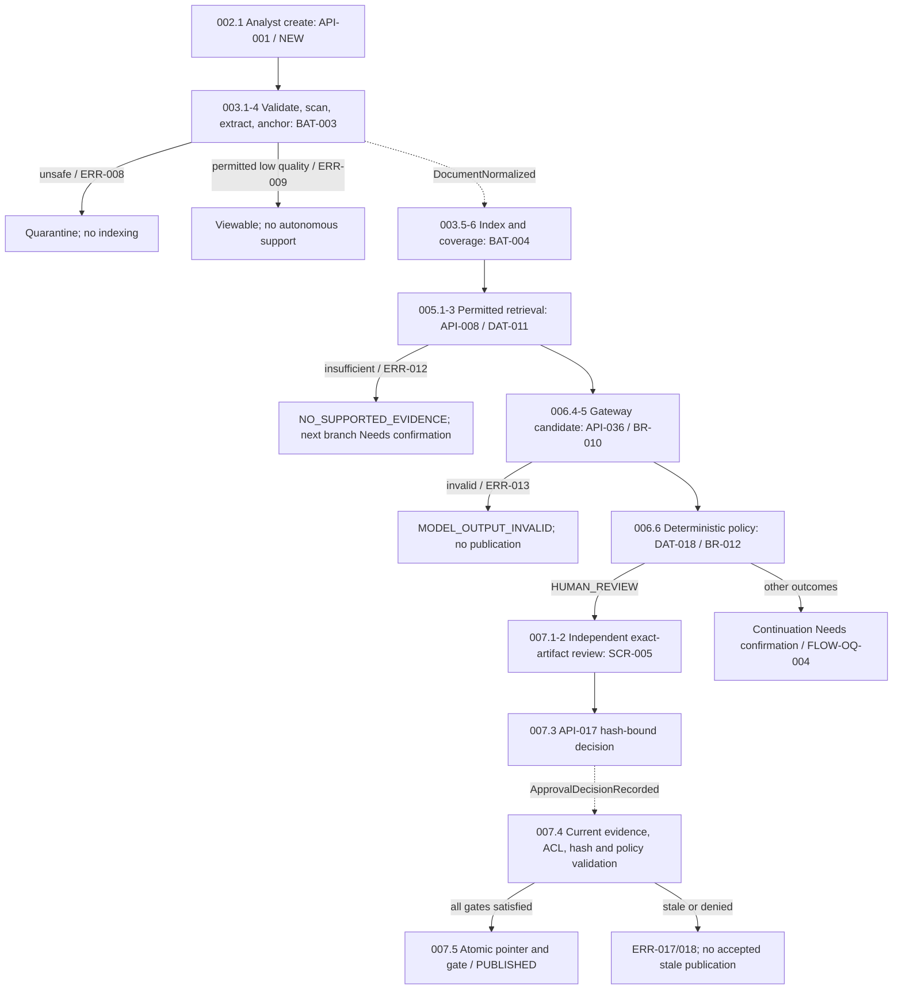
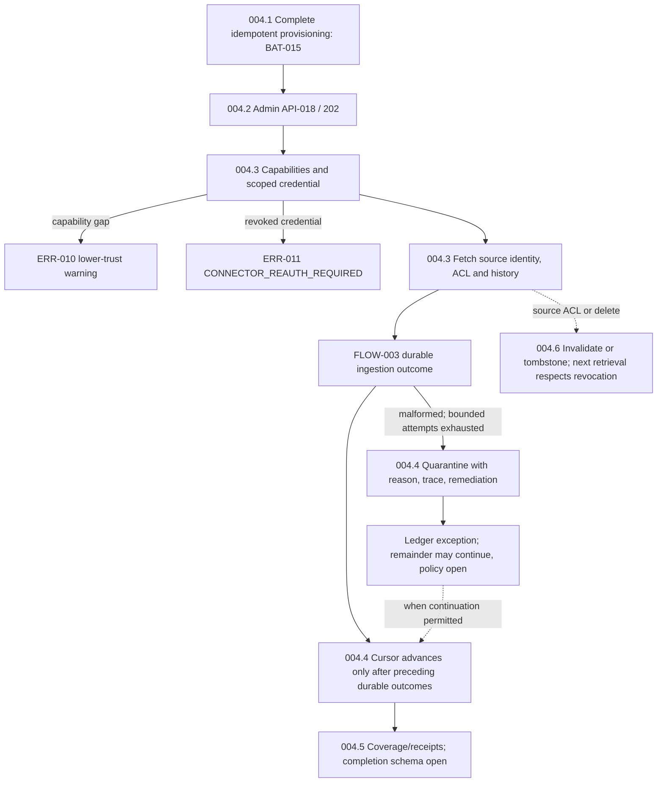
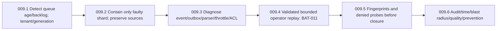
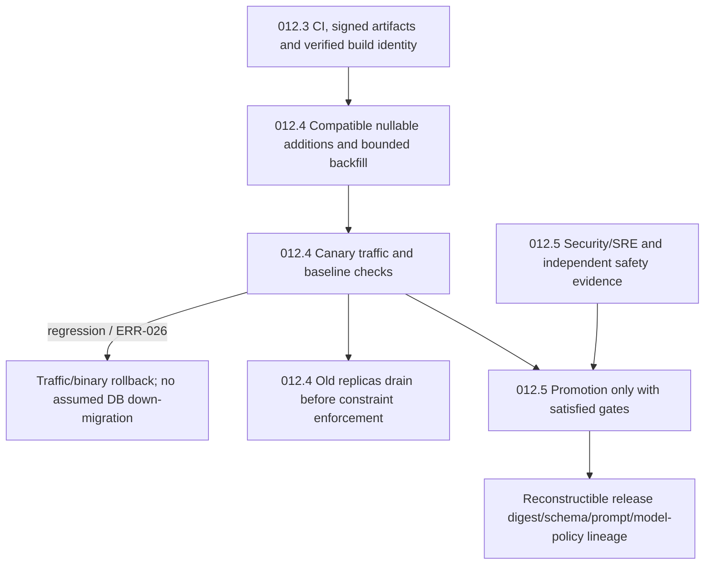

# 7. Processing Flow Specification

## Flow Inventory and Prerequisites

### Baseline and evidence convention

`07_processing_flows.md` specifies **OrionDesk AI**, `OD-AI-DDS-001`, release `R1.0`, design revision `1.3`. **Confirmed** means a requirement of the fictional reference design, not observed deployment. The source states: “All numbers are design assumptions, not measured production performance.” [Source: `1794325316-OrionDesk_AI_Detailed_Design_Specification.pdf`, pp.1–2; processing_flows:r1:c1:f1–f4, processing_flows:r1:c2:f1.]

All citations below refer to that exact filename and original pages. Finding shorthand `cN:fM` means `processing_flows:r1:cN:fM`. FLOW identifiers and step numbers are assigned here; no native flow identifier is supplied. **Needs confirmation** is a blocker, not implementation discretion. No Proposal is approved. Logical figures, contents, register order, state catalogs and screenshots do not supply missing executable edges. [pp.2–6; c2:f2–f11.]

This file connects, without rewriting, [01_screen_functions.md](01_screen_functions.md) SCR/SF/OQ, [02_api.md](02_api.md) API/API-OQ, [03_data.md](03_data.md) DAT/DAT-OQ, [04_batch_functions.md](04_batch_functions.md) BAT/BAT-OQ, [05_business_rules.md](05_business_rules.md) BR/BR-OQ and [06_exception_handling.md](06_exception_handling.md) ERR/EH/ERR-OQ. Earlier specifications are references, not independent source evidence. A screen mapping identifies an authorized consumer, not an unspecified button or route; BAT names are logical functions, not necessarily separate workers.

**Out of scope:** Physical automation, irreversible financial transactions, foundation-model fine-tuning, unrestricted browsing, agent administrative cloud permissions and application-hosted GPU inference. Cross-region active/active mutation, OCR beyond English and customer-managed weights are deferred. Ordinary authorized manual case work remains in scope. [pp.9–10,19; c4:f7,f11; c7:f7.]

### Shared prerequisites — FLOW-001

1. Authenticate principal and tenant. Interactive OIDC authorization code with PKCE validates issuer, audience, expiry, subject and tenant; reject unexpected algorithms/missing tenancy. Do not store long-lived refresh tokens in browser local storage. A BFF issuing secure, HttpOnly, SameSite cookies is permitted, not selected. [p.21; c8:f1–f3; SF-003, API-045, BR-002, ERR-002.]
2. Apply role, tenant, workspace membership, case sensitivity, source ACL, action and separation of duties. Gateway broad checks do not replace independent resource checks within domain transactions. Baseline roles are Analyst, Reviewer, Admin, Auditor, Service; Workspace Admin, Owner, Member, approver and Operators require mapping. Hidden navigation is not authorization. [pp.11,22; c5:f2–f3; c8:f6–f7; SF-002/OQ-001, ERR-OQ-005.]
3. Validate payload before allocation/transaction, at domain invariants and before tool dispatch. Resolve mutable authority from PostgreSQL; objects contain sources/derivatives, index is nonauthoritative/eventually consistent, cache ephemeral/versioned. Orchestrator has no direct DB credentials. [pp.9,16,56; c4:f10; c6:f9–f10; c18:f7; DAT-001, BR-006/009, EH-001.]
4. Install transaction-scoped tenant RLS context and include tenant in every storage predicate. Background tenancy is signed and immutable. Reference cases policy is `tenant_id = current_setting('app.tenant_id')::UUID`; additional production workspace-tenancy FK or controlled writes are required, mechanism unselected. Reset scoped pool variables after **every transaction**, including failures. [pp.22,51,86; c8:f9; c17:f1; c27:f11,f14–f16; DAT-023/027, BR-003, ERR-021.]
5. Check revision/hash/idempotency before accepted effects. Job-creating POSTs require `Idempotency-Key`; identical replay returns original outcome, changed fingerprint gives `409 IDEMPOTENCY_CONFLICT`. Actor/request-fingerprint outcomes last **24 hours**, not universal event/SSE retention. Case mutations, decisions and outbox inserts share ACID boundaries; state-changing workflows use outbox or explicitly reconciled saga. [pp.17,25,52,54,89; c6:f13; c9:f7; c17:f4; c18:f3; c30:f2; SF-016, DAT-029, BR-006/015, ERR-005/006.]
6. Preserve `tenant_id`, `revision`, `actor_id`, `occurred_at`, correlation context for durable changes. Every request has `trace_id` and `correlation_id`, independently propagated from provider trace IDs. Audit accepted transitions once; record safe denials without changing rejected business state. Denial ordering/revision/commit remains FLOW-OQ-003. [pp.16–17,23,64; c6:f4,f12; c8:f8,f10; c21:f2; EH-006.]
7. Enforce private datastores, declared egress, separate service identities, internal TLS/mTLS/audiences/IAM and managed identity where supported. Models receive scoped prompts, never raw connector credentials or DB authority. No untrusted document/model response may authorize tools, tenancy, approvals or policy bypass. [pp.7,15,18,61; c3:f2–f4; c6:f3; c7:f1–f3; c20:f1–f3.]

**Completion:** Passing FLOW-001 permits the affected operation's remaining guards; it is not business completion. Failure terminates the attempted unauthorized/invalid mutation with unchanged business state and safe evidence. Dependency failure returns a documented retryable error or **persisted** operation identifier, never ambiguous success. `202` is acknowledgement, not READY, PUBLISHED or all-item success.

For every flow, absent schema/type/requiredness/default, endpoint success status, actor grant, route/control, state edge, schedule, lock/lease, partial/empty result or numeric bound is **Needs confirmation** individually. Repository IDL generates authoritative OpenAPI/protobuf; selected DDL is not a complete schema. [pp.55,82,85–86; c18:f6; c26:f1; c27:f1.]

### Flow inventory

| ID | Purpose; users/systems | Trigger and prerequisites | Completion evidence; related specifications |
|---|---|---|---|
| FLOW-001 | Shared guarded request; all principals/services | Any request/step/replay; authenticated immutable tenancy and resource policy | Authorized validated operation or safe rejection; API-045/053, DAT-027/029, BR-002/003/006/015, EH-001–004 |
| FLOW-002 | Create/classify/edit/close case; Analyst, authorized Owner, Case Service/classifier | Case POST, `CaseCreated`, revisioned edit, guarded closure | NEW case, classification lineage, accepted revision or closure snapshot; SCR-001/002, API-001–005, DAT-004/005/025, BAT-001/012, BR-004/005/006, ERR-001/004/005/024 |
| FLOW-003 | Upload/extract/index; Analyst, Ingestion, Indexer | Attachment POST or accepted connector source; format/scan/ACL gates | Immutable source/anchors and checked index coverage; SCR-002/003, API-006/007, DAT-006–008, BAT-003–005, BR-007/009, ERR-007–009/020 |
| FLOW-004 | Provision/sync/backfill/source changes; Admin, Operators, connector workers | Complete provisioning before sync POST; source delta/ACL/delete | Durable cursor/item ledger, receipts and coverage; SCR-006, API-018/019/050, DAT-016, BAT-002/006/015/020, BR-008, ERR-010/011/018 |
| FLOW-005 | Search/view evidence; Member/authorized Analyst/Reviewer, Retrieval/object services | Search POST or citation/evidence read; current document ACL | Supported evidence and verified source click-through or no-support result; SCR-003/005, API-008–010/047/052, DAT-011, BAT-007, BR-009, ERR-012/018/022 |
| FLOW-006 | Bounded drafting/tool run; Analyst, Orchestrator, agents, gateway | Case-run POST; admission, plan and evidence gates | Candidate/policy/checkpoints, guarded continuation or exact failed checkpoint; SCR-004, API-011–015/036/037/047/048/051, DAT-009/010/017/018, BAT-007, BR-010–012/018, ERR-013–016/019 |
| FLOW-007 | Independent review/publication; eligible Reviewer, Policy/Case services | Policy human-review requirement/task; decision POST | Exact supported artifact and satisfied gate atomically committed, or stale/denied/expired outcome; SCR-005, API-016/017/046, DAT-012/013/018, BAT-008/009, BR-013/014, ERR-017/018 |
| FLOW-008 | Event delivery/progress/webhooks; producers/consumers/browser/subscriber | Committed outbox/checkpoint, SSE subscription/reconnect, optional delivery | One accepted effect; scoped progress or delivery outcome; API-015/046/049, DAT-015/033/034, BAT-010/016, BR-015/020, ERR-006/022/023 |
| FLOW-009 | Validated replay/index recovery/ACL containment; authorized Operators | Dead letter, delayed-index alert or suspected leak | Fingerprint/access verification and incident evidence; API-038, BAT-011, BR-015/019, ERR-018/020, EH-006 |
| FLOW-010 | Audit/usage/secret lifecycle; Auditor/Admin/Operators/services | Authorized audit/usage read, usage/audit records, defined rotation policy | Redacted immutable lineage, attributed daily reports, scoped credential/key lifecycle; API-020/021/030/041, DAT-014/017/026, BAT-017–020, BR-016–018/021, ERR-024/025 |
| FLOW-011 | Controlled export/delete/retention; Admin plus independent approver, Retention Worker | Export/delete POST, eligible closed retention or tombstone pipeline | Checksummed controlled package or verified purge/protected receipts; API-024/025/040, DAT-019/031, BAT-012–014/019, BR-017, ERR-024 |
| FLOW-012 | Baseline/evaluate/release; engineering, Admin, Security/SRE, security-control owner | Approved change, evaluation POST, prompt/model change, engineering release | Signed reconstructible compatible release or blocked/rolled-back promotion; API-022/023/031/032/043/044, BAT-021/022, BR-001/022, ERR-026 |
| FLOW-013 | Reference regional recovery; incident command/services | Primary outage; primary/warm recovery topology and continuous backups | Relational/object/index consistency at reference RPO/RTO; BAT-023, DAT-032, BR-021, ERR-027 |

Inventory evidence: pp.11–12,24–56,62–80,83,87,90 [c5:f1–f7; c9:f1–f10; c10:f1–f10; c11:f1–f11; c12:f1–f7; c13:f1–f10; c14:f1–f12; c15:f1–f13; c16:f1–f11; c18:f4–f5; c20:f6–f7; c21:f10–f11; c22:f6; c23:f1–f11; c24:f7–f11; c25:f1–f7; c26:f6–f20; c28:f1–f12; c31:f6–f13].

## Normal Processing

### FLOW-002 — Case initiation, classification, revision and closure

1. **002.1 Create:** Analyst submits business context via `POST /v1/cases` (API-001), with idempotency. Apply FLOW-001; return `201` and case identifier, initial domain state `NEW`. Creation form location/complete fields are open; do not invent a Create Case screen. Persist DAT-004 and accepted outbox lineage. [pp.12,52,83; c5:f6; c17:f4; c26:f6.]
2. **002.2 Classify:** `CaseCreated` from Case Service carries selected Case ID/revision labels and invokes classifier (BAT-001). The described journey receives context/attachments before policy-aware classification; reconcile readiness with event-triggered classification rather than assuming all attachments READY. Store labels, confidences, provenance; correction requires reason code, transport/role/catalog open. [pp.12,87; c5:f6; c28:f1; BR-004.]
3. **002.3 Read/edit:** `GET /v1/cases/{caseId}` (API-003, Analyst/Reviewer, `200`) reads authorized current revision. Owner `PATCH /v1/cases/{caseId}` (API-004) supplies `If-Match`, returns `200` or `409 CASE_VERSION_CONFLICT` with current revision. Read/update case attributes: title, description, priority, sensitivity, state, owner, approved-result pointer, monotonic revision; append-only DAT-005 history preserves changes. Inputs/patch format/edit predicates remain open. [pp.24–25,83,85; c9:f4,f7; c26:f7–f8; c27:f3.]
4. **002.4 Apply state/calculations:** Only supported edges are `NEW→TRIAGED→IN_PROGRESS`; `IN_PROGRESS→PENDING_APPROVAL` or `RESOLVED`; `PENDING_APPROVAL→RESOLVED` or `IN_PROGRESS`, with role/revision/approval guards. Priority uses explicit impact/urgency, not model alone; workspace-timezone business calendar computes contractual deadline; breach prediction remains advisory. Formula/calendar/recalculation timing open. [p.25; c9:f6,f9; BR-004/005.]
5. **002.5 Close:** Guarded `POST /v1/cases/{caseId}/close` (API-005) snapshots approved answer, cited document versions and reviewer decisions; CLOSED lineage remains immutable. Incoming closure edge, caller/status and snapshot commit grouping open. CLOSED final except explicit reopening as **new revision**, target/API unknown. Only eligible closed cases proceed to FLOW-011 retention; legal holds survive. [pp.24–26; c9:f1,f5,f10.]

Accepted case mutation/decision/outbox writes are ACID; indexing/notifications reconcile asynchronously. Stale PATCH does not auto-merge/retry or advance business state. Canonical message is `Case revision no longer matches.`; example `retryable: false`, revisions `7`/`8` and `trace_01HZZ_EXAMPLE` are not fixed values. [pp.52,84; c17:f4; c26:f21–f22; ERR-004, EH-002.]

### FLOW-003 — Attachment to immutable evidence and checked index

1. **003.1 Accept request:** Analyst `POST /v1/cases/{caseId}/attachments` (API-006) returns `202` ingestion operation. Validate PDF, DOCX, HTML or UTF-8 text; signature/extension agreement; configurable **25 MB per file**; decompression protection. Units/equality/threshold/file-count/schema remain FLOW-OQ-006. [pp.30,83; c11:f2–f3; c26:f9; BAT-003, BR-007.]
2. **003.2 Scan:** Scan **before parsing**, disable macros and embedded remote fetching. Unsafe branch quarantines and never indexes. [p.30; c11:f5; ERR-007/008.]
3. **003.3 Extract/normalize:** PDF preserves page/bbox blocks, tables' row/column annotations, headings/reading order. OCR fallback opt-in and provenance-marked; beyond English deferred. Strip transport artifacts without rewriting claims. Fingerprint plus pipeline version identifies immutable derivatives; changed processing coexists side by side. Store DAT-006–008 and encrypted objects. [pp.10,31,85; c4:f11; c11:f7–f8; c27:f4.]
4. **003.4 Anchor/quality:** Every chunk retains source URI/file hash/page/optional bbox. Record empty-page ratio, unknown-character ratio, table loss, language confidence. Low-quality **permitted** sources remain viewable, but cannot support autonomous recommendations; unlike unsafe quarantine. Cite only resolvable/currently permitted anchors. [pp.31–32; c11:f10–f11; ERR-009/012.]
5. **003.5 Dispatch index:** Accepted normalization publishes `DocumentNormalized` (Ingestion, Version ID/source hash), consumer BAT-004 builds searchable derivative. Keyword and **1536-dimensional** vector representation includes tenant/workspace/version/chunk/language/classification. `SearchIndexCommitted` (Indexer, generation/document revision) invalidates query cache. [pp.34,87; c12:f2; c28:f2–f3.]
6. **003.6 Verify readiness/rebuild:** `GET /v1/documents/{documentId}/status` (API-007) is status integration. Catalog `ACCEPTED`, `SCANNING`, `EXTRACTING`, `INDEXING`, `READY`, `QUARANTINED` has scan/quality guards, not fully supplied edges. Readiness uses index coverage, not queue emptiness. Rebuild creates parallel index, checks completeness/recall, **then atomically switches read alias**. Exact gates/retirement/races open. [pp.32,34,78,82; c11:f6; c12:f3; c25:f3; c26:f4.]

No all-store ACID is asserted. Failed index writes preserve accepted metadata; BAT-005 compares fingerprints/retries and repairs outbox links, with FLOW-009 recovery. [p.49; c16:f8; ERR-020.]

### FLOW-004 — Provision, synchronize and propagate source authority

1. **004.1 Provision:** One idempotent workflow creates policy, encryption references, role bindings, quotas and connector stubs; incomplete status visible and **sync blocked**. Launch API and single-transaction assumption are not supplied. [p.78; c25:f2; BAT-015, ERR-010.]
2. **004.2 Start sync:** Admin `POST /v1/connectors/{connectorId}/sync` (API-018) returns `202`. Resolve workspace secret references, never browser/model raw tokens. `GET /v1/connectors/{connectorId}/runs` (API-019) reads run context; generic allocation wording remains unresolved. [pp.27–29,83; c10:f3–f5; c26:f14.]
3. **004.3 Discover/fetch:** Discover list/fetch/delta cursor/ACL/delete capabilities. Unsupported capability visibly lowers trust rather than silent assumption or universal rejection. Preserve source IDs, ACL/history; workers honor `Retry-After`, bounded backoff/jitter, workspace quotas/fairness. Accepted sources enter FLOW-003. [pp.27–28; c10:f1–f2,f9.]
4. **004.4 Checkpoint items:** Store cursor, high-watermark, error ledger; advance only after **all preceding durable ingestion outcomes**. Downstream index completion is not an extra prerequisite. Partial batches retry safely. Exhausted malformed item quarantines with reason/correlation/remediation; remaining batch **may continue** with ledger exception. Continuation policy/partial status open. [pp.28–29; c10:f6,f10; DAT-016, BAT-002, ERR-008.]
5. **004.5 Backfill:** Historic ingestion uses bounded windows, stable IDs/per-batch reconciliation receipts and verified index coverage. No daily schedule/window size inferred. [p.78; c25:f3.]
6. **004.6 Source authority change:** Delete creates tombstone and schedules index removal; ACL change invalidates cache before new results. Revoked source permission effective before **next retrieval**; stale visibility is security incident. FLOW-005 and FLOW-007 recheck current access independently. [pp.27–29,53; c10:f1,f7,f15; c17:f8; BAT-006, ERR-018.]

Credential revocation makes queued work fail `CONNECTOR_REAUTH_REQUIRED` without tokens; reauthorization/resume interface remains open. Do not retry unchanged revoked credentials as a bypass. [p.27; c10:f4; ERR-011.]

### FLOW-005 — Grounded search and source inspection

1. **005.1 Query:** Member `POST /v1/search` (API-008, `200`) receives validated query/context, exact body open. Recheck tenant/workspace/document ACL. Ranking is not authorization. [pp.34,83; c12:f1,f9; c26:f15; BR-009.]
2. **005.2 Rank/select:** Form lexical and normalized vector queries; retrieve bounded candidates; reciprocal rank fusion; deterministic reranking; diversity against redundant document hits/coverage across relevant sources; token cap. Both queries are supplied, **simultaneous execution is not**. Algorithms/limits open. [p.35; c12:f4–f5.]
3. **005.3 Release evidence:** ACL-filter before any model text. Evidence items semantically contain chunk ID, title, document revision, page anchor, ACL digest. Verify opaque citations before display. Store/link DAT-011 permission-sensitive evidence; complete Citation schema open. Insufficient confidence/quality gives `NO_SUPPORTED_EVIDENCE`, not fabricated context; clarification or human routing permitted, branch unselected. [pp.35–36; c12:f6–f7.]
4. **005.4 Inspect source:** Authorized `GET /v1/evidence/{evidenceId}` and `GET /v1/cases/{caseId}/evidence` (API-009/010) provide related evidence; overlap/schema open. Citation click opens source and highlights anchored page range. Access requires current permission; encrypted objects use opaque names/scoped short-lived signed URLs, issuance/renewal unknown. Soft-deleted/revoked content not retrievable. Reviewer must be **able** to inspect; actual-click attestation not specified. [pp.51–52,57–59; c17:f3,f7; c19:f1,f4,f6; SCR-003, ERR-018/022.]

### FLOW-006 — Bounded generation and authorized capabilities

1. **006.1 Admit/start:** Analyst `POST /v1/cases/{caseId}/runs` (API-011, `202`) starts bounded run only when token, queue-age/provider-capacity thresholds pass. Throttle `429 Retry-After`, keep saved cases. `POST /v1/runs` (API-012) remains separate unresolved source contract, not approved alias. Create run immediately and UI subscribe FLOW-008. [pp.15,40,58,69,83; c6:f5; c14:f4; c19:f7; c22:f4; c26:f10.]
2. **006.2 Plan/checkpoint:** Persist plan revision before effects; DAG **depth≤8**, **tool calls≤16**, explicit dependencies/replayable checkpoints. `AgentPlanApproved` dispatches steps; each stage checkpoint precedes downstream dispatch, `WorkflowStageAdvanced` resumes consumers. Triage/Research/Draft responsibilities do not specify a complete DAG or parallel worker schedule. [pp.40,49,87; c14:f2,f5; c16:f7; c28:f4,f6; DAT-009/010, BAT-007.]
3. **006.3 Retrieve:** Research requests FLOW-005 evidence. `knowledge.search@v1` accepts `{query: string, case_id: uuid, max_items: int<=10}`, returns `{evidence_set_id: uuid, citations: Citation[]}`; tenant `read:permitted_documents`, read-only/no arbitrary URLs/filesystem. Ten is tool-specific, not page/global selection size. Discovery is not invocation grant. A2A `research.grounded_search.v1` may be declined and declares schemas/deadline/trace; formal decline/adapter open. Example `case_demo` cannot directly satisfy MCP UUID. [pp.41,87; c14:f8–f9; c28:f9–f13; API-047/048, ERR-014.]
4. **006.4 Generate:** Gateway `POST /internal/model/generate` (API-036) uses approved deployment by capability/region/handling/context/cost/evaluation, maximum included information class, reserved input/output tokens and workspace usage ledger. Prompt separates fixed rules, signed workflow, validated user input/delimited evidence; remove context tool directives, record injection indicators and policy-permitted nonessential personal-data redaction before provider. Model text not authority. [pp.37–39,62; c13:f2,f4,f6,f9–f10; c20:f4–f5; DAT-017, BR-010/018.]
5. **006.5 Validate candidate:** Bounded versioned JSON parse rejects unknown fields, invalid citations/control injection with `MODEL_OUTPUT_INVALID`, no publication. Draft candidate remains separate from retrieval/policy/decision. Any external write needs separate capability; consequential write additionally human authorization/idempotency. Denied effect cannot use equivalent tool. [pp.38,41–42,89; c13:f7; c14:f8,f12; c30:f5,f14.]
6. **006.6 Evaluate policy:** Normalize/store sensitivity, action, evidence quality, model class, financial-impact category, confidence bands/rule version (DAT-018); digest alone insufficient. Deterministic outcomes `AUTO_ALLOW`, `HUMAN_REVIEW`, `REQUEST_MORE_EVIDENCE`, `DENY`; LLM tags cannot override. High-impact recommendations create review tasks. HUMAN_REVIEW follows FLOW-007; other executable continuations remain FLOW-OQ-004/005, not permission to choose. [pp.44–45; c15:f1–f3.]

Run catalog `REQUESTED`, `RETRIEVING`, `GENERATING`, `POLICY_CHECK`, `AWAITING_REVIEW`, `PUBLISHED`, `FAILED`; described stage progression includes review waiting. Missing approval/call exhaustion/repeated invalid plans/policy denial/deadline stop at exact failed checkpoint, but waiting/expiry/timeout timing remains unresolved. Quota exhaustion terminal for current run with **no automatic model/data-class switch**. [pp.12,38,41,49,82; c5:f9; c13:f9; c14:f11; c16:f7; c26:f3; ERR-015/016.]

### FLOW-007 — Review, exact-artifact decision and publication

1. **007.1 Assign/read:** Policy pool/minimum role/duties select eligible Reviewer; `GET /v1/review-queue` (API-016) exposes tasks. Task-wide **no self approval**, not merely own-high-risk prohibition. Assignment/open endpoint and exact edges unknown; states `ASSIGNED`, `OPENED`, `APPROVED`, `REJECTED`, `EXPIRED` actor/hash/duties guarded. [pp.11,45,82,85; c5:f3; c15:f9; c26:f5; c27:f6.]
2. **007.2 Present:** SCR-005 shows exact candidate, citations, model/prompt version, policy reasons; evidence inspectable via SCR-003. Both Approve/Reject disabled until required fields complete; field list unknown. [pp.57–58; c19:f1,f8; SF-010.]
3. **007.3 Decide:** Reviewer `POST /v1/approvals/{approvalId}/decision` (API-017) binds exact reviewed hash; `200`/`409`. Capture actor/time/hash/decision/rationale/optional annotations in immutable DAT-013. Changed hash rejects stale, audited, unchanged business state. Exact decision enum/rationale input requiredness open. [pp.45,83,89; c15:f10–f11; c26:f13; c30:f6; ERR-017.]
4. **007.4 Validate publication:** Policy Service `ApprovalDecisionRecorded` (Task/actor/content hash) causes BAT-009 **publication validation**, not unconditional publish. Recompute current tenancy/document ACL/evidence/required policy/hash. Unapproved high-risk or unsupported/revoked artifact cannot publish. [pp.11–12,46,87; c5:f1,f7; c15:f17; c28:f5; BR-014.]
5. **007.5 Complete:** Commit final-response pointer and satisfied gate **in the same transaction**, preserving case/decision/outbox ACID responsibilities; replay cannot publish another artifact under old approval. Display approved result distinctly from draft/partial. Closure separately follows 002.5. [pp.45,52,57; c15:f12; c17:f4; c19:f6.]

Expiry records escalation/reassigns under configured SLA, never approval. Denied/rejected work reworks as new run revision, not history rewrite; override requires elevated role **and secondary reviewer and audited reason**, no stated hash exception. Race arbitration, transport and run effects open. [pp.45–46,89; c15:f9,f13; c30:f10.]

### FLOW-008 — Events, progress and optional notifications

1. **008.1 Publish/consume:** Outbox/versioned canonical JSON UTC envelopes contain `event_id`, `type`, `schema_version`, `tenant_id`, `aggregate_id`, `aggregate_revision`, `occurred_at`, `trace_id`, `payload`. Consumers check event/operation identity and revision; duplicates record outcome/return without reapplying; stale disposition open. No cross-partition order invariant. [pp.17,48–50; c6:f13; c16:f2,f6,f14.]
2. **008.2 Execute selected consumer action:** Appendix C mappings below apply; typed payloads and browser event mapping remain open. Resume from durable checkpoints, not new duplicate effects. [p.87; c28:f1–f8.]
3. **008.3 Observe:** Analyst/Reviewer `GET /v1/runs/{runId}` (`200` stages/evidence), `GET /v1/runs/{runId}/steps`, `GET /v1/streams/runs/{runId}` (SSE `200`). Show retrieval/generation/policy. Refresh reconstructs server progress; reconnect `Last-Event-ID` backfills monotonic **retained/currently authorized** events. Retention/expired-offset/heartbeat/final disconnect behavior open. [pp.42,55,58,83; c14:f6; c18:f4; c19:f7; c26:f11–f12; ERR-022.]
4. **008.4 Notify optionally:** Signed optional webhook recipient checks signature/age; exponential backoff. Delivery failure **never rolls back internal case transition**. Exact delivery schema/keys/retry cap/terminal notification open. [p.55; c18:f5; BAT-016, ERR-023.]

| Event | Producer; selected payload labels | Supported consumer action |
|---|---|---|
| `CaseCreated` | Case Service; Case ID/revision | Classify (002.2) |
| `DocumentNormalized` | Ingestion; Version ID/source hash | Build index (003.5) |
| `SearchIndexCommitted` | Indexer; generation/document revision | Invalidate query cache (003.5/004.6) |
| `AgentPlanApproved` | Orchestrator; Run ID/plan hash | Dispatch steps (006.2) |
| `ApprovalDecisionRecorded` | Policy Service; Task/actor/content hash | Validate publication (007.4) |
| `WorkflowStageAdvanced` | Orchestrator; Run/stage/checkpoint | Resume consumer (006.2/008.2) |
| `AccessDenied` | Policy Service; Principal/action/policy digest | Alert enrichment (FLOW-001/010) |
| `TenantDeletionVerified` | Retention Worker; Manifest ID/receipt hash | Close purge record (011.4) |

Source p.87 [c28:f1–f8]. These are selected labels, not complete JSON keys or automatic SSE types.

Retain chapter events `BaselineCommitted`, `RunRequested`, `DeploymentPromoted`, `CaseStateChanged`, `ConnectorSyncStarted`, `ModelInvocationCompleted`, `DataRetentionPurgeCommitted`, `ApiCompatibilityVerified`, `UserReviewOpened`, `SecurityPolicyChanged`, `SloBurnRateDetected`, `BackpressureActivated`, `ReleasePromoted`, `EvaluationCompleted`. Each retains versioned outbox, conditional provenance, guarded accepted writes, ledger/revision duplicate handling, current-publication permission check and safe audit/testing obligations. Exact producer/payload/cause/SSE associations absent from source remain open. [Registers pp.10–80; c4:f13–f16; c6:f14–f18; c7:f13–f16; c9:f13–f16; c10:f13–f15; c13:f14–f17; c17:f13–f16; c18:f13–f16; c19:f13–f16; c20:f13–f16; c21:f13–f16; c22:f13–f16; c23:f13–f16; c24:f12–f15.]

### FLOW-010–013 — Governance, lifecycle and engineering completion

**FLOW-010:**
1. Auditor `GET /v1/audit/events` (`200`, cursor immutable redacted log) reads decision/prompt-template digest/access lineage, not case edit authority. Operators query historical decisions, never alter. Append-only batch-hash audit exports to independently controlled retention storage; cadence/format open. [pp.11,62,83; c5:f2–f3; c20:f6; c26:f16; SCR-008, BAT-017.]
2. Attribute model/embedding/storage/index usage by workspace cost center/deployment; DAT-017 input/output tokens; daily rollups budget/forecast/rejected excess. Admin `GET /v1/usage` (`200`) reads costs/quotas/trends, internal metrics separate. Daily is reporting granularity, not schedule/accounting close. [pp.65,83,85; c21:f10; c26:f17; c27:f9; BAT-018.]
3. Vault-scoped managed-identity secrets/service rotation remain separate from logs/models; keys rotate by defined policy without request-path bulk reencryption. Operator connector revoke follows004.2 failure branch. `POST /v1/security/holds` exists but complete hold lifecycle not supplied. [pp.21,27,63; c8:f3; c10:f4; c20:f7,f9.]

**FLOW-011:**
1. Verify Admin plus **independent** approval checks before export/delete; single-Admin export fails. `POST /v1/workspaces/{workspaceId}/export` or `/delete` (`202`) acknowledges work; no additional screen or approval endpoint inferred. [pp.78–83,88; c25:f1,f9; c26:f19–f20; c29:f11.]
2. Export authorized case metadata/approved artifacts/source references/audit manifests with checksums; exclude secrets/internal prompts. Complete package format/checksum/download/snapshot consistency open. Export is not required predecessor of deletion. [p.79; c25:f6; BAT-014.]
3. Retention selects eligible closed cases only, respecting legal hold. Diagnostic default TTL **30 days** distinct from fictional security audit **seven years**; corporate policy open. Soft-delete prevents retrieval; scheduled tombstone pipeline removes eligible objects/index. [pp.26,51,66; c9:f10; c17:f3; c21:f11; BAT-012/013/019.]
4. Enforce holds, tombstone/remove eligible blob/index, record DAT-019 receipts; protected records retained/receipted. Shared subject-request inventory not a new endpoint. `TenantDeletionVerified` closes purge record; held partial completion schema open. [pp.80,85,87,89; c25:f7; c27:f10; c28:f8; c30:f13.]

**FLOW-012:**
1. Baseline changes use `POST /v1/design-decisions`, read `GET /v1/design-baselines/{id}`; impact behavior/migration/threat/cost and negative-test links. Approved minor/incompatible-major rules have unresolved overlap/effective-time. No invented approver. [pp.8–10; c4:f2,f4,f6; API-031/032, BR-001.]
2. Admin `POST /v1/evaluations` (`202`) starts frozen benchmark, read `GET /v1/evaluations/{evaluationId}`. Use1200 synthetic permission-controlled cases/expected citations/outcomes; precision≥0.97, unsupported≤0.02, frozen high-risk recall1.00 with CI/domain shift. Independent prompt/model roll-forward requires reevaluation; low confidence blocks. Fixtures frozen/versioned/reviewed; seeds recorded. [pp.74–76,83,89; c24:f7–f11; c26:f18; c30:f17–f18; BAT-021.]
3. CI static/dependency/unit/contract checks, SBOM/sign images; source defaults/signed environment config/vault refs; production allowed-build verified digest. Terraform/Bicep unselected. `POST /internal/releases` and read `GET /internal/releases/{releaseId}` are engineering contracts, not browser actions. [pp.71–73; c23:f2–f5,f7; API-043/044.]
4. Expand-contract nullable addition→bounded backfill→constraint enforcement; predeploy compatibility, canary traffic and old-replica drain before postdeploy enforcement. Never delete active-reader fields; document new-write readability. Canary regression automated traffic rollback, binary-first recovery, **not DB down-migration**; compensation only explicitly supported. [pp.20,52,72; c7:f11; c17:f5; c23:f8,f10.]
5. Security/SRE egress/secrets/backups/alert validation precedes promotion. Security-control owner independently reviews/reproduces/signs negative release evidence; critical isolation/approval zero exceptions, SEC-001–012 blocking regardless of benchmark. Signed test outputs link release digest; image/schema/prompt/model route reconstructible. Exact gate thresholds/order/state/approval protocol open. [pp.73–76,88–89; c23:f11,f16; c24:f1; c29:f13–f14; c30:f19–f20.]

**FLOW-013:**
1. Continuous PostgreSQL backup, primary writes/one warm recovery region; secondary restore only under incident command. No active-active mutation/automatic user failover. [p.19; c7:f8; BAT-023.]
2. Restore and jointly verify relational/object versions/index rebuild recipes; reference **RPO≤15 minutes**, **RTO≤4 hours**. Snapshot selection/order/retention/command identity/restore endpoints open. Chaos429/heartbeat/duplicate/object/region exercises measure safety and time. [pp.69–70,89; c22:f6–f7; c30:f12; ERR-027.]

## Branches, Failures, and Recovery

### Explicit branches and forbidden compensation

| Point | Condition; exception | Required outcome/resumption |
|---|---|---|
| FLOW-001/002.3 | Invalid payload/permission/foreign ID/stale revision; ERR-001–004 | `422` schema failure; foreign404-equivalent; stale409/current revision; unchanged business state/safe denial audit. No automatic stale-edit merge/retry. |
| FLOW-001/008.1 | Same key/body, changed body, duplicate event; ERR-005/006 | Original outcome or409 IDEMPOTENCY_CONFLICT. Event ledger/revision duplicate record/return, no effect reapplication. Stale-event disposition/arbitration open. |
| 003.1–4 | Abuse/unsafe versus low-quality; ERR-007–009 | Fail closed; unsafe quarantine/no-index. Permitted low quality viewable/nonautonomous. Opt-in marked OCR; side-by-side pipeline reprocessing never overwrites cited history. |
| 004.2–4 | Incomplete capability/provisioning/revoked credential/poison item; ERR-008/010/011 | Block incomplete sync; capability warn/lower trust; queued revoked job CONNECTOR_REAUTH_REQUIRED. Poison exhausted record quarantine/ledger, possible remainder continuation, not all-success/whole-batch rollback. |
| 005.3/006.5 | Unsupported/invalid citations/schema/injection; ERR-012/013 | NO_SUPPORTED_EVIDENCE or MODEL_OUTPUT_INVALID; missing citations needs-review or unsupported, choice open. No fabricated/partial-as-approved answer. |
| 006.1/006.4 | Admission/provider429/quota; ERR-015/019 | 429 Retry-After, capped recovery/fairness, saved cases. Exhausted quota terminal current run, no automatic model/data-class change. |
| 006.3–5 | Arbitrary/denied tool/A2A decline; ERR-014 | DENY before dispatch; no equivalent-tool substitution. A2A may decline, resulting run branch open. Discovery never grants permission. |
| 006.6 | AUTO_ALLOW/REQUEST_MORE_EVIDENCE/DENY | Outcomes confirmed, executable route/state not selected. DENY no unauthorized effect; new-revision rework possible. No diagram-created AUTO_ALLOW bypass. |
| 006.2/007.1 | Missing approval/deadline/invalid plan/expiry; ERR-016/017 | Exact failed checkpoint for termination, but waiting/timing/timeout literal open. EXPIRED records escalation, no approval. No cancellation/universal retry endpoint confirmed. |
| 007.3–5 | Wrong hash/self approval/revocation/policy fail; ERR-017/018 | Stale audited409 review conflict, independent duties; current artifact/evidence/policy/access gate prevents publish. Rework new revision; override all three prerequisites, no hash bypass. |
| 003.5–6/008.4 | Index write/webhook failure; ERR-020/023 | Accepted source metadata/case transition remains durable. Fingerprint/outbox reconciliation or signed delivery recovery; no generic compensation. |
| FLOW-011 | Missing second person/held data; ERR-024 | No unauthorized export/delete; retained protected receipts. Immutability does not imply indefinite retention or historical access permission. |
| FLOW-012 | Critical security/low confidence/tampered fixture/canary regression; ERR-026 | Block promotion; compatible traffic/binary recovery, no assumed database down-migration. |

Sources: pp.13,23,25,27–42,45–55,72–80,84,88–90 [c5:f10; c8:f10; c9:f7; c10:f4,f6,f10; c11:f5,f8,f11; c12:f7; c13:f7,f9; c14:f9,f11–f12; c15:f9–f13,f17; c16:f8,f10; c18:f5; c23:f10; c24:f11; c25:f1,f5,f7; c26:f21–f22; c29:f14; c30:f1–f16; c31:f6–f12]. EH-003/004 remains the error/retry dependency; unspecified HTTP mappings are not invented here.

### Parallel work, mutual exclusion and races

**Confirmed:** Parallel replacement-index construction followed by checked atomic alias switch; asynchronous index/webhook effects separate from authoritative ACID; explicit DAG dependencies/checkpoints; independently rolled-forward prompt/model versions still reevaluated. None implies a selected scheduler, simultaneous lexical/vector query dispatch, all-agent parallelism, batch size or database isolation level. [pp.34,40,52,76; c12:f3–f4; c14:f5; c17:f4; c24:f11.]

**Required semantic exclusion:** Stale revision/hash/unauthorized effects cannot commit; old approval cannot authorize different artifact. **Needs confirmation:** Actual locks/leases/concurrent same-key arbitration, sync-cursor overlap, rebuild writes, decision-versus-expiry, publication-versus-revocation and export-versus-delete snapshot arbitration. Do not select mechanisms solely to complete diagrams.

**Retries:** Actual transient faults use bounded exponential backoff/randomized jitter/per-dependency circuit breakers; validation/permission faults permanent, not retried. Read transient retry permitted; mutable retry idempotent, consequential effect human-authorized. Parser/provider/poison/replay bounds are separate policies, all numerical omissions remain open. [pp.28,38,42,49–50; c10:f9; c13:f7; c14:f12; c16:f10–f11.]

### FLOW-009 — Recovery and safety containment

**Dead-letter fragment:** Authorized operator `POST /internal/deadletters/{id}/replay` requires reason, dry-run validation and scope limit. Preserve original event identity except provenance-linked schema migration; bounded replay applies ledger/revision safety and durable checkpoint resumption. Exact grants/protocol/empty/partial outcome open. [pp.48–50; c16:f4,f11; API-038, BAT-011, EH-006.]

**Delayed document indexing, F.1 ordered steps:**
1. **009.1 Detect:** Alert oldest queue age/index backlog; identify affected tenant/index generation.
2. **009.2 Contain:** Pause **only faulty connector/indexer shard**; keep accepted sources durable.
3. **009.3 Diagnose:** Inspect event ID/outbox lag/parser flags/search throttle/source ACL revision.
4. **009.4 Recover:** Replay **validated** outbox through bounded operator-controlled job; relationship to API-038 not selected.
5. **009.5 Verify:** Compare source fingerprints/indexed versions and run denied-access probes before incident closure.
6. **009.6 Document:** Link audit IDs/time window/blast radius/quality effect/preventative action.

Source p.90 [c31:f6–f12]. Thresholds, unpause/resumption authority, probe suite/closure criteria remain open, not presumed automatic.

**Suspected ACL leak:** Suspend affected aliases, revoke cached evidence/preserve audit, scoped ACL-revision replay; reenable search **only after negative tests pass**. This qualifies normal evidence availability. [p.79; c25:f5; ERR-018.]

**Provider outage:** Disable new generation, keep manual/evidence, display degraded; page on-call only availability-budget impact. Approved equal-or-stronger fallback restrictions do not authorize new outage admission or quota switching. Vector failure **may** retain visibly reduced-quality lexical retrieval; all gates apply. In-flight recovery and reenable criteria open. [pp.37–38,69,79; c13:f3,f9; c22:f5; c25:f4.]

## Flow Diagrams and Specification Mappings

### Diagram conventions

Arrows show only supported causal dependencies; dashed arrows denote asynchronous events or explicitly unresolved dependencies. Decision exits labelled **Needs confirmation** are blockers, not runnable routes. Diagrams are specifications of the numbered steps above, not copied logical-register arrows or approved navigation. [pp.2,9; c2:f2; c4:f8.]

### Grounded human-review journey

Evidence pp.12,30–45,75,87 [c5:f7; c11:f5,f11; c12:f7; c13:f7; c15:f3,f12,f17; c24:f10; c28:f2,f5]. This represents the supported acceptance journey, not all state transitions, creation-form placement or universal human review.

### Connector durable continuation

Evidence pp.27–29,78 [c10:f1–f10; c25:f2–f3]. No lock, whole-batch rollback, fixed retry count or requirement to await index completion is added.

### Index incident recovery

Source p.90 [c31:f6–f12]. API-038 mapping and unpause mechanism remain open. Suspected ACL leak additionally requires affected-alias suspension and negative-test-gated reenable.

### Migration and release partial order

Evidence pp.20,52,71–76,88–89 [c7:f11; c17:f5; c23:f7–f11; c24:f1; c29:f13–f14; c30:f20]. No edge asserts exact promotion-versus-postdeploy-enforcement order; that remains open.

### Screen → contract → implementation mapping

| Confirmed screen | Flows / screen requirements | APIs | Data | Logical batch | Rules | Exceptions |
|---|---|---|---|---|---|---|
| SCR-001 Case Queue | FLOW-002; SF-004/005/006 | API-002 list; API-001 create placement open | DAT-004/025 | BAT-001 | BR-002/004/006/020 | ERR-001–005/019 |
| SCR-002 Case Detail | FLOW-002/003/006/007; SF-006/007 | API-003/004/005/006/010/011 | DAT-004/005/006/007/009/011 | BAT-001/003/007/009/012 | BR-004–007/014/020 | ERR-004/007–009/015–019 |
| SCR-003 Evidence Viewer | FLOW-003/005/007; SF-008 | API-008/009/010/052 | DAT-006–008/011/033 | BAT-003–007 | BR-002/007/009/020 | ERR-009/012/018/020/022 |
| SCR-004 Run Timeline | FLOW-006/008; SF-009 | API-011/013/014/015; API-012 relationship open | DAT-009/010/011/017/018 | BAT-007/010 | BR-010–015/018–020 | ERR-006/012–019/022 |
| SCR-005 Review Inbox | FLOW-007; SF-010 | API-016/017/010 | DAT-011–013/018 | BAT-008/009 | BR-012–014/020 | ERR-001/003/012/016–018/022 |
| SCR-006 Connector Health | FLOW-004/009; SF-011 | API-018/019; API-050 integration not browser route | DAT-006/016/025 | BAT-002/006/011/015/020 | BR-008/009/019/021 | ERR-008/010/011/015/018–020 |
| SCR-007 Policy Settings | Configuration dependency/FLOW-001/006/007; SF-012 | Actual mutation contract open; API-028 catalog context | DAT-003/018/025 | BAT-007 policy application | BR-002/006/010/012/013 | ERR-003/004/017/019 |
| SCR-008 Audit Explorer | FLOW-010; SF-013 | API-020 | DAT-013/014/026 | BAT-017 | BR-002/016/020 | ERR-003/024/025 |

Primary screen inventory p.57 [c19:f2], specific interactions pp.57–59 [c19:f1,f6–f11], API inventory p.83 [c26:f6–f20], data pp.85–86 [c27:f1–f16]. Each mapping inherits the applicable domain evidence above. Internal generate/storage/capacity/replay/release endpoints are never browser APIs by this table. Export/delete/evaluation/provisioning/region recovery have **no confirmed dedicated screens**.

### Source-wide register coverage

All component boundaries in `03_data.md` DAT-021 retain positive/foreign-tenant/duplicate/evidence-retention tests, conditional provenance, guarded writes, safe audit and outbox contracts. Exact scoped register categories are `Owner aggregate / UUIDv7 + tenant scope`, `Immutable derivative / SHA-256 source/ revision`, `Policy-bound control / Actor and role predicate`, `Operational ledger / Event ID + trace context`. They are not application Owner grants, complete SQL schemas, universal hash fields or runtime sequences. [Registers/figures pp.8–80; c4:f12,f17–f18; c5:f11,f16; c6:f14–f15,f19–f20; c7:f12,f17–f18; c8:f12,f17–f18; c9:f12,f17; c10:f12,f16; c11:f12,f17; c12:f13,f18; c13:f13,f18; c14:f13,f18; c15:f4,f14; c16:f12,f17; c17:f12,f17; c18:f12,f17; c19:f12,f17; c20:f12,f17; c21:f12,f17; c22:f12,f17–f18; c23:f12,f17; c24:f12,f16; c25:f12,f17.]

Ancillary paths `GET /v1/me`, membership PUT, catalog/OpenAPI/baseline/health/degraded/usage/metrics/capacity/evaluation/release/storage/workflow reads, design decisions and security holds remain confirmed contracts even when absent from Appendix A. Repeated long-running allocation/event associations remain unresolved; do not add GET mutations or provisioning-through-export/delete. [pp.8–80; c4:f4; c6:f6; c7:f5; c8:f4–f5; c9:f3; c10:f5; c11:f6; c12:f10; c13:f5; c14:f6; c15:f7; c16:f4; c17:f10; c18:f9; c19:f4; c20:f9; c21:f4; c22:f9; c23:f5; c24:f5; c25:f18; EH-007.]

## Acceptance Criteria

### Representative normal and branch procedures

1. **Human-reviewed resolution:** Authorized Analyst, permitted evidence and eligible independent Reviewer perform002.1→003.1–6→005.1–4→006.4–6→007.1–5. Preserve separate retrieval/generation/policy/decision records; show exact artifact/model-prompt/policy/citations; require current supported hash/ACL/policy and atomic pointer/gate. No partial-as-approved display. [pp.12,45,58,75; c5:f7,f10; c15:f12; c19:f8; c24:f10.]
2. **Connector partial path:** Provision incomplete blocks sync; unsupported capability warns; revoked credential safe failure. Exhausted malformed item quarantines with ledger/trace/remediation; continuation if permitted retains failed-item exception and cursor only crosses durable outcomes. Index failure preserves source metadata and repairs fingerprint/outbox. [pp.27–29,49,78; c10:f2,f4,f6,f10; c16:f8; c25:f2–f3.]
3. **Evidence race:** Revoke during search and between retrieval/publication; no forbidden result/model release, no stale publish. Low-quality permitted viewability retained; unsafe no-index. Suspected leak reenables only after negative probes. [pp.31–36,79,88; c11:f10–f11; c12:f1; c25:f5; c29:f8.]
4. **Durable resume:** Refresh/reconnect authorized run reconstructs server stages and scope-limited retained offsets; replay accepted event produces one business outcome. Empty/expired/future offsets and no-input job expectations await approved contracts. [pp.48–55,58; c16:f6–f7,f14; c18:f4; c19:f7.]
5. **Lifecycle/release recovery:** Independent export excludes secrets/prompts; hold-safe purge receipts protected records. Compatible reader drain, verified artifacts, signed tests and zero-exception safety precede promotion; regression traffic rollback, no DB down-migration. Joint regional recovery reference limits apply. [pp.69,72–80,88–89; c22:f6; c23:f8–f11; c25:f1,f6–f7; c29:f13–f14; c30:f13,f16,f20.]

### Source test matrix

| Source ID | Flow / trigger | Expected result |
|---|---|---|
| TST-001 | FLOW-002 create twice same key/body | One case/identical response |
| TST-002 | FLOW-001 changed body reused key | `409 IDEMPOTENCY_CONFLICT` |
| TST-003 | FLOW-001/002 foreign case read |404-equivalent non-disclosing error |
| TST-004 | FLOW-004/005 revoke indexed access |Next query no forbidden evidence |
| TST-005 | FLOW-006 schema failure |MODEL_OUTPUT_INVALID; no publish |
| TST-006 | FLOW-007 wrong artifact hash |Stale rejection/audit |
| TST-007 | FLOW-008/009 replay outbox |Exactly one accepted transition |
| TST-008 | FLOW-004/006 provider429 burst |Capped retries/controlled admission; numeric bounds open |
| TST-009 | FLOW-005/006 missing citations |Needs-review or unsupported; branch open |
| TST-010 | FLOW-007 expiry |No implicit approval; escalation recorded |
| TST-011 | FLOW-002 keyboard case opening |No blocked action/visible focus |
| TST-012 | FLOW-013 reference recovery |RPO≤15min/RTO≤4h |
| TST-013 | FLOW-011 held purge |Protected retained/receipted |
| TST-014 | FLOW-006 arbitrary MCP |DENY before dispatch |
| TST-015 | FLOW-003 unsafe PDF |Quarantine/no index |
| TST-016 | FLOW-012 safety regression |Promotion blocked |

Source p.89 [c30:f1–f16]; numeric recovery p.69 [c22:f6]. Tests cannot silently choose missing schemas/thresholds.

Appendix D `T-01`–`T-12` preserve valid foreign-ID token, hostile PDF paragraph, old-draft approval, polyglot/zipped attack, credential observation, regional fallback, **100** same-event replays, mid-search revocation, audit edit, recursive hints, single-Admin export and replaced fixtures. ZIP is attack input,100 a test count; `SEC-001`–`SEC-012` are separate release-blocking namespace, no suffix-based mapping. Independent security reproduction/signature and zero-exception critical isolation/approval cannot be offset by AI scores. [pp.74,88; c24:f1; c29:f1–f15.]

Synthetic fixtures cover success/empty/mixed/adversarial/malformed, all seeds recorded, corpora frozen/versioned/independently reviewed. Deterministic state/idempotency/ACL/hash/retry/schema tests avoid live models and pin adapters; disposable transaction/outbox/ACL/index/purge randomized retries leave one outcome. Minimum release pack includes unit/schema/auth/replay/staging-sync/visual accessibility/recall/grounding/policy/load/DR, signed digest-linked outputs. [pp.74,89; c24:f2–f3; c30:f17–f20.]

### Performance qualification

Design targets: API99.9% monthly; case-create P95 **within300ms** p.12 versus **under300ms** p.65, equality open; search P95 **under1.5s excluding remote connector fetch**, generation measured separately. Reference2000 daily users,60 steady/180 burst rps,100000 documents/tenant,20 runs/large tenant; typical1MB~40–120chunks depending parser/content. These are not UI/page/quota/retry defaults. Evaluation1200 cases,precision≥.97,unsupported≤.02,frozen high-risk recall1.00 plus confidence/domain shift gates; no rounding failure into pass absent approved rules. [pp.12,65,68–69,75; c5:f9; c21:f7; c22:f2–f3,f6; c24:f7–f8.]

## Consistency and Open Questions

### Cross-specification decisions and required amendments

Do not silently change earlier Markdown bodies or identifiers. Approved future decisions must identify affected FLOW steps and earlier requirements. Existing `OQ-008` is the Stage1 identifier; later prose `SF-OQ-008` is not a newly established namespace.

| Open ID / affected flows | Conflict or missing decision | Earlier dependencies to amend/link |
|---|---|---|
| FLOW-OQ-001 / all |Role/persona/action/redaction/independence mappings; identity/session/BFF; internal/operator grants incomplete |01 SF-002/003 OQ-001/002;02 API-OQ-001/002;03 DAT-OQ-003;04 BAT-OQ-001;05 BR-OQ-002;06 ERR-OQ-005/013 |
| FLOW-OQ-002 / all |IDL/full field/status/error/SQL translation/header/cursor/SSE/object/webhook schemas absent; uppercase literals versus snake-case prose |01 OQ-006/007/015;02 API-OQ-003/004/010/013/015;03 DAT-OQ-001/005/013;04 BAT-OQ-003;05 BR-OQ-005/014;06 ERR-OQ-001/004/009 |
| FLOW-OQ-003 /001/002/004/007/008/010–012 |Case/service/aggregate mutable versus immutable registers; membership/sync/alias/task/form scope; alternate run paths; workspace case-PATCH; GET allocation/events and provisioning export/delete; denied-event order/revision/audit failure |01 OQ-009/011/015;02 API-OQ-005/006/007/012/013/019;03 DAT-OQ-002/004/010/011/012;04 BAT-OQ-006/007;05 BR-OQ-012/019/020;06 ERR-OQ-002/007/008 |
| FLOW-OQ-004 /006/007 |Missing approval terminates p.41 vs AWAITING_REVIEW p.49/82 and expiry p.45; recoverable timeout p.12 vs FAILED; AUTO_ALLOW p.44 no route |01 OQ-008;02 API-OQ-009;03 DAT-OQ-008;04 BAT-OQ-004;05 BR-OQ-010;06 ERR-OQ-003; evidence c14:f11,c16:f7,c15:f9,c5:f9,c26:f3,c15:f3 |
| FLOW-OQ-005 /002/006/007 |Close/reopen guards/edges; classification readiness/correction; priority/calendar formulas; policy predicates/activation/high-impact-risk comparison; required fields/pools/hash/SLA/expiry-race/override/rework |01 OQ-009/011/012;02 API-OQ-008;03 DAT-OQ-006/009;04 BAT-OQ-003/004;05 BR-OQ-003/004/011/013;06 ERR-OQ-005 |
| FLOW-OQ-006 /003–006 |MB units/equality/decompression; OCR actor/quality/manual low-quality use; anchor/hash/Citation geometry; fusion/selection/token/coverage/recall thresholds |01 OQ-010/013;02 API-OQ-011/012/015;03 DAT-OQ-007/014;04 BAT-OQ-009;05 BR-OQ-006/007/008/009;06 ERR-OQ-009 |
| FLOW-OQ-007 / all async/recovery |Concurrent same-key/decision-expiry/revoke/rebuild/sync/export-delete locks/leases/commit units; separate retry/breaker/quota/fairness/replay bounds, schedule/misfire/partial-empty outcomes and unpause |02 API-OQ-012/016;03 DAT-OQ-013/014;04 BAT-OQ-002/003/005;05 BR-OQ-005/007/014;06 ERR-OQ-004/010 |
| FLOW-OQ-008 /002.5/010/011 |Eligible closed retention, hold lifecycle/protected partial results, corporate/privacy policy, independent approver/manifest/checksum/receipt/download |01 OQ-014/016/018;02 API-OQ-014/017;03 DAT-OQ-015/016/019;04 BAT-OQ-008;05 BR-OQ-015;06 ERR-OQ-010/013 |
| FLOW-OQ-009 /010 |Token reservation/settlement/refund/cost/forecast/day/late correction/fiscal close; log levels/sampling/metric units/alerts/recipient/channel/owner values absent |02 API-021/API-OQ-019;03 DAT-OQ-016/020;04 BAT-OQ-005/010;05 BR-OQ-016;06 ERR-OQ-006 |
| FLOW-OQ-010 /009/012/013/acceptance |Under/within300 boundary,load/SLO denominators; CI/low-confidence/regression/probe methods; signing/release gates/reader drain/restore recipes/closure authority |01 OQ-017;02 API-OQ-016/019;03 DAT-OQ-018/020;04 BAT-OQ-010;05 BR-OQ-018;06 ERR-OQ-011 |
| FLOW-OQ-011 /screen consumers |Routes/deep-links/back/actions/error/loading/empty/conflict/recovery layout, aliases/title-selection mismatch; no extra screen approved |01 OQ-003/004/005/008;02 API-OQ-018;03 DAT-OQ-017;05 BR-OQ-017;06 ERR-OQ-012 |
| FLOW-OQ-012 /architecture lock |Dated region/search/identity/approved-deployment/corporate-retention/connector-permission decisions before lock; key isolation/rotation before enterprise GA |01 OQ-018;02 API-OQ-017;03 DAT-OQ-019;04 BAT-OQ-011;05 BR-OQ-021;06 ERR-OQ-013; source pp.10,90 c4:f11,c31:f13 |

Specific domain descriptions govern mutable current cases while immutable revisions/evidence/approved lineage remain protected; inconsistent registers still need amendment. Eventual derivative consistency never excuses ACL delay. Explicit poison continuation, low-quality viewability, index-source durability, webhook no-rollback, legal holds and shard/alias containment remain binding exceptions, not defects to eliminate.

Representative views pp.7,14,33,43,47,60,67,77,81 contain `Overview`, `Agent Runs`, `Connectors`, `Audit Events`, `Usage & Quality` and mismatched titles/selections, including Case Detail/Case Queue, Case Queue/Overview, Evidence Explorer/Case Detail, Agent Run/Evidence Viewer, Approval Inbox/Agent Runs, Connector Health/Review Inbox, Audit Explorer/Connectors, AI Quality/Audit Events. They do not confirm aliases/extra screens/routes. `Meridian Manufacturing`, `OD-2026-1042`–`OD-2026-1038`, subjects/statuses, `128`, `14`, `97.6%`, `Healthy`, `5 verified citations`, `gateway-r1.2`, `Assigned to reviewer`, `Awaiting decision` remain fictional examples. [c3:f6–f9; c5:f17–f19; c11:f18–f20; c14:f19–f21; c15:f19–f22; c19:f18–f20; c21:f18–f19; c24:f17–f19; c25:f19–f21.]

### Configuration is not a selected flow policy

Appendix F examples retain exact identifiers/values: `release: r1.0`; `max_plan_depth: 8`, `max_tool_calls: 16`, `run_timeout_seconds: 180`, `replay_dedup_hours: 24`; `max_candidate_chunks: 80`, `max_selected_chunks: 10`, `embed_dimension: 1536`, `hybrid_rrf_k: 60`; `auto_publish_classification: INTERNAL`, `require_human_review_for: [HIGH_RISK, RESTRICTED]`, `self_approval_allowed: false`; `upload_limit_mb: 25`, `user_data_region: primary-approved-region`; `trace_sample_rate: 0.10`, `diagnostic_retention_days: 30`, `audit_retention_years: 7`. [p.90; c31:f1–f5.]

Independent chapter evidence confirms depth8/calls16,dimension1536,configurable25MB,actor/fingerprint24h and substantive task-wide no-self-approval/diagnostic/audit rules **only in those scopes**. Timeout180,candidates80,global selected10,RRF60,sampling0.10,auto-publishINTERNAL and placeholder region are not approved decisions. MCP≤10 is tool-specific; DDL revision1/INTERNAL/now defaults are persistence-only. [pp.25,30,34,40,66,85–87; c9:f7; c11:f2; c12:f2; c14:f5; c21:f11; c27:f6,f13; c28:f10.]

### Stage 8 dependency

This is Stage7; all six preceding specifications remain unchanged. Their references to later processing-flow detail now resolve to this provisional file, not to invented API/state decisions. Stage8 is **To be defined in a later stage** and must consolidate FLOW/FLOW-OQ plus the linked prior identifiers in `08_architecture_decision.md`, with links to all affected Markdown files. Record both source positions where unresolved; never invent a decision, owner, deadline, provider, approval or claim Stage8 already exists. The source requires dated selections before implementation lock and key tradeoff before enterprise GA, without calendar dates. [pp.10,90; c4:f11; c31:f13–f14.] This candidate remains provisional until separate root approval.
