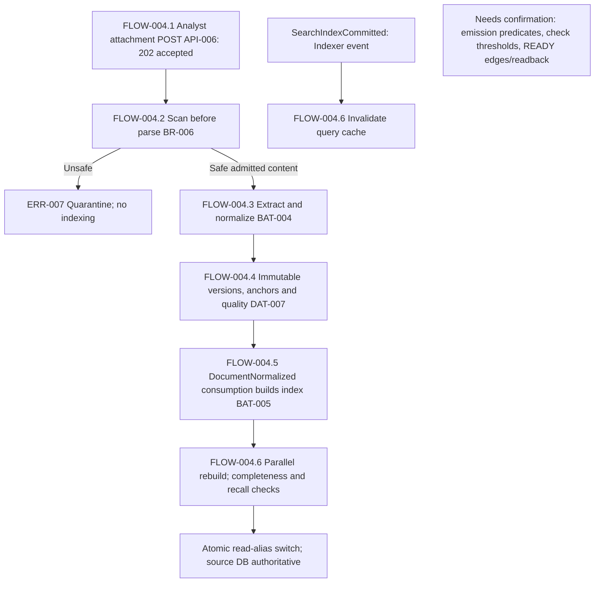
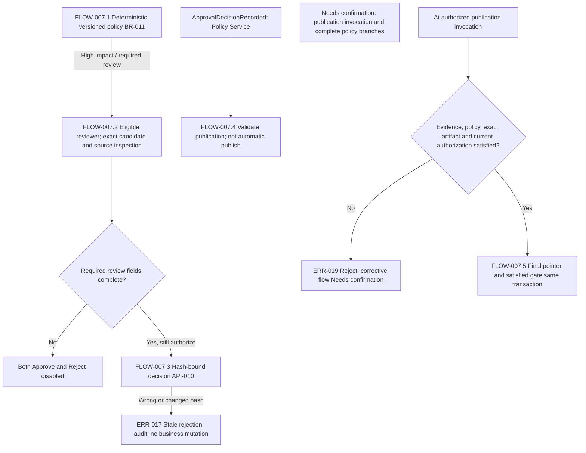
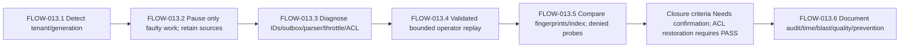

# 7. Processing Flow Specification

## Flow Inventory and Prerequisites

### FLOW-000 — Authority and interpretation

**Confirmed.** This is `07_processing_flows.md`, Stage 7/8, for OrionDesk AI, `OD-AI-DDS-001`, `R1.0 / revision 1.3`. It integrates supplied chapter judgments for **1794363094-OrionDesk_AI_Detailed_Design_Specification.pdf**, abbreviated **Current PDF** below, using original pages and finding IDs. It does not claim a fresh inspection of unavailable attachments. The candidate is provisional pending evidence review.

The source states: “All numbers are design assumptions, not measured production performance.” The baseline is normative only for the fictional sample. Figures are normative boundary illustrations, not generated implementation artifacts. Contents and CONTRACT 01–04 chains do not independently establish executable order, jobs, tables or event triggers. No source `FLOW-*` identifiers were found; identifiers here are specification-assigned. [Current PDF pp.1–2,8; `processing_flows:r1:c1:f1`, `processing_flows:r1:c1:f3`, `processing_flows:r1:c2:f1`, `processing_flows:r1:c2:f3`, `processing_flows:r1:c5:f1`]

**Confirmed** means source-supported; **Needs confirmation** means missing or contradictory contract; **Proposal** would mean an unapproved suggestion. No new proposal is selected. References connect the six completed specifications without making them independent source evidence:

| File | Preserved identifiers and responsibility |
|---|---|
| [01_screen_functions.md](01_screen_functions.md) | `SF-*`, `SCR-001`–`SCR-008`: user interaction |
| [02_api.md](02_api.md) | `API-*`, `API-G*`: interfaces |
| [03_data.md](03_data.md) | `DAT-*`, `DAT-OQ-*`: persistence and context |
| [04_batch_functions.md](04_batch_functions.md) | `BAT-*`, `BAT-OQ-*`: background responsibilities, not selected executables |
| [05_business_rules.md](05_business_rules.md) | `BR-*`, `BR-OQ-*`: policy and domain constraints |
| [06_exception_handling.md](06_exception_handling.md) | `ERR-*`, `ERR-OQ-*`: interruption and recovery |

Stages 1–5 cite **1794353355-OrionDesk_AI_Detailed_Design_Specification.pdf**. Stage 6 and this stage cite Current PDF. Shared identity/revision does not prove file equivalence; do not relabel earlier citations.

### Inventory

All flows inherit FLOW-000 and shared guards below. For **every flow**, unstated initiator/executor, field schema, screen control/route, transaction participant, concurrency mechanism, schedule/timezone, success/no-input/partial completion, status readback and recovery permission is **Needs confirmation**, not implementation discretion.

| Flow | Purpose, users and systems | Trigger and prerequisites | Confirmed completion boundary; missing contract | Related identifiers |
|---|---|---|---|---|
| FLOW-001 | Authenticate/authorize; all callers, gateway/domain/retrieval | Interactive PKCE; each request/job binds tenancy and resource authority | Authorized boundary access or safe rejection; session lifecycle open | SF-003; API-002/048; DAT-009/010; BAT-022; BR-003; ERR-005/006 |
| FLOW-002 | Intake/classify/update case; Analyst, Case Service/classifier | Valid case POST; permitted revision mutations | `201` case/NEW; classification outputs; guarded update. Classification completion state open | SCR-001/002; API-003–005; DAT-006/010; BAT-001; BR-004/005; ERR-001–004 |
| FLOW-003 | Provision/backfill/sync repositories; Admin, operators/workers | Provisioning complete; Admin sync POST; historic onboarding | Durable item outcomes/cursors and index coverage; whole-sync/backfill completion open | SCR-006; API-011/027; DAT-011/017; BAT-002/003/012; BR-007/018; ERR-009–011/023 |
| FLOW-004 | Safe ingestion and index production; Analyst/Ingestion/Indexer | Attachment POST or configured source intake; admitted safe file | Immutable anchored derivatives; guarded index promotion. `202` is not READY | SCR-003; API-006/023; DAT-007/011; BAT-004–006; BR-006/008; ERR-007/008/021 |
| FLOW-005 | Permitted search and source inspection; Member mapping open, Analyst/Reviewer | Authorized query/source; current ACL | ACL-filtered verified evidence or unsupported outcome; citation opens exact source anchor | SCR-003; API-012/021/022; DAT-007/009; BAT-007; BR-008/019; ERR-008/012/022 |
| FLOW-006 | Bounded draft/tool workflow; Analyst/Orchestrator/Gateway | Case-run POST, approved plan/deployments/quota/tool grants | Candidate/policy checkpoint or stop; accepted run not publication | SCR-004; API-007/008/024/037/042e/046; DAT-012; BAT-007; BR-009/010; ERR-013–016 |
| FLOW-007 | Deterministic policy/review/publication; Policy Service/Reviewer | Candidate and normalized versioned inputs; eligibility/evidence | Exact gate and final pointer atomic commit; invoker/API open | SCR-005/007; API-010/025/052; DAT-013; BAT-008/009; BR-011–013; ERR-017–019 |
| FLOW-008 | Progress observation/reconnect; Analyst/Reviewer/browser | Authorized run read/SSE | Retained scoped backfill/server reconstruction, not execution restart | SCR-004; API-009/047; DAT-008/018; BAT-023; BR-019; ERR-022 |
| FLOW-009 | Close/reopen/retain case; authorized actor open | Close interface, valid revision/approval; eligible closed retention | Immutable approved lineage; reopening only new revision. Entry/reopen edges open | SCR-002; API-026; DAT-010/016; BAT-014; BR-004/016; ERR-024 |
| FLOW-010 | Durable event/replay coordination; services/consumers/operator | Registered event or authorized bounded replay | One accepted transition; duplicate recorded/no reapplication; recovery verification | API-038/039/053; DAT-014/018; BAT-010/011; BR-014; ERR-003/020/021 |
| FLOW-011 | Audit/usage/key lifecycle; Auditor/Admin/operators | Accepted/denied/duplicate evidence; policy rotation; daily report granularity | Immutable scope-redacted audit/read, attributed report, rotation obligation; procedure/cadence open | SCR-008; API-013/014/029; DAT-015–017; BAT-015/017/018; BR-015/017; ERR-025/029/030 |
| FLOW-012 | Controlled export/delete; Admin + approver/Retention Worker | Two independent checks; export two persons/manifest; legal holds | Authorized package or verified hold-safe receipts; `202` not completed exit | API-016/017/041; DAT-016; BAT-013/014; BR-016; ERR-024 |
| FLOW-013 | Incident/degraded/regional recovery; operators/incident command | Index backlog/ACL suspicion/provider or primary outage | Verified safe restoration; no bypass; closure/readback criteria partly open | API-031/039/042b; DAT-017; BAT-011/020/023; BR-018; ERR-016/021/027/031 |
| FLOW-014 | Evaluation/migration/release; Admin/CI/Security/SRE/control owner | Frozen benchmark/release/change; signed compatible artifacts | All applicable release gates satisfied; no pass/sign-off asserted | API-015/030/035/036/042c/042d; DAT-017/019; BAT-016/019; BR-020; ERR-026/034 |

Inventory evidence: Current PDF pp.12,25–26,27–32,40–46,55–59,62–66,69–80,83,87,90; `processing_flows:r1:c13:f1`, `processing_flows:r1:c37:f1`, `processing_flows:r1:c38:f6`, `processing_flows:r1:c43:f1`, `processing_flows:r1:c48:f4`, `processing_flows:r1:c66:f5`, `processing_flows:r1:c74:f1`, `processing_flows:r1:c91:f1`, `processing_flows:r1:c104:f1`, `processing_flows:r1:c110:f1`, `processing_flows:r1:c132:f1`, `processing_flows:r1:c134:f6`, `processing_flows:r1:c137:f6`, `processing_flows:r1:c139:f1`, `processing_flows:r1:c142:f5`.

## Normal Processing

### FLOW-001 — Shared entry, transaction and disclosure guards

1. **FLOW-001.1:** Authenticate interactive sessions with authorization-code PKCE. Check issuer, audience, expiry, subject and tenant; reject unexpected algorithms/missing tenancy. Do not store long-lived refresh tokens in local storage. Secure `HttpOnly`, `SameSite` BFF cookies remain optional/unselected. Session routes/durations/refresh recovery are open. [Current PDF p.21 §5.1; `processing_flows:r1:c30:f1`, `processing_flows:r1:c30:f5`]
2. **FLOW-001.2:** Bind principal/tenant and evaluate role, workspace membership, sensitivity, source ACL, action and separation of duties. Baseline roles: Analyst, Reviewer, Admin, Auditor, Service. Navigation is not authorization. Edge checks, in-transaction attribute reevaluation, retrieval checks, dispatch and publication guards apply independently. [pp.21–23; `processing_flows:r1:c29:f1`, `processing_flows:r1:c31:f1`, `processing_flows:r1:c31:f2`]
3. **FLOW-001.3:** Validate before transaction, at domain invariants, before tool dispatch and before long-work allocation. Use tenant storage predicates/RLS. Reset pooled scoped variables after **every transaction**, including failed transactions by the universal wording. Additionally enforce workspace-tenancy membership by foreign keys **OR controlled write procedures**, unselected. [pp.51,56,86; `processing_flows:r1:c83:f2`, `processing_flows:r1:c92:f4`, `processing_flows:r1:c138:f23`, `processing_flows:r1:c138:f24`, `processing_flows:r1:c138:f25`]
4. **FLOW-001.4:** Actual background jobs carry immutable tenant identity in signed envelopes. This neither freezes permissions nor makes the whole job immutable. General boundary tenant/actor context applies everywhere; fuller `tenant_id`, `revision`, `actor_id`, `occurred_at`, correlation ID records apply **wherever durable state changes**. Request `trace_id`/`correlation_id`, provider trace, canonical events, job signatures and SSE offsets are not declared aliases. [pp.22,48,64; `processing_flows:r1:c32:f2`, `processing_flows:r1:c78:f1`, `processing_flows:r1:c78:f2`, `processing_flows:r1:c108:f1`]
5. **FLOW-001.5:** Reject stale/unauthorized business writes before their relevant named-event publication, leaving business state unchanged. One audit record applies to each accepted transition; retain separate denial/duplicate evidence. Public responses/errors exclude credentials, full prompts, retrieved documents and private existence; diagnostics exclude documents/API secrets/source text. [pp.49–50,64,84; `processing_flows:r1:c79:f9`, `processing_flows:r1:c82:f1`, `processing_flows:r1:c82:f3`, `processing_flows:r1:c107:f2`, `processing_flows:r1:c137:f22`]

Runtime prerequisites: private datastores/declared egress, distinct scoped identities, independently authorized internal HTTP/gRPC, external model gateway and no direct orchestrator DB credentials. Managed identity replaces static credentials where supported. [pp.9,18–19; `processing_flows:r1:c8:f1`, `processing_flows:r1:c24:f1`, `processing_flows:r1:c24:f5`, `processing_flows:r1:c25:f2`]

### FLOW-002 — Case initiation and revision-controlled work

1. **FLOW-002.1:** Authorized Analyst initiates case creation through the still-unmapped SCR-001/SCR-002 creation interaction: `POST /v1/cases` (`API-003`). Validate and apply idempotency; reference result `201`, case identifier, initial `NEW`. Intake includes attachments/business context; exact fields/completeness are open. [Current PDF pp.12,83; `processing_flows:r1:c13:f1`, `processing_flows:r1:c137:f6`]
2. **FLOW-002.2:** Case Service's `CaseCreated` carries case ID/revision concepts; consumer runs classifier (`BAT-001`). Asynchronous classification attaches labels, confidences and provenance. User corrections require a reason code, with correction endpoint/catalog/authorization open. Do not infer that run creation emits CaseCreated. [pp.12,87; `processing_flows:r1:c13:f1`, `processing_flows:r1:c139:f1`]
3. **FLOW-002.3:** Authorized Analyst/Reviewer reads current revision with `GET /v1/cases/{caseId}` (`API-004`, `200`). Owner-scoped mapping-open PATCH (`API-005`, `200/409`) submits `If-Match`. Read/mutate `cases`; preserve append-only `case_revisions`. Exact wire fields and revision-increment algorithm remain open. [pp.25,83,85; `processing_flows:r1:c37:f5`, `processing_flows:r1:c137:f7`, `processing_flows:r1:c137:f8`, `processing_flows:r1:c138:f4`, `processing_flows:r1:c138:f5`]
4. **FLOW-002.4:** Apply `BR-004/005`: `NEW→TRIAGED→IN_PROGRESS`; `IN_PROGRESS→PENDING_APPROVAL or RESOLVED`; `PENDING_APPROVAL→RESOLVED or IN_PROGRESS`, under role/revision/approval guards. Branch predicates are open. Priority derives from explicit impact/urgency, never model alone. Workspace business calendars set deadlines; advisory breach prediction cannot alter them. [pp.25,82; `processing_flows:r1:c37:f1`, `processing_flows:r1:c38:f1`, `processing_flows:r1:c38:f2`, `processing_flows:r1:c137:f2`]

**Transaction boundary:** preserve source wording: “Case mutations, approval decisions and outbox inserts commit in one ACID transaction.” It establishes the applicable local boundary, not that every case mutation creates an approval or that all services share a transaction. Indexing/webhooks are asynchronous reconciled. Exact participants per operation remain open. [p.52 §14.2.1; `processing_flows:r1:c85:f1`]

### FLOW-003 — Provisioning, historic intake and connector sync

1. **FLOW-003.1:** One idempotent provisioning workflow creates workspace policy, encryption references, role bindings, quotas and connector stubs (`BAT-012`). Visible incomplete provisioning blocks sync. Initiator/API/internal step order/completion predicate remain open; one workflow is not one transaction. [Current PDF p.78; `processing_flows:r1:c132:f1`, `processing_flows:r1:c132:f2`]
2. **FLOW-003.2:** Admin initiates `POST /v1/connectors/{connectorId}/sync` (`API-011`, `202`). Inspect advertised list/fetch/delta cursor/ACL/delete support and resolve workspace secret references. Capability gaps produce lower-trust visible warning, never permission bypass. [pp.27,83; `processing_flows:r1:c42:f1`, `processing_flows:r1:c42:f6`, `processing_flows:r1:c137:f14`]
3. **FLOW-003.3:** Workers fetch configured sources while preserving identity, ACL and history; route allowed source intake into FLOW-004. Persist provider cursor/high-watermark/error ledger (`connector_cursors`). Advance only when **all preceding items have durable ingestion outcomes**. Item/batch transaction units and exact source-to-ingestion message contracts remain open. [pp.27–28,85; `processing_flows:r1:c41:f1`, `processing_flows:r1:c43:f1`, `processing_flows:r1:c138:f16`]
4. **FLOW-003.4:** Historic backfill uses bounded windows/stable source IDs/per-batch reconciliation receipts (`BAT-003`). Search readiness derives from index coverage, not queue emptiness. Window bounds/coverage formula/threshold and whole-job completion are open. [p.78; `processing_flows:r1:c132:f7`, `processing_flows:r1:c132:f8`]
5. **FLOW-003.5:** Source deletes tombstone and schedule index removal; ACL changes invalidate affected caches before new results. Revocation applies before next retrieval despite pending index cleanup. Sync history interface `GET /v1/connectors/{connectorId}/runs` exists; complete status/readback linkage is open. [pp.27–29; `processing_flows:r1:c41:f2`, `processing_flows:r1:c43:f5`, `processing_flows:r1:c43:f6`, `processing_flows:r1:c45:f7`]

### FLOW-004 — Attachment, normalization and index production

1. **FLOW-004.1:** Analyst submits `POST /v1/cases/{caseId}/attachments` (`API-006`, `202` ingestion operation). Admit PDF, DOCX, HTML, UTF-8 text, signature-extension agreement, configurable **25 MB/file**, bomb protection. `202` is not READY. [Current PDF pp.30,83; `processing_flows:r1:c48:f1`, `processing_flows:r1:c137:f9`]
2. **FLOW-004.2:** Scan **before parsing**, disable macros and never fetch embedded remote references. Unsafe files quarantine/no indexing (`ERR-007`). [p.30; `processing_flows:r1:c48:f4`]
3. **FLOW-004.3:** Extract PDF blocks/page indices/bboxes, table rows/columns, headings/reading order. OCR fallback is opt-in/provenance-marked; beyond-English OCR deferred. Normalize transport artifacts without rewriting claims. Fingerprint + pipeline version yields immutable derivative IDs; changed processing may coexist side by side. [pp.10,31; `processing_flows:r1:c8:f7`, `processing_flows:r1:c49:f1`, `processing_flows:r1:c49:f2`, `processing_flows:r1:c49:f6`]
4. **FLOW-004.4:** Preserve `documents`, immutable `document_versions`, chunks/anchors: URI, file hash, page, **optional chunk bbox**. Record empty-page/unknown-character/table-loss/language-confidence quality. Authorized low-quality remains viewable but excluded autonomous recommendations; indexability/state mapping remains open. [pp.31–32,85; `processing_flows:r1:c50:f1`, `processing_flows:r1:c50:f6`, `processing_flows:r1:c138:f6`, `processing_flows:r1:c138:f7`, `processing_flows:r1:c138:f8`]
5. **FLOW-004.5:** Ingestion's `DocumentNormalized` version ID/source hash consumption builds index (`BAT-005`). Search rows include tenancy/workspace/version/chunk/language/classification, normalized text and **1536-dimensional embedding**. [pp.34,87; `processing_flows:r1:c54:f1`, `processing_flows:r1:c139:f2`]
6. **FLOW-004.6:** Rebuild creates a parallel index; completeness/recall checks precede **atomic read-alias switch**. Database remains authoritative. Indexer's `SearchIndexCommitted` generation/document revision consumption invalidates query cache. Check metrics, promotion arbitration, emission predicates and old-generation retirement remain open. [pp.34,87; `processing_flows:r1:c54:f5`, `processing_flows:r1:c139:f3`]

Document catalog `ACCEPTED/SCANNING/EXTRACTING/INDEXING/READY/QUARANTINED` has scan/quality guard, **not all directed edges**. `GET /v1/documents/{documentId}/status` exists, but accepted-operation linkage/schema is open. [pp.32,82; `processing_flows:r1:c51:f7`, `processing_flows:r1:c137:f4`]

### FLOW-005 — Search and citation inspection

1. **FLOW-005.1:** Authorized Member mapping-open search submits `POST /v1/search` (`API-012`, `200`). Form lexical and normalized vector queries; bounded candidates→RRF→deterministic rerank, diversity and model-token budget. No confirmed lexical/vector concurrent execution, RRF constant or selected candidate limit. Ranking never authorizes; filter originating ACL before generation release. [Current PDF pp.34–36,83; `processing_flows:r1:c53:f2`, `processing_flows:r1:c55:f1`, `processing_flows:r1:c55:f5`, `processing_flows:r1:c137:f15`]
2. **FLOW-005.2:** Return evidence item chunk ID/title/document revision/page anchor/ACL digest; opaque citation IDs verify before display. Evidence-set storage supports later publish validation, not authority. [pp.35,85; `processing_flows:r1:c56:f1`, `processing_flows:r1:c138:f11`]
3. **FLOW-005.3:** Citation activation opens source and highlights anchored page range. Preserve exact immutable version and current access; objects encrypted, opaque public names, authorized short-lived signed URLs. Source-opening endpoint/destination/window/page basis/expiry failure remain open. Reviewer inspection must be available before approval, not recorded completed inspection. [pp.31,52,57–58; `processing_flows:r1:c50:f1`, `processing_flows:r1:c86:f1`, `processing_flows:r1:c95:f2`, `processing_flows:r1:c96:f6`]

### FLOW-006 — Bounded planning, generation and tool dispatch

1. **FLOW-006.1:** Analyst starts `POST /v1/cases/{caseId}/runs` (`API-007`, `202`). Run created immediately, not an approved answer. General `POST /v1/runs` (`API-042e`) also exists; relationship/browser choice remains unresolved. [Current PDF pp.15,58,83; `processing_flows:r1:c18:f4`, `processing_flows:r1:c97:f1`, `processing_flows:r1:c137:f10`]
2. **FLOW-006.2:** Store plan revision before side effects. DAG depth **8**, maximum **16 tool invocations**, explicit dependencies/replayable checkpoints. Each stage checkpoints before downstream dispatch. Triage/Research/Draft responsibilities differ; policy evaluator deterministic. Stage prose is `REQUESTED→RETRIEVING→GENERATING→POLICY_CHECK→AWAITING_REVIEW→PUBLISHED or terminal failure`; timer/branch exceptions remain FLOW-OQ-003. [pp.40,49; `processing_flows:r1:c66:f1`, `processing_flows:r1:c66:f5`, `processing_flows:r1:c66:f6`, `processing_flows:r1:c79:f1`]
3. **FLOW-006.3:** Research consumes FLOW-005 permitted evidence. Models allowlist specific approved capability/region/handling/context/cost/evaluation deployments. Reserve input/output tokens/account provider usage under quota; reservation timing/atomicity/pricing open. Maximum included class governs route/redaction/retention/approval. [pp.37–39,62; `processing_flows:r1:c60:f1`, `processing_flows:r1:c62:f1`, `processing_flows:r1:c103:f1`]
4. **FLOW-006.4:** Construct fixed rules/signed workflow/validated user input/delimited untrusted passages; strip evidence tool directives/record indicators. Nonessential PII redaction precedes provider where policy permits. Gateway `POST /internal/model/generate` (`API-037`) requests versioned JSON/bounded parse. Unknown fields/invalid citations/control injection `MODEL_OUTPUT_INVALID`, no publication. [pp.38–39,62,89; `processing_flows:r1:c61:f1`, `processing_flows:r1:c61:f5`, `processing_flows:r1:c62:f7`, `processing_flows:r1:c103:f5`, `processing_flows:r1:c141:f5`]
5. **FLOW-006.5:** Orchestrator `AgentPlanApproved` consumption dispatches plan steps **still independently authorized**. Pinned approved MCP schema/validated arguments do not grant effect permission. External writes separate capability; mutable calls idempotency; consequential mutable calls human authorization. No equivalent denied action workaround. [pp.41–42,87; `processing_flows:r1:c67:f1`, `processing_flows:r1:c68:f8`, `processing_flows:r1:c68:f9`, `processing_flows:r1:c139:f4`, `processing_flows:r1:c139:f12`]
6. **FLOW-006.6:** A2A task/capability/input-output schema/deadline/trace handoff may be declined. `knowledge.search@v1` is `{query:string, case_id:uuid, max_items:int<=10}`→`{evidence_set_id:uuid,citations:Citation[]}`, tenant `read:permitted_documents`, read-only/no arbitrary URL/filesystem. Actual typed handoff, grant verification and decline recovery open. [pp.41,87; `processing_flows:r1:c67:f5`, `processing_flows:r1:c139:f10`, `processing_flows:r1:c139:f11`, `processing_flows:r1:c139:f13`]

### FLOW-007 — Policy, exact review and distinct publication

1. **FLOW-007.1:** Normalize/store sensitivity, action, evidence quality, model class, financial-impact category and confidence bands with rule-set version. Outcomes `AUTO_ALLOW/HUMAN_REVIEW/REQUEST_MORE_EVIDENCE/DENY`; LLM risk tags never override. High-impact becomes task, not autonomous mutation. Full input/outcome/lifecycle mapping open; AUTO_ALLOW not unconditional publish. [Current PDF p.44; `processing_flows:r1:c72:f1`, `processing_flows:r1:c72:f6`]
2. **FLOW-007.2:** For required review assign policy pool/minimum-role/separation. Display exact candidate/citations/model-prompt version/reasons and inspectable sources. Both Approve/Reject disabled until required fields complete; completeness never replaces authorization. Own-high-risk self-approval prohibited; broader no-self-approval scope unresolved. [pp.11,45,58,85; `processing_flows:r1:c12:f5`, `processing_flows:r1:c73:f1`, `processing_flows:r1:c97:f7`, `processing_flows:r1:c97:f8`, `processing_flows:r1:c138:f12`]
3. **FLOW-007.3:** Reviewer `POST /v1/approvals/{approvalId}/decision` (`API-010`, `200/409`) binds exact reviewed hash. Record decision/actor/time/hash/rationale/optional annotations, immutable decisions. Changed/wrong hash stale-reject/audit, business state unchanged. [pp.45,83,85,89; `processing_flows:r1:c73:f6`, `processing_flows:r1:c73:f10`, `processing_flows:r1:c137:f13`, `processing_flows:r1:c138:f13`, `processing_flows:r1:c141:f6`]
4. **FLOW-007.4:** Policy Service's `ApprovalDecisionRecorded` task/actor/content-hash consumer **validates publication**, does not automatically publish. Publication requires evidence AND satisfied versioned policy, exact artifact and current tenant/document permission. Reject stale evidence after intervening changes; unapproved high-risk cannot publish. [pp.11–12,46,87; `processing_flows:r1:c11:f2`, `processing_flows:r1:c13:f5`, `processing_flows:r1:c76:f2`, `processing_flows:r1:c139:f5`]
5. **FLOW-007.5:** At authorized publication invocation, final response pointer and satisfied approval gate commit **in the same transaction**. Old approval/replay cannot publish another artifact. Publication invoker/endpoint/readback and exact status mapping remain open; no button invented. [p.45; `processing_flows:r1:c74:f1`]

Review catalog `ASSIGNED/OPENED/APPROVED/REJECTED/EXPIRED` actor/hash/separation guards does not supply every edge. [p.82; `processing_flows:r1:c137:f5`]

### FLOW-008 — Observation recovery

1. **FLOW-008.1:** Authorized Analyst/Reviewer `GET /v1/runs/{runId}` (`API-008`, `200`) obtains stages/evidence metadata; subscribe `GET /v1/streams/runs/{runId}` (`API-009`, `200` SSE). Show retrieval/generation/policy, accessible draft state and exact failed checkpoint where applicable. [Current PDF pp.41,57–58,83; `processing_flows:r1:c68:f2`, `processing_flows:r1:c96:f5`, `processing_flows:r1:c97:f1`, `processing_flows:r1:c137:f11`, `processing_flows:r1:c137:f12`]
2. **FLOW-008.2:** Offsets increase; reconnect `Last-Event-ID` backfills retained caller-scoped events. Refresh reconstructs server progress, not browser memory. Expired history/current-stream revocation/framing remain open. No execution restart/resume command follows. [pp.55,58; `processing_flows:r1:c91:f1`, `processing_flows:r1:c97:f2`]
3. **FLOW-008.3:** Meaningful-only live announcements, visible focus/semantic regions/keyboard order/WCAG2.2AA target; UTC storage displays workspace-local labeled time, locale no durable/order change. [pp.58–59; `processing_flows:r1:c98:f1`, `processing_flows:r1:c98:f2`, `processing_flows:r1:c98:f7`]

### FLOW-009–012 — Completion lineage and supporting operations

| Step | Confirmed processing and boundary | Needs confirmation |
|---|---|---|
| FLOW-009.1 | `POST /v1/cases/{caseId}/close` exists. Closure snapshots approved answer/cited versions/reviewer decisions; immutable lineage survives. CLOSED final **unless reopened as new revision** | Actor/entry/reopen edges/API/status/transaction/readback |
| FLOW-009.2 | Retention only eligible closed cases with holds; soft-deleted nonretrievable; scheduled tombstone purge | Eligibility/cadence/hold/reopen race/permitted lineage erasure |
| FLOW-010.1 | Registered events use canonical UTC/JSON envelope and applicable outbox; consumer ledger/event/operation/revision checks duplicate/stale/delayed delivery | Full payloads/triggers/ledger atomicity/retention/stale-nonduplicate results |
| FLOW-010.2 | Duplicate: check ledger/revision→record duplicate→return without business reapplication. `WorkflowStageAdvanced` consumer resumes consumers, not SSE | Actual checkpoint resume algorithm/cancel/lease |
| FLOW-011.1 | Append-only batch-hash audit exported to independent retention; Auditor cursor immutable scope-redacted `GET /v1/audit/events`, `200`; operators cannot edit past decisions | Chain algorithm/batching/cadence/verification/receipt |
| FLOW-011.2 | Invocation/embedding/storage/index cost-center/deployment attribution; daily budget/forecast/rejected-excess rollups; Admin usage GET `200` | Prices/formulas/cutoff/timezone/late adjustments/empty output |
| FLOW-011.3 | Service credentials automatically rotate; secrets managed-identity vault; encryption keys policy rotation without request-path bulk reencryption | Intervals/hierarchy/failure recovery/isolation decision |
| FLOW-012.1 | Admin+approver workspace export/delete POST each `202`; two independent checks both, **two-person+manifest export**; single Admin export denied | Approval binding/person identities/delete-check mechanics/download/status |
| FLOW-012.2 | Export metadata/approved artifacts/source refs/checksum audit manifests, exclude secrets/internal prompts | Package/checksum schema/partial delivery |
| FLOW-012.3 | Delete enforces holds/tombstones/permitted blob/index removal/receipts; held protected records retained/receipted. Retention Worker's `TenantDeletionVerified` manifest/receipt hash consumer closes purge record | Tenant/workspace scope, verification/held-partial completion/readback |

Sources: Current PDF pp.21,25–26,48–53,62–66,78–80,83,87–89; `processing_flows:r1:c30:f6`, `processing_flows:r1:c37:f1`, `processing_flows:r1:c38:f6`, `processing_flows:r1:c38:f7`, `processing_flows:r1:c79:f9`, `processing_flows:r1:c82:f1`, `processing_flows:r1:c84:f7`, `processing_flows:r1:c104:f1`, `processing_flows:r1:c104:f7`, `processing_flows:r1:c104:f8`, `processing_flows:r1:c110:f1`, `processing_flows:r1:c131:f1`, `processing_flows:r1:c134:f1`, `processing_flows:r1:c134:f6`, `processing_flows:r1:c137:f16`, `processing_flows:r1:c137:f17`, `processing_flows:r1:c137:f19`, `processing_flows:r1:c137:f20`, `processing_flows:r1:c139:f6`, `processing_flows:r1:c139:f8`, `processing_flows:r1:c140:f11`, `processing_flows:r1:c141:f13`.

Diagnostic TTL **30-day default**, security audit **seven-year fictional** policy are separate, with holds/receipts and corporate retention unselected. Data-subject requests reuse inventory, not new endpoint or deletion authority. [Current PDF pp.66,80; `processing_flows:r1:c110:f6`, `processing_flows:r1:c110:f7`, `processing_flows:r1:c134:f7`]

### FLOW-014 — Governance, evaluation and release

1. **FLOW-014.1:** Baseline change requires architecture record, impact scores for behavior/data migration/threat/cost, traceable contract/test and negative test per revised invariant. Minor/major revision overlap/activation open. Governance POST/GET exist, not screen or BaselineCommitted trigger inference. [Current PDF pp.8–10; `processing_flows:r1:c5:f2`, `processing_flows:r1:c6:f1`, `processing_flows:r1:c6:f5`, `processing_flows:r1:c9:f6`, `processing_flows:r1:c9:f7`]
2. **FLOW-014.2:** Admin `POST /v1/evaluations` (`API-015`, `202`) starts frozen benchmark; evaluation GET exists, report linkage open. 1200 synthetic permission-controlled cases retain expected citations/decisions. Frozen precision≥0.97, unsupported≤0.02, high-risk recall1.00 plus domain intervals/shift. Independent model/prompt change requires reevaluation; low confidence blocks release. [pp.75–76,83; `processing_flows:r1:c127:f1`, `processing_flows:r1:c127:f6`, `processing_flows:r1:c128:f6`, `processing_flows:r1:c128:f7`, `processing_flows:r1:c129:f7`, `processing_flows:r1:c137:f18`]
3. **FLOW-014.3:** Build reproducible artifacts/config; Terraform OR Bicep unselected. Source nonsecret defaults, signed environment and vault refs separate. CI static/dependency/unit/contracts/SBOM/sign images; production accepts only allowed-build-identity verified digests. Enumeration not parallel/sequential suite graph. [pp.71–72; `processing_flows:r1:c120:f1`, `processing_flows:r1:c120:f6`, `processing_flows:r1:c121:f1`]
4. **FLOW-014.4:** Compatible nullable expansion→bounded backfill→constraints; predeploy compatibility precedes canary, postdeploy enforcement after old replicas drain. Plans disclose new-write readability. Compare baseline latency/errors/auth denials/AI regression; regression causes **traffic rollback, not DB down-migration**. [pp.52,72; `processing_flows:r1:c85:f6`, `processing_flows:r1:c121:f5`, `processing_flows:r1:c122:f1`]
5. **FLOW-014.5:** Security/SRE egress/secrets/backups/alerts validation before promotion; release binds image/schema/prompt/model-policy and reconstructibility. Security-control owner reviews evidence, independently reproduces negatives, signs release. Critical isolation/approval zero exceptions; SEC001–012 release-blocking; unmitigated critical isolation/approval bypass blocks regardless benchmark. Relative canary/operator gate order, signature/report schema and mappings open. [pp.73–76,88; `processing_flows:r1:c122:f5`, `processing_flows:r1:c124:f4`, `processing_flows:r1:c125:f2`, `processing_flows:r1:c140:f13`, `processing_flows:r1:c140:f14`, `processing_flows:r1:c140:f15`]

`POST /internal/releases`/release GET and `EvaluationCompleted`/`ReleasePromoted` exist with conditional interface/versioned outbox/guard/duplicate requirements. No GET starts/promotes release, and neither completion event grants promotion. [Current PDF pp.73,76; `processing_flows:r1:c123:f6`, `processing_flows:r1:c123:f7`, `processing_flows:r1:c123:f8`, `processing_flows:r1:c129:f8`]

## Branches, Failures, and Recovery

### Failure and alternative-path matrix

| Flow / condition | Required branch and retained state | Retry, termination and resumption |
|---|---|---|
| FLOW-001 foreign tenant | Absent-ID not-found class; case test404-equivalent non-disclosing; safe principal/resource-class audit (`ERR-006`) | Permanent permission nonretry; exact universal status/body open |
| FLOW-002 revision mismatch |409 `CASE_VERSION_CONFLICT`, current revision, unchanged business state (`ERR-001`) | Example retryable:false; merge/corrected submission open |
| FLOW-002 same key/body or changed body | One case/identical response; changed409 `IDEMPOTENCY_CONFLICT` (`ERR-002/003`) | Actor/fingerprint outcome24h; expiry/concurrency mechanics open |
| All named interfaces unavailable dependency | Documented retryable error **OR** persisted asynchronous ID, never ambiguous success (`ERR-020`) | Branch/owner/readback open, not universal GET jobs; ordinary200/201/202 stand |
| FLOW-003 revoked queued credentials | `CONNECTOR_REAUTH_REQUIRED`, no tokens (`ERR-010`) | Running jobs/reauth/rerun open |
| FLOW-003 malformed/partial batch | Bounded quarantine reason/correlation/remediation; remaining batch **may** proceed with ledger exception (`ERR-011`) | No automatic poisoned success/cursor advance; taxonomy versus permanent nonretry open |
| FLOW-004 unsafe versus low quality | Unsafe quarantine/no index; authorized low-quality viewable/no autonomous recommendations (`ERR-007/008`) | Remediation/quality thresholds/READY edges open |
| FLOW-004 index failure | Retain accepted metadata, compare fingerprints/eligible retry, repair outbox links (`ERR-021`) | Not source rollback or unrestricted retries; verification/completion open |
| FLOW-005 insufficient confidence OR quality | `NO_SUPPORTED_EVIDENCE`, never fabricated context (`ERR-012`) | Clarification **OR** human routing unselected; missing citation review **OR** unsupported separate |
| FLOW-006 invalid model output | `MODEL_OUTPUT_INVALID`, no publication (`ERR-013`) | Bounded parsing; overlapping invalid/missing/unsupported precedence open |
| FLOW-006 arbitrary/denied tool | `DENY` before dispatch, no equivalent-tool substitution (`ERR-014`) | Permanent permission nonretry; model text/discovery no grants |
| FLOW-006 quota/stop conditions | Current-run quota terminal without model/class switch; missing approval/call budget/invalid plans/denial/deadline stop and failed checkpoint (`ERR-015`) | AWAITING_REVIEW/recoverable timeout applicability unresolved; no180s review inference |
| FLOW-006 provider outage/throttle | New admission tokens/queue/capacity conjunction;429+Retry-After/saved cases; only approved equal-or-stronger eligible fallback (`ERR-016`) | Capped/bounded retry, no quota evasion or unapproved restricted route |
| FLOW-007 wrong hash/ineligible reviewer | Stale/unauthorized reject, audit, unchanged business state (`ERR-017`) | No transferred approval; correction/new review contract open |
| FLOW-007 expiry/denial | No implicit approval; reassign **OR** escalate, escalation recorded; denied rework new run revision (`ERR-018`) | SLA/branch/timers open; override elevated+secondary+audited reason, no hash/ACL waiver |
| FLOW-007 permission change | Recompute authorization/reject stale evidence even after search/review (`ERR-019`) | Corrective evidence/review/publication invocation open |
| FLOW-008 disconnect/refresh | Retained scoped Last-Event-ID backfill/server reconstruction (`ERR-022`) | Observation only; expired-history/active revoke open |
| FLOW-010 duplicate | Ledger/revision check→duplicate record→return/no reapplication (`ERR-003`) | One accepted transition not exactly-once transport; delayed/stale behavior needs ledger contract |
| FLOW-012 hold/inadequate checks | Held protected retain/receipt; single Admin export fails (`ERR-024`) | Partial completion/approval binding open; no export→delete causality |
| FLOW-014 canary/critical/low confidence | Promotion blocks; regression traffic rollback not DB down-migration (`ERR-026`) | Data compensation only explicitly supported; no reported approval |
| Optional webhook failure | Sign/age verify/exponential retry; internal case remains committed (`ERR-022`) | Selection/exhaustion/receipts open; never case rollback |

Sources: Current PDF pp.23,25,29–32,36,38–42,45–50,55,69,72,83–89; `processing_flows:r1:c32:f5`, `processing_flows:r1:c37:f6`, `processing_flows:r1:c42:f7`, `processing_flows:r1:c44:f5`, `processing_flows:r1:c48:f4`, `processing_flows:r1:c50:f6`, `processing_flows:r1:c56:f6`, `processing_flows:r1:c61:f5`, `processing_flows:r1:c62:f2`, `processing_flows:r1:c68:f1`, `processing_flows:r1:c68:f9`, `processing_flows:r1:c73:f2`, `processing_flows:r1:c74:f5`, `processing_flows:r1:c74:f6`, `processing_flows:r1:c79:f5`, `processing_flows:r1:c80:f1`, `processing_flows:r1:c91:f5`, `processing_flows:r1:c115:f1`, `processing_flows:r1:c122:f1`, `processing_flows:r1:c137:f21`, `processing_flows:r1:c140:f11`, `processing_flows:r1:c141:f1`, `processing_flows:r1:c141:f2`, `processing_flows:r1:c141:f5`, `processing_flows:r1:c141:f9`, `processing_flows:r1:c141:f10`, `processing_flows:r1:c141:f13`, `processing_flows:r1:c141:f14`.

### FLOW-013 — Bounded operator recovery

1. **FLOW-013.1 Detect:** Alert on queue oldest age/index backlog; identify affected tenant/index generation.
2. **FLOW-013.2 Contain:** Pause **only** faulty connector/indexer shard; retain accepted sources.
3. **FLOW-013.3 Diagnose:** Inspect event ID/outbox lag/parser flags/search throttling/source ACL revision.
4. **FLOW-013.4 Recover:** Replay validated outbox through bounded operator-controlled job (`BAT-011`). Applicable dead-letter replay also requires reason/dry-run/scope limit and original event identity **except schema-transforming migration with explicit provenance link**. Replay grants no new authority.
5. **FLOW-013.5 Verify:** Compare fingerprints/index versions, run denied-access probes before closure. Generic delayed-index pass criteria/closure authority open. For suspected ACL leak separately suspend affected aliases/revoke cache/preserve audit/scoped ACL replay; restore search **only after negative access tests pass**.
6. **FLOW-013.6 Document:** Link audit IDs/time window/blast radius/quality effect/preventative action.

These are six operator stages, not six executable jobs. No unpause/restart command inferred. [Current PDF pp.50,79,90; `processing_flows:r1:c80:f5`, `processing_flows:r1:c80:f6`, `processing_flows:r1:c133:f5`, `processing_flows:r1:c142:f5`, `processing_flows:r1:c142:f6`, `processing_flows:r1:c142:f7`, `processing_flows:r1:c142:f8`, `processing_flows:r1:c142:f9`, `processing_flows:r1:c142:f10`, `processing_flows:r1:c142:f11`]

**FLOW-013.7 Provider degradation:** Disable new generation, preserve manual/evidence workflows/show degraded, page only impacted availability budget. Vector lexical fallback **may** continue with visible reduced-quality flag; no safety bypass. Current-running disposition/restoration open. [pp.69,79; `processing_flows:r1:c113:f2`, `processing_flows:r1:c115:f4`, `processing_flows:r1:c133:f1`]

**FLOW-013.8 Regional recovery:** Primary persistent writes, one warm recovery region, snapshot restoration only under incident command. Continuous PostgreSQL reference RPO≤15min/RTO≤4h with joint objects/relational/index-recipe verification; authority/order/write-switch/cadence open. Chaos includes429/lost heartbeats/duplicates/object failures/primary outage, measuring safety **and** recovery time. [pp.19,69–70; `processing_flows:r1:c25:f6`, `processing_flows:r1:c116:f1`, `processing_flows:r1:c116:f2`, `processing_flows:r1:c116:f6`]

### Concurrency and exclusion

**Confirmed:** explicit DAG dependencies/replayable checkpoints; parallel index generation with guarded atomic switch; side-by-side immutable derivatives; at-least-once duplicate/delayed safety without cross-partition ordering dependence; fair workspace connector scheduling; primary-only writes. These do **not** select leases, mutexes, scheduler joins, lexical/vector concurrency, global transactions or automatic blocked-work resume. Concurrent launch/promotion/reopen-purge/replay exclusions are Needs confirmation. [Current PDF pp.19,28,31,34,40,48; `processing_flows:r1:c25:f6`, `processing_flows:r1:c44:f1`, `processing_flows:r1:c49:f6`, `processing_flows:r1:c54:f5`, `processing_flows:r1:c66:f5`, `processing_flows:r1:c78:f5`]

## Flow Diagrams and Specification Mappings

Diagrams show only supported segments. Nodes marked **Needs confirmation** stop at missing contracts; arrows do not invent endpoints, statuses or triggers. Step IDs match prose. Source logical figure arrows are not reused as executable chains.

### Ingestion/index segment — FLOW-004



Evidence: Current PDF pp.30–35,83,87; `processing_flows:r1:c48:f4`, `processing_flows:r1:c49:f6`, `processing_flows:r1:c54:f5`, `processing_flows:r1:c137:f9`, `processing_flows:r1:c139:f2`, `processing_flows:r1:c139:f3`. No arrow from alias switch to event is added absent its precise emission contract.

### Exact review/publication segment — FLOW-007



Evidence: Current PDF pp.44–46,58,83,87,89; `processing_flows:r1:c71:f1`, `processing_flows:r1:c73:f6`, `processing_flows:r1:c74:f1`, `processing_flows:r1:c97:f8`, `processing_flows:r1:c139:f5`, `processing_flows:r1:c141:f6`. No graphically selected AUTO_ALLOW publication or missing decision-event trigger.

### Delayed-index operator sequence — FLOW-013



Evidence: Current PDF pp.50,79,90; `processing_flows:r1:c80:f6`, `processing_flows:r1:c133:f5`, `processing_flows:r1:c142:f6`, `processing_flows:r1:c142:f7`, `processing_flows:r1:c142:f8`, `processing_flows:r1:c142:f9`, `processing_flows:r1:c142:f10`, `processing_flows:r1:c142:f11`.

### Event handoffs and incomplete causality

| Event / producer | Selected payload concepts | Confirmed consumer action / flow |
|---|---|---|
| CaseCreated / Case Service | Case ID/revision | Classify, FLOW-002.2 |
| DocumentNormalized / Ingestion | Version ID/source hash | Build index, FLOW-004.5 |
| SearchIndexCommitted / Indexer | Generation/document revision | Invalidate query cache, FLOW-004.6 |
| AgentPlanApproved / Orchestrator | Run ID/plan hash | Dispatch still-authorized plan steps, FLOW-006.5 |
| ApprovalDecisionRecorded / Policy Service | Task/actor/content hash | **Validate** publication, FLOW-007.4 |
| WorkflowStageAdvanced / Orchestrator | Run/stage/checkpoint | Resume consumers, FLOW-010.2, not SSE |
| AccessDenied / Policy Service | Principal/action/policy digest | Alert enrichment, not blanket page |
| TenantDeletionVerified / Retention Worker | Manifest ID/receipt hash | Close purge record, FLOW-012.3; scope open |

[Current PDF p.87 C.1; `processing_flows:r1:c139:f1`, `processing_flows:r1:c139:f2`, `processing_flows:r1:c139:f3`, `processing_flows:r1:c139:f4`, `processing_flows:r1:c139:f5`, `processing_flows:r1:c139:f6`, `processing_flows:r1:c139:f7`, `processing_flows:r1:c139:f8`]

Also preserve chapter events `BaselineCommitted`, `RunRequested`, `DeploymentPromoted`, `CaseStateChanged`, `ConnectorSyncStarted`, `ModelInvocationCompleted`, `DataRetentionPurgeCommitted`, `ApiCompatibilityVerified`, `UserReviewOpened`, `SecurityPolicyChanged`, `SloBurnRateDetected`, `BackpressureActivated`, `ReleasePromoted`, `EvaluationCompleted`. Each has applicable versioned envelope/outbox, diagnostic-safe visibility, named rejection-before-publication and duplicate-ledger/revision guards. Full normal triggers/payloads/consumer actions remain open. C.1 is not exhaustive; no GET trigger, promotion alias, `CaseStatusEvent` alias or export-deletion linkage inferred. [Current PDF registers pp.10–80; `processing_flows:r1:c9:f8`, `processing_flows:r1:c21:f8`, `processing_flows:r1:c27:f8`, `processing_flows:r1:c39:f8`, `processing_flows:r1:c45:f8`, `processing_flows:r1:c63:f8`, `processing_flows:r1:c87:f8`, `processing_flows:r1:c93:f8`, `processing_flows:r1:c99:f8`, `processing_flows:r1:c105:f8`, `processing_flows:r1:c111:f8`, `processing_flows:r1:c117:f8`, `processing_flows:r1:c123:f8`, `processing_flows:r1:c129:f8`]

### Screen-to-specification mapping

Mappings are activity associations, not routes, complete permissions or evidence of additional screens. Every actual action reauthorizes under FLOW-001.

| Screen | Flow / API | Data | Background responsibility | Business rule | Exceptions |
|---|---|---|---|---|---|
| SCR-001 Case Queue | FLOW-002; API-003/019 | DAT-006/010, cases | BAT-001 | BR-003–005/019 | ERR-001–006 |
| SCR-002 Case Detail | FLOW-002/009; API-004/005/026 | cases/case_revisions/approved lineage | BAT-001/014 | BR-004/005/016 | ERR-001/002/024 |
| SCR-003 Evidence Viewer | FLOW-004/005; API-006/021/022/023/012 | documents/versions/chunks/evidence | BAT-004–007 | BR-006/008/019 | ERR-007/008/012/021/022 |
| SCR-004 Run Timeline | FLOW-006/008; API-007–009/024 | runs/steps/budget/evidence | BAT-007/010 | BR-009/010/019 | ERR-013–016/019/022 |
| SCR-005 Review Inbox | FLOW-007; API-010/025 | policy_evaluations/tasks/decisions | BAT-008/009 | BR-011–013 | ERR-017–019 |
| SCR-006 Connector Health | FLOW-003; API-011/027 | connector_cursors/source catalogs | BAT-002/003/012 | BR-007/018 | ERR-009–011/021/023 |
| SCR-007 Policy Settings | FLOW-001/007; setting endpoint open | workspace/versioned policy inputs | No selected policy-save batch | BR-005/011 | ERR-006/025 |
| SCR-008 Audit Explorer | FLOW-011; API-013 | audit_events/redacted evidence | BAT-017 | BR-015/019 | ERR-006/025 |
| Unmapped activities | FLOW-012/013/014, usage/key lifecycle | Manifests/receipts/incidents/release/fixtures | BAT-011/013–020 | BR-016–020 | ERR-024/026/027 |

Formal screen evidence Current PDF p.57 `processing_flows:r1:c96:f1`; persistence mappings pp.85–86 `processing_flows:r1:c138:f1`–`processing_flows:r1:c138:f25`; API mappings p.83 `processing_flows:r1:c137:f6`–`processing_flows:r1:c137:f20`. Ranges identify exact supplied finding families, not invented evidence IDs.

## Acceptance Criteria

All criteria are implementation/test obligations, **not reported passes**. Preserve `SF-019 AC-*`, `API-057`, `DAT-019`, `BAT-024`, BR validation and `ERR-033/034` mappings.

| Criterion | Representative action | Expected result |
|---|---|---|
| FLOW-AC-001 / TST-001/002 | Repeat same-key case; then changed body | One case/identical response; changed409 IDEMPOTENCY_CONFLICT |
| FLOW-AC-002 / TST-003/T-01 | Valid foreign tenant token/resource | Domain/RLS guard, case404-equivalent non-disclosure; no business mutation |
| FLOW-AC-003 / TST-004/T-08 | Revoke indexed ACL; also revoke **during search** | No forbidden next-query evidence; current ACL/cache guards; in-flight mechanism decision remains |
| FLOW-AC-004 / TST-015/T-04 | Unsafe PDF/polyglot/zipped hostile input | Scan/sandbox/bounded parse, quarantine/no index; ZIP not admitted format |
| FLOW-AC-005 | Authorized low-quality document / incomplete provisioning | Viewable but excluded autonomous recommendations; visible incomplete blocks sync; coverage not queue readiness |
| FLOW-AC-006 / TST-005/009 | Forced model schema failure / missing citations | MODEL_OUTPUT_INVALID/no publish; missing-citation needs-review **OR** unsupported selection open |
| FLOW-AC-007 / TST-006/T-03 | Revise candidate then prior/wrong hash decision | Stale reject/audit/no business mutation; exact artifact/source inspection/required-field guards |
| FLOW-AC-008 / TST-010 | Review expiry | No implicit approval, escalation recorded; reassignment/SLA branch open |
| FLOW-AC-009 | Permissions change after search/review; old approval replay | Reauthorization/stale evidence rejection; no changed artifact; atomic exact pointer/gate |
| FLOW-AC-010 / TST-007/T-07 | Same event **100 times** | Exactly one accepted business transition, duplicate records/no reapplication; at-least-once transport |
| FLOW-AC-011 / TST-008/T-06 | Provider429/regional provider outage | Capped retries/admission, saved/manual/evidence continuity, only approved eligible fallback; no quota escape |
| FLOW-AC-012 / TST-014/T-02/T-10 | Arbitrary MCP/hostile instructions/recursive hints | DENY before dispatch; independent grants/pinned schemas/delimited data/bounded tools/steps/time |
| FLOW-AC-013 / TST-011 | Keyboard-only case open; active-run refresh/reconnect | Visible focus/no blocked action, server reconstruction/scoped retained observation, no false approval |
| FLOW-AC-014 / T-11/TST-013 | Single Admin export; held purge | Export denied/two-person+manifest; held protected retain/receipt, partial scope not unqualified purge |
| FLOW-AC-015 / TST-012 | Primary recovery/chaos worker-object faults | Reference RPO≤15min/RTO≤4h and safety/artifact consistency; not only speed |
| FLOW-AC-016 / TST-016/T-12 | Safety-regressed canary/replaced fixtures | Promotion block/traffic rollback no DB down-migration; signed/versioned fixture integrity; low confidence independently blocks |
| FLOW-AC-017 / T-05/T-09 | Observe provider/traces; attempt past decision edit | No prohibited secrets/documents; managed vault/rotation and append-only audit integrity |
| FLOW-AC-018 | End-to-end create→ingest→retrieve→draft→review→publish and rework/quarantine/foreign denial | All independent gates and retained lineage; failed index accepted metadata survives; replay bounded and ACL restoration only passing negatives |

Evidence: Current PDF pp.75,88–89; `processing_flows:r1:c128:f1`, `processing_flows:r1:c140:f1`, `processing_flows:r1:c140:f2`, `processing_flows:r1:c140:f3`, `processing_flows:r1:c140:f4`, `processing_flows:r1:c140:f5`, `processing_flows:r1:c140:f6`, `processing_flows:r1:c140:f7`, `processing_flows:r1:c140:f8`, `processing_flows:r1:c140:f9`, `processing_flows:r1:c140:f10`, `processing_flows:r1:c140:f11`, `processing_flows:r1:c140:f12`, `processing_flows:r1:c141:f1`–`processing_flows:r1:c141:f16`; detailed operative citations beside preceding flows define additional safeguards.

Fixtures: synthetic success/empty/mixed-permission/adversarial/malformed; random seed recorded; corpus frozen/versioned/independently leakage-reviewed. Empty fixtures do not establish successful runtime no-op. Complete release pack: unit/schema evolution/negative authorization/replay/staging sync/visual accessibility/search recall/grounding/policy recall/load/DR; outputs signed/release-digest referenced. Revised invariants each negative-test linked. [Current PDF pp.8,89; `processing_flows:r1:c5:f2`, `processing_flows:r1:c141:f17`, `processing_flows:r1:c141:f18`, `processing_flows:r1:c141:f19`, `processing_flows:r1:c141:f20`, `processing_flows:r1:c141:f21`]

Reference objectives remain assumptions: API99.9%monthly; case P95 **within300ms** versus **under300ms** unresolved equality/load; searchP95<1.5s excluding remote fetch, generation separate; 2000daily users/60steady180burst rps/100000indexed docs tenant maximum/20runs large tenant; typical1MB≈40–120chunks not parser rule. None chooses alert/admission thresholds. [Current PDF pp.12,65,68; `processing_flows:r1:c14:f1`, `processing_flows:r1:c109:f1`, `processing_flows:r1:c114:f1`, `processing_flows:r1:c114:f5`]

## Consistency and Open Questions

### FLOW-015 — Cross-specification decisions and amendments

Do not rewrite earlier bodies, silently choose TBDs or infer permission from an omission. The following consolidates all remaining child gaps by affected contract family; the detailed gaps beside each flow remain binding.

| Open ID | Affected flow and earlier links | Evidence / required resolution |
|---|---|---|
| FLOW-OQ-001 | FLOW-000; ERR-OQ-001; earlier authority sections | Current/prior PDF equivalence unverified; preserve separate filenames. No source FLOW identifiers; figures/registers not executable contracts |
| FLOW-OQ-002 | All; SF OQ-001/002/006; API-G01/04; DAT-OQ-001; BAT-OQ-001–005; ERR-OQ-002–004 | Complete fields/IDL/types/defaults/requiredness/actors/audiences/roles/sessions/routes/actions/error copy/navigation and all omitted success/no-input/partial contracts. No inferred schema/key/cascade |
| FLOW-OQ-003a | FLOW-006; SF OQ-003; API-G02a; DAT-OQ-005; BAT-OQ-008; BR-OQ-003; ERR-OQ-005 | General POST /v1/runs pp.15–17 versus case POST p.83 (`processing_flows:r1:c18:f4`, `processing_flows:r1:c137:f10`): relationship/body/scope/browser path unresolved |
| FLOW-OQ-003b | FLOW-006/007; same lifecycle links | “terminates on missing approval” p.41 (`processing_flows:r1:c68:f1`) versus AWAITING_REVIEW p.49/82 (`processing_flows:r1:c79:f1`, `processing_flows:r1:c137:f3`); recoverable timeout p.12 (`processing_flows:r1:c14:f2`): define conditions/status/timer/counting/equality/cancel/resume/new run |
| FLOW-OQ-003c | FLOW-007; SF OQ-006; API-G04/G12; DAT-OQ-006/013; BAT-OQ-010; BR-OQ-002; ERR-OQ-009 | Own-high-risk p.11 (`processing_flows:r1:c12:f5`) versus unqualified no self approval p.85 (`processing_flows:r1:c138:f12`), example false not decision. Pool/secondary independence/override effects/required review fields/hash and publication invoker open |
| FLOW-OQ-003d | FLOW-007 | Reassign OR escalate p.45 (`processing_flows:r1:c73:f2`) versus escalation recorded p.89 (`processing_flows:r1:c141:f10`): SLA/branch/recipient/record semantics open; no silent approval |
| FLOW-OQ-004 | All data/register mappings; API-G05; DAT-OQ-002–004; BAT-OQ-009; BR-OQ-004; ERR-OQ-008 | Case/CaseService/CaseAggregate immutable rows pp.13/17/26 versus mutable revision p.24; ApprovalTask p.46/ReviewForm p.59 versus assignment/input pp.45/58; IndexAlias p.36 versus switch p.34; CacheEntry p.53 versus ephemeral p.16. Also APIReplicaSet/TenantMembership/SyncRun/ExtractionJob/ErrorEnvelope/ProvisioningJob/MetricSeries and other derivative subjects. Define immutable/hash/revision scope, not heads/snapshots. IDs `processing_flows:r1:c15:f3`, `processing_flows:r1:c21:f3`, `processing_flows:r1:c39:f3`, `processing_flows:r1:c36:f5`, `processing_flows:r1:c75:f3`, `processing_flows:r1:c99:f3`, `processing_flows:r1:c54:f5`, `processing_flows:r1:c57:f3`, `processing_flows:r1:c87:f5`, `processing_flows:r1:c19:f5` |
| FLOW-OQ-005 | All interfaces; API-G03; DAT-OQ-007; BAT-OQ-011; BR-OQ-009; ERR-OQ-002–004 | Conditional retryable error OR persisted-ID versus ordinary200/201/202: per-interface allocation/branch/owner/schema/lifetime/readback/recovery. No universal GET jobs; aliases between operation and resource IDs open |
| FLOW-OQ-006 | FLOW-003/006/010; BR-OQ-007; ERR-OQ-006 | Malformed bounded quarantine p.29 (`processing_flows:r1:c44:f5`) and parse retries p.38 (`processing_flows:r1:c61:f5`) versus permanent validation/permission nonretry p.49 (`processing_flows:r1:c80:f1`). Fault/attempt taxonomy, retry/breaker/quota/fairness bounds and poison cursor outcomes unresolved |
| FLOW-OQ-007 | FLOW-004/005; SF OQ-010/013; API-G08/09; DAT-OQ-011; ERR-OQ-010–012 | MIME/MB/equality/bomb/scanner/parser/OCR/quality/indexability/anchors/page/bbox/Citation/hash/parser-pipeline/URL expiry and remediation undefined. ZIP hostile fixture not support; low-quality exception retained |
| FLOW-OQ-008 | FLOW-002/009; SF OQ-011; DAT-OQ-010/015 | Intake/classification/reason/confidence catalogs; priority/calendars/DST/rounding; close/reopen actor/edge/API/state; holds/eligibility/permitted lineage purge/reopen race |
| FLOW-OQ-009 | FLOW-004–007; API-G10/G12; BR-OQ-008/018 | Retrieval bounds/RRF/rerank/diversity/token/model thresholds, promotion checks/arbitration/retirement; handling/fallback/grants/A2A full schema and case_demo UUID mismatch; token accounting/refunds/duplicate charges; unsupported/invalid/missing citation precedence |
| FLOW-OQ-010 | FLOW-010/008; API-G06/07/14; DAT-OQ-008/016; ERR-OQ-007 | Canonical JSON/signatures/context aliases/event normal triggers/full payloads, ledger/checkpoint/outbox atomicity/retention/stale-delayed semantics/replay migration provenance. Request24h distinct replay example24h and unspecified SSE history |
| FLOW-OQ-011 | FLOW-005/007/008/013; BR-OQ-011; ERR-OQ-010–012 | Next retrieval/pre-generation/publication authorization mandatory; during-search test timing retained. In-flight cache/search/download/URL/active-SSE revocation, expired-history/framing/heartbeat/terminal reconstruction mechanisms open |
| FLOW-OQ-012 | FLOW-003/006/010/013/014; BAT-OQ-001–005/015–016 | Local ACID/saga participants/compensation, leases/mutexes/concurrent admission/promotion/replay/joins, scheduler/batch/timezone and exact checkpoint resumption; primary/warm restore authority/order/write switch/backups/DR clocks/receipts undefined |
| FLOW-OQ-013 | FLOW-009/012; API-G13; DAT-OQ-015; BAT-OQ-012; ERR-OQ-013/014 | Workspace paths versus tenant receipts/event p.83/85/87, two independent checks versus explicit export two-person p.88, manifest/checksum/download/holds/partial receipts/verified closure and immutable lineage purge. No scope equivalence or export-deletion edge |
| FLOW-OQ-014 | FLOW-011/013; DAT-OQ-014/017; BAT-OQ-013/014; ERR-OQ-015/016 | Audit hash/export/verification, redaction/levels/recipients/on-call/windows/clearance, credential/key policy intervals/hierarchy/failure recovery, corporate retention arithmetic; daily usage prices/formulas/cutoff/adjustments/empty report |
| FLOW-OQ-015 | FLOW-014/AC; API-G15/17–19; DAT-OQ-017–019; ERR-OQ-015/016 | Within300ms p.12 versus under p.65 equality/load; snake-case p.54 versus explicit uppercase pp.84/89. Preserve literals/formulations. Quality statistics/domains/confidence, thresholds/canary/drain/readability/signatures/reconstruction, SEC/T/TST mapping and full fixture/report contracts open |
| FLOW-OQ-016 | UI mappings; SF-005/015; ERR-OQ-017 | Preserve title/highlight discrepancies, accessibility/focus/locale/announcement definitions; no alias or five-citation/model/quota inference |
| FLOW-OQ-017 | All; SF OQ-020; API-G20; DAT-OQ-021; BAT-OQ-018; BR-OQ-020; ERR-OQ-018 | Six dated selections before implementation lock; key isolation/rotation throughput before enterprise GA; optional BFF/webhooks/Terraform-Bicep remain unselected |

Preserve DAT-004 exact logical families throughout: **Owner aggregate / UUIDv7 + tenant scope; Immutable derivative / SHA-256 source/ revision; Policy-bound control / Actor and role predicate; Operational ledger / Event ID + trace context.** These do not resolve physical subjects, cryptographic equivalence, permissions or flow order. Selected Appendix B fields/defaults are not UI/API defaults or update triggers.

Representative title/highlight pairs remain: p.7 Case Detail / Resolution Package—Case Queue; p.14 Case Queue / Risk Prioritization—Overview; p.33 Case Detail / Resolution Package—Case Queue; p.43 Evidence Explorer / Citation Audit—Case Detail; p.47 Agent Run / Execution Trace—Evidence Viewer; p.60 Approval Inbox / Binding Decision—Agent Runs; p.67 Connector Health / Synchronization—Review Inbox; p.77 Audit Explorer / Event Lineage—Connectors; p.81 AI Quality / Evaluation Scorecard—Audit Events. Current fictional sample descriptions include `Customs document mismatch`; do not silently replace earlier-file wording. Sidebar labels Overview/Agent Runs/Connectors/Audit Events/Usage & Quality are not confirmed aliases or new primary screens. [Current PDF cited figures; `processing_flows:r1:c4:f7`, `processing_flows:r1:c16:f6`, `processing_flows:r1:c52:f6`, `processing_flows:r1:c70:f6`, `processing_flows:r1:c76:f5`, `processing_flows:r1:c100:f5`, `processing_flows:r1:c112:f6`, `processing_flows:r1:c130:f5`, `processing_flows:r1:c136:f5`]

### Example values and architecture dependency

Retain exact Appendix F **examples**, not chosen universal configuration:

```yaml
release: r1.0
workflow: {max_plan_depth: 8, max_tool_calls: 16, run_timeout_seconds: 180, replay_dedup_hours: 24}
retrieval: {max_candidate_chunks: 80, max_selected_chunks: 10, embed_dimension: 1536, hybrid_rrf_k: 60}
policy: {auto_publish_classification: INTERNAL, require_human_review_for: [HIGH_RISK, RESTRICTED], self_approval_allowed: false}
storage: {upload_limit_mb: 25, user_data_region: primary-approved-region}
observability: {trace_sample_rate: 0.10, diagnostic_retention_days: 30, audit_retention_years: 7}
```

Only independently operative8/16/1536/configurable25MB and qualified retention bind their substantive scopes.180s does not time human review;24h replay does not set SSE/request windows;80/10/RRF60/.10 do not select batch/pagination/admission/sampling; INTERNAL not unconditional publication; placeholder region not selection. [Current PDF p.90; `processing_flows:r1:c142:f1`, `processing_flows:r1:c142:f2`, `processing_flows:r1:c142:f3`, `processing_flows:r1:c142:f4`]

**Prior-stage amendment notes, not rewrites:** retain `CaseStateChanged`, `ConnectorSyncStarted`, scoped `Idempotency-Key`, signed immutable background-job tenancy, policy-driven encryption rotation/no request-path bulk reencryption distinct from credential rotation, versioned numeric thresholds, conditional transient read retry and pool reset after failed transactions. Explicitly retain named checkpoint **rejection-before-WorkflowStageAdvanced** (p.49 `processing_flows:r1:c79:f9`) alongside, not instead of, rejection-before-AccessDenied and other named events. No universal GET emission follows. Identical-path garbled comparisons create no new route discrepancy.

**Out of scope:** physical automation, irreversible financial transactions, foundation-model fine-tuning, unrestricted browsing, agent cloud-administration permissions, application-hosted GPU inference. **Deferred:** active/active cross-region mutation, OCR beyond English, customer-managed weights. Neither is an implicit fallback choice. [Current PDF pp.9–10,19; `processing_flows:r1:c7:f1`, `processing_flows:r1:c8:f7`, `processing_flows:r1:c25:f2`]

Six selections—supported cloud region, exact search provider, identity provider, approved model deployments, corporate retention and third-party connector permissions—require **dated architecture decisions before implementation lock**. Key isolation versus rotation throughput requires resolution **before enterprise GA**. No owner/calendar date/approval/selection supplied. [Current PDF pp.10,90; `processing_flows:r1:c8:f8`, `processing_flows:r1:c142:f12`]

**Dependencies:** remaining integration/architecture refinements are **To be defined in a later stage**. Stage 8 will consolidate TBDs from all seven completed Markdown specifications into `08_architecture_decision.md`, linking FLOW/SF/API/DAT/BAT/BR/ERR identifiers. That file is not generated here. No missing contract authorizes silent implementation choices.
